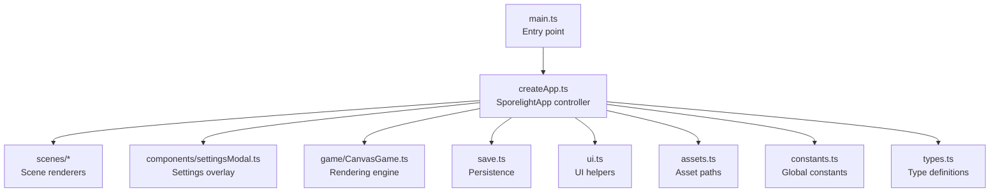
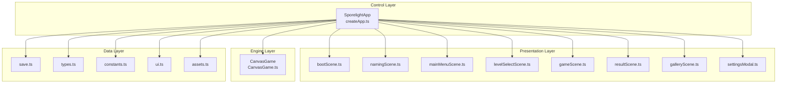
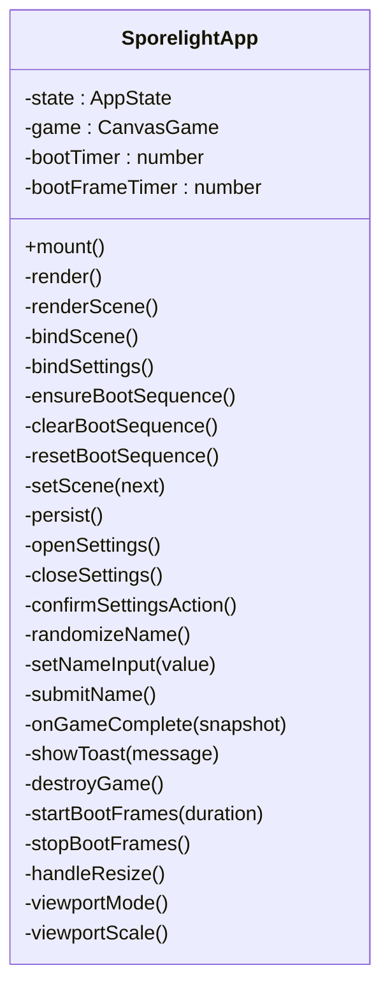
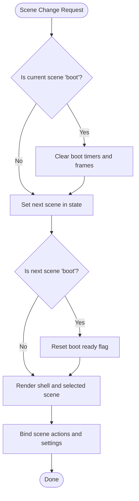
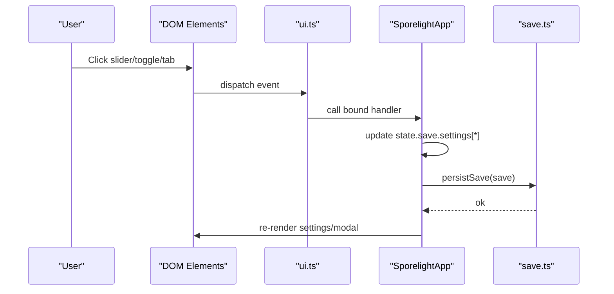
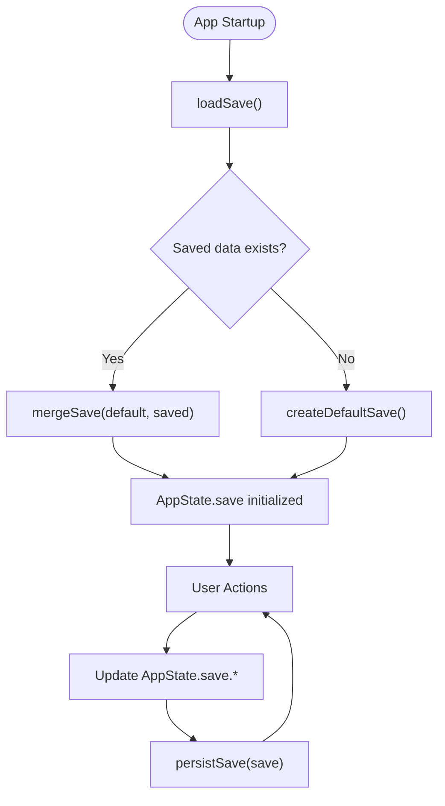
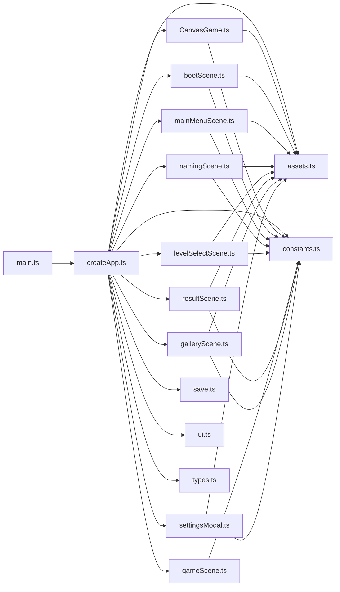

# Architecture Overview

<cite>
**Referenced Files in This Document**
- [main.ts](file://src/main.ts)
- [createApp.ts](file://src/app/createApp.ts)
- [CanvasGame.ts](file://src/app/game/CanvasGame.ts)
- [bootScene.ts](file://src/app/scenes/bootScene.ts)
- [mainMenuScene.ts](file://src/app/scenes/mainMenuScene.ts)
- [namingScene.ts](file://src/app/scenes/namingScene.ts)
- [gameScene.ts](file://src/app/scenes/gameScene.ts)
- [levelSelectScene.ts](file://src/app/scenes/levelSelectScene.ts)
- [resultScene.ts](file://src/app/scenes/resultScene.ts)
- [galleryScene.ts](file://src/app/scenes/galleryScene.ts)
- [settingsModal.ts](file://src/app/components/settingsModal.ts)
- [types.ts](file://src/app/types.ts)
- [save.ts](file://src/app/save.ts)
- [constants.ts](file://src/app/constants.ts)
- [ui.ts](file://src/app/ui.ts)
- [assets.ts](file://src/app/assets.ts)
- [package.json](file://package.json)
</cite>

## Table of Contents
1. [Introduction](#introduction)
2. [Project Structure](#project-structure)
3. [Core Components](#core-components)
4. [Architecture Overview](#architecture-overview)
5. [Detailed Component Analysis](#detailed-component-analysis)
6. [Dependency Analysis](#dependency-analysis)
7. [Performance Considerations](#performance-considerations)
8. [Troubleshooting Guide](#troubleshooting-guide)
9. [Conclusion](#conclusion)

## Introduction
This document describes the architecture of SporeLight, a single-page application with a modular design centered around a main controller, a dedicated rendering engine, and a scene-based navigation system. The system follows an MVC-like separation:
- View: Scene renderers and UI components (HTML templates and modal overlays)
- Controller: Application orchestration and event handling (SporelightApp)
- Data: Persistent save state and typed application state

Design patterns used include:
- State Machine Pattern for scene transitions
- Observer Pattern for UI interactions (event listeners)
- Factory Pattern for dynamic scene creation via render functions
- Singleton Pattern for application instance management (one SporelightApp per mount)

## Project Structure
The project is organized by feature and layer:
- Entry point initializes the app and mounts the controller
- App controller orchestrates scenes, settings, and save data
- Rendering engine encapsulates canvas-based gameplay
- Scenes are pure renderers with minimal logic
- UI utilities provide reusable helpers for actions and escaping
- Assets and constants define resource paths and global values
- Styles are separate for maintainability



**Diagram sources**
- [main.ts:1-11](file://src/main.ts#L1-L11)
- [createApp.ts:16-377](file://src/app/createApp.ts#L16-L377)
- [CanvasGame.ts:14-318](file://src/app/game/CanvasGame.ts#L14-L318)
- [bootScene.ts:19-65](file://src/app/scenes/bootScene.ts#L19-L65)
- [settingsModal.ts:10-118](file://src/app/components/settingsModal.ts#L10-L118)
- [save.ts:49-67](file://src/app/save.ts#L49-L67)
- [ui.ts:1-16](file://src/app/ui.ts#L1-L16)
- [assets.ts:1-4](file://src/app/assets.ts#L1-L4)
- [constants.ts:1-71](file://src/app/constants.ts#L1-L71)
- [types.ts:1-45](file://src/app/types.ts#L1-L45)

**Section sources**
- [main.ts:1-11](file://src/main.ts#L1-L11)
- [package.json:1-16](file://package.json#L1-L16)

## Core Components
- SporelightApp (controller): Manages AppState, scene transitions, settings modal, boot sequence, save persistence, and UI bindings. It acts as the central orchestrator and lifecycle manager.
- CanvasGame (engine): Encapsulates rendering, input handling, game logic, and completion reporting. It is instantiated only when the game scene is active.
- Scene renderers: Pure functions returning HTML strings for each screen (boot, naming, main menu, level select, game, result, gallery).
- UI utilities: Provide action binding and HTML escaping.
- Save system: Provides default save creation, merging, loading, and persistence.
- Constants and assets: Centralized asset path resolution and global constants.

**Section sources**
- [createApp.ts:22-377](file://src/app/createApp.ts#L22-L377)
- [CanvasGame.ts:14-318](file://src/app/game/CanvasGame.ts#L14-L318)
- [types.ts:1-45](file://src/app/types.ts#L1-L45)
- [save.ts:4-67](file://src/app/save.ts#L4-L67)
- [constants.ts:1-71](file://src/app/constants.ts#L1-L71)
- [assets.ts:1-4](file://src/app/assets.ts#L1-L4)
- [ui.ts:1-16](file://src/app/ui.ts#L1-L16)

## Architecture Overview
High-level system boundaries:
- Presentation boundary: Scenes and settings modal render HTML into the DOM shell
- Control boundary: SporelightApp updates state and triggers re-renders
- Data boundary: Save data persisted to localStorage
- Engine boundary: CanvasGame renders the game and reports completion
- Asset boundary: Centralized asset path provider

Data flow architecture:
- UI events trigger action handlers bound by the controller
- Actions update AppState and optionally instantiate or destroy the rendering engine
- Scene renderers consume AppState to produce views
- Save system reads/writes persistent state
- Asset paths resolve to static resources

Integration patterns:
- Factory pattern for scenes: Each scene module exports a render function selected by the controller’s scene switch
- Observer pattern for UI: Event listeners are attached to DOM elements and delegated to controller methods
- State machine pattern for scenes: Scene transitions are explicit state changes with guards and cleanup
- Singleton pattern for app instance: One SporelightApp instance per mount



**Diagram sources**
- [createApp.ts:16-377](file://src/app/createApp.ts#L16-L377)
- [CanvasGame.ts:14-318](file://src/app/game/CanvasGame.ts#L14-L318)
- [bootScene.ts:19-65](file://src/app/scenes/bootScene.ts#L19-L65)
- [namingScene.ts:8-35](file://src/app/scenes/namingScene.ts#L8-L35)
- [mainMenuScene.ts:8-23](file://src/app/scenes/mainMenuScene.ts#L8-L23)
- [levelSelectScene.ts:13-38](file://src/app/scenes/levelSelectScene.ts#L13-L38)
- [gameScene.ts:3-21](file://src/app/scenes/gameScene.ts#L3-L21)
- [resultScene.ts:8-30](file://src/app/scenes/resultScene.ts#L8-L30)
- [galleryScene.ts:18-42](file://src/app/scenes/galleryScene.ts#L18-L42)
- [settingsModal.ts:10-118](file://src/app/components/settingsModal.ts#L10-L118)
- [save.ts:49-67](file://src/app/save.ts#L49-L67)
- [types.ts:1-45](file://src/app/types.ts#L1-L45)
- [constants.ts:1-71](file://src/app/constants.ts#L1-L71)
- [ui.ts:1-16](file://src/app/ui.ts#L1-L16)
- [assets.ts:1-4](file://src/app/assets.ts#L1-L4)

## Detailed Component Analysis

### SporelightApp Controller
Responsibilities:
- Initialize AppState from saved data
- Render the shell and delegate scene rendering
- Bind scene-specific actions and settings interactions
- Manage boot sequence and loading frames
- Instantiate/destroy CanvasGame during gameplay
- Persist save data and manage confirm modes
- Handle viewport scaling and responsive layout

Key behaviors:
- Scene switching via explicit state updates and render delegation
- Boot sequence with configurable duration and animated frames
- Settings modal with sliders, toggles, and quality tabs
- Name input validation and persistence
- Toast notifications for locked levels



**Diagram sources**
- [createApp.ts:22-377](file://src/app/createApp.ts#L22-L377)

**Section sources**
- [createApp.ts:22-377](file://src/app/createApp.ts#L22-L377)

### CanvasGame Rendering Engine
Responsibilities:
- Load and cache assets
- Handle pointer and keyboard input
- Update game state (player movement, seed planting, exit activation)
- Render frames using Canvas 2D
- Report completion to the controller

Key behaviors:
- Frame-based animations for idle, move, and sow states
- Path drawing and particle effects
- Completion detection and snapshot emission
- Cleanup on destruction

```mermaid
classDiagram
class CanvasGame {
-ctx : CanvasRenderingContext2D
-raf : number
-destroyed : boolean
-completed : boolean
-keys : Set<string>
-target : {x,y}
-player : {x,y,state}
-seeds : Seed[]
-exit : {x,y,active}
-images : Map<string,HTMLImageElement>
-last : number
-sowUntil : number
-messageUntil : number
+destroy()
+sow()
-loadImages()
-bind()
-onKeyDown(event)
-onKeyUp(event)
-loop(time)
-update(delta,time)
-draw(time)
-drawPath()
-drawSeeds(time)
-drawExit(time)
-drawPlayer(time)
-frameFor(time)
-drawImage(key,x,y,width,height)
-nearSeed()
-say(message)
}
```

**Diagram sources**
- [CanvasGame.ts:14-318](file://src/app/game/CanvasGame.ts#L14-L318)

**Section sources**
- [CanvasGame.ts:14-318](file://src/app/game/CanvasGame.ts#L14-L318)

### Scene-Based Navigation
Scenes are implemented as pure renderers that accept AppState and return HTML strings. The controller selects the active renderer based on the current scene.



**Diagram sources**
- [createApp.ts:201-213](file://src/app/createApp.ts#L201-L213)
- [createApp.ts:316-320](file://src/app/createApp.ts#L316-L320)
- [createApp.ts:165-183](file://src/app/createApp.ts#L165-L183)
- [createApp.ts:196-200](file://src/app/createApp.ts#L196-L200)

**Section sources**
- [createApp.ts:65-82](file://src/app/createApp.ts#L65-L82)
- [bootScene.ts:19-65](file://src/app/scenes/bootScene.ts#L19-L65)
- [mainMenuScene.ts:8-23](file://src/app/scenes/mainMenuScene.ts#L8-L23)
- [namingScene.ts:8-35](file://src/app/scenes/namingScene.ts#L8-L35)
- [levelSelectScene.ts:13-38](file://src/app/scenes/levelSelectScene.ts#L13-L38)
- [gameScene.ts:3-21](file://src/app/scenes/gameScene.ts#L3-L21)
- [resultScene.ts:8-30](file://src/app/scenes/resultScene.ts#L8-L30)
- [galleryScene.ts:18-42](file://src/app/scenes/galleryScene.ts#L18-L42)

### Settings Modal and UI Interactions
The settings modal is rendered as an overlay and bound with event listeners for sliders, toggles, and quality tabs. UI actions are centralized via a binding utility.



**Diagram sources**
- [settingsModal.ts:10-118](file://src/app/components/settingsModal.ts#L10-L118)
- [createApp.ts:111-163](file://src/app/createApp.ts#L111-L163)
- [ui.ts:5-11](file://src/app/ui.ts#L5-L11)
- [save.ts:64-67](file://src/app/save.ts#L64-L67)

**Section sources**
- [settingsModal.ts:10-118](file://src/app/components/settingsModal.ts#L10-L118)
- [createApp.ts:111-163](file://src/app/createApp.ts#L111-L163)
- [ui.ts:1-16](file://src/app/ui.ts#L1-L16)

### Save Data Management
Save data is loaded from localStorage on startup, merged with defaults, and persisted after state changes. The save shape includes player name, level progress, gallery unlocks, and settings.



**Diagram sources**
- [save.ts:49-67](file://src/app/save.ts#L49-L67)
- [save.ts:4-47](file://src/app/save.ts#L4-L47)
- [createApp.ts:23-30](file://src/app/createApp.ts#L23-L30)
- [createApp.ts:215-217](file://src/app/createApp.ts#L215-L217)

**Section sources**
- [save.ts:4-67](file://src/app/save.ts#L4-L67)
- [types.ts:13-44](file://src/app/types.ts#L13-L44)
- [constants.ts:1-71](file://src/app/constants.ts#L1-L71)

## Dependency Analysis
Component relationships:
- Entry point depends on createApp
- SporelightApp depends on scenes, settings modal, CanvasGame, save, ui, assets, constants, and types
- CanvasGame depends on assets and constants
- Scenes depend on assets and constants
- UI helpers depend on DOM and are used by SporelightApp
- Save depends on constants and localStorage



**Diagram sources**
- [main.ts:1-11](file://src/main.ts#L1-L11)
- [createApp.ts:16-377](file://src/app/createApp.ts#L16-L377)
- [CanvasGame.ts:14-318](file://src/app/game/CanvasGame.ts#L14-L318)
- [bootScene.ts:19-65](file://src/app/scenes/bootScene.ts#L19-L65)
- [mainMenuScene.ts:8-23](file://src/app/scenes/mainMenuScene.ts#L8-L23)
- [namingScene.ts:8-35](file://src/app/scenes/namingScene.ts#L8-L35)
- [levelSelectScene.ts:13-38](file://src/app/scenes/levelSelectScene.ts#L13-L38)
- [gameScene.ts:3-21](file://src/app/scenes/gameScene.ts#L3-L21)
- [resultScene.ts:8-30](file://src/app/scenes/resultScene.ts#L8-L30)
- [galleryScene.ts:18-42](file://src/app/scenes/galleryScene.ts#L18-L42)
- [settingsModal.ts:10-118](file://src/app/components/settingsModal.ts#L10-L118)
- [save.ts:49-67](file://src/app/save.ts#L49-L67)
- [ui.ts:1-16](file://src/app/ui.ts#L1-L16)
- [assets.ts:1-4](file://src/app/assets.ts#L1-L4)
- [constants.ts:1-71](file://src/app/constants.ts#L1-L71)
- [types.ts:1-45](file://src/app/types.ts#L1-L45)

**Section sources**
- [createApp.ts:16-377](file://src/app/createApp.ts#L16-L377)

## Performance Considerations
- Boot sequence animation frames are throttled by duration and cleared on scene transitions to avoid unnecessary work
- CanvasGame uses requestAnimationFrame and caps delta time to ensure smooth updates
- Asset loading preloads images once and caches them in memory
- DOM updates are minimized by re-rendering only the stage and settings overlay
- LocalStorage persistence is deferred until after state changes

[No sources needed since this section provides general guidance]

## Troubleshooting Guide
Common issues and resolutions:
- Missing #app root: The entry point throws if the root element is absent
- Canvas unsupported: CanvasGame constructor validates 2D context availability
- Settings not persisting: Verify localStorage availability and that persistSave is invoked after state changes
- Scene not updating: Ensure setScene is called and render is invoked after state changes
- Boot stuck: Confirm bootReady flag and timer clearing on scene transitions

**Section sources**
- [main.ts:6-8](file://src/main.ts#L6-L8)
- [CanvasGame.ts:37-41](file://src/app/game/CanvasGame.ts#L37-L41)
- [createApp.ts:215-217](file://src/app/createApp.ts#L215-L217)
- [createApp.ts:201-213](file://src/app/createApp.ts#L201-L213)
- [createApp.ts:165-183](file://src/app/createApp.ts#L165-L183)

## Conclusion
SporeLight employs a clean, modular architecture with a clear separation between view, controller, and data layers. SporelightApp serves as the central coordinator, delegating rendering to scene modules, managing a dedicated CanvasGame engine for gameplay, and maintaining persistent state. The design leverages well-known patterns—state machine for scenes, observer for UI, factory for renderers, and singleton for the app instance—to keep the system maintainable and extensible.