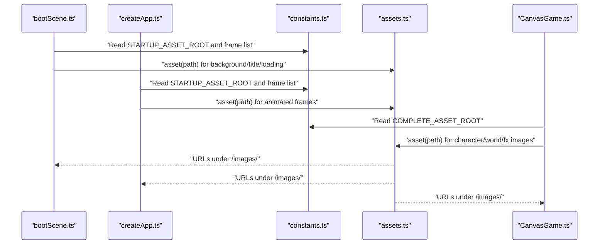
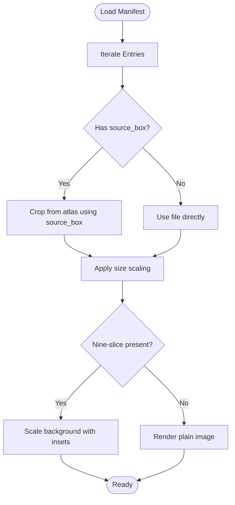
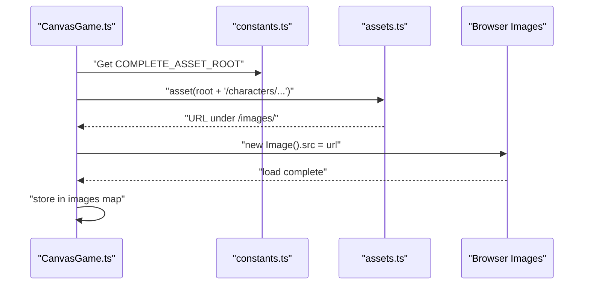
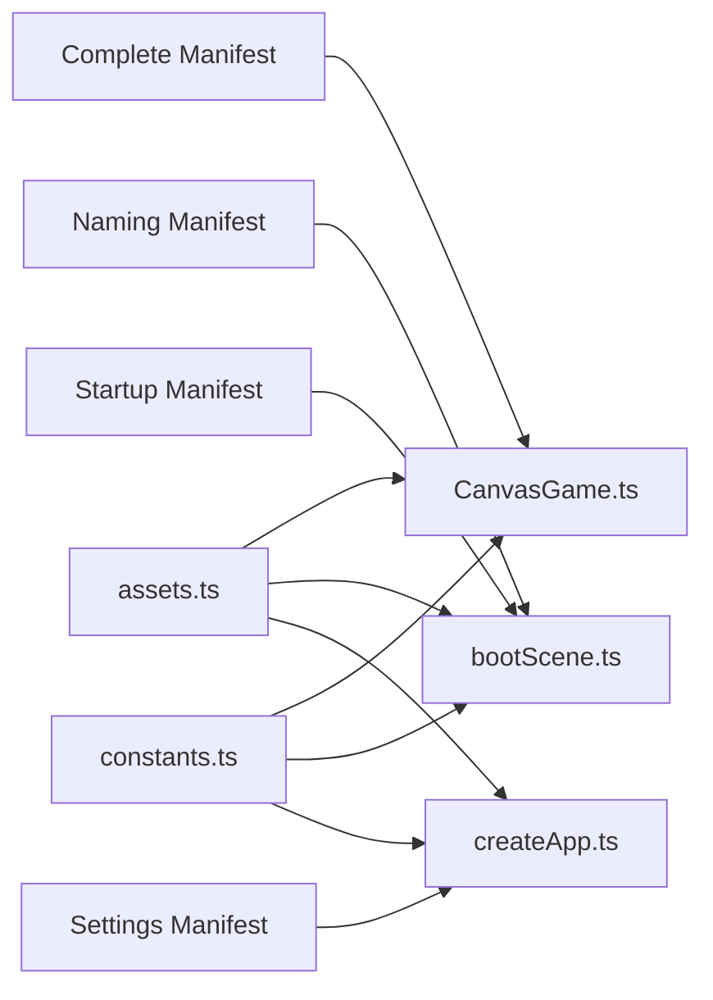

# Asset Manifests

<cite>
**Referenced Files in This Document**
- [asset_manifest.json (Complete Assets)](file://assets/images/sporelight_complete_assets_png/meta/asset_manifest.json)
- [asset_manifest.json (Naming Assets)](file://assets/images/sporelight_naming_page_assets/meta/asset_manifest.json)
- [asset_manifest.json (Settings Popup Assets)](file://assets/images/sporelight_settings_popup_assets/sporelight_settings_assets/meta/asset_manifest.json)
- [manifest.json (Startup Assets)](file://assets/images/startup_page_assets_assets_only_png/manifest.json)
- [manifest.json (Legacy Sliced Assets)](file://assets/images_old/sporelight_sliced_assets_web/manifest.json)
- [manifest.csv (Startup Assets CSV)](file://assets/images/startup_page_assets_assets_only_png/manifest.csv)
- [README (Startup Assets)](file://assets/images/startup_page_assets_assets_only_png/README.md)
- [README (Naming Assets)](file://assets/images/sporelight_naming_page_assets/README_命名页切图说明.md)
- [assets.ts](file://src/app/assets.ts)
- [constants.ts](file://src/app/constants.ts)
- [CanvasGame.ts](file://src/app/game/CanvasGame.ts)
- [bootScene.ts](file://src/app/scenes/bootScene.ts)
- [createApp.ts](file://src/app/createApp.ts)
- [types.ts](file://src/app/types.ts)
</cite>

## Table of Contents
1. [Introduction](#introduction)
2. [Project Structure](#project-structure)
3. [Core Components](#core-components)
4. [Architecture Overview](#architecture-overview)
5. [Detailed Component Analysis](#detailed-component-analysis)
6. [Dependency Analysis](#dependency-analysis)
7. [Performance Considerations](#performance-considerations)
8. [Troubleshooting Guide](#troubleshooting-guide)
9. [Conclusion](#conclusion)
10. [Appendices](#appendices)

## Introduction
This document explains SporeLight’s asset manifest processing system. It covers manifest formats (complete, naming, settings popup, startup, and legacy sliced), metadata semantics (dimensions, nine-slice, categories, statuses), and how manifests integrate with the asset loading pipeline. It also documents sprite sheet management concepts, animation frame extraction patterns, validation strategies, error handling, lazy loading triggers, and performance optimizations.

## Project Structure
The asset manifests live alongside the image assets they describe. There are several manifest variants:
- Complete assets manifest: array of entries with file paths, sizes, nine-slice flags, and descriptions.
- Naming assets manifest: array of entries with width/height and nine-slice booleans.
- Settings popup assets manifest: dictionary keyed by asset path with nested size and nine-slice insets.
- Startup assets manifest: array of entries with name, category, status, original coordinates, and notes.
- Legacy sliced assets manifest: array of entries with source boxes and transparent edge flags.
- Startup assets CSV: tabular representation of the startup manifest.
- READMEs: provide usage notes and migration context.

```mermaid
graph TB
subgraph "Assets"
A1["sporelight_complete_assets_png/meta/asset_manifest.json"]
A2["sporelight_naming_page_assets/meta/asset_manifest.json"]
A3["sporelight_settings_popup_assets/sporelight_settings_assets/meta/asset_manifest.json"]
A4["startup_page_assets_assets_only_png/manifest.json"]
A5["images_old/sporelight_sliced_assets_web/manifest.json"]
A6["startup_page_assets_assets_only_png/manifest.csv"]
end
subgraph "Runtime"
R1["src/app/assets.ts"]
R2["src/app/constants.ts"]
R3["src/app/game/CanvasGame.ts"]
R4["src/app/scenes/bootScene.ts"]
R5["src/app/createApp.ts"]
end
A1 --> R3
A2 --> R4
A3 --> R5
A4 --> R4
A5 --> R3
A6 --> R4
R1 --> R3
R1 --> R4
R1 --> R5
R2 --> R3
R2 --> R4
R2 --> R5
```

**Diagram sources**
- [asset_manifest.json (Complete Assets):1-1472](file://assets/images/sporelight_complete_assets_png/meta/asset_manifest.json#L1-L1472)
- [asset_manifest.json (Naming Assets):1-212](file://assets/images/sporelight_naming_page_assets/meta/asset_manifest.json#L1-L212)
- [asset_manifest.json (Settings Popup Assets):1-653](file://assets/images/sporelight_settings_popup_assets/sporelight_settings_assets/meta/asset_manifest.json#L1-L653)
- [manifest.json (Startup Assets):1-266](file://assets/images/startup_page_assets_assets_only_png/manifest.json#L1-L266)
- [manifest.json (Legacy Sliced Assets):1-2018](file://assets/images_old/sporelight_sliced_assets_web/manifest.json#L1-L2018)
- [assets.ts:1-4](file://src/app/assets.ts#L1-L4)
- [constants.ts:1-71](file://src/app/constants.ts#L1-L71)
- [CanvasGame.ts:76-102](file://src/app/game/CanvasGame.ts#L76-L102)
- [bootScene.ts:1-55](file://src/app/scenes/bootScene.ts#L1-L55)
- [createApp.ts:321-364](file://src/app/createApp.ts#L321-L364)

**Section sources**
- [asset_manifest.json (Complete Assets):1-1472](file://assets/images/sporelight_complete_assets_png/meta/asset_manifest.json#L1-L1472)
- [asset_manifest.json (Naming Assets):1-212](file://assets/images/sporelight_naming_page_assets/meta/asset_manifest.json#L1-L212)
- [asset_manifest.json (Settings Popup Assets):1-653](file://assets/images/sporelight_settings_popup_assets/sporelight_settings_assets/meta/asset_manifest.json#L1-L653)
- [manifest.json (Startup Assets):1-266](file://assets/images/startup_page_assets_assets_only_png/manifest.json#L1-L266)
- [manifest.json (Legacy Sliced Assets):1-2018](file://assets/images_old/sporelight_sliced_assets_web/manifest.json#L1-L2018)
- [manifest.csv (Startup Assets):1-26](file://assets/images/startup_page_assets_assets_only_png/manifest.csv#L1-L26)
- [README (Startup Assets):1-31](file://assets/images/startup_page_assets_assets_only_png/README.md#L1-L31)
- [README (Naming Assets):1-200](file://assets/images/sporelight_naming_page_assets/README_命名页切图说明.md#L1-L200)
- [assets.ts:1-4](file://src/app/assets.ts#L1-L4)
- [constants.ts:1-71](file://src/app/constants.ts#L1-L71)
- [CanvasGame.ts:76-102](file://src/app/game/CanvasGame.ts#L76-L102)
- [bootScene.ts:1-55](file://src/app/scenes/bootScene.ts#L1-L55)
- [createApp.ts:321-364](file://src/app/createApp.ts#L321-L364)

## Core Components
- Manifest formats and fields:
  - Complete assets manifest: array of objects with file, size, nine_slice, desc, size_note.
  - Naming assets manifest: array of objects with file, width, height, nine_slice, notes.
  - Settings popup manifest: object keyed by asset path with nested size, description, nine_slice.
  - Startup assets manifest: array of objects with file, name, category, status, original_x, original_y, width, height, note.
  - Legacy sliced manifest: array of objects with name, category, file, source_box, size, transparent_edge_bg_removed.
- Metadata processing:
  - Dimensions: width/height or size arrays.
  - Nine-slice: boolean or structured insets (left/right/top/bottom).
  - Categories and statuses: used for grouping and prioritization.
  - Notes: human-readable guidance for scaling and layout.
- Asset loading integration:
  - Runtime paths constructed via a helper that prepends "/images/".
  - Constants define asset roots and startup frame sequences.
  - Scenes and game code reference assets by manifest-defined keys and paths.

**Section sources**
- [asset_manifest.json (Complete Assets):1-1472](file://assets/images/sporelight_complete_assets_png/meta/asset_manifest.json#L1-L1472)
- [asset_manifest.json (Naming Assets):1-212](file://assets/images/sporelight_naming_page_assets/meta/asset_manifest.json#L1-L212)
- [asset_manifest.json (Settings Popup Assets):1-653](file://assets/images/sporelight_settings_popup_assets/sporelight_settings_assets/meta/asset_manifest.json#L1-L653)
- [manifest.json (Startup Assets):1-266](file://assets/images/startup_page_assets_assets_only_png/manifest.json#L1-L266)
- [manifest.json (Legacy Sliced Assets):1-2018](file://assets/images_old/sporelight_sliced_assets_web/manifest.json#L1-L2018)
- [assets.ts:1-4](file://src/app/assets.ts#L1-L4)
- [constants.ts:1-71](file://src/app/constants.ts#L1-L71)

## Architecture Overview
The runtime composes asset URLs from constants and manifest entries, then loads images either statically in scenes or dynamically during boot animations.

**Diagram sources**
- [bootScene.ts:1-55](file://src/app/scenes/bootScene.ts#L1-L55)
- [createApp.ts:321-364](file://src/app/createApp.ts#L321-L364)
- [constants.ts:1-71](file://src/app/constants.ts#L1-L71)
- [assets.ts:1-4](file://src/app/assets.ts#L1-L4)
- [CanvasGame.ts:76-102](file://src/app/game/CanvasGame.ts#L76-L102)

## Detailed Component Analysis

### Manifest Formats and Differences
- Complete assets manifest (array):
  - Fields: file, size (w,h), nine_slice (text flag), desc, size_note.
  - Typical for modern asset sets with explicit size and nine-slice support.
- Naming assets manifest (array):
  - Fields: file, width, height, nine_slice (boolean), notes.
  - Emphasizes explicit pixel dimensions and nine-slice booleans.
- Settings popup manifest (dictionary):
  - Keys: asset paths; values: size, description, nine_slice (nullable or insets).
  - Supports granular per-image nine-slice definitions.
- Startup assets manifest (array):
  - Fields: file, name, category, status, original_x, original_y, width, height, note.
  - Includes stability classification (stable/provisional) and original coordinates.
- Legacy sliced assets manifest (array):
  - Fields: name, category, file, source_box (bbox), size, transparent_edge_bg_removed.
  - Used for pre-sliced spritesheets; supports cropping and transparency hints.

Migration strategies:
- From legacy sliced manifest to modern manifests:
  - Map source_box to crop regions and size to width/height.
  - Convert transparent_edge_bg_removed to nine-slice decisions where applicable.
  - Normalize categories and statuses to align with modern naming.
- From CSV to JSON:
  - Convert rows to JSON objects with consistent field names.
  - Preserve original coordinates and notes for layout fidelity.

**Section sources**
- [asset_manifest.json (Complete Assets):1-1472](file://assets/images/sporelight_complete_assets_png/meta/asset_manifest.json#L1-L1472)
- [asset_manifest.json (Naming Assets):1-212](file://assets/images/sporelight_naming_page_assets/meta/asset_manifest.json#L1-L212)
- [asset_manifest.json (Settings Popup Assets):1-653](file://assets/images/sporelight_settings_popup_assets/sporelight_settings_assets/meta/asset_manifest.json#L1-L653)
- [manifest.json (Startup Assets):1-266](file://assets/images/startup_page_assets_assets_only_png/manifest.json#L1-L266)
- [manifest.json (Legacy Sliced Assets):1-2018](file://assets/images_old/sporelight_sliced_assets_web/manifest.json#L1-L2018)
- [manifest.csv (Startup Assets):1-26](file://assets/images/startup_page_assets_assets_only_png/manifest.csv#L1-L26)
- [README (Startup Assets):1-31](file://assets/images/startup_page_assets_assets_only_png/README.md#L1-L31)
- [README (Naming Assets):1-200](file://assets/images/sporelight_naming_page_assets/README_命名页切图说明.md#L1-L200)

### Metadata Processing System
- Dimensions:
  - Numeric width/height or size array [w,h].
  - Used for layout calculations and nine-slice scaling.
- Categories:
  - Grouping assets by functional area (UI, characters, world, FX, etc.).
  - Supports prioritization and filtering in UI galleries or loaders.
- Statuses:
  - stable vs provisional indicate reliability of boundaries and cropping.
  - Useful for fallback rendering or warning messages.
- Nine-slice:
  - Boolean or structured insets (left/right/top/bottom).
  - Controls scalable UI backgrounds and controls without distortion.
- Notes:
  - Human-readable guidance for aspect ratio, scaling, and layout constraints.

**Section sources**
- [asset_manifest.json (Complete Assets):1-1472](file://assets/images/sporelight_complete_assets_png/meta/asset_manifest.json#L1-L1472)
- [asset_manifest.json (Naming Assets):1-212](file://assets/images/sporelight_naming_page_assets/meta/asset_manifest.json#L1-L212)
- [asset_manifest.json (Settings Popup Assets):1-653](file://assets/images/sporelight_settings_popup_assets/sporelight_settings_assets/meta/asset_manifest.json#L1-L653)
- [manifest.json (Startup Assets):1-266](file://assets/images/startup_page_assets_assets_only_png/manifest.json#L1-L266)

### Sprite Sheet Management and Animation Frames
- Pre-sliced assets manifest:
  - source_box defines crop rectangles within a larger atlas.
  - size indicates the output sprite dimensions after slicing.
  - transparent_edge_bg_removed signals whether edges were cleaned.
- Animation frame extraction:
  - Frame sequences are often stored as numbered files under a shared path.
  - The loader iterates through frame indices to animate UI loading screens.
- Atlas generation:
  - Not shown in code; manifests imply atlases via source_box and file paths.
  - Coordinate mapping is derived from source_box and size.

**Diagram sources**
- [manifest.json (Legacy Sliced Assets):1-2018](file://assets/images_old/sporelight_sliced_assets_web/manifest.json#L1-L2018)
- [manifest.json (Startup Assets):1-266](file://assets/images/startup_page_assets_assets_only_png/manifest.json#L1-L266)

**Section sources**
- [manifest.json (Legacy Sliced Assets):1-2018](file://assets/images_old/sporelight_sliced_assets_web/manifest.json#L1-L2018)
- [manifest.json (Startup Assets):1-266](file://assets/images/startup_page_assets_assets_only_png/manifest.json#L1-L266)

### Manifest Parsing Logic and Validation
- Parsing:
  - JSON manifests are loaded as JavaScript objects.
  - Dictionary-style manifests require key-based iteration.
  - Array-style manifests are iterated linearly.
- Validation:
  - Required fields: file/path, size/width+height.
  - Nine-slice: ensure boolean or numeric insets are present and sane.
  - Coordinates: original_x/original_y should be numeric and within bounds.
  - Status: enforce allowed values (e.g., stable/provisional).
- Error handling:
  - Missing assets: skip or log with asset name/path.
  - Corrupted entries: skip invalid items and continue.
  - Dimension mismatches: normalize to size arrays or numeric pairs.
  - Nine-slice inconsistencies: default to no scaling or warn.

Note: The repository does not include explicit parsing/validation code; these are recommended patterns for integrating manifests into the runtime.

[No sources needed since this section provides general guidance]

### Integration with Asset Loading Pipeline
- Path construction:
  - assets.ts prepends "/images/" to manifest paths.
- Root selection:
  - constants.ts defines asset roots for different scenes.
- Static loading:
  - CanvasGame.ts statically loads core images by predefined keys.
- Dynamic boot animation:
  - createApp.ts cycles through startup frame files to animate the loading bar.
- Scene rendering:
  - bootScene.ts renders startup visuals using asset helper and constants.

**Diagram sources**
- [CanvasGame.ts:76-102](file://src/app/game/CanvasGame.ts#L76-L102)
- [constants.ts:1-71](file://src/app/constants.ts#L1-L71)
- [assets.ts:1-4](file://src/app/assets.ts#L1-L4)

**Section sources**
- [assets.ts:1-4](file://src/app/assets.ts#L1-L4)
- [constants.ts:1-71](file://src/app/constants.ts#L1-L71)
- [CanvasGame.ts:76-102](file://src/app/game/CanvasGame.ts#L76-L102)
- [bootScene.ts:1-55](file://src/app/scenes/bootScene.ts#L1-L55)
- [createApp.ts:321-364](file://src/app/createApp.ts#L321-L364)

### Lazy Loading Triggers and Performance Optimizations
- Triggers:
  - Scene transitions: switch to a new scene and defer loading off-screen assets.
  - UI overlays: lazy-load settings or gallery assets when opened.
  - Animations: preload critical frames before starting a sequence.
- Techniques:
  - Preload key assets during boot.
  - Defer non-critical assets until needed.
  - Use nine-slice backgrounds to avoid re-rendering scaled UI.
  - Batch requests and stagger large sprite sheets.
  - Cache resolved asset URLs and reuse maps.

[No sources needed since this section provides general guidance]

## Dependency Analysis
Manifests feed into the asset pipeline through helper functions and constants. The loader depends on:
- Manifest entries for asset paths and metadata.
- Asset helper for URL construction.
- Constants for root paths and frame lists.

**Diagram sources**
- [asset_manifest.json (Complete Assets):1-1472](file://assets/images/sporelight_complete_assets_png/meta/asset_manifest.json#L1-L1472)
- [asset_manifest.json (Naming Assets):1-212](file://assets/images/sporelight_naming_page_assets/meta/asset_manifest.json#L1-L212)
- [asset_manifest.json (Settings Popup Assets):1-653](file://assets/images/sporelight_settings_popup_assets/sporelight_settings_assets/meta/asset_manifest.json#L1-L653)
- [manifest.json (Startup Assets):1-266](file://assets/images/startup_page_assets_assets_only_png/manifest.json#L1-L266)
- [assets.ts:1-4](file://src/app/assets.ts#L1-L4)
- [constants.ts:1-71](file://src/app/constants.ts#L1-L71)
- [CanvasGame.ts:76-102](file://src/app/game/CanvasGame.ts#L76-L102)
- [bootScene.ts:1-55](file://src/app/scenes/bootScene.ts#L1-L55)
- [createApp.ts:321-364](file://src/app/createApp.ts#L321-L364)

**Section sources**
- [assets.ts:1-4](file://src/app/assets.ts#L1-L4)
- [constants.ts:1-71](file://src/app/constants.ts#L1-L71)
- [CanvasGame.ts:76-102](file://src/app/game/CanvasGame.ts#L76-L102)
- [bootScene.ts:1-55](file://src/app/scenes/bootScene.ts#L1-L55)
- [createApp.ts:321-364](file://src/app/createApp.ts#L321-L364)

## Performance Considerations
- Prefer nine-slice backgrounds for scalable UI to reduce texture memory and re-sampling costs.
- Group frequently used assets (characters, UI) for early preload.
- Use stable assets for critical UI to minimize layout shifts.
- Animate only essential frames during boot; others can be loaded on demand.
- Cache asset URLs and reuse maps to avoid repeated string concatenation.

[No sources needed since this section provides general guidance]

## Troubleshooting Guide
Common issues and resolutions:
- Missing asset file:
  - Symptom: broken image or load failure.
  - Action: verify file exists under the expected root; check manifest entry path; ensure asset helper resolves to a valid URL.
- Incorrect dimensions:
  - Symptom: stretched or cropped UI.
  - Action: confirm width/height or size array; validate nine-slice insets; adjust layout accordingly.
- Nine-slice misconfiguration:
  - Symptom: seams or distortion at edges.
  - Action: set nine_slice to false or correct insets; test with a small UI panel.
- Provisional assets causing layout instability:
  - Symptom: shifting or unexpected clipping.
  - Action: replace with stable variants or add fallback rendering.
- Legacy manifest mismatch:
  - Symptom: wrong crop or scale.
  - Action: convert source_box to size and apply transparent_edge_bg_removed hints; re-evaluate nine-slice.

**Section sources**
- [README (Startup Assets):1-31](file://assets/images/startup_page_assets_assets_only_png/README.md#L1-L31)
- [README (Naming Assets):1-200](file://assets/images/sporelight_naming_page_assets/README_命名页切图说明.md#L1-L200)
- [manifest.json (Legacy Sliced Assets):1-2018](file://assets/images_old/sporelight_sliced_assets_web/manifest.json#L1-L2018)

## Conclusion
SporeLight’s asset manifests provide a structured way to describe assets, their dimensions, and layout constraints. The runtime integrates manifests through a simple asset helper and constants, enabling static and dynamic loading across scenes. By migrating legacy manifests, validating entries, and leveraging nine-slice scaling, teams can maintain robust, performant asset delivery.

[No sources needed since this section summarizes without analyzing specific files]

## Appendices

### Example Manifest Entries
- Complete assets entry (array):
  - file: "characters/char_luvie_front.png"
  - size: [150, 150]
  - nine_slice: "否"
  - desc: "正面立绘"
  - size_note: "150×150"
- Naming assets entry (array):
  - file: "backgrounds/bg_naming.png"
  - width: 1280
  - height: 720
  - nine_slice: false
  - notes: "全屏背景，按 16:9 等比缩放或居中裁剪。"
- Settings popup entry (dictionary):
  - key: "ui/settings/frame/ui_settings_bg.png"
  - size: [824, 624]
  - nine_slice: { left: 36, right: 36, top: 36, bottom: 36 }
  - description: "设置弹窗背景底板；建议与半透明遮罩分层使用"
- Startup assets entry (array):
  - file: "01_logo_title_text/logo_cn_weiguangtaiyuan.png"
  - name: "logo_cn_weiguangtaiyuan"
  - category: "logo_title_text"
  - status: "stable"
  - original_x: "556"
  - original_y: "259"
  - width: "566"
  - height: "133"
  - note: "中文主标题；从扁平稿按暗色笔画阈值提取，剔除了边缘藤蔓和星形碎片。"

**Section sources**
- [asset_manifest.json (Complete Assets):1-200](file://assets/images/sporelight_complete_assets_png/meta/asset_manifest.json#L1-L200)
- [asset_manifest.json (Naming Assets):1-100](file://assets/images/sporelight_naming_page_assets/meta/asset_manifest.json#L1-L100)
- [asset_manifest.json (Settings Popup Assets):1-100](file://assets/images/sporelight_settings_popup_assets/sporelight_settings_assets/meta/asset_manifest.json#L1-L100)
- [manifest.json (Startup Assets):1-100](file://assets/images/startup_page_assets_assets_only_png/manifest.json#L1-L100)