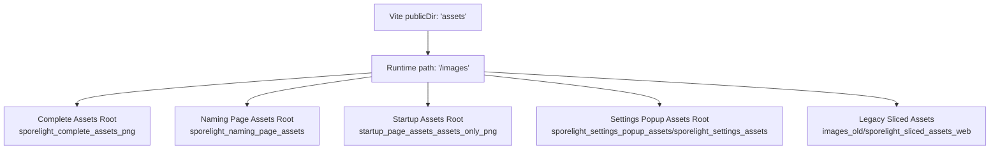
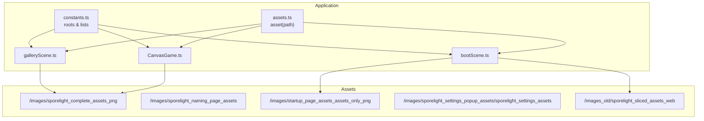
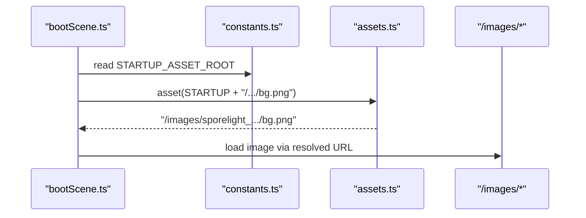
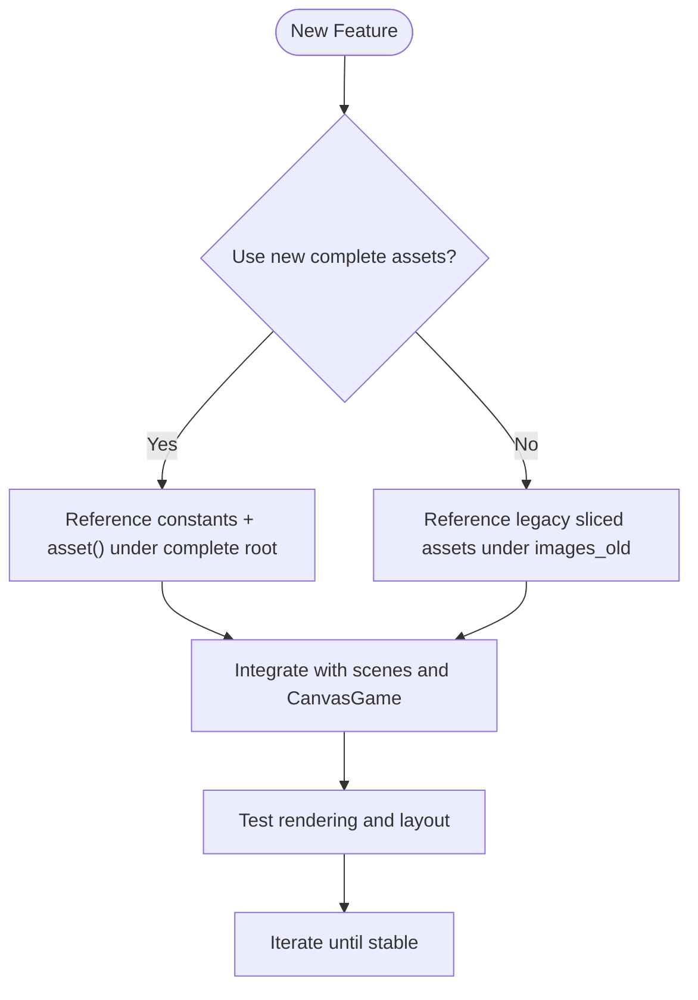
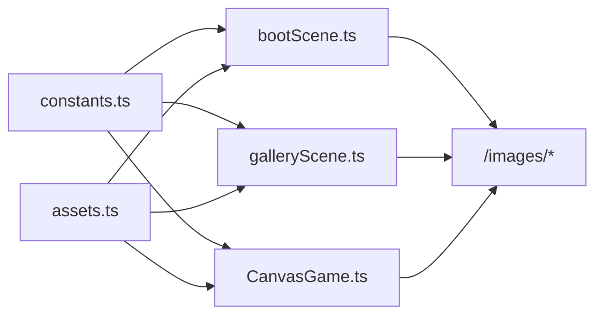

# Asset Organization

<cite>
**Referenced Files in This Document**
- [assets.ts](file://src/app/assets.ts)
- [constants.ts](file://src/app/constants.ts)
- [CanvasGame.ts](file://src/app/game/CanvasGame.ts)
- [bootScene.ts](file://src/app/scenes/bootScene.ts)
- [galleryScene.ts](file://src/app/scenes/galleryScene.ts)
- [vite.config.ts](file://vite.config.ts)
- [asset_manifest.json (Complete)](file://assets/images/sporelight_complete_assets_png/meta/asset_manifest.json)
- [asset_manifest.json (Naming)](file://assets/images/sporelight_naming_page_assets/meta/asset_manifest.json)
- [asset_manifest.json (Settings Popup)](file://assets/images/sporelight_settings_popup_assets/sporelight_settings_assets/meta/asset_manifest.json)
- [manifest.json (Startup Page)](file://assets/images/startup_page_assets_assets_only_png/manifest.json)
- [manifest.json (Legacy Sliced)](file://assets/images_old/sporelight_sliced_assets_web/manifest.json)
- [README_使用说明.md (Complete Assets)](file://assets/images/sporelight_complete_assets_png/README_使用说明.md)
- [README_命名页切图说明.md (Naming Assets)](file://assets/images/sporelight_naming_page_assets/README_命名页切图说明.md)
- [README.md (Startup Assets)](file://assets/images/startup_page_assets_assets_only_png/README.md)
</cite>

## Table of Contents
1. [Introduction](#introduction)
2. [Project Structure](#project-structure)
3. [Core Components](#core-components)
4. [Architecture Overview](#architecture-overview)
5. [Detailed Component Analysis](#detailed-component-analysis)
6. [Dependency Analysis](#dependency-analysis)
7. [Performance Considerations](#performance-considerations)
8. [Troubleshooting Guide](#troubleshooting-guide)
9. [Conclusion](#conclusion)
10. [Appendices](#appendices)

## Introduction
This document explains SporeLight’s asset organization and path resolution strategy. It covers:
- Hierarchical asset directories for backgrounds, characters, UI, world objects, and gallery
- Asset categorization and metadata-driven guidance
- Path resolution via a centralized asset function and constants
- Dual asset system: modern complete assets and legacy sliced assets
- Naming conventions, directory best practices, and transition strategies

## Project Structure
Assets are served from the public directory configured in Vite. The build pipeline exposes the assets/images folder at runtime under /images.

**Diagram sources**
- [vite.config.ts:1-9](file://vite.config.ts#L1-L9)

**Section sources**
- [vite.config.ts:1-9](file://vite.config.ts#L1-L9)

## Core Components
- Centralized asset path resolver: a single function that prepends the public images prefix to relative asset paths.
- Constants module defines asset roots and reusable asset lists.
- Scenes and game systems consume these constants and the asset resolver to reference images.

Key responsibilities:
- asset(path): resolves a path segment to a full public URL
- constants: defines asset root names and lists (e.g., startup loading frames)
- CanvasGame and scenes: assemble asset paths using constants and the asset resolver

**Section sources**
- [assets.ts:1-3](file://src/app/assets.ts#L1-L3)
- [constants.ts:1-71](file://src/app/constants.ts#L1-L71)
- [CanvasGame.ts:76-102](file://src/app/game/CanvasGame.ts#L76-L102)
- [bootScene.ts:1-33](file://src/app/scenes/bootScene.ts#L1-L33)
- [galleryScene.ts:1-42](file://src/app/scenes/galleryScene.ts#L1-L42)

## Architecture Overview
The asset system follows a simple, predictable pattern:
- Paths are constructed using constants for asset roots
- The asset resolver ensures paths resolve under /images
- Manifests describe asset categories, sizes, nine-slice configurations, and notes

**Diagram sources**
- [assets.ts:1-3](file://src/app/assets.ts#L1-L3)
- [constants.ts:4-6](file://src/app/constants.ts#L4-L6)
- [bootScene.ts:1-33](file://src/app/scenes/bootScene.ts#L1-L33)
- [galleryScene.ts:1-42](file://src/app/scenes/galleryScene.ts#L1-L42)
- [CanvasGame.ts:76-102](file://src/app/game/CanvasGame.ts#L76-L102)

## Detailed Component Analysis

### Asset Path Resolution Mechanism
- asset(path) returns "/images/" + path
- constants.ts defines root names for different asset sets
- Scenes and CanvasGame compose full paths by concatenating root + category + filename

**Diagram sources**
- [bootScene.ts:1-33](file://src/app/scenes/bootScene.ts#L1-L33)
- [assets.ts:1-3](file://src/app/assets.ts#L1-L3)
- [constants.ts:5-6](file://src/app/constants.ts#L5-L6)

**Section sources**
- [assets.ts:1-3](file://src/app/assets.ts#L1-L3)
- [constants.ts:5-6](file://src/app/constants.ts#L5-L6)
- [bootScene.ts:1-33](file://src/app/scenes/bootScene.ts#L1-L33)

### Asset Roots and Usage
- Complete Assets Root: used for game scenes and gallery
- Naming Page Assets Root: used for naming scene UI
- Startup Assets Root: used for boot/loading visuals
- Settings Popup Assets Root: used for settings UI elements
- Legacy Sliced Assets: historical split assets referenced during boot

Examples of usage:
- CanvasGame loads character, world, and FX assets from the complete assets root
- GalleryScene loads gallery backgrounds and cards from the complete assets root
- bootScene loads startup visuals and constructs animated loading frames

**Section sources**
- [constants.ts:4-6](file://src/app/constants.ts#L4-L6)
- [CanvasGame.ts:76-102](file://src/app/game/CanvasGame.ts#L76-L102)
- [galleryScene.ts:18-41](file://src/app/scenes/galleryScene.ts#L18-L41)
- [bootScene.ts:19-33](file://src/app/scenes/bootScene.ts#L19-L33)

### Asset Manifests and Metadata
Manifests provide structured metadata to guide asset usage:
- Complete Assets manifest: lists files, sizes, nine-slice notes, and descriptions
- Naming Assets manifest: lists files, widths/heights, nine-slice flags, and notes
- Settings Popup manifest: maps filenames to size and nine-slice insets
- Startup Assets manifest: categorizes assets (logo/title/text, glow/decor, UI loading, etc.), statuses, and notes
- Legacy Sliced manifest: categorizes by folders and provides source boxes and sizes

These manifests inform:
- Nine-slice configuration for scalable UI
- Animation sequences and timing
- Status flags (stable/provisional) for quality expectations
- Category-based grouping for slicing and reuse

**Section sources**
- [asset_manifest.json (Complete):1-800](file://assets/images/sporelight_complete_assets_png/meta/asset_manifest.json#L1-L800)
- [asset_manifest.json (Naming):1-212](file://assets/images/sporelight_naming_page_assets/meta/asset_manifest.json#L1-L212)
- [asset_manifest.json (Settings Popup):1-653](file://assets/images/sporelight_settings_popup_assets/sporelight_settings_assets/meta/asset_manifest.json#L1-L653)
- [manifest.json (Startup Page):1-266](file://assets/images/startup_page_assets_assets_only_png/manifest.json#L1-L266)
- [manifest.json (Legacy Sliced):1-800](file://assets/images_old/sporelight_sliced_assets_web/manifest.json#L1-L800)

### Dual Asset System: Complete vs Legacy Sliced
- Modern path resolution targets the complete assets root for game scenes and gallery
- Legacy sliced assets remain available under images_old and are used for boot visuals
- Transition strategy:
  - Prefer complete assets for new development
  - Migrate boot visuals gradually to the new complete assets root
  - Keep legacy assets for compatibility during the transition period

[No sources needed since this diagram shows conceptual workflow, not actual code structure]

**Section sources**
- [bootScene.ts:19-33](file://src/app/scenes/bootScene.ts#L19-L33)
- [CanvasGame.ts:76-102](file://src/app/game/CanvasGame.ts#L76-L102)

### Asset Categories and Purposes
- backgrounds: page and level backgrounds, parallax layers
- characters: character sprites, animations, and shadows
- ui/buttons: button states (normal, hover, press, disabled)
- ui/icons: functional and HUD icons
- ui/logo: logos and chapter text bases
- ui/panels: popups, dialogs, frames, cards
- ui/progress: progress bars and fill indicators
- world: interactive world tiles, growth states, bridges
- gallery: unlockable art assets and descriptions
- fx: particle effects and glow elements
- meta: asset manifests and notes

These categories align with the directory structure and are documented in each asset set’s README.

**Section sources**
- [README_使用说明.md (Complete Assets):5-16](file://assets/images/sporelight_complete_assets_png/README_使用说明.md#L5-L16)
- [README_命名页切图说明.md (Naming Assets):5-14](file://assets/images/sporelight_naming_page_assets/README_命名页切图说明.md#L5-L14)
- [README.md (Startup Assets):1-31](file://assets/images/startup_page_assets_assets_only_png/README.md#L1-L31)

### Naming Conventions and Directory Best Practices
- Use lowercase with underscores or hyphens for readability
- Group related assets by category (ui, world, fx, gallery)
- Maintain consistent naming for animation frames (e.g., suffix numbering)
- Keep asset roots stable and referenced via constants
- Document nine-slice insets and sizes in manifests
- Use manifest categories to guide slicing and reuse

**Section sources**
- [README_使用说明.md (Complete Assets):18-32](file://assets/images/sporelight_complete_assets_png/README_使用说明.md#L18-L32)
- [README_命名页切图说明.md (Naming Assets):16-17](file://assets/images/sporelight_naming_page_assets/README_命名页切图说明.md#L16-L17)
- [README.md (Startup Assets):1-31](file://assets/images/startup_page_assets_assets_only_png/README.md#L1-L31)

## Dependency Analysis
The asset system exhibits low coupling and high cohesion:
- constants.ts centralizes asset roots and lists
- assets.ts encapsulates path construction
- Scenes and CanvasGame depend on constants and the asset resolver
- Manifests are consumed indirectly by developers for guidance

**Diagram sources**
- [constants.ts:4-6](file://src/app/constants.ts#L4-L6)
- [assets.ts:1-3](file://src/app/assets.ts#L1-L3)
- [bootScene.ts:1-33](file://src/app/scenes/bootScene.ts#L1-L33)
- [galleryScene.ts:1-42](file://src/app/scenes/galleryScene.ts#L1-L42)
- [CanvasGame.ts:76-102](file://src/app/game/CanvasGame.ts#L76-L102)

**Section sources**
- [constants.ts:4-6](file://src/app/constants.ts#L4-L6)
- [assets.ts:1-3](file://src/app/assets.ts#L1-L3)
- [bootScene.ts:1-33](file://src/app/scenes/bootScene.ts#L1-L33)
- [galleryScene.ts:1-42](file://src/app/scenes/galleryScene.ts#L1-L42)
- [CanvasGame.ts:76-102](file://src/app/game/CanvasGame.ts#L76-L102)

## Performance Considerations
- Nine-slice scaling reduces texture memory and improves UI scalability
- Use stable assets for production; provisional assets may require rework
- Consolidate repeated UI elements into nine-slice assets to minimize draw calls
- Prefer complete assets for new features to reduce slicing overhead

[No sources needed since this section provides general guidance]

## Troubleshooting Guide
Common issues and resolutions:
- Broken image paths: verify asset root constants and asset() usage
- Missing assets after build: confirm Vite publicDir configuration and file placement under assets/images
- Incorrect nine-slice behavior: check manifest insets and apply appropriate CSS or engine scaling
- Legacy assets not loading: ensure images_old references are intentional and scoped to boot visuals

**Section sources**
- [vite.config.ts:1-9](file://vite.config.ts#L1-L9)
- [assets.ts:1-3](file://src/app/assets.ts#L1-L3)
- [constants.ts:4-6](file://src/app/constants.ts#L4-L6)

## Conclusion
SporeLight’s asset system emphasizes clarity and maintainability:
- A single asset resolver and constants module simplify path management
- Manifests provide essential metadata for nine-slice and animation guidance
- The dual asset system supports a smooth transition from legacy sliced assets to modern complete assets
Adhering to naming conventions and directory best practices will keep the asset hierarchy organized and scalable.

## Appendices

### Appendix A: Example Asset Path Construction
- Complete assets: asset(COMPLETE_ASSET_ROOT + "/characters/char_luvie_idle_01.png")
- Naming assets: asset(NAMING_ASSET_ROOT + "/ui/buttons/ui_btn_start.png")
- Startup assets: asset(STARTUP_ASSET_ROOT + "/02_ui_loading/ui_loading_bar_full_group.png")

**Section sources**
- [constants.ts:4-6](file://src/app/constants.ts#L4-L6)
- [assets.ts:1-3](file://src/app/assets.ts#L1-L3)
- [CanvasGame.ts:76-102](file://src/app/game/CanvasGame.ts#L76-L102)
- [bootScene.ts:19-33](file://src/app/scenes/bootScene.ts#L19-L33)
- [galleryScene.ts:18-41](file://src/app/scenes/galleryScene.ts#L18-L41)