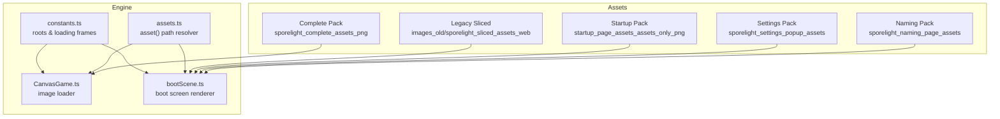
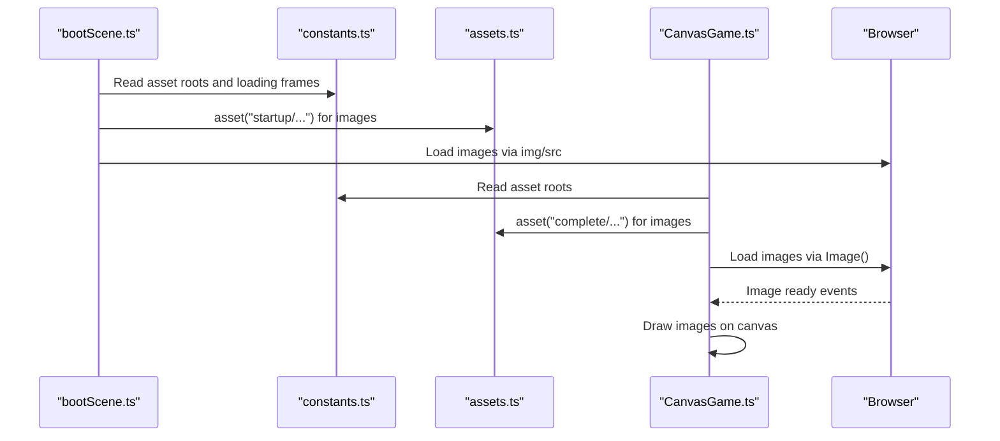
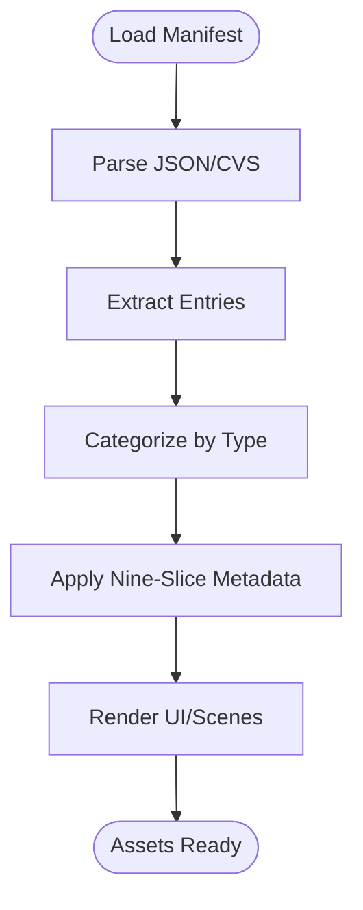
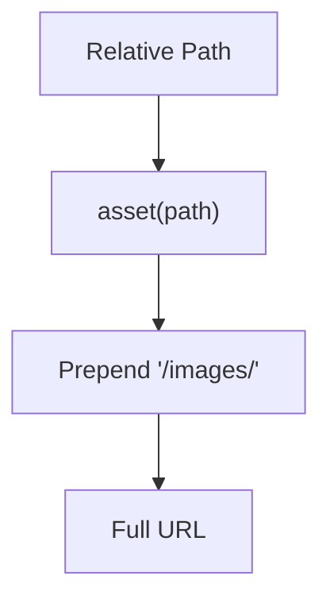
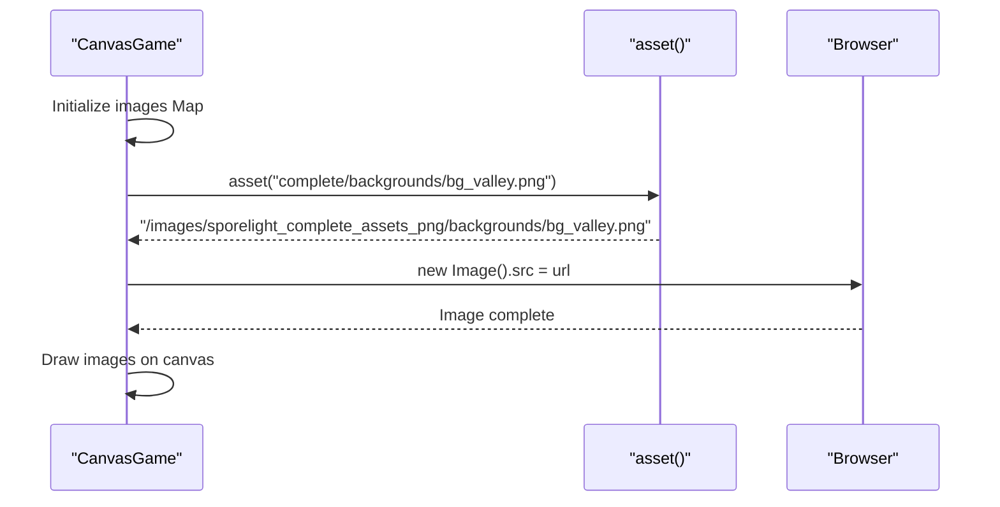
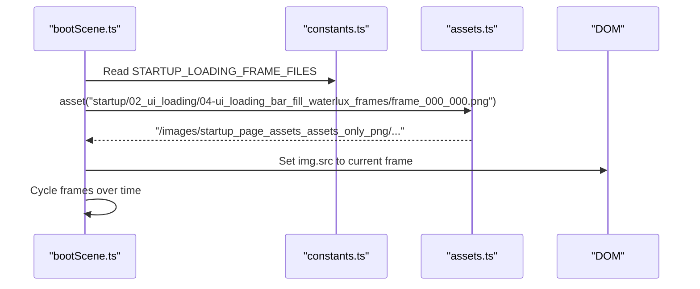
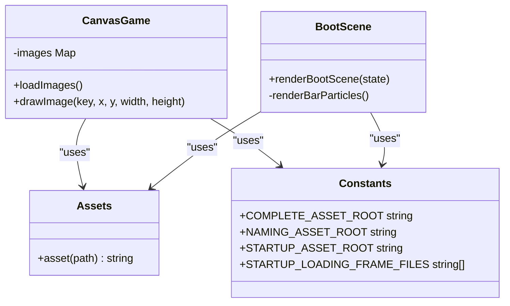
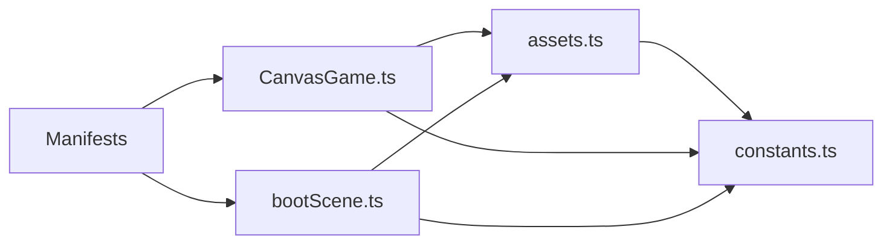

# Asset System

<cite>
**Referenced Files in This Document**
- [asset_manifest.json](file://assets/images/sporelight_complete_assets_png/meta/asset_manifest.json)
- [asset_manifest.json](file://assets/images/sporelight_naming_page_assets/meta/asset_manifest.json)
- [asset_manifest.json](file://assets/images/sporelight_settings_popup_assets/sporelight_settings_assets/meta/asset_manifest.json)
- [manifest.json](file://assets/images/startup_page_assets_assets_only_png/manifest.json)
- [manifest.csv](file://assets/images/startup_page_assets_assets_only_png/manifest.csv)
- [manifest.json](file://assets/images/images_old/sporelight_sliced_assets_web/manifest.json)
- [assets.ts](file://src/app/assets.ts)
- [constants.ts](file://src/app/constants.ts)
- [CanvasGame.ts](file://src/app/game/CanvasGame.ts)
- [bootScene.ts](file://src/app/scenes/bootScene.ts)
- [README_命名页切图说明.md](file://assets/images/sporelight_naming_page_assets/README_命名页切图说明.md)
</cite>

## Table of Contents
1. [Introduction](#introduction)
2. [Project Structure](#project-structure)
3. [Core Components](#core-components)
4. [Architecture Overview](#architecture-overview)
5. [Detailed Component Analysis](#detailed-component-analysis)
6. [Dependency Analysis](#dependency-analysis)
7. [Performance Considerations](#performance-considerations)
8. [Troubleshooting Guide](#troubleshooting-guide)
9. [Conclusion](#conclusion)
10. [Appendices](#appendices)

## Introduction
This document explains SporeLight’s asset management system, focusing on how images are organized, loaded, and integrated into the game. It covers:
- Asset organization structure and categories
- Manifest-based loading systems for modern and legacy assets
- Asset path resolution and integration with the game engine
- Loading strategies, performance optimizations, and memory management
- Metadata processing and sprite sheet handling
- Best practices for adding new assets

## Project Structure
Assets are organized under a dedicated images directory with multiple asset packs:
- Complete asset pack with extensive backgrounds, characters, UI, effects, and gallery content
- Naming page assets with UI and character assets for the naming scene
- Settings popup assets with UI controls and decorations
- Startup page assets with logo/title, UI loading visuals, and hero sprites
- Legacy sliced assets for older UI components

Key directories and files:
- assets/images/sporelight_complete_assets_png: Full set of assets with metadata
- assets/images/sporelight_naming_page_assets: Assets for naming scene
- assets/images/sporelight_settings_popup_assets: Settings UI assets
- assets/images/startup_page_assets_assets_only_png: Startup/loading visuals
- assets/images/images_old/sporelight_sliced_assets_web: Legacy sliced assets
- src/app/assets.ts: Path resolution utility
- src/app/constants.ts: Asset root constants and startup loading frames
- src/app/game/CanvasGame.ts: Game scene image loading and rendering
- src/app/scenes/bootScene.ts: Boot screen rendering and asset usage

**Diagram sources**
- [assets.ts:1-4](file://src/app/assets.ts#L1-L4)
- [constants.ts:1-71](file://src/app/constants.ts#L1-L71)
- [CanvasGame.ts:1-318](file://src/app/game/CanvasGame.ts#L1-L318)
- [bootScene.ts:1-94](file://src/app/scenes/bootScene.ts#L1-L94)

**Section sources**
- [assets.ts:1-4](file://src/app/assets.ts#L1-L4)
- [constants.ts:1-71](file://src/app/constants.ts#L1-L71)

## Core Components
- Asset path resolver: Provides a consistent way to resolve asset paths by prepending the images directory.
- Asset roots: Constants define the base directories for different asset packs.
- Manifests: JSON manifests describe asset metadata, sizes, nine-slice regions, and notes.
- Loader integration: Game scenes load images directly from the asset roots and use them for rendering.

Key responsibilities:
- Path resolution: Ensures assets are loaded from the correct subdirectories.
- Manifest-driven metadata: Enables nine-slice scaling and sizing hints for UI elements.
- Lazy loading: Images are loaded on demand during scene initialization.
- Rendering: Scenes draw assets onto canvases or DOM elements.

**Section sources**
- [assets.ts:1-4](file://src/app/assets.ts#L1-L4)
- [constants.ts:1-71](file://src/app/constants.ts#L1-L71)
- [CanvasGame.ts:76-102](file://src/app/game/CanvasGame.ts#L76-L102)
- [bootScene.ts:19-65](file://src/app/scenes/bootScene.ts#L19-L65)

## Architecture Overview
The asset system follows a manifest-first, path-resolved loading model:
- Manifests define asset metadata and categorization.
- The path resolver constructs URLs for assets.
- Scenes load assets into memory and render them.

**Diagram sources**
- [bootScene.ts:1-94](file://src/app/scenes/bootScene.ts#L1-L94)
- [constants.ts:1-71](file://src/app/constants.ts#L1-L71)
- [assets.ts:1-4](file://src/app/assets.ts#L1-L4)
- [CanvasGame.ts:76-102](file://src/app/game/CanvasGame.ts#L76-L102)

## Detailed Component Analysis

### Asset Organization and Categories
- Complete asset pack: backgrounds, characters, UI, effects, gallery items, world tiles, and more.
- Naming asset pack: backgrounds, UI logos, input fields, buttons, text labels, character assets, FX, and decorations.
- Settings asset pack: UI controls (sliders, toggles, dropdowns, tabs), icons, dialog frames, and decorative FX.
- Startup asset pack: logo/title, UI loading visuals, hero sprites, and particle effects.
- Legacy sliced assets: older UI components organized by slices.

Categorization examples:
- Backgrounds: full-screen backgrounds for menus and gameplay
- Characters: character sprites and animations
- UI elements: buttons, inputs, icons, panels, progress bars
- Effects (FX): particles, glows, transitions
- Gallery: unlockable cards and tags
- World: terrain tiles and interactive elements

**Section sources**
- [asset_manifest.json:1-1472](file://assets/images/sporelight_complete_assets_png/meta/asset_manifest.json#L1-L1472)
- [asset_manifest.json:1-212](file://assets/images/sporelight_naming_page_assets/meta/asset_manifest.json#L1-L212)
- [asset_manifest.json:1-653](file://assets/images/sporelight_settings_popup_assets/sporelight_settings_assets/meta/asset_manifest.json#L1-L653)
- [manifest.json:1-266](file://assets/images/startup_page_assets_assets_only_png/manifest.json#L1-L266)
- [README_命名页切图说明.md:1-18](file://assets/images/sporelight_naming_page_assets/README_命名页切图说明.md#L1-L18)

### Manifest-Based Loading System
Manifests serve as authoritative sources of truth for assets:
- Complete asset manifest: array of entries with file paths, sizes, nine-slice notes, and descriptions.
- Naming asset manifest: array of entries with width/height, nine-slice booleans, and notes.
- Settings asset manifest: dictionary keyed by asset path with size arrays, descriptions, and nine-slice insets.
- Startup asset manifest: array with name, category, status, original dimensions, and notes.
- Legacy sliced manifest: JSON with asset metadata for older UI components.

Processing highlights:
- Nine-slice metadata enables scalable UI components without re-exporting assets.
- Size and note fields guide rendering and layout decisions.
- Category and status fields help organize and manage asset lifecycle.

**Diagram sources**
- [asset_manifest.json:1-1472](file://assets/images/sporelight_complete_assets_png/meta/asset_manifest.json#L1-L1472)
- [asset_manifest.json:1-212](file://assets/images/sporelight_naming_page_assets/meta/asset_manifest.json#L1-L212)
- [asset_manifest.json:1-653](file://assets/images/sporelight_settings_popup_assets/sporelight_settings_assets/meta/asset_manifest.json#L1-L653)
- [manifest.json:1-266](file://assets/images/startup_page_assets_assets_only_png/manifest.json#L1-L266)
- [manifest.json](file://assets/images/images_old/sporelight_sliced_assets_web/manifest.json)

**Section sources**
- [asset_manifest.json:1-1472](file://assets/images/sporelight_complete_assets_png/meta/asset_manifest.json#L1-L1472)
- [asset_manifest.json:1-212](file://assets/images/sporelight_naming_page_assets/meta/asset_manifest.json#L1-L212)
- [asset_manifest.json:1-653](file://assets/images/sporelight_settings_popup_assets/sporelight_settings_assets/meta/asset_manifest.json#L1-L653)
- [manifest.json:1-266](file://assets/images/startup_page_assets_assets_only_png/manifest.json#L1-L266)
- [manifest.csv:1-26](file://assets/images/startup_page_assets_assets_only_png/manifest.csv#L1-L26)
- [manifest.json](file://assets/images/images_old/sporelight_sliced_assets_web/manifest.json)

### Legacy Asset Support
Legacy assets are maintained for backward compatibility:
- Legacy sliced assets manifest defines UI components with nine-slice insets and notes.
- These assets can be integrated alongside modern manifests for transitional UI elements.

Integration approach:
- Treat legacy assets similarly to modern ones: resolve paths, apply nine-slice metadata, and render.
- Maintain separate categories to distinguish modern vs. legacy assets.

**Section sources**
- [manifest.json](file://assets/images/images_old/sporelight_sliced_assets_web/manifest.json)

### Asset Path Resolution Mechanism
The path resolver ensures consistent asset URLs:
- asset(path) prepends "/images/" to the given path.
- Asset roots in constants define the base directories for different packs.
- Scenes use asset() to construct URLs for images.

**Diagram sources**
- [assets.ts:1-4](file://src/app/assets.ts#L1-L4)
- [constants.ts:1-71](file://src/app/constants.ts#L1-L71)

**Section sources**
- [assets.ts:1-4](file://src/app/assets.ts#L1-L4)
- [constants.ts:1-71](file://src/app/constants.ts#L1-L71)

### Asset Loading Strategy
Loading strategy:
- On-demand loading: Scenes initialize and load only required assets.
- CanvasGame loads character, background, world, FX, and gallery assets.
- BootScene loads startup visuals, hero sprites, and loading frames.

Implementation details:
- CanvasGame creates Image instances and sets their src via asset().
- BootScene renders images directly in the DOM with dynamic loading frames.
- Loading frames for the startup sequence are enumerated in constants.

**Diagram sources**
- [CanvasGame.ts:76-102](file://src/app/game/CanvasGame.ts#L76-L102)
- [assets.ts:1-4](file://src/app/assets.ts#L1-L4)

**Section sources**
- [CanvasGame.ts:76-102](file://src/app/game/CanvasGame.ts#L76-L102)
- [bootScene.ts:19-65](file://src/app/scenes/bootScene.ts#L19-L65)
- [constants.ts:10-51](file://src/app/constants.ts#L10-L51)

### Sprite Sheet Management
Sprite sheets are handled as sequences of frames:
- Startup loading uses a series of frames under a shared directory.
- Frames are enumerated in constants and cycled during boot.
- Each frame is treated as a standalone asset for rendering.

**Diagram sources**
- [bootScene.ts:1-94](file://src/app/scenes/bootScene.ts#L1-L94)
- [constants.ts:10-51](file://src/app/constants.ts#L10-L51)
- [assets.ts:1-4](file://src/app/assets.ts#L1-L4)

**Section sources**
- [bootScene.ts:1-94](file://src/app/scenes/bootScene.ts#L1-L94)
- [constants.ts:10-51](file://src/app/constants.ts#L10-L51)

### Metadata Processing and Nine-Slice Scaling
Metadata drives UI scalability:
- Complete manifest: nine_slice notes describe insets and stretching behavior.
- Naming manifest: nine_slice booleans indicate whether nine-slice is applicable.
- Settings manifest: nine_slice insets are defined as left/right/top/bottom values.

Processing approach:
- Extract nine-slice metadata from manifests.
- Apply insets for scalable UI components.
- Use size notes and dimensions for layout calculations.

**Section sources**
- [asset_manifest.json:1-1472](file://assets/images/sporelight_complete_assets_png/meta/asset_manifest.json#L1-L1472)
- [asset_manifest.json:1-212](file://assets/images/sporelight_naming_page_assets/meta/asset_manifest.json#L1-L212)
- [asset_manifest.json:1-653](file://assets/images/sporelight_settings_popup_assets/sporelight_settings_assets/meta/asset_manifest.json#L1-L653)

### Integration with the Game Engine
Integration points:
- CanvasGame loads and draws images on a canvas.
- BootScene renders startup visuals and manages loading animations.
- Asset roots and path resolver unify asset access across scenes.

**Diagram sources**
- [CanvasGame.ts:1-318](file://src/app/game/CanvasGame.ts#L1-L318)
- [bootScene.ts:1-94](file://src/app/scenes/bootScene.ts#L1-L94)
- [assets.ts:1-4](file://src/app/assets.ts#L1-L4)
- [constants.ts:1-71](file://src/app/constants.ts#L1-L71)

**Section sources**
- [CanvasGame.ts:1-318](file://src/app/game/CanvasGame.ts#L1-L318)
- [bootScene.ts:1-94](file://src/app/scenes/bootScene.ts#L1-L94)
- [assets.ts:1-4](file://src/app/assets.ts#L1-L4)
- [constants.ts:1-71](file://src/app/constants.ts#L1-L71)

## Dependency Analysis
Dependencies and relationships:
- assets.ts depends on the images directory structure.
- constants.ts centralizes asset roots and startup frame lists.
- CanvasGame.ts and bootScene.ts depend on both assets.ts and constants.ts.
- Manifests are consumed by scenes indirectly through metadata and categorization.

**Diagram sources**
- [assets.ts:1-4](file://src/app/assets.ts#L1-L4)
- [constants.ts:1-71](file://src/app/constants.ts#L1-L71)
- [CanvasGame.ts:1-318](file://src/app/game/CanvasGame.ts#L1-L318)
- [bootScene.ts:1-94](file://src/app/scenes/bootScene.ts#L1-L94)

**Section sources**
- [assets.ts:1-4](file://src/app/assets.ts#L1-L4)
- [constants.ts:1-71](file://src/app/constants.ts#L1-L71)
- [CanvasGame.ts:1-318](file://src/app/game/CanvasGame.ts#L1-L318)
- [bootScene.ts:1-94](file://src/app/scenes/bootScene.ts#L1-L94)

## Performance Considerations
- Lazy loading: Images are loaded only when scenes initialize, reducing initial memory footprint.
- On-demand rendering: Scenes draw only visible assets, minimizing GPU/CPU overhead.
- Nine-slice scaling: Reduces the need for multiple asset variants, saving disk and memory usage.
- Frame cycling: Startup loading frames are precomputed and cycled efficiently.
- Canvas drawing: Uses Image.complete checks to avoid rendering incomplete assets.

Optimization recommendations:
- Preload critical assets during boot to reduce perceived loading delays.
- Use texture atlases for frequently animated sprites to minimize draw calls.
- Compress assets judiciously; balance quality and file size for web delivery.
- Cache frequently reused assets in memory maps to avoid repeated network requests.

[No sources needed since this section provides general guidance]

## Troubleshooting Guide
Common issues and resolutions:
- Asset not found: Verify asset path resolution and ensure the asset exists under the correct root.
- Incorrect nine-slice behavior: Confirm nine-slice metadata in the manifest and apply insets accordingly.
- Loading delays: Consider preloading startup assets or optimizing image sizes.
- Rendering artifacts: Ensure Image.complete checks are in place before drawing.

**Section sources**
- [CanvasGame.ts:286-296](file://src/app/game/CanvasGame.ts#L286-L296)
- [bootScene.ts:19-65](file://src/app/scenes/bootScene.ts#L19-L65)

## Conclusion
SporeLight’s asset system combines manifest-driven metadata, a centralized path resolver, and on-demand loading to deliver a flexible, scalable solution for managing diverse assets across scenes. By leveraging nine-slice scaling, categorization, and sprite sheet sequencing, the system balances performance and maintainability while supporting both modern and legacy assets.

[No sources needed since this section summarizes without analyzing specific files]

## Appendices

### Best Practices for Adding New Assets
- Place assets under the appropriate asset pack directory.
- Add entries to the relevant manifest with accurate file paths, sizes, and nine-slice metadata.
- Use categories and statuses to organize assets for easy filtering and lifecycle management.
- Prefer nine-slice scaling for UI components to avoid maintaining multiple variants.
- Test asset loading and rendering in the intended scenes before integrating.

**Section sources**
- [asset_manifest.json:1-1472](file://assets/images/sporelight_complete_assets_png/meta/asset_manifest.json#L1-L1472)
- [asset_manifest.json:1-212](file://assets/images/sporelight_naming_page_assets/meta/asset_manifest.json#L1-L212)
- [asset_manifest.json:1-653](file://assets/images/sporelight_settings_popup_assets/sporelight_settings_assets/meta/asset_manifest.json#L1-L653)
- [manifest.json:1-266](file://assets/images/startup_page_assets_assets_only_png/manifest.json#L1-L266)
- [README_命名页切图说明.md:1-18](file://assets/images/sporelight_naming_page_assets/README_命名页切图说明.md#L1-L18)