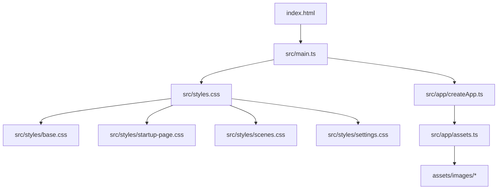
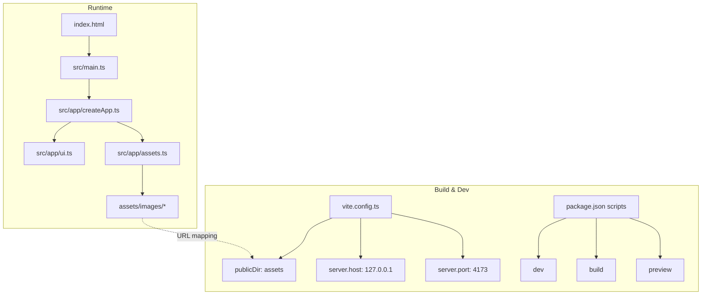
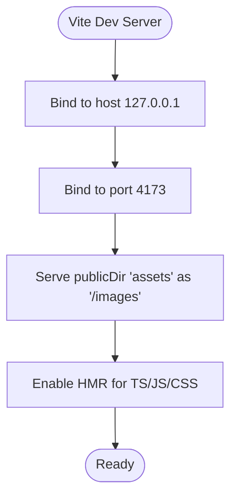
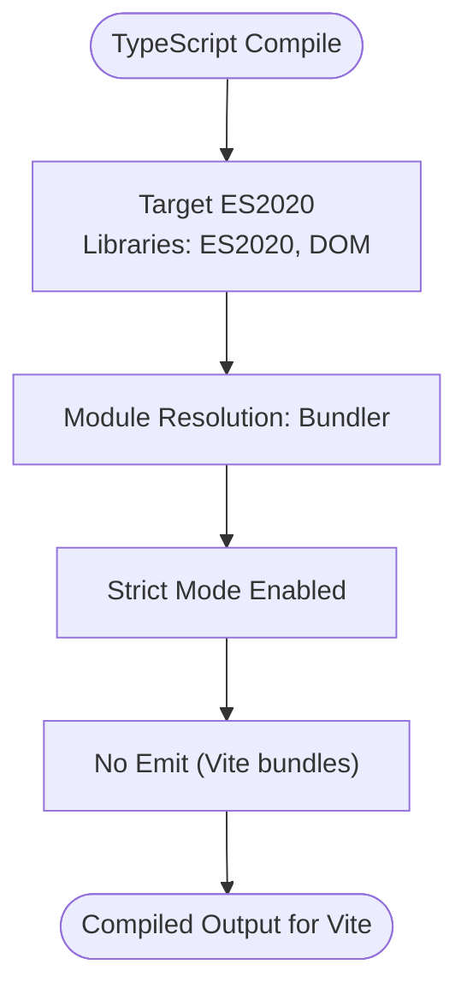
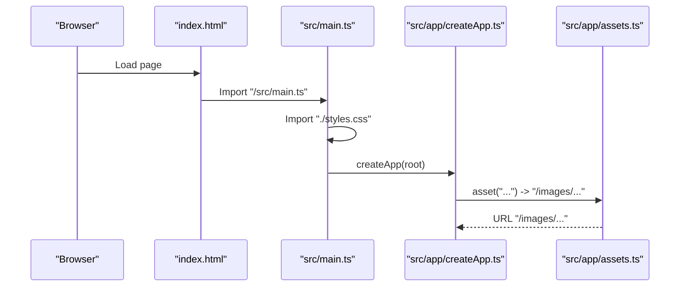
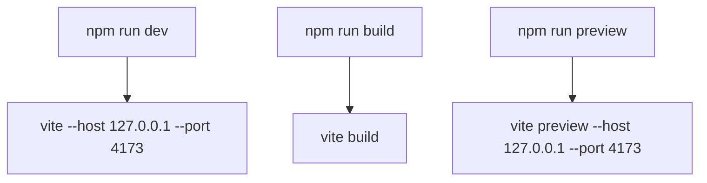
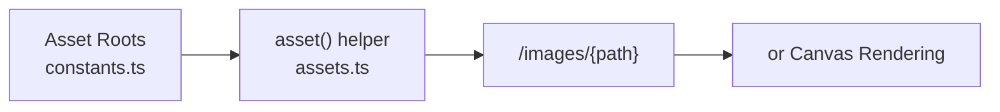
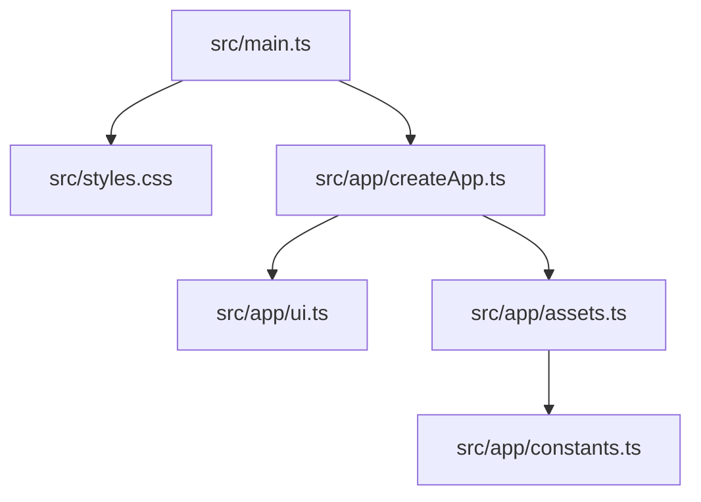

# Build and Development

<cite>
**Referenced Files in This Document**
- [vite.config.ts](file://vite.config.ts)
- [package.json](file://package.json)
- [tsconfig.json](file://tsconfig.json)
- [index.html](file://index.html)
- [src/main.ts](file://src/main.ts)
- [src/styles.css](file://src/styles.css)
- [src/app/createApp.ts](file://src/app/createApp.ts)
- [src/app/assets.ts](file://src/app/assets.ts)
- [src/app/constants.ts](file://src/app/constants.ts)
- [.gitignore](file://.gitignore)
</cite>

## Table of Contents
1. [Introduction](#introduction)
2. [Project Structure](#project-structure)
3. [Core Components](#core-components)
4. [Architecture Overview](#architecture-overview)
5. [Detailed Component Analysis](#detailed-component-analysis)
6. [Dependency Analysis](#dependency-analysis)
7. [Performance Considerations](#performance-considerations)
8. [Troubleshooting Guide](#troubleshooting-guide)
9. [Conclusion](#conclusion)

## Introduction
This document explains SporeLight’s build system and development workflow. It covers Vite configuration for asset directory mapping, development server setup, and production builds; TypeScript compilation and module resolution; and the npm scripts used for development, building, and previewing. It also outlines asset optimization strategies, bundle analysis, and performance monitoring during development, along with best practices and troubleshooting guidance.

## Project Structure
SporeLight organizes source code under src and static assets under assets/images. The application boots from index.html, which loads src/main.ts. Styles are composed via src/styles.css, which imports modular CSS files. Assets are referenced through a helper that maps logical asset paths to URLs served from the configured public directory.

**Diagram sources**
- [index.html:1-13](file://index.html#L1-L13)
- [src/main.ts:1-11](file://src/main.ts#L1-L11)
- [src/styles.css:1-5](file://src/styles.css#L1-L5)
- [src/app/createApp.ts:1-377](file://src/app/createApp.ts#L1-L377)
- [src/app/assets.ts:1-4](file://src/app/assets.ts#L1-L4)

**Section sources**
- [index.html:1-13](file://index.html#L1-L13)
- [src/main.ts:1-11](file://src/main.ts#L1-L11)
- [src/styles.css:1-5](file://src/styles.css#L1-L5)
- [src/app/createApp.ts:1-377](file://src/app/createApp.ts#L1-L377)
- [src/app/assets.ts:1-4](file://src/app/assets.ts#L1-L4)

## Core Components
- Vite configuration
  - Public directory mapping: assets published under /images in the built application.
  - Development server: bound to 127.0.0.1:4173.
- TypeScript configuration
  - ESNext module with DOM libraries.
  - Strict mode enabled.
  - Module resolution via Bundler.
  - No emit (used for type-checking and transpilation by Vite).
- Application bootstrap
  - index.html mounts src/main.ts.
  - src/main.ts initializes styles and the application root.

**Section sources**
- [vite.config.ts:1-10](file://vite.config.ts#L1-L10)
- [tsconfig.json:1-17](file://tsconfig.json#L1-L17)
- [index.html:1-13](file://index.html#L1-L13)
- [src/main.ts:1-11](file://src/main.ts#L1-L11)

## Architecture Overview
The runtime architecture ties together the HTML entry, TypeScript application, and asset pipeline. Vite serves assets from assets/images and resolves module imports. The application composes scenes and UI via createApp and renders them into the DOM.

**Diagram sources**
- [vite.config.ts:1-10](file://vite.config.ts#L1-L10)
- [package.json:1-16](file://package.json#L1-L16)
- [index.html:1-13](file://index.html#L1-L13)
- [src/main.ts:1-11](file://src/main.ts#L1-L11)
- [src/app/createApp.ts:1-377](file://src/app/createApp.ts#L1-L377)
- [src/app/assets.ts:1-4](file://src/app/assets.ts#L1-L4)

## Detailed Component Analysis

### Vite Configuration
- Asset directory mapping
  - publicDir is set to assets, so files placed under assets/images are served at /images in the browser.
- Development server
  - Host and port are fixed to 127.0.0.1 and 4173 respectively.
- Hot reload
  - Vite’s default development server provides file watching and HMR; no explicit configuration is present in the provided config.

**Diagram sources**
- [vite.config.ts:1-10](file://vite.config.ts#L1-L10)

**Section sources**
- [vite.config.ts:1-10](file://vite.config.ts#L1-L10)

### TypeScript Compilation and Module Resolution
- Compiler options
  - Target: ES2020
  - Module: ESNext
  - Libraries: ES2020, DOM, DOM.Iterable
  - Strict mode enabled
  - Module resolution: Bundler
  - No emit (Vite handles bundling/transpilation)
- Include scope
  - Only src is included for compilation.

**Diagram sources**
- [tsconfig.json:1-17](file://tsconfig.json#L1-L17)

**Section sources**
- [tsconfig.json:1-17](file://tsconfig.json#L1-L17)

### Application Boot and Asset Path Mapping
- index.html loads src/main.ts as a module script.
- src/main.ts imports styles and creates the app root.
- src/app/assets.ts exposes a helper that prefixes asset paths with /images, aligning with Vite’s publicDir mapping.

**Diagram sources**
- [index.html:1-13](file://index.html#L1-L13)
- [src/main.ts:1-11](file://src/main.ts#L1-L11)
- [src/app/createApp.ts:1-377](file://src/app/createApp.ts#L1-L377)
- [src/app/assets.ts:1-4](file://src/app/assets.ts#L1-L4)

**Section sources**
- [index.html:1-13](file://index.html#L1-L13)
- [src/main.ts:1-11](file://src/main.ts#L1-L11)
- [src/app/assets.ts:1-4](file://src/app/assets.ts#L1-L4)
- [src/app/createApp.ts:1-377](file://src/app/createApp.ts#L1-L377)

### Development Scripts
- npm run dev
  - Invokes Vite with host and port matching the Vite config.
- npm run build
  - Produces a production build using Vite.
- npm run preview
  - Starts a local static server to preview the production build on 127.0.0.1:4173.

**Diagram sources**
- [package.json:1-16](file://package.json#L1-L16)
- [vite.config.ts:1-10](file://vite.config.ts#L1-L10)

**Section sources**
- [package.json:1-16](file://package.json#L1-L16)
- [vite.config.ts:1-10](file://vite.config.ts#L1-L10)

### Asset Optimization Strategies
- Asset directory layout
  - Assets are organized under assets/images with subfolders per feature area (e.g., startup, ui, world).
- URL mapping
  - src/app/assets.ts maps logical asset roots to URLs under /images, ensuring consistent references across scenes.
- Image loading patterns
  - src/app/createApp.ts demonstrates preloading and animating frames from the startup asset root, which can benefit from efficient caching and minimal reflows.

**Diagram sources**
- [src/app/constants.ts:1-71](file://src/app/constants.ts#L1-L71)
- [src/app/assets.ts:1-4](file://src/app/assets.ts#L1-L4)
- [src/app/createApp.ts:1-377](file://src/app/createApp.ts#L1-L377)

**Section sources**
- [src/app/constants.ts:1-71](file://src/app/constants.ts#L1-L71)
- [src/app/assets.ts:1-4](file://src/app/assets.ts#L1-L4)
- [src/app/createApp.ts:1-377](file://src/app/createApp.ts#L1-L377)

### Bundle Analysis and Performance Monitoring
- Built artifacts
  - Production builds are emitted to dist by default; see .gitignore for excluded directories.
- Monitoring
  - Use Vite’s built-in dev server performance indicators and browser devtools Network/Performance panels.
  - For deeper analysis, integrate a third-party bundle analyzer plugin in Vite (not present in the current configuration).
- Recommendations
  - Keep assets under assets/images to leverage Vite’s optimized serving.
  - Minimize large synchronous image loads; consider lazy-loading and progressive image techniques.

**Section sources**
- [.gitignore:1-4](file://.gitignore#L1-L4)

## Dependency Analysis
- Internal dependencies
  - src/main.ts depends on styles and createApp.
  - createApp depends on assets, scenes, and UI helpers.
  - assets.ts depends on constants for asset roots.
- External dependencies
  - Vite and TypeScript are declared as devDependencies.
  - esbuild is a transitive dependency managed by Vite.

**Diagram sources**
- [src/main.ts:1-11](file://src/main.ts#L1-L11)
- [src/styles.css:1-5](file://src/styles.css#L1-L5)
- [src/app/createApp.ts:1-377](file://src/app/createApp.ts#L1-L377)
- [src/app/ui.ts:1-15](file://src/app/ui.ts#L1-L15)
- [src/app/assets.ts:1-4](file://src/app/assets.ts#L1-L4)
- [src/app/constants.ts:1-71](file://src/app/constants.ts#L1-L71)

**Section sources**
- [src/main.ts:1-11](file://src/main.ts#L1-L11)
- [src/app/createApp.ts:1-377](file://src/app/createApp.ts#L1-L377)
- [src/app/assets.ts:1-4](file://src/app/assets.ts#L1-L4)
- [src/app/constants.ts:1-71](file://src/app/constants.ts#L1-L71)

## Performance Considerations
- Development
  - Use Vite’s fast HMR and minimal transforms to iterate quickly.
  - Keep styles modular to reduce repaint costs.
- Production
  - Ensure assets remain under assets/images to benefit from optimized serving.
  - Consider splitting large assets and deferring non-critical resources.
- Observability
  - Monitor bundle sizes and network requests in the browser devtools.
  - Introduce a bundle analyzer plugin if deeper insights are needed.

[No sources needed since this section provides general guidance]

## Troubleshooting Guide
- Missing #app root
  - src/main.ts throws if the root element is absent; ensure index.html contains a matching element.
- Asset paths not resolving
  - Verify asset roots in constants.ts and the asset helper mapping in assets.ts; confirm assets exist under assets/images.
- Dev server binding issues
  - Confirm host and port match between vite.config.ts and package.json scripts.
- Build artifacts not found
  - Production builds emit to dist by default; check .gitignore to avoid committing built artifacts.

**Section sources**
- [src/main.ts:1-11](file://src/main.ts#L1-L11)
- [src/app/constants.ts:1-71](file://src/app/constants.ts#L1-L71)
- [src/app/assets.ts:1-4](file://src/app/assets.ts#L1-L4)
- [vite.config.ts:1-10](file://vite.config.ts#L1-L10)
- [package.json:1-16](file://package.json#L1-L16)
- [.gitignore:1-4](file://.gitignore#L1-L4)

## Conclusion
SporeLight’s build system centers on a concise Vite configuration that maps assets to /images and runs a local dev server on 127.0.0.1:4173. TypeScript is configured for strictness and modern modules, while npm scripts provide straightforward workflows for development, building, and previewing. Following the asset organization and URL mapping patterns outlined here will help maintain a predictable and performant development experience.