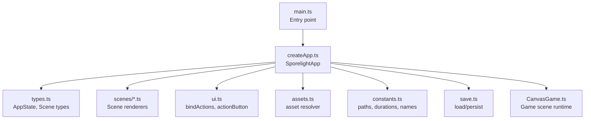
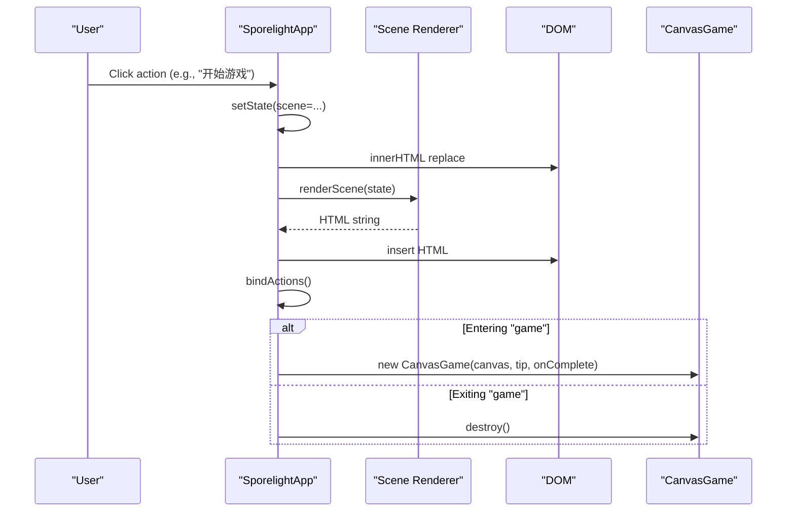
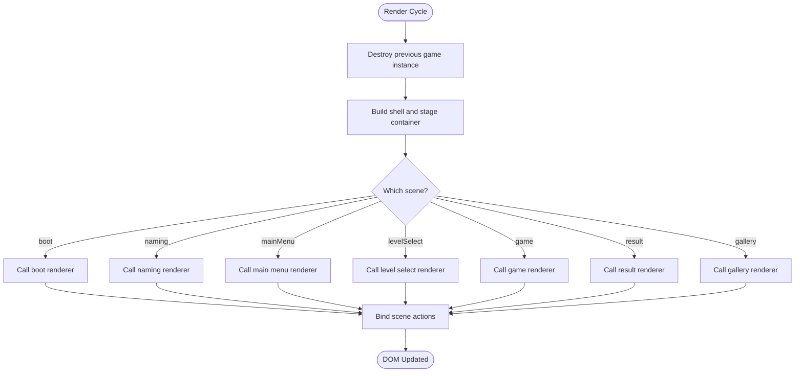
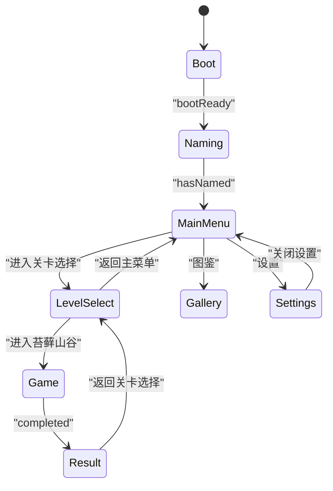
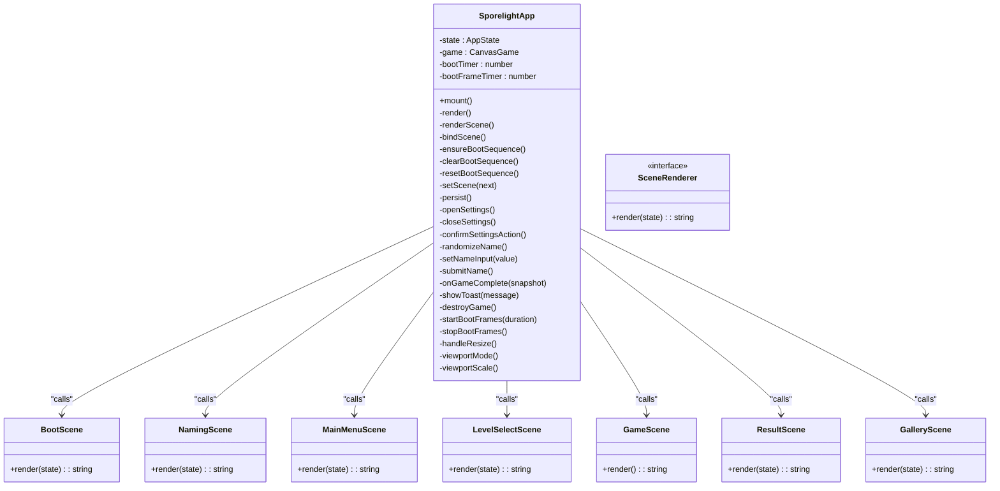
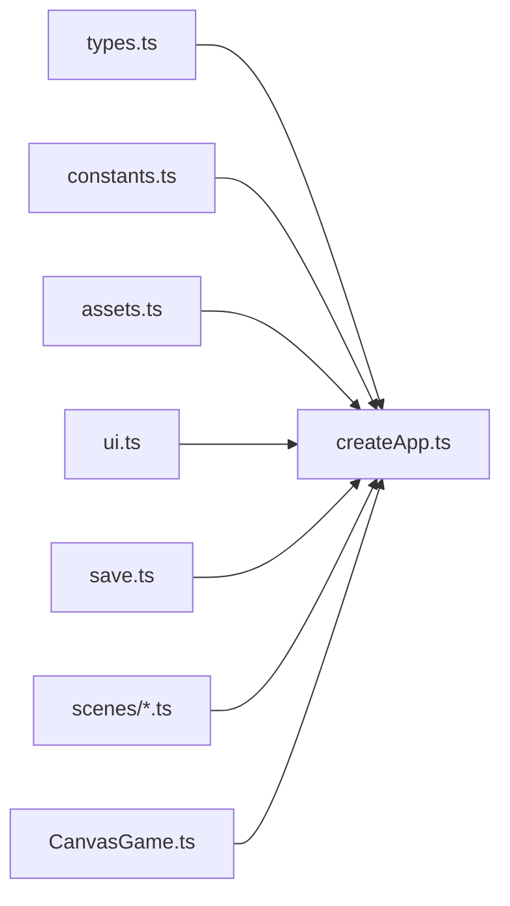

# Adding New Scenes

<cite>
**Referenced Files in This Document**
- [createApp.ts](file://src/app/createApp.ts)
- [types.ts](file://src/app/types.ts)
- [ui.ts](file://src/app/ui.ts)
- [assets.ts](file://src/app/assets.ts)
- [constants.ts](file://src/app/constants.ts)
- [save.ts](file://src/app/save.ts)
- [CanvasGame.ts](file://src/app/game/CanvasGame.ts)
- [bootScene.ts](file://src/app/scenes/bootScene.ts)
- [mainMenuScene.ts](file://src/app/scenes/mainMenuScene.ts)
- [namingScene.ts](file://src/app/scenes/namingScene.ts)
- [levelSelectScene.ts](file://src/app/scenes/levelSelectScene.ts)
- [gameScene.ts](file://src/app/scenes/gameScene.ts)
- [resultScene.ts](file://src/app/scenes/resultScene.ts)
- [galleryScene.ts](file://src/app/scenes/galleryScene.ts)
- [main.ts](file://src/main.ts)
</cite>

## Table of Contents
1. [Introduction](#introduction)
2. [Project Structure](#project-structure)
3. [Core Components](#core-components)
4. [Architecture Overview](#architecture-overview)
5. [Detailed Component Analysis](#detailed-component-analysis)
6. [Dependency Analysis](#dependency-analysis)
7. [Performance Considerations](#performance-considerations)
8. [Troubleshooting Guide](#troubleshooting-guide)
9. [Conclusion](#conclusion)
10. [Appendices](#appendices)

## Introduction
This document explains how to add a new scene to SporeLight. It covers the scene architecture pattern, lifecycle management, state transitions, UI rendering, and integration points with the main application controller. It also provides a step-by-step guide to implement a new scene, including UI component integration, state management, and registration procedures. Practical examples show how to implement scene-specific functionality, handle user interactions, manage assets, and integrate with the save/load system. Responsive design considerations, performance optimization for scene transitions, and debugging techniques are included.

## Project Structure
SporeLight organizes scenes under a dedicated folder and renders them via a central application controller. The controller manages state, binds actions, and orchestrates scene rendering and lifecycle events. Assets are resolved through a centralized asset helper, and UI interactions are bound using a shared action binding utility.

**Diagram sources**
- [main.ts:1-11](file://src/main.ts#L1-L11)
- [createApp.ts:1-377](file://src/app/createApp.ts#L1-L377)
- [types.ts:1-45](file://src/app/types.ts#L1-L45)
- [ui.ts:1-16](file://src/app/ui.ts#L1-L16)
- [assets.ts:1-4](file://src/app/assets.ts#L1-L4)
- [constants.ts:1-71](file://src/app/constants.ts#L1-L71)
- [save.ts:1-67](file://src/app/save.ts#L1-L67)
- [CanvasGame.ts:1-318](file://src/app/game/CanvasGame.ts#L1-L318)

**Section sources**
- [main.ts:1-11](file://src/main.ts#L1-L11)
- [createApp.ts:16-82](file://src/app/createApp.ts#L16-L82)

## Core Components
- Application controller: Manages AppState, scene transitions, rendering, and event binding. It also controls special sequences like the boot loader and integrates with the CanvasGame for gameplay.
- Scene renderers: Pure functions that return HTML strings for each scene, using the asset helper and constants.
- UI utilities: Provide reusable UI primitives and a global action binder.
- Asset system: Centralized path resolution for images.
- Save system: Persistent storage of player progress, settings, and gallery unlocks.
- Game runtime: Canvas-based game logic and rendering for the game scene.

Key responsibilities:
- Scene lifecycle: Render, bind actions, initialize specialized components (e.g., CanvasGame), and clean up resources.
- State transitions: Controlled by the controller’s scene setter and action handlers.
- Rendering pipeline: Root container updates, innerHTML replacement, and re-binding of actions.

**Section sources**
- [createApp.ts:22-377](file://src/app/createApp.ts#L22-L377)
- [types.ts:1-45](file://src/app/types.ts#L1-L45)
- [ui.ts:1-16](file://src/app/ui.ts#L1-L16)
- [assets.ts:1-4](file://src/app/assets.ts#L1-L4)
- [save.ts:1-67](file://src/app/save.ts#L1-L67)
- [CanvasGame.ts:14-318](file://src/app/game/CanvasGame.ts#L14-L318)

## Architecture Overview
The scene architecture follows a state-driven rendering model:
- The controller holds AppState, including the current Scene and other flags.
- On each render cycle, the controller selects a renderer based on the current Scene and injects state into it.
- Actions are bound globally via a single utility; handlers call controller methods to mutate state and trigger re-renders.
- Specialized components (e.g., CanvasGame) are initialized when entering a scene and destroyed when leaving.

**Diagram sources**
- [createApp.ts:42-109](file://src/app/createApp.ts#L42-L109)
- [createApp.ts:201-213](file://src/app/createApp.ts#L201-L213)
- [CanvasGame.ts:32-47](file://src/app/game/CanvasGame.ts#L32-L47)

## Detailed Component Analysis

### Scene Lifecycle Management
- Render phase: The controller clears previous game instances, renders the current scene, and conditionally binds actions and special behaviors.
- Action binding: A single utility binds all declared actions to handlers, enabling decoupled UI-to-controller communication.
- Scene transitions: The controller’s scene setter updates state and triggers re-render; it also handles boot sequence cleanup and reset logic.

**Diagram sources**
- [createApp.ts:42-82](file://src/app/createApp.ts#L42-L82)
- [createApp.ts:84-109](file://src/app/createApp.ts#L84-L109)

**Section sources**
- [createApp.ts:42-82](file://src/app/createApp.ts#L42-L82)
- [createApp.ts:84-109](file://src/app/createApp.ts#L84-L109)

### State Transition Mechanisms
- Scene type: Enumerated union defines valid scenes.
- AppState: Holds the current scene, save data, settings modal state, and boot readiness.
- Transition triggers: Action handlers call the controller’s scene setter, which updates state and re-renders.
- Boot sequence: Dedicated timers and frame animation are managed during boot transitions.

**Diagram sources**
- [types.ts:1-45](file://src/app/types.ts#L1-L45)
- [createApp.ts:201-213](file://src/app/createApp.ts#L201-L213)
- [createApp.ts:165-183](file://src/app/createApp.ts#L165-L183)

**Section sources**
- [types.ts:1-45](file://src/app/types.ts#L1-L45)
- [createApp.ts:201-213](file://src/app/createApp.ts#L201-L213)

### UI Rendering System
- Scene renderers: Pure functions returning HTML strings. They use the asset helper for image paths and constants for asset roots.
- Global action binding: A single utility binds all elements with matching action attributes to handlers.
- Escape utilities: Prevent XSS by escaping user-provided text injected into HTML.

**Diagram sources**
- [createApp.ts:22-377](file://src/app/createApp.ts#L22-L377)
- [bootScene.ts:19-94](file://src/app/scenes/bootScene.ts#L19-L94)
- [namingScene.ts:8-36](file://src/app/scenes/namingScene.ts#L8-L36)
- [mainMenuScene.ts:8-24](file://src/app/scenes/mainMenuScene.ts#L8-L24)
- [levelSelectScene.ts:13-39](file://src/app/scenes/levelSelectScene.ts#L13-L39)
- [gameScene.ts:3-22](file://src/app/scenes/gameScene.ts#L3-L22)
- [resultScene.ts:8-31](file://src/app/scenes/resultScene.ts#L8-L31)
- [galleryScene.ts:18-43](file://src/app/scenes/galleyScene.ts#L18-L43)

**Section sources**
- [bootScene.ts:19-94](file://src/app/scenes/bootScene.ts#L19-L94)
- [namingScene.ts:8-36](file://src/app/scenes/namingScene.ts#L8-L36)
- [mainMenuScene.ts:8-24](file://src/app/scenes/mainMenuScene.ts#L8-L24)
- [levelSelectScene.ts:13-39](file://src/app/scenes/levelSelectScene.ts#L13-L39)
- [gameScene.ts:3-22](file://src/app/scenes/gameScene.ts#L3-L22)
- [resultScene.ts:8-31](file://src/app/scenes/resultScene.ts#L8-L31)
- [galleryScene.ts:18-43](file://src/app/scenes/galeryScene.ts#L18-L43)

### Step-by-Step: Add a New Scene
Follow these steps to add a new scene to SporeLight:

1. Define the scene type
- Extend the Scene union in the types module with your new scene identifier.
- Add any scene-specific state fields to AppState if needed.

2. Create the scene renderer
- Implement a render function that returns an HTML string for your scene.
- Use the asset helper for image paths and constants for asset roots.
- Reference existing renderers for structure and patterns.

3. Integrate UI components
- Use the action button utility for consistent buttons.
- Escape user-provided text to prevent XSS.
- Bind actions via the global action binder.

4. Register the scene in the controller
- Add a case in the controller’s scene renderer switch to call your renderer.
- Add action handlers in the controller’s scene binding method to handle user interactions.

5. Manage scene-specific assets
- Place assets under the appropriate asset root and reference them via constants.
- Ensure asset paths resolve correctly through the asset helper.

6. Handle scene transitions
- Use the controller’s scene setter to switch scenes.
- Clean up specialized components (e.g., destroy CanvasGame) when leaving a scene.

7. Integrate with the save/load system
- Persist any scene-specific state changes through the save system.
- Load initial state from saved data when entering the scene.

8. Responsive design and performance
- Use viewport scaling and mode calculations for responsive layouts.
- Optimize animations and timers to avoid jank during transitions.

9. Debugging scene-related issues
- Verify action bindings by checking that elements have the correct data-action attributes.
- Inspect rendered HTML to ensure proper insertion and styling.
- Use console logs sparingly and remove them before committing.

**Section sources**
- [types.ts:1-45](file://src/app/types.ts#L1-L45)
- [assets.ts:1-4](file://src/app/assets.ts#L1-L4)
- [constants.ts:1-71](file://src/app/constants.ts#L1-L71)
- [createApp.ts:65-82](file://src/app/createApp.ts#L65-L82)
- [createApp.ts:84-109](file://src/app/createApp.ts#L84-L109)
- [save.ts:49-67](file://src/app/save.ts#L49-L67)

### Scene Interface Requirements
- Function signature: A render function that accepts state and returns an HTML string.
- Asset usage: Use the asset helper to resolve image paths.
- Accessibility: Include aria attributes where appropriate (e.g., aria-live, aria-hidden).
- Actions: Use data-action attributes to mark interactive elements.

**Section sources**
- [bootScene.ts:19-94](file://src/app/scenes/bootScene.ts#L19-L94)
- [mainMenuScene.ts:8-24](file://src/app/scenes/mainMenuScene.ts#L8-L24)
- [namingScene.ts:8-36](file://src/app/scenes/namingScene.ts#L8-L36)
- [levelSelectScene.ts:13-39](file://src/app/scenes/levelSelectScene.ts#L13-L39)
- [resultScene.ts:8-31](file://src/app/scenes/resultScene.ts#L8-L31)
- [galleryScene.ts:18-43](file://src/app/scenes/galeryScene.ts#L18-L43)

### Rendering Methods
- Pure renderers: Return HTML strings; keep logic minimal and deterministic.
- Asset resolution: Centralized via the asset helper to simplify path management.
- Constants: Use constants for asset roots and animation frame lists.

**Section sources**
- [bootScene.ts:19-94](file://src/app/scenes/bootScene.ts#L19-L94)
- [constants.ts:4-51](file://src/app/constants.ts#L4-L51)
- [assets.ts:1-4](file://src/app/assets.ts#L1-L4)

### Event Handling Patterns
- Global action binding: A single utility binds all elements with matching action attributes.
- Handler delegation: Controller methods mutate state and trigger re-renders.
- Specialized components: Initialize and destroy specialized components per scene.

**Section sources**
- [ui.ts:5-11](file://src/app/ui.ts#L5-L11)
- [createApp.ts:84-109](file://src/app/createApp.ts#L84-L109)
- [CanvasGame.ts:49-54](file://src/app/game/CanvasGame.ts#L49-L54)

### Communication with the Main Application Controller
- Scene selection: The controller’s scene setter updates state and re-renders.
- Action dispatch: Handlers call controller methods to change state and navigate scenes.
- Specialized runtime: The controller initializes and destroys specialized components (e.g., CanvasGame) when entering or leaving scenes.

**Section sources**
- [createApp.ts:201-213](file://src/app/createApp.ts#L201-L213)
- [createApp.ts:101-109](file://src/app/createApp.ts#L101-L109)
- [CanvasGame.ts:32-47](file://src/app/game/CanvasGame.ts#L32-L47)

### Practical Examples
- Implementing scene-specific functionality:
  - Use the controller’s scene setter to move between scenes.
  - Initialize specialized components (e.g., CanvasGame) when entering the game scene and destroy them when leaving.

- Handling user interactions:
  - Bind actions via the global action binder; handlers call controller methods to mutate state and trigger re-renders.

- Managing scene-specific assets:
  - Place assets under the appropriate asset root and reference them via constants.
  - Ensure asset paths resolve correctly through the asset helper.

- Integrating with the save/load system:
  - Persist state changes through the save system.
  - Load initial state from saved data when entering the scene.

**Section sources**
- [createApp.ts:201-213](file://src/app/createApp.ts#L201-L213)
- [createApp.ts:101-109](file://src/app/createApp.ts#L101-L109)
- [save.ts:49-67](file://src/app/save.ts#L49-L67)

## Dependency Analysis
Scenes depend on:
- The controller for state and lifecycle management.
- The asset helper for resolving image paths.
- Constants for asset roots and animation frame lists.
- The UI utility for consistent button rendering and action binding.
- The save system for persistence.

**Diagram sources**
- [types.ts:1-45](file://src/app/types.ts#L1-L45)
- [constants.ts:1-71](file://src/app/constants.ts#L1-L71)
- [assets.ts:1-4](file://src/app/assets.ts#L1-L4)
- [ui.ts:1-16](file://src/app/ui.ts#L1-L16)
- [save.ts:1-67](file://src/app/save.ts#L1-L67)
- [createApp.ts:1-15](file://src/app/createApp.ts#L1-L15)

**Section sources**
- [createApp.ts:1-15](file://src/app/createApp.ts#L1-L15)

## Performance Considerations
- Minimize DOM churn: Re-render the entire stage container per scene but avoid unnecessary re-initialization of components.
- Optimize animations: Use requestAnimationFrame and clamp delta time to prevent jitter.
- Boot sequence: Control frame animation timing and clear intervals/timers when leaving the boot scene.
- Canvas game: Destroy the game instance when leaving the game scene to free resources.

**Section sources**
- [createApp.ts:321-360](file://src/app/createApp.ts#L321-L360)
- [CanvasGame.ts:134-146](file://src/app/game/CanvasGame.ts#L134-L146)
- [createApp.ts:316-319](file://src/app/createApp.ts#L316-L319)

## Troubleshooting Guide
- Actions not firing:
  - Ensure elements have the correct data-action attributes.
  - Verify that bindActions is called after inserting HTML.

- Incorrect asset paths:
  - Confirm asset roots and filenames match constants.
  - Use the asset helper to resolve paths.

- Scene not transitioning:
  - Check that the scene setter is called with a valid scene identifier.
  - Ensure the switch statement in the controller includes your new scene.

- Canvas game not initializing:
  - Confirm the game scene renderer returns a canvas element with the expected ID.
  - Verify that the controller initializes CanvasGame only when entering the game scene.

**Section sources**
- [ui.ts:5-11](file://src/app/ui.ts#L5-L11)
- [constants.ts:4-71](file://src/app/constants.ts#L4-L71)
- [createApp.ts:201-213](file://src/app/createApp.ts#L201-L213)
- [createApp.ts:101-109](file://src/app/createApp.ts#L101-L109)

## Conclusion
Adding a new scene to SporeLight involves extending the scene type, implementing a pure renderer, integrating UI components, registering the scene in the controller, managing assets, and coordinating with the save system. By following the established patterns—state-driven rendering, global action binding, and lifecycle hooks—you can implement new scenes efficiently while maintaining consistency and performance.

## Appendices
- Example references for implementation patterns:
  - Scene renderer examples: [bootScene.ts:19-94](file://src/app/scenes/bootScene.ts#L19-L94), [mainMenuScene.ts:8-24](file://src/app/scenes/mainMenuScene.ts#L8-L24), [namingScene.ts:8-36](file://src/app/scenes/namingScene.ts#L8-L36), [levelSelectScene.ts:13-39](file://src/app/scenes/levelSelectScene.ts#L13-L39), [resultScene.ts:8-31](file://src/app/scenes/resultScene.ts#L8-L31), [galleryScene.ts:18-43](file://src/app/scenes/galeryScene.ts#L18-L43)
  - Controller integration: [createApp.ts:65-82](file://src/app/createApp.ts#L65-L82), [createApp.ts:84-109](file://src/app/createApp.ts#L84-L109)
  - UI utilities: [ui.ts:1-16](file://src/app/ui.ts#L1-L16)
  - Asset helper: [assets.ts:1-4](file://src/app/assets.ts#L1-L4)
  - Constants: [constants.ts:1-71](file://src/app/constants.ts#L1-L71)
  - Save system: [save.ts:1-67](file://src/app/save.ts#L1-L67)
  - Canvas game runtime: [CanvasGame.ts:14-318](file://src/app/game/CanvasGame.ts#L14-L318)