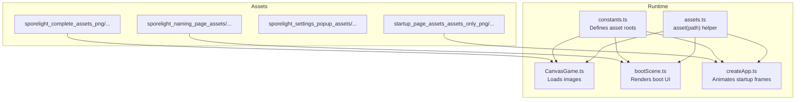
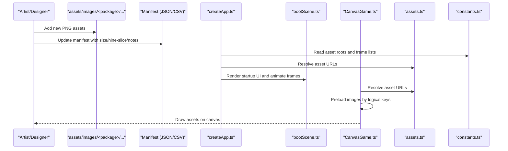
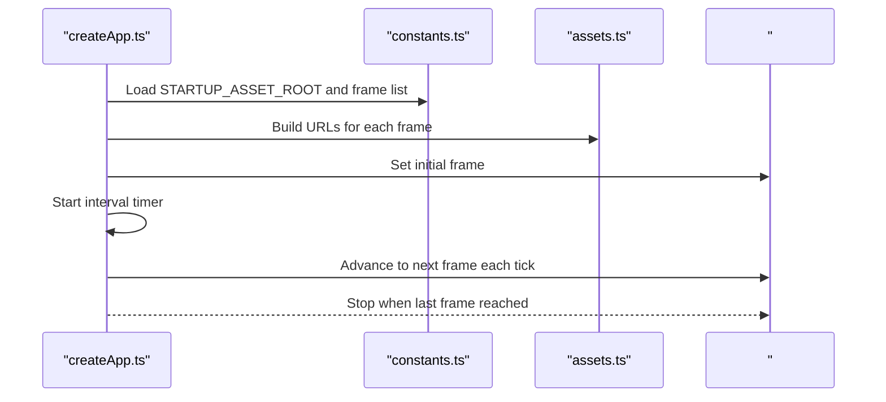
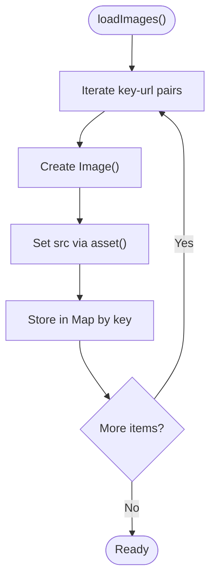
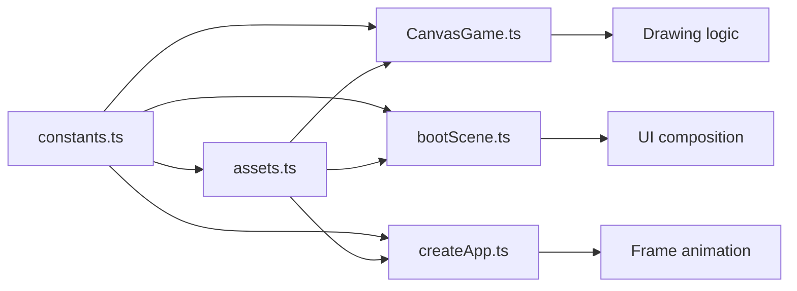

# Asset Integration

<cite>
**Referenced Files in This Document**
- [asset_manifest.json](file://assets/images/sporelight_complete_assets_png/meta/asset_manifest.json)
- [asset_manifest.json](file://assets/images/sporelight_naming_page_assets/meta/asset_manifest.json)
- [asset_manifest.json](file://assets/images/sporelight_settings_popup_assets/sporelight_settings_assets/meta/asset_manifest.json)
- [manifest.json](file://assets/images/startup_page_assets_assets_only_png/manifest.json)
- [manifest.csv](file://assets/images/startup_page_assets_assets_only_png/manifest.csv)
- [README_命名页切图说明.md](file://assets/images/sporelight_naming_page_assets/README_命名页切图说明.md)
- [assets.ts](file://src/app/assets.ts)
- [constants.ts](file://src/app/constants.ts)
- [CanvasGame.ts](file://src/app/game/CanvasGame.ts)
- [bootScene.ts](file://src/app/scenes/bootScene.ts)
- [createApp.ts](file://src/app/createApp.ts)
- [types.ts](file://src/app/types.ts)
</cite>

## Table of Contents
1. [Introduction](#introduction)
2. [Project Structure](#project-structure)
3. [Core Components](#core-components)
4. [Architecture Overview](#architecture-overview)
5. [Detailed Component Analysis](#detailed-component-analysis)
6. [Dependency Analysis](#dependency-analysis)
7. [Performance Considerations](#performance-considerations)
8. [Troubleshooting Guide](#troubleshooting-guide)
9. [Conclusion](#conclusion)
10. [Appendices](#appendices)

## Introduction
This document explains how to integrate new assets into SporeLight using the manifest-based asset management system. It covers the manifest formats, path resolution, sprite sheet processing, and the end-to-end workflow for adding new assets. It also documents asset organization, naming conventions, file format requirements, optimization guidelines, legacy support, caching, validation, error handling, responsive scaling, and best practices for consistency across screen sizes and resolutions.

## Project Structure
Assets are organized under the assets/images directory with multiple curated packages:
- Complete character, environment, UI, and FX assets
- Naming page assets with metadata
- Settings popup assets with metadata
- Startup page assets with JSON and CSV manifests

The runtime resolves asset paths via a simple helper that prepends the images folder, while constants define the roots for each asset package.

**Diagram sources**
- [constants.ts:1-7](file://src/app/constants.ts#L1-L7)
- [assets.ts:1-3](file://src/app/assets.ts#L1-L3)
- [CanvasGame.ts:76-102](file://src/app/game/CanvasGame.ts#L76-L102)
- [bootScene.ts:19-64](file://src/app/scenes/bootScene.ts#L19-L64)
- [createApp.ts:321-360](file://src/app/createApp.ts#L321-L360)

**Section sources**
- [constants.ts:1-7](file://src/app/constants.ts#L1-L7)
- [assets.ts:1-3](file://src/app/assets.ts#L1-L3)

## Core Components
- Manifest-based asset catalogs:
  - JSON manifests with per-file metadata (size, nine-slice hints, notes)
  - CSV manifests for startup assets with structured fields
- Path resolution:
  - Centralized asset helper that prefixes paths with the images folder
  - Constants that define the root folders for each asset package
- Loading pipeline:
  - CanvasGame loads static images by key
  - Boot scene renders startup UI and animates frame sequences
  - Startup frame animation cycles through sprite sheet frames

Key responsibilities:
- asset(path): resolves a logical asset path to a web-accessible URL
- constants: provide asset roots and startup frame lists
- CanvasGame: preloads and draws images keyed by logical names
- bootScene: renders startup UI and composes particle overlays
- createApp: drives the animated startup frame sequence

**Section sources**
- [asset_manifest.json:1-200](file://assets/images/sporelight_complete_assets_png/meta/asset_manifest.json#L1-L200)
- [asset_manifest.json:1-212](file://assets/images/sporelight_naming_page_assets/meta/asset_manifest.json#L1-L212)
- [asset_manifest.json:1-100](file://assets/images/sporelight_settings_popup_assets/sporelight_settings_assets/meta/asset_manifest.json#L1-L100)
- [manifest.json:1-266](file://assets/images/startup_page_assets_assets_only_png/manifest.json#L1-L266)
- [manifest.csv:1-26](file://assets/images/startup_page_assets_assets_only_png/manifest.csv#L1-L26)
- [assets.ts:1-3](file://src/app/assets.ts#L1-L3)
- [constants.ts:1-7](file://src/app/constants.ts#L1-L7)
- [CanvasGame.ts:76-102](file://src/app/game/CanvasGame.ts#L76-L102)
- [bootScene.ts:19-64](file://src/app/scenes/bootScene.ts#L19-L64)
- [createApp.ts:321-360](file://src/app/createApp.ts#L321-L360)

## Architecture Overview
The asset integration architecture combines manifest-driven metadata with a centralized path resolver and explicit loaders.

**Diagram sources**
- [constants.ts:1-7](file://src/app/constants.ts#L1-L7)
- [assets.ts:1-3](file://src/app/assets.ts#L1-L3)
- [bootScene.ts:19-64](file://src/app/scenes/bootScene.ts#L19-L64)
- [createApp.ts:321-360](file://src/app/createApp.ts#L321-L360)
- [CanvasGame.ts:76-102](file://src/app/game/CanvasGame.ts#L76-L102)

## Detailed Component Analysis

### Manifest Formats and Metadata
- Complete assets manifest:
  - Per-entry fields include file path, size, nine_slice flag, and descriptive notes
  - Used to document intended dimensions and UI behavior (e.g., nine-slice insets)
- Naming page manifest:
  - Per-entry fields include file path, width, height, nine_slice boolean, and notes
  - Provides explicit sizing and nine-slice guidance for UI elements
- Settings popup manifest:
  - Key-value mapping from file path to metadata including size and nine_slice insets
  - Supports structured nine-slice definitions for scalable UI components
- Startup page manifest:
  - JSON array with file, name, category, status, original coordinates, width, height, note
  - CSV mirrors the same fields for tooling compatibility

Practical implications:
- Use the appropriate manifest format depending on the asset package
- Include accurate size and nine-slice hints to enable responsive UI scaling
- Keep notes concise and actionable for artists and developers

**Section sources**
- [asset_manifest.json:1-200](file://assets/images/sporelight_complete_assets_png/meta/asset_manifest.json#L1-L200)
- [asset_manifest.json:1-212](file://assets/images/sporelight_naming_page_assets/meta/asset_manifest.json#L1-L212)
- [asset_manifest.json:1-100](file://assets/images/sporelight_settings_popup_assets/sporelight_settings_assets/meta/asset_manifest.json#L1-L100)
- [manifest.json:1-266](file://assets/images/startup_page_assets_assets_only_png/manifest.json#L1-L266)
- [manifest.csv:1-26](file://assets/images/startup_page_assets_assets_only_png/manifest.csv#L1-L26)

### Path Resolution and Asset Roots
- asset(path) helper:
  - Returns "/images/<path>" for all assets
  - Ensures consistent URL construction across scenes and loaders
- constants:
  - COMPLETE_ASSET_ROOT, NAMING_ASSET_ROOT, STARTUP_ASSET_ROOT define package roots
  - STARTUP_LOADING_FRAME_FILES enumerates startup frame filenames

Usage patterns:
- Combine constants with relative asset paths to build full URLs
- Use asset() to resolve final resource URLs for loaders and templates

**Section sources**
- [assets.ts:1-3](file://src/app/assets.ts#L1-L3)
- [constants.ts:1-7](file://src/app/constants.ts#L1-L7)
- [constants.ts:10-51](file://src/app/constants.ts#L10-L51)

### Sprite Sheet Processing and Frame Animation
- Startup frame animation:
  - createApp.ts builds a list of frame URLs from STARTUP_ASSET_ROOT and frame filenames
  - Cycles through frames at a calculated interval, supporting low-motion mode
- Boot scene rendering:
  - bootScene.ts composes the startup UI and overlays animated particles
  - Particles are generated dynamically with randomized styles and positions

Guidelines:
- Maintain consistent frame naming and ordering
- Keep frame counts balanced for smooth playback
- Consider low-motion mode by jumping to the last frame

**Diagram sources**
- [createApp.ts:321-360](file://src/app/createApp.ts#L321-L360)
- [constants.ts:10-51](file://src/app/constants.ts#L10-L51)
- [assets.ts:1-3](file://src/app/assets.ts#L1-L3)

**Section sources**
- [createApp.ts:321-360](file://src/app/createApp.ts#L321-L360)
- [bootScene.ts:19-64](file://src/app/scenes/bootScene.ts#L19-L64)
- [constants.ts:10-51](file://src/app/constants.ts#L10-L51)

### Static Image Loading and Caching
- CanvasGame preloads images by logical keys:
  - Associates each asset with a key (e.g., bg, idle1, roll1, trail)
  - Uses asset() to resolve URLs and stores loaded images in a Map
- Drawing logic:
  - Checks image readiness before drawing
  - Falls back to a placeholder when images are not yet ready

Caching behavior:
- Browser caches images automatically
- Application-level cache via Map avoids repeated creation
- No explicit eviction policy; images remain until destruction

**Diagram sources**
- [CanvasGame.ts:76-102](file://src/app/game/CanvasGame.ts#L76-L102)

**Section sources**
- [CanvasGame.ts:76-102](file://src/app/game/CanvasGame.ts#L76-L102)
- [CanvasGame.ts:286-296](file://src/app/game/CanvasGame.ts#L286-L296)

### Legacy Asset Support and Manifest Variants
- Startup page supports both JSON and CSV manifests:
  - JSON manifest for structured metadata
  - CSV manifest for tooling and spreadsheet workflows
- Naming page manifest demonstrates width/height and nine_slice fields
- Settings popup manifest uses a key-value structure with nine_slice insets

Recommendations:
- Prefer JSON manifests for richer metadata and structured nine-slice definitions
- Keep CSV and JSON synchronized when both are present
- Use consistent field names and units across variants

**Section sources**
- [manifest.json:1-266](file://assets/images/startup_page_assets_assets_only_png/manifest.json#L1-L266)
- [manifest.csv:1-26](file://assets/images/startup_page_assets_assets_only_png/manifest.csv#L1-L26)
- [asset_manifest.json:1-212](file://assets/images/sporelight_naming_page_assets/meta/asset_manifest.json#L1-L212)
- [asset_manifest.json:1-100](file://assets/images/sporelight_settings_popup_assets/sporelight_settings_assets/meta/asset_manifest.json#L1-L100)

### Asset Organization and Naming Conventions
- Package roots:
  - sporelight_complete_assets_png: main game assets
  - sporelight_naming_page_assets: naming UI and related assets
  - sporelight_settings_popup_assets: settings UI and effects
  - startup_page_assets_assets_only_png: startup UI and animations
- Folder structure:
  - backgrounds/, characters/, ui/, fx/, deco/, meta/
  - meta contains asset_manifest.json with metadata
- Naming:
  - Use descriptive lowercase names with underscores
  - Keep filenames short and meaningful
  - Group related assets under dedicated subfolders

**Section sources**
- [constants.ts:4-6](file://src/app/constants.ts#L4-L6)
- [README_命名页切图说明.md:5-17](file://assets/images/sporelight_naming_page_assets/README_命名页切图说明.md#L5-L17)

### File Format Requirements and Optimization Guidelines
- Preferred format:
  - PNG for raster assets to preserve crisp edges and transparency
- Nine-slice optimization:
  - Define nine_slice insets in manifests for scalable UI components
  - Use insets that preserve corners and stretch centers appropriately
- Sprite sheets:
  - Maintain uniform frame size and alignment
  - Number frames consistently for predictable sequencing
- Responsive scaling:
  - Use nine-slice for UI backgrounds and controls
  - Provide scalable assets where possible; avoid unnecessary pixelation

**Section sources**
- [asset_manifest.json:1-200](file://assets/images/sporelight_complete_assets_png/meta/asset_manifest.json#L1-L200)
- [asset_manifest.json:1-212](file://assets/images/sporelight_naming_page_assets/meta/asset_manifest.json#L1-L212)
- [asset_manifest.json:1-100](file://assets/images/sporelight_settings_popup_assets/sporelight_settings_assets/meta/asset_manifest.json#L1-L100)

### Practical Workflow: Adding New Assets
- Characters
  - Place PNGs under characters/
  - Add entries to the appropriate manifest with size and nine-slice hints
  - Reference in CanvasGame by a logical key and draw in the game loop
- Environment Tiles
  - Place PNGs under world/ or backgrounds/
  - Update manifest with size and notes
  - Load via asset() and draw in CanvasGame
- UI Elements
  - Place PNGs under ui/<category>/
  - Add entries to the naming or settings manifest with nine_slice insets
  - Reference in scenes via asset() and renderBootScene
- Particle Effects
  - Place PNGs under fx/ or particles_png_10/
  - Animate via createApp.ts by cycling through frame files
- Backgrounds
  - Place PNGs under backgrounds/
  - Add entries to the manifest with size and notes
  - Reference in scenes via asset()

Validation and error handling:
- If an image fails to load, CanvasGame draws a placeholder rectangle
- Use manifest entries to validate presence and sizes during development
- For startup frames, ensure all frame files exist and are ordered correctly

Responsive scaling:
- Use nine-slice insets from manifests to scale UI backgrounds and controls
- Keep aspect ratios consistent for backgrounds and logos

Best practices:
- Keep asset roots and categories aligned with constants and folder structure
- Maintain consistent naming and grouping conventions
- Include concise notes in manifests for future maintainers

**Section sources**
- [CanvasGame.ts:76-102](file://src/app/game/CanvasGame.ts#L76-L102)
- [CanvasGame.ts:286-296](file://src/app/game/CanvasGame.ts#L286-L296)
- [bootScene.ts:19-64](file://src/app/scenes/bootScene.ts#L19-L64)
- [createApp.ts:321-360](file://src/app/createApp.ts#L321-L360)
- [asset_manifest.json:1-200](file://assets/images/sporelight_complete_assets_png/meta/asset_manifest.json#L1-L200)
- [asset_manifest.json:1-212](file://assets/images/sporelight_naming_page_assets/meta/asset_manifest.json#L1-L212)
- [asset_manifest.json:1-100](file://assets/images/sporelight_settings_popup_assets/sporelight_settings_assets/meta/asset_manifest.json#L1-L100)

## Dependency Analysis
The asset system exhibits clear separation of concerns:
- constants.ts defines roots and frame lists
- assets.ts centralizes path resolution
- CanvasGame.ts and bootScene.ts depend on constants and assets.ts
- createApp.ts orchestrates startup frame animation using constants and assets.ts

**Diagram sources**
- [constants.ts:1-7](file://src/app/constants.ts#L1-L7)
- [assets.ts:1-3](file://src/app/assets.ts#L1-L3)
- [CanvasGame.ts:76-102](file://src/app/game/CanvasGame.ts#L76-L102)
- [bootScene.ts:19-64](file://src/app/scenes/bootScene.ts#L19-L64)
- [createApp.ts:321-360](file://src/app/createApp.ts#L321-L360)

**Section sources**
- [constants.ts:1-7](file://src/app/constants.ts#L1-L7)
- [assets.ts:1-3](file://src/app/assets.ts#L1-L3)
- [CanvasGame.ts:76-102](file://src/app/game/CanvasGame.ts#L76-L102)
- [bootScene.ts:19-64](file://src/app/scenes/bootScene.ts#L19-L64)
- [createApp.ts:321-360](file://src/app/createApp.ts#L321-L360)

## Performance Considerations
- Image caching:
  - Browser-level caching reduces network overhead
  - Application-level Map avoids redundant Image instances
- Frame animation:
  - Startup frames are preloaded and cycled at a fixed interval
  - Low-motion mode option skips animation for accessibility/performance
- Nine-slice scaling:
  - Reduces re-rasterization by stretching backgrounds efficiently
- Memory footprint:
  - Large sprite sheets increase memory usage; consider splitting into smaller sheets
  - Avoid loading unnecessary assets; keep manifest entries minimal and precise

[No sources needed since this section provides general guidance]

## Troubleshooting Guide
Common issues and remedies:
- Missing assets:
  - Symptom: Placeholder rectangles drawn instead of images
  - Cause: asset() path mismatch or missing file
  - Fix: Verify constants, asset roots, and file paths; ensure manifest entries match actual files
- Incorrect nine-slice scaling:
  - Symptom: Stretched UI looks distorted
  - Cause: Incorrect insets or lack of nine-slice metadata
  - Fix: Update manifest with accurate nine_slice insets; test UI scaling
- Startup frame animation stalls:
  - Symptom: Frame does not advance
  - Cause: Missing frame files or incorrect frame list order
  - Fix: Ensure all frame files exist and are named consistently; verify STARTUP_LOADING_FRAME_FILES
- Manifest desynchronization:
  - Symptom: Mismatch between CSV and JSON manifests
  - Cause: Outdated CSV or JSON
  - Fix: Synchronize both manifests; keep fields consistent

**Section sources**
- [CanvasGame.ts:286-296](file://src/app/game/CanvasGame.ts#L286-L296)
- [createApp.ts:321-360](file://src/app/createApp.ts#L321-L360)
- [manifest.csv:1-26](file://assets/images/startup_page_assets_assets_only_png/manifest.csv#L1-L26)
- [manifest.json:1-266](file://assets/images/startup_page_assets_assets_only_png/manifest.json#L1-L266)

## Conclusion
SporeLight’s asset integration relies on manifest-driven metadata, a centralized path resolver, and explicit loaders. By following the documented workflow—preparing assets, updating manifests, configuring asset roots, and implementing loading procedures—you can reliably add new assets across characters, environments, UI, particle effects, and backgrounds. Adhering to naming conventions, nine-slice guidelines, and optimization strategies ensures consistent visuals and strong performance across devices.

[No sources needed since this section summarizes without analyzing specific files]

## Appendices

### Manifest Field Reference
- Complete assets manifest:
  - file: relative path to asset
  - size: [width, height]
  - nine_slice: "是"/"否" or boolean
  - desc/size_note: human-readable notes
- Naming page manifest:
  - file: relative path to asset
  - width/height: numeric dimensions
  - nine_slice: boolean
  - notes: guidance text
- Settings popup manifest:
  - key: file path
  - size: [width, height]
  - nine_slice: object with left/right/top/bottom insets or null
  - description: optional text
- Startup page manifest (JSON):
  - file, name, category, status, original_x, original_y, width, height, note
- Startup page manifest (CSV):
  - Same fields as JSON variant

**Section sources**
- [asset_manifest.json:1-200](file://assets/images/sporelight_complete_assets_png/meta/asset_manifest.json#L1-L200)
- [asset_manifest.json:1-212](file://assets/images/sporelight_naming_page_assets/meta/asset_manifest.json#L1-L212)
- [asset_manifest.json:1-100](file://assets/images/sporelight_settings_popup_assets/sporelight_settings_assets/meta/asset_manifest.json#L1-L100)
- [manifest.json:1-266](file://assets/images/startup_page_assets_assets_only_png/manifest.json#L1-L266)
- [manifest.csv:1-26](file://assets/images/startup_page_assets_assets_only_png/manifest.csv#L1-L26)