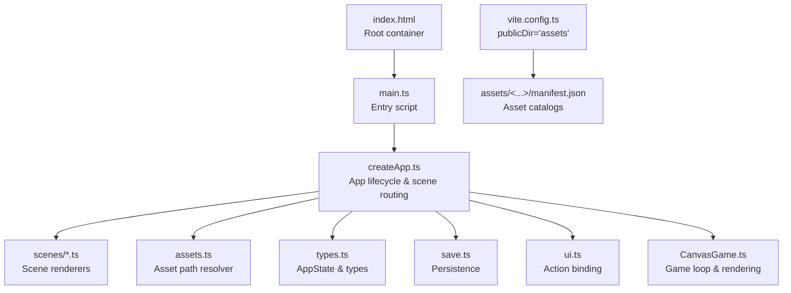
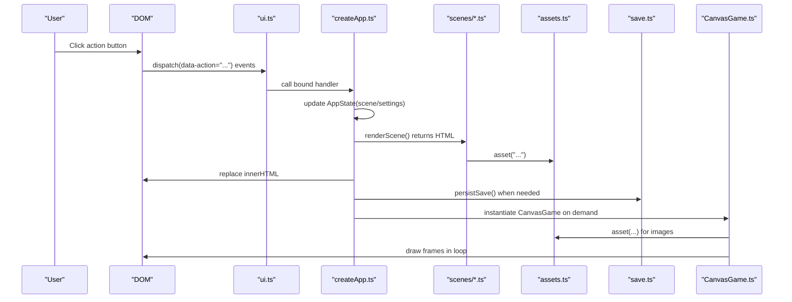
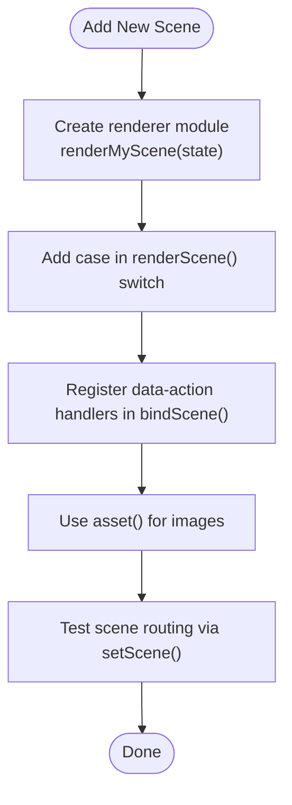
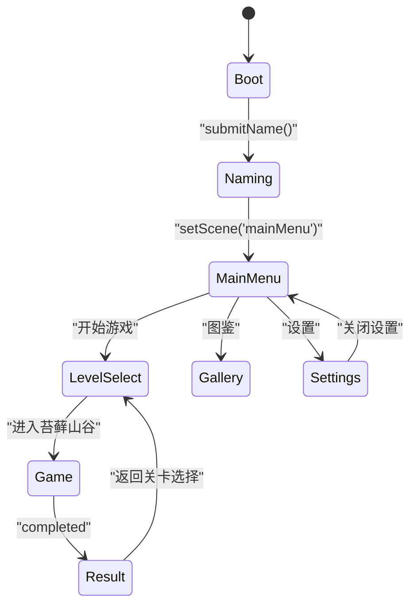
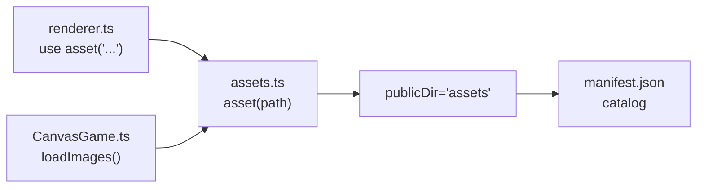
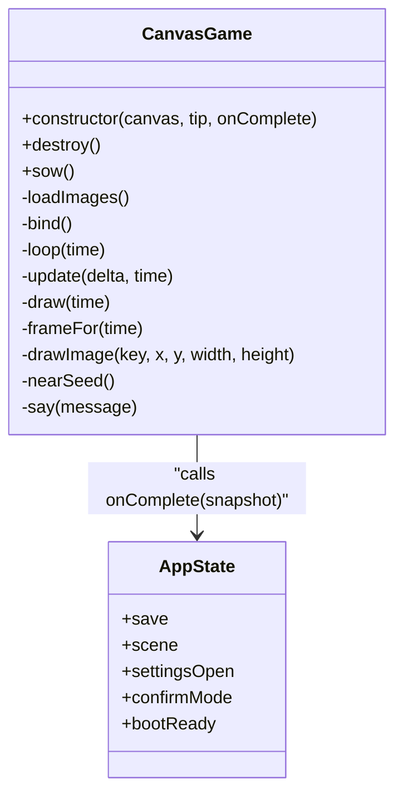
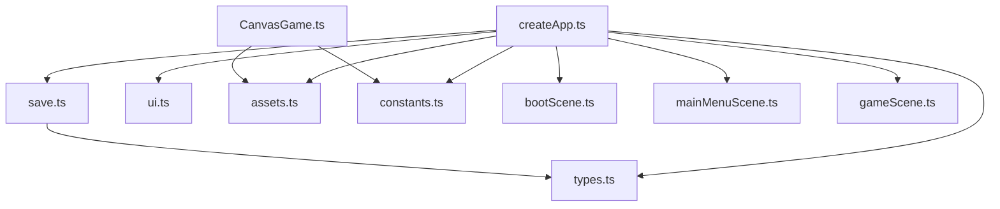

# Contributing and Extension

<cite>
**Referenced Files in This Document**
- [index.html](file://index.html)
- [main.ts](file://src/main.ts)
- [createApp.ts](file://src/app/createApp.ts)
- [assets.ts](file://src/app/assets.ts)
- [constants.ts](file://src/app/constants.ts)
- [types.ts](file://src/app/types.ts)
- [save.ts](file://src/app/save.ts)
- [ui.ts](file://src/app/ui.ts)
- [CanvasGame.ts](file://src/app/game/CanvasGame.ts)
- [bootScene.ts](file://src/app/scenes/bootScene.ts)
- [mainMenuScene.ts](file://src/app/scenes/mainMenuScene.ts)
- [gameScene.ts](file://src/app/scenes/gameScene.ts)
- [settingsModal.ts](file://src/app/components/settingsModal.ts)
- [styles.css](file://src/styles.css)
- [vite.config.ts](file://vite.config.ts)
- [package.json](file://package.json)
- [asset_manifest.json (complete)](file://assets/images/sporelight_complete_assets_png/meta/asset_manifest.json)
- [manifest.json (startup)](file://assets/images/startup_page_assets_assets_only_png/manifest.json)
</cite>

## Table of Contents
1. [Introduction](#introduction)
2. [Project Structure](#project-structure)
3. [Core Components](#core-components)
4. [Architecture Overview](#architecture-overview)
5. [Detailed Component Analysis](#detailed-component-analysis)
6. [Dependency Analysis](#dependency-analysis)
7. [Performance Considerations](#performance-considerations)
8. [Troubleshooting Guide](#troubleshooting-guide)
9. [Conclusion](#conclusion)
10. [Appendices](#appendices)

## Introduction
This document explains how to contribute to and extend SporeLight. It covers:
- Adding new scenes: creation guidelines, UI integration, state management, and asset integration.
- Extending game mechanics: Canvas game modifications, physics/collision integration, animation implementation, and performance considerations.
- Asset integration: adding new assets, updating manifests, path resolution, and optimization guidelines.
- Coding standards, architectural patterns, testing approaches, and best practices for maintainability and stability.

## Project Structure
SporeLight is a Vite-powered TypeScript application with a modular structure:
- Entry point initializes the app and mounts the root container.
- Scenes render UI per screen and bind actions via a shared action dispatcher.
- A central state machine controls scenes, settings, and persistence.
- Assets are resolved via a simple path helper and served from the configured public directory.
- Styles are organized per module and imported centrally.

**Diagram sources**
- [index.html:1-13](file://index.html#L1-L13)
- [main.ts:1-11](file://src/main.ts#L1-L11)
- [createApp.ts:1-377](file://src/app/createApp.ts#L1-L377)
- [assets.ts:1-4](file://src/app/assets.ts#L1-L4)
- [types.ts:1-45](file://src/app/types.ts#L1-L45)
- [save.ts:1-67](file://src/app/save.ts#L1-L67)
- [ui.ts:1-16](file://src/app/ui.ts#L1-L16)
- [CanvasGame.ts:1-318](file://src/app/game/CanvasGame.ts#L1-L318)
- [vite.config.ts:1-10](file://vite.config.ts#L1-L10)
- [manifest.json (startup):1-266](file://assets/images/startup_page_assets_assets_only_png/manifest.json#L1-L266)

**Section sources**
- [index.html:1-13](file://index.html#L1-L13)
- [main.ts:1-11](file://src/main.ts#L1-L11)
- [createApp.ts:16-82](file://src/app/createApp.ts#L16-L82)
- [vite.config.ts:1-10](file://vite.config.ts#L1-L10)
- [styles.css:1-5](file://src/styles.css#L1-L5)

## Core Components
- Application bootstrap and lifecycle: creates the app, manages scene rendering, binds actions, and orchestrates settings and persistence.
- Scene rendering: each scene is a pure renderer that returns HTML strings and relies on the global action binder to wire events.
- Asset resolution: a single helper resolves asset paths under the configured public directory.
- State and persistence: a typed state model with defaults and localStorage-backed persistence.
- Game engine: a Canvas-based game loop with keyboard/pointer input, simple movement, and animation frames.

Key responsibilities:
- createApp.ts: state transitions, scene rendering, settings modal, boot sequence, and persistence.
- scenes/*.ts: declarative UI rendering with action bindings.
- assets.ts: centralized asset path construction.
- save.ts: default save creation, merging partial saves, and localStorage persistence.
- CanvasGame.ts: game loop, input handling, simple collision detection, and sprite drawing.

**Section sources**
- [createApp.ts:22-377](file://src/app/createApp.ts#L22-L377)
- [bootScene.ts:19-94](file://src/app/scenes/bootScene.ts#L19-L94)
- [mainMenuScene.ts:8-23](file://src/app/scenes/mainMenuScene.ts#L8-L23)
- [gameScene.ts:3-21](file://src/app/scenes/gameScene.ts#L3-L21)
- [assets.ts:1-4](file://src/app/assets.ts#L1-L4)
- [save.ts:4-67](file://src/app/save.ts#L4-L67)
- [CanvasGame.ts:14-318](file://src/app/game/CanvasGame.ts#L14-L318)

## Architecture Overview
The runtime architecture follows a unidirectional data flow:
- UI renders based on AppState.
- Actions dispatched via the global action binder update AppState.
- Some actions trigger scene transitions or game instantiation.
- Settings updates persist immediately to localStorage.
- Boot sequence and asset preloading are orchestrated during the boot scene.

**Diagram sources**
- [ui.ts:5-11](file://src/app/ui.ts#L5-L11)
- [createApp.ts:84-109](file://src/app/createApp.ts#L84-L109)
- [bootScene.ts:19-65](file://src/app/scenes/bootScene.ts#L19-L65)
- [mainMenuScene.ts:8-23](file://src/app/scenes/mainMenuScene.ts#L8-L23)
- [gameScene.ts:3-21](file://src/app/scenes/gameScene.ts#L3-L21)
- [assets.ts:1-4](file://src/app/assets.ts#L1-L4)
- [save.ts:64-67](file://src/app/save.ts#L64-L67)
- [CanvasGame.ts:76-102](file://src/app/game/CanvasGame.ts#L76-L102)

## Detailed Component Analysis

### Scene System and UI Integration
Scenes are rendered by dedicated modules that return HTML strings. They rely on:
- A global action binder to attach event handlers to elements marked with data-action attributes.
- An asset helper to resolve image paths.
- Escape helpers for safe HTML insertion.

Guidelines for adding a new scene:
- Create a new scene renderer module exporting a render function that returns a static HTML string.
- Add a case in the scene switch inside the app’s renderScene method.
- Register action handlers in the app’s bindScene method for any interactive elements.
- Ensure the scene integrates with the existing CSS and layout classes.

**Diagram sources**
- [createApp.ts:65-82](file://src/app/createApp.ts#L65-L82)
- [createApp.ts:84-109](file://src/app/createApp.ts#L84-L109)
- [assets.ts:1-4](file://src/app/assets.ts#L1-L4)

**Section sources**
- [bootScene.ts:19-94](file://src/app/scenes/bootScene.ts#L19-L94)
- [mainMenuScene.ts:8-23](file://src/app/scenes/mainMenuScene.ts#L8-L23)
- [gameScene.ts:3-21](file://src/app/scenes/gameScene.ts#L3-L21)
- [ui.ts:1-16](file://src/app/ui.ts#L1-L16)
- [createApp.ts:65-109](file://src/app/createApp.ts#L65-L109)

### State Management Patterns
AppState drives the entire UI:
- Scene transitions via setScene().
- Settings modal opens/closes and persists changes.
- Name submission validates input and updates state.
- Game completion updates save data and navigates to result.

Patterns to follow:
- Keep state immutable where possible; shallow merges in place for nested settings/galleries.
- Persist after any change requiring durability.
- Use confirm modes for destructive actions.

**Diagram sources**
- [createApp.ts:201-249](file://src/app/createApp.ts#L201-L249)
- [createApp.ts:288-303](file://src/app/createApp.ts#L288-L303)
- [types.ts:1-45](file://src/app/types.ts#L1-L45)

**Section sources**
- [createApp.ts:23-377](file://src/app/createApp.ts#L23-L377)
- [types.ts:38-45](file://src/app/types.ts#L38-L45)
- [save.ts:39-67](file://src/app/save.ts#L39-L67)

### Asset Integration and Path Resolution
Assets are served from the configured public directory and resolved via a simple helper:
- asset(path) prepends the images root.
- Manifests describe assets for the complete and startup sets.
- Vite serves assets from assets/images under the configured publicDir.

Guidelines:
- Place new assets under assets/images/<asset_root>/<category>/...
- Update the appropriate manifest if the asset is part of the curated set.
- Use asset() in renderers and CanvasGame image loaders.
- Keep filenames consistent and avoid spaces/special characters.

**Diagram sources**
- [assets.ts:1-4](file://src/app/assets.ts#L1-L4)
- [vite.config.ts:4](file://vite.config.ts#L4)
- [manifest.json (startup):1-266](file://assets/images/startup_page_assets_assets_only_png/manifest.json#L1-L266)
- [asset_manifest.json (complete):1-800](file://assets/images/sporelight_complete_assets_png/meta/asset_manifest.json#L1-L800)
- [CanvasGame.ts:76-102](file://src/app/game/CanvasGame.ts#L76-L102)

**Section sources**
- [assets.ts:1-4](file://src/app/assets.ts#L1-L4)
- [vite.config.ts:1-10](file://vite.config.ts#L1-L10)
- [manifest.json (startup):1-266](file://assets/images/startup_page_assets_assets_only_png/manifest.json#L1-L266)
- [asset_manifest.json (complete):1-800](file://assets/images/sporelight_complete_assets_png/meta/asset_manifest.json#L1-L800)

### Canvas Game Mechanics Extension
CanvasGame demonstrates:
- Resource loading and caching via a Map.
- Input handling for keyboard and pointer events.
- A fixed timestep loop with delta clamping.
- Simple collision detection and win condition.
- Animation frame selection based on state/time.

Extending the game:
- Add new seed types or tiles by extending the seeds array and tile maps.
- Integrate physics/collision by adding bounding boxes and SAT-style checks.
- Add particle effects by introducing a ParticleSystem and drawing routines.
- Optimize rendering by batching draws and using offscreen canvases for precomputed layers.

**Diagram sources**
- [CanvasGame.ts:14-318](file://src/app/game/CanvasGame.ts#L14-L318)
- [types.ts:38-45](file://src/app/types.ts#L38-L45)

**Section sources**
- [CanvasGame.ts:14-318](file://src/app/game/CanvasGame.ts#L14-L318)

### Animation Implementation
Animation is frame-based:
- Player animations switch by state and time.
- Seeds and exits use periodic effects (pulse/wobble).
- Loading bar uses a sequence of frames driven by timing.

Guidelines:
- Use time-based modulo arithmetic for frame selection.
- Keep animation durations consistent across spritesheets.
- Defer heavy computations to idle frames or preload assets.

**Section sources**
- [CanvasGame.ts:271-284](file://src/app/game/CanvasGame.ts#L271-L284)
- [CanvasGame.ts:222-240](file://src/app/game/CanvasGame.ts#L222-L240)
- [CanvasGame.ts:242-256](file://src/app/game/CanvasGame.ts#L242-L256)
- [bootScene.ts:67-93](file://src/app/scenes/bootScene.ts#L67-L93)

### Settings Modal and UI Controls
The settings modal supports:
- Audio sliders, toggles, and quality tabs.
- Language selection and fullscreen toggle.
- Confirmation dialogs for destructive actions.

Integration tips:
- Use data-setting-slider and data-setting-toggle attributes for automatic binding.
- Persist changes immediately upon user interaction.
- Keep UI labels and accessibility attributes consistent.

**Section sources**
- [settingsModal.ts:10-158](file://src/app/components/settingsModal.ts#L10-L158)
- [createApp.ts:111-163](file://src/app/createApp.ts#L111-L163)

## Dependency Analysis
High-level dependencies:
- createApp.ts depends on scenes, assets, ui, save, constants, and types.
- Scenes depend on assets and ui helpers.
- CanvasGame depends on assets and constants.
- save.ts depends on constants and types.
- vite.config.ts configures asset serving.

**Diagram sources**
- [createApp.ts:1-15](file://src/app/createApp.ts#L1-L15)
- [types.ts:1-45](file://src/app/types.ts#L1-L45)
- [save.ts:1-3](file://src/app/save.ts#L1-L3)
- [ui.ts:1-16](file://src/app/ui.ts#L1-L16)
- [assets.ts:1-4](file://src/app/assets.ts#L1-L4)
- [constants.ts:1-71](file://src/app/constants.ts#L1-L71)
- [bootScene.ts:1-4](file://src/app/scenes/bootScene.ts#L1-L4)
- [mainMenuScene.ts:1-5](file://src/app/scenes/mainMenuScene.ts#L1-L5)
- [gameScene.ts:1-2](file://src/app/scenes/gameScene.ts#L1-L2)
- [CanvasGame.ts:1-4](file://src/app/game/CanvasGame.ts#L1-L4)

**Section sources**
- [createApp.ts:1-15](file://src/app/createApp.ts#L1-L15)
- [CanvasGame.ts:1-4](file://src/app/game/CanvasGame.ts#L1-L4)

## Performance Considerations
- Clamp delta time in the game loop to stabilize movement and reduce jitter.
- Preload and cache images to avoid draw-time stalls.
- Minimize DOM operations; batch updates and reuse nodes.
- Use CSS transforms and GPU-accelerated properties for UI animations.
- Avoid frequent reflows; prefer requestAnimationFrame for smooth loops.
- Keep asset sizes reasonable; compress PNGs and remove unused assets.
- Prefer vector graphics for scalable UI where feasible.

[No sources needed since this section provides general guidance]

## Troubleshooting Guide
Common issues and resolutions:
- Missing #app root: the entry script throws if the root element is absent.
- Canvas unsupported: CanvasGame constructor throws if 2D context is unavailable.
- Action handlers not firing: ensure elements have the correct data-action attributes and that bindActions is called after render.
- Settings not persisting: verify localStorage availability and that persistSave is invoked after state changes.
- Assets not loading: confirm asset paths returned by asset() and that publicDir is correctly set.

**Section sources**
- [main.ts:4-11](file://src/main.ts#L4-L11)
- [CanvasGame.ts:32-47](file://src/app/game/CanvasGame.ts#L32-L47)
- [createApp.ts:84-109](file://src/app/createApp.ts#L84-L109)
- [save.ts:64-67](file://src/app/save.ts#L64-L67)
- [vite.config.ts:4](file://vite.config.ts#L4)

## Conclusion
SporeLight offers a clear, extensible foundation for adding scenes, integrating assets, and extending gameplay. By following the established patterns—pure scene renderers, centralized state management, asset path resolution, and a robust game loop—you can deliver new features efficiently while maintaining performance and stability.

[No sources needed since this section summarizes without analyzing specific files]

## Appendices

### Coding Standards and Architectural Patterns
- Use TypeScript strict mode and type-safe state updates.
- Favor functional renderers for scenes; keep side effects minimal.
- Centralize asset paths via the asset helper.
- Persist settings immediately upon change; merge defaults for forward compatibility.
- Encapsulate game logic in CanvasGame; expose only lifecycle methods externally.

**Section sources**
- [types.ts:1-45](file://src/app/types.ts#L1-L45)
- [assets.ts:1-4](file://src/app/assets.ts#L1-L4)
- [save.ts:39-47](file://src/app/save.ts#L39-L47)
- [CanvasGame.ts:49-54](file://src/app/game/CanvasGame.ts#L49-L54)

### Testing Approaches for New Features
- Unit test state transitions and action handlers by mocking DOM and invoking bound functions.
- Snapshot tests for scene renderers to prevent regressions in HTML structure.
- Integration tests for CanvasGame by stubbing requestAnimationFrame and measuring draw cycles.
- Asset tests to verify asset() produces expected URLs and that manifests include new entries.

[No sources needed since this section provides general guidance]