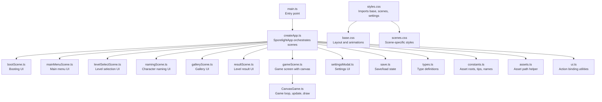
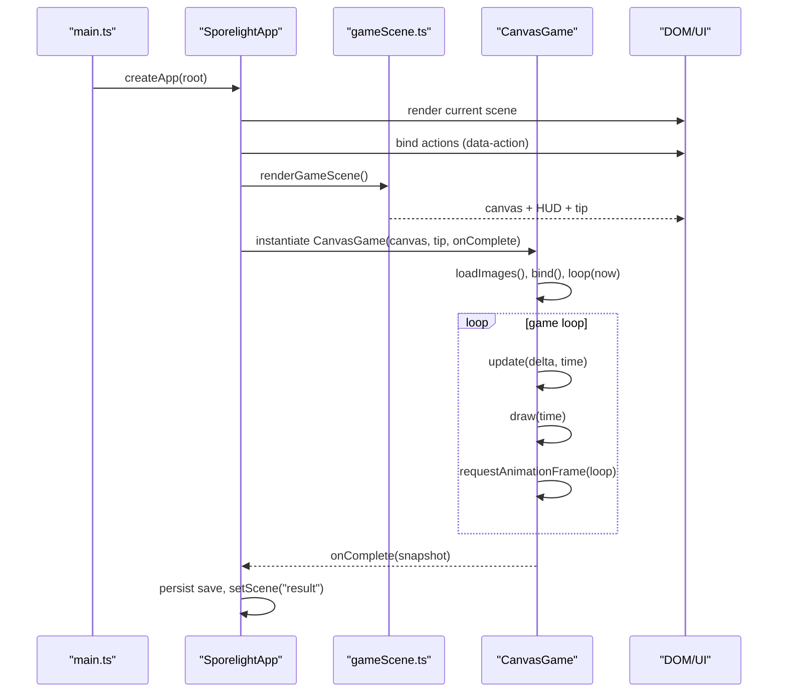
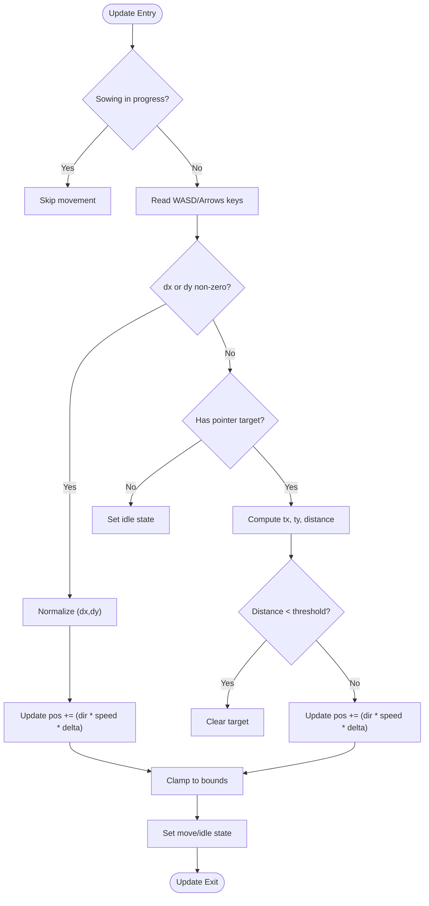
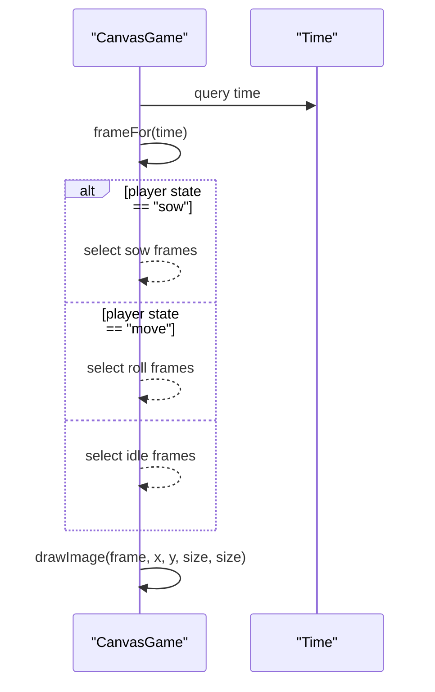
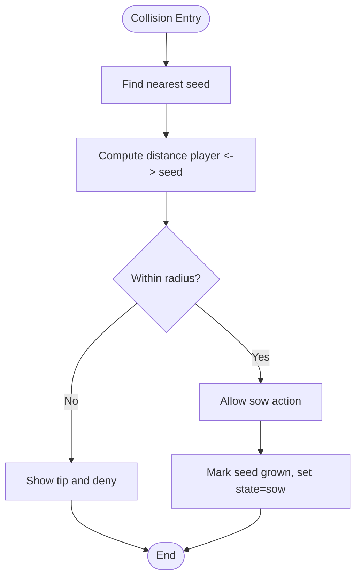
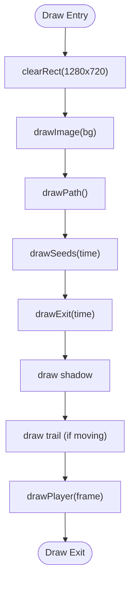
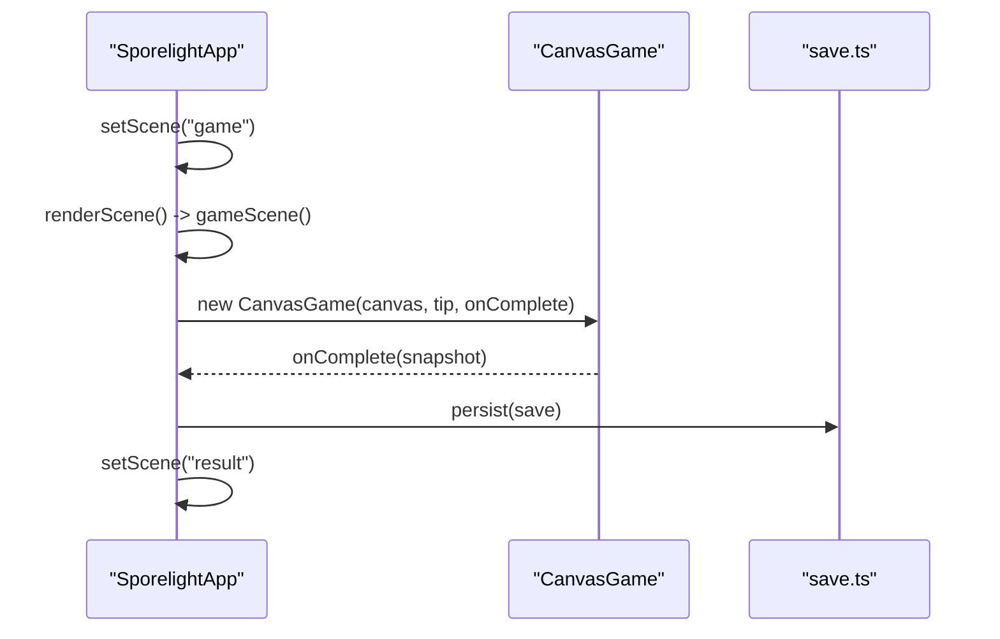
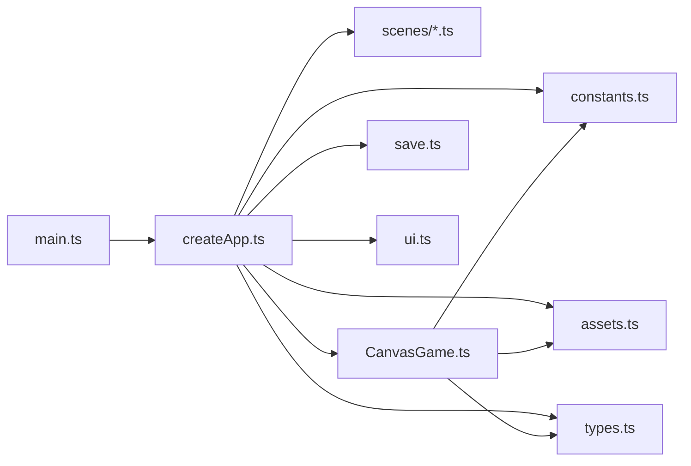

# Extending Game Mechanics

<cite>
**Referenced Files in This Document**
- [CanvasGame.ts](file://src/app/game/CanvasGame.ts)
- [createApp.ts](file://src/app/createApp.ts)
- [gameScene.ts](file://src/app/scenes/gameScene.ts)
- [types.ts](file://src/app/types.ts)
- [constants.ts](file://src/app/constants.ts)
- [assets.ts](file://src/app/assets.ts)
- [save.ts](file://src/app/save.ts)
- [ui.ts](file://src/app/ui.ts)
- [main.ts](file://src/main.ts)
- [styles.css](file://src/styles.css)
- [base.css](file://src/styles/base.css)
- [scenes.css](file://src/styles/scenes.css)
- [package.json](file://package.json)
</cite>

## Table of Contents
1. [Introduction](#introduction)
2. [Project Structure](#project-structure)
3. [Core Components](#core-components)
4. [Architecture Overview](#architecture-overview)
5. [Detailed Component Analysis](#detailed-component-analysis)
6. [Dependency Analysis](#dependency-analysis)
7. [Performance Considerations](#performance-considerations)
8. [Troubleshooting Guide](#troubleshooting-guide)
9. [Conclusion](#conclusion)
10. [Appendices](#appendices)

## Introduction
This document explains how to extend SporeLight’s game mechanics with a focus on the CanvasGame architecture. It covers modifying core gameplay systems such as character movement physics, collision detection, animation frame management, and environmental interactions. It also documents how to integrate new mechanics into the existing game loop, state management, and rendering pipeline, along with performance optimization, memory management, debugging, and compatibility considerations.

## Project Structure
SporeLight is a browser-based HTML5 game built with TypeScript and vanilla Canvas. The runtime is organized around a small set of modules:
- Application bootstrap and scene orchestration
- Game scene and canvas rendering
- State management and persistence
- UI bindings and settings modal
- Asset loading helpers
- Styles and responsive layout



**Diagram sources**
- [main.ts:1-11](file://src/main.ts#L1-L11)
- [createApp.ts:1-377](file://src/app/createApp.ts#L1-L377)
- [gameScene.ts:1-22](file://src/app/scenes/gameScene.ts#L1-L22)
- [CanvasGame.ts:1-318](file://src/app/game/CanvasGame.ts#L1-L318)
- [save.ts:1-67](file://src/app/save.ts#L1-L67)
- [types.ts:1-45](file://src/app/types.ts#L1-L45)
- [constants.ts:1-71](file://src/app/constants.ts#L1-L71)
- [assets.ts:1-4](file://src/app/assets.ts#L1-L4)
- [ui.ts:1-16](file://src/app/ui.ts#L1-L16)
- [styles.css:1-5](file://src/styles.css#L1-L5)
- [base.css:1-190](file://src/styles/base.css#L1-L190)
- [scenes.css:1-452](file://src/styles/scenes.css#L1-L452)

**Section sources**
- [main.ts:1-11](file://src/main.ts#L1-L11)
- [createApp.ts:16-110](file://src/app/createApp.ts#L16-L110)
- [gameScene.ts:3-21](file://src/app/scenes/gameScene.ts#L3-L21)
- [styles.css:1-5](file://src/styles.css#L1-L5)
- [base.css:53-92](file://src/styles/base.css#L53-L92)
- [scenes.css:254-307](file://src/styles/scenes.css#L254-L307)

## Core Components
- CanvasGame: Implements the game loop, input handling, movement physics, animation frame selection, drawing pipeline, and basic environmental interactions (seeds, exit).
- SporelightApp: Manages scenes, binds UI actions, instantiates CanvasGame, persists save data, and coordinates transitions.
- Scene rendering: gameScene.ts provides the canvas and HUD; other scenes provide menus, settings, and UI overlays.
- State and persistence: types.ts defines AppState/GameSnapshot; save.ts loads/persists SaveData to localStorage.
- Asset and constants: assets.ts resolves asset paths; constants.ts centralizes asset roots and UI tips.
- UI utilities: ui.ts binds action handlers via data-action attributes.

Key responsibilities:
- Movement: normalized vector updates with delta time clamping and bounds checking.
- Animation: frame selection based on state and time; wobble and pulsing effects for environment.
- Rendering: layered draw order (background, path, seeds, exit, shadow, trail, player).
- Interactions: pointer click movement, keyboard WASD/Arrows, E to sow; proximity checks for seeds and exit.

**Section sources**
- [CanvasGame.ts:14-47](file://src/app/game/CanvasGame.ts#L14-L47)
- [CanvasGame.ts:134-192](file://src/app/game/CanvasGame.ts#L134-L192)
- [CanvasGame.ts:194-296](file://src/app/game/CanvasGame.ts#L194-L296)
- [CanvasGame.ts:298-316](file://src/app/game/CanvasGame.ts#L298-L316)
- [createApp.ts:101-109](file://src/app/createApp.ts#L101-L109)
- [types.ts:33-44](file://src/app/types.ts#L33-L44)
- [save.ts:49-66](file://src/app/save.ts#L49-L66)
- [assets.ts:1-4](file://src/app/assets.ts#L1-L4)
- [constants.ts:8-9](file://src/app/constants.ts#L8-L9)
- [ui.ts:5-11](file://src/app/ui.ts#L5-L11)

## Architecture Overview
CanvasGame runs inside a dedicated canvas within the game scene. The app lifecycle:
- Entry point initializes the app.
- SporelightApp renders the current scene and binds actions.
- On entering the game scene, a CanvasGame instance is created and starts the game loop.
- The loop alternates between update and draw phases, driven by requestAnimationFrame.
- On completion, the app receives a snapshot and transitions to the result scene.



**Diagram sources**
- [main.ts:10](file://src/main.ts#L10)
- [createApp.ts:101-109](file://src/app/createApp.ts#L101-L109)
- [gameScene.ts:3-21](file://src/app/scenes/gameScene.ts#L3-L21)
- [CanvasGame.ts:32-47](file://src/app/game/CanvasGame.ts#L32-L47)
- [CanvasGame.ts:134-146](file://src/app/game/CanvasGame.ts#L134-L146)
- [createApp.ts:288-303](file://src/app/createApp.ts#L288-L303)

## Detailed Component Analysis

### CanvasGame: Game Loop, Physics, and Rendering
CanvasGame encapsulates:
- State: player position, state machine, seeds, exit, UI tip timers, input keys, target pointer.
- Lifecycle: constructor sets up context, loads images, binds events, starts loop.
- Update: handles state transitions, movement with normalized vectors, delta clamping, bounds, proximity triggers, and completion check.
- Draw: clears canvas, draws background, path, seeds, exit, shadow/trail, and animated player sprite.
- Helpers: frameFor selects animation frames; drawImage safely draws images or fallback rectangles; nearSeed finds closest seed; say displays tips.

```mermaid
classDiagram
class CanvasGame {
-ctx : CanvasRenderingContext2D
-raf : number
-destroyed : boolean
-completed : boolean
-keys : Set<string>
-target : {x,y}?
-player : {x,y,state}
-seeds : Seed[]
-exit : {x,y,active}
-images : Map
-last : number
-sowUntil : number
-messageUntil : number
+constructor(canvas, tip, onComplete)
+destroy()
+sow()
-loadImages()
-bind()
-onKeyDown(event)
-onKeyUp(event)
-loop(time)
-update(delta, time)
-draw(time)
-drawPath()
-drawSeeds(time)
-drawExit(time)
-drawPlayer(time)
-frameFor(time) : string
-drawImage(key, x, y, width, height)
-nearSeed() : Seed?
-say(message)
}
```

**Diagram sources**
- [CanvasGame.ts:14-318](file://src/app/game/CanvasGame.ts#L14-L318)

**Section sources**
- [CanvasGame.ts:14-47](file://src/app/game/CanvasGame.ts#L14-L47)
- [CanvasGame.ts:134-192](file://src/app/game/CanvasGame.ts#L134-L192)
- [CanvasGame.ts:194-296](file://src/app/game/CanvasGame.ts#L194-L296)
- [CanvasGame.ts:298-316](file://src/app/game/CanvasGame.ts#L298-L316)

### Movement Physics and Input Handling
Movement is implemented with:
- Keyboard input: WASD or Arrow keys mapped to dx/dy.
- Pointer input: pointerdown sets a target; the player moves toward it until within threshold.
- Normalized movement: direction vector is normalized and multiplied by speed and delta time.
- Delta clamping: limits maximum frame duration to avoid skipping frames during stalls.
- Bounds: player position clamped to a rectangle.



**Diagram sources**
- [CanvasGame.ts:148-192](file://src/app/game/CanvasGame.ts#L148-L192)

**Section sources**
- [CanvasGame.ts:148-192](file://src/app/game/CanvasGame.ts#L148-L192)

### Animation Frame Management
Animation is time-based and state-driven:
- Player states: idle, move, sow, done.
- frameFor selects frames per state using time modulo frame durations.
- Trail and shadow are drawn conditionally based on state and time.
- Seeds and exit incorporate subtle animations (wobble, pulse) for polish.



**Diagram sources**
- [CanvasGame.ts:258-284](file://src/app/game/CanvasGame.ts#L258-L284)

**Section sources**
- [CanvasGame.ts:258-284](file://src/app/game/CanvasGame.ts#L258-L284)

### Collision Detection and Proximity Interactions
Proximity checks are used for:
- Sowing: nearSeed computes Euclidean distance to seeds.
- Completion: hypot distance to exit determines level completion.
- Path visibility: seed growth affects path curve continuation.



**Diagram sources**
- [CanvasGame.ts:298-300](file://src/app/game/CanvasGame.ts#L298-L300)
- [CanvasGame.ts:56-74](file://src/app/game/CanvasGame.ts#L56-L74)

**Section sources**
- [CanvasGame.ts:56-74](file://src/app/game/CanvasGame.ts#L56-L74)
- [CanvasGame.ts:187-191](file://src/app/game/CanvasGame.ts#L187-L191)
- [CanvasGame.ts:214-216](file://src/app/game/CanvasGame.ts#L214-L216)

### Environmental Interactions and Drawing Pipeline
Drawing order and effects:
- Background fills the canvas.
- Path is drawn as a stroke with quadratic curves; grows with seed.
- Seeds show soil and overlay (moss/vine); grown seeds emit rings.
- Exit pulses when active.
- Player shadow and trail are drawn beneath/under the sprite.
- Tip text is shown temporarily.



**Diagram sources**
- [CanvasGame.ts:194-201](file://src/app/game/CanvasGame.ts#L194-L201)
- [CanvasGame.ts:203-220](file://src/app/game/CanvasGame.ts#L203-L220)
- [CanvasGame.ts:222-240](file://src/app/game/CanvasGame.ts#L222-L240)
- [CanvasGame.ts:242-256](file://src/app/game/CanvasGame.ts#L242-L256)
- [CanvasGame.ts:258-269](file://src/app/game/CanvasGame.ts#L258-L269)

**Section sources**
- [CanvasGame.ts:194-201](file://src/app/game/CanvasGame.ts#L194-L201)
- [CanvasGame.ts:203-269](file://src/app/game/CanvasGame.ts#L203-L269)

### State Management Integration
SporelightApp integrates CanvasGame with the global state:
- Scene transitions trigger CanvasGame instantiation or destruction.
- Actions bind UI buttons to state changes and CanvasGame methods.
- On completion, CanvasGame passes a snapshot to SporelightApp, which updates save data and navigates to the result scene.



**Diagram sources**
- [createApp.ts:101-109](file://src/app/createApp.ts#L101-L109)
- [createApp.ts:288-303](file://src/app/createApp.ts#L288-L303)
- [save.ts:64-66](file://src/app/save.ts#L64-L66)

**Section sources**
- [createApp.ts:101-109](file://src/app/createApp.ts#L101-L109)
- [createApp.ts:288-303](file://src/app/createApp.ts#L288-L303)
- [types.ts:33-36](file://src/app/types.ts#L33-L36)

## Dependency Analysis
High-level dependencies:
- main.ts depends on createApp.ts.
- createApp.ts depends on scenes, CanvasGame, save, types, constants, assets, ui.
- CanvasGame depends on constants for asset roots, assets for path resolution, and types for GameSnapshot.
- UI utilities bind actions via data-action attributes, which SporelightApp wires to state transitions and CanvasGame methods.



**Diagram sources**
- [main.ts:1-11](file://src/main.ts#L1-L11)
- [createApp.ts:1-20](file://src/app/createApp.ts#L1-L20)
- [CanvasGame.ts:1-6](file://src/app/game/CanvasGame.ts#L1-L6)
- [save.ts:1-3](file://src/app/save.ts#L1-L3)
- [types.ts:1-4](file://src/app/types.ts#L1-L4)
- [constants.ts:1-7](file://src/app/constants.ts#L1-L7)
- [assets.ts:1-4](file://src/app/assets.ts#L1-L4)
- [ui.ts:1-3](file://src/app/ui.ts#L1-L3)

**Section sources**
- [main.ts:1-11](file://src/main.ts#L1-L11)
- [createApp.ts:1-20](file://src/app/createApp.ts#L1-L20)
- [CanvasGame.ts:1-6](file://src/app/game/CanvasGame.ts#L1-L6)

## Performance Considerations
- Frame pacing: delta is clamped to a maximum to prevent large jumps; keep update logic O(1) per frame.
- Rendering: drawImage checks image completeness; otherwise, a fallback rectangle is drawn to avoid undefined rendering.
- Animation: time-based modulo frame selection avoids reliance on frame rate; keep frame counts modest.
- Input handling: Set-based key tracking prevents repeated key processing; pointer target is cleared when reached.
- Memory: Images are cached in a Map keyed by asset identifiers; avoid creating new image objects per frame.
- DOM and UI: Action binding uses data-action selectors; ensure cleanup on scene changes to avoid event leaks.

Practical tips:
- Minimize allocations in update/draw loops (reuse objects, avoid closures in hot paths).
- Prefer precomputed constants and early exits for collision checks.
- Use requestAnimationFrame consistently; cancel on destroy to prevent orphaned callbacks.

**Section sources**
- [CanvasGame.ts:139](file://src/app/game/CanvasGame.ts#L139)
- [CanvasGame.ts:286-296](file://src/app/game/CanvasGame.ts#L286-L296)
- [createApp.ts:316-319](file://src/app/createApp.ts#L316-L319)

## Troubleshooting Guide
Common issues and remedies:
- Canvas not supported: constructor throws if 2D context is unavailable; ensure the canvas element exists and is attached.
- Missing assets: drawImage falls back to a colored rectangle if images are not yet loaded; verify asset paths and asset loader.
- Input not responding: ensure bind() is called and event listeners are attached; verify key mappings and that the canvas is focused if pointer events require it.
- Stuttering or skipping: delta clamping prevents large deltas; if still noticeable, profile update cost and reduce per-frame work.
- Completion not detected: verify exit active flag and distance thresholds; ensure completion state is set and snapshot passed to onComplete.
- Settings not persisting: confirm persistSave is called after state changes; check localStorage availability.

Debugging steps:
- Log time deltas and frame counts to detect irregularities.
- Temporarily disable animations to isolate performance bottlenecks.
- Add console logs in update and draw to trace state transitions and rendering order.

**Section sources**
- [CanvasGame.ts:37-44](file://src/app/game/CanvasGame.ts#L37-L44)
- [CanvasGame.ts:286-296](file://src/app/game/CanvasGame.ts#L286-L296)
- [createApp.ts:215-217](file://src/app/createApp.ts#L215-L217)

## Conclusion
CanvasGame provides a compact, extensible foundation for SporeLight’s gameplay. By leveraging the established game loop, state machine, and rendering pipeline, you can add new mechanics—such as new plant growth behaviors, puzzle elements, environmental effects, and interactive objects—while preserving performance and compatibility. Integrate new features through the existing update/draw phases, maintain clean separation of concerns, and rely on the centralized state and UI binding system for seamless integration.

## Appendices

### Practical Extension Recipes
- New plant growth behavior
  - Add a new Seed type and associated world assets.
  - Extend the seed array and draw logic; introduce a new overlay image for the grown state.
  - Modify sow() to mark the new seed type and update completion conditions.
  - Keep drawOrder consistent: soil base, overlay, optional glow/ring.

- New puzzle element
  - Define a new interactive object with position and state.
  - Add proximity checks in update() similar to nearSeed().
  - Trigger state changes and effects; ensure completion or progression logic integrates with the snapshot.

- Custom environmental effect
  - Add a new draw phase after background but before player (e.g., particle layer).
  - Use time-based alpha or scaling for subtle animations.
  - Reuse drawImage with a fallback to avoid undefined textures.

- Interactive object integration
  - Bind a UI action to a method on CanvasGame (e.g., activateObject()).
  - Wire the action in SporelightApp so it calls the method on the active CanvasGame instance.
  - Persist any state changes via the save system if needed.

Compatibility and maintenance:
- Keep asset paths centralized via assets.ts and constants.ts.
- Use data-action for UI wiring to avoid tight coupling.
- Preserve the update/draw contract: minimal work per frame, deterministic state transitions.

**Section sources**
- [CanvasGame.ts:22-31](file://src/app/game/CanvasGame.ts#L22-L31)
- [CanvasGame.ts:56-74](file://src/app/game/CanvasGame.ts#L56-L74)
- [CanvasGame.ts:194-201](file://src/app/game/CanvasGame.ts#L194-L201)
- [createApp.ts:97-98](file://src/app/createApp.ts#L97-L98)
- [assets.ts:1-4](file://src/app/assets.ts#L1-L4)
- [constants.ts:4-9](file://src/app/constants.ts#L4-L9)