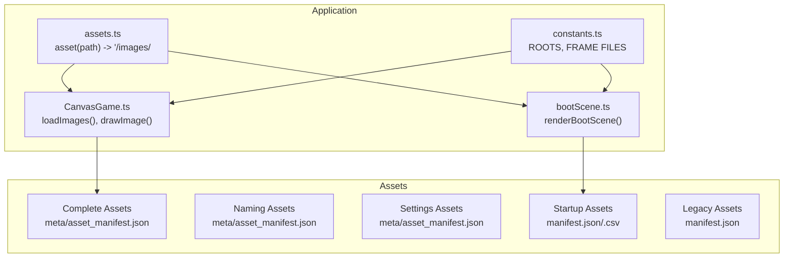
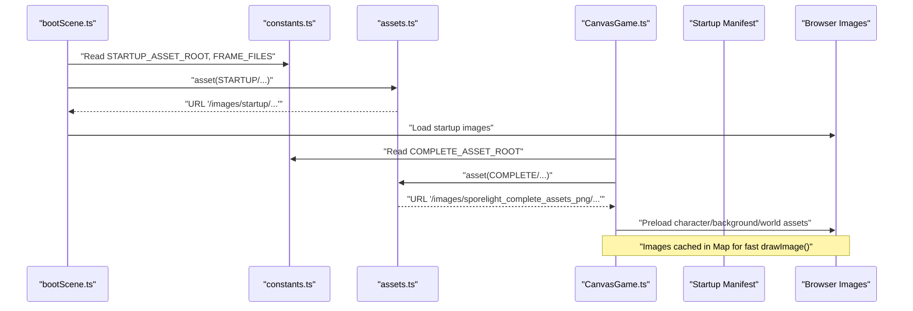
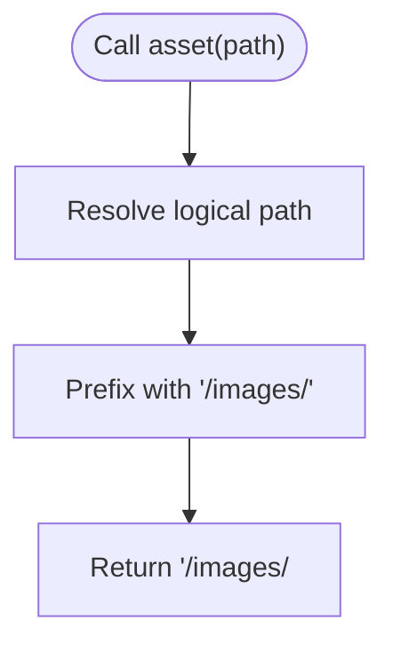
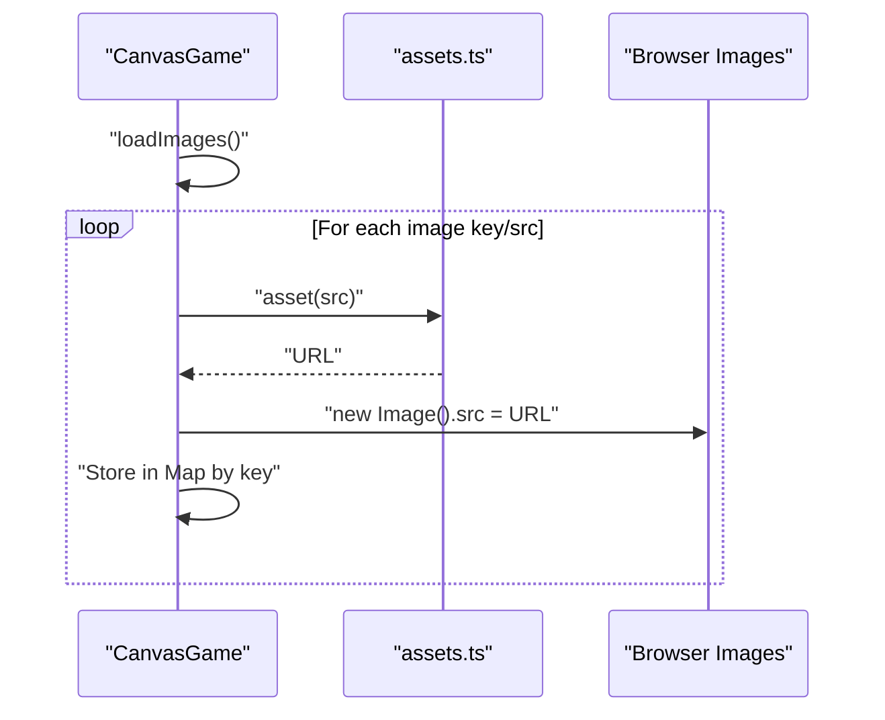
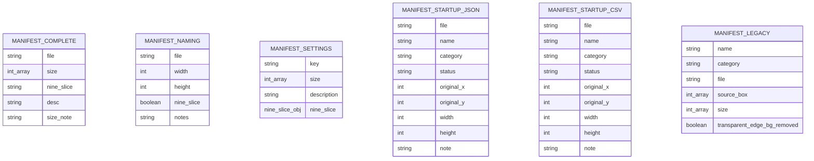
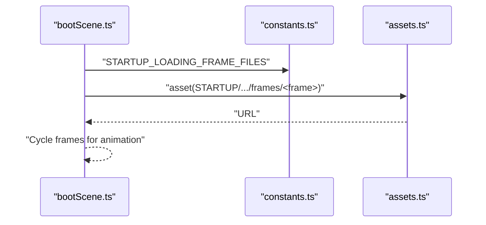
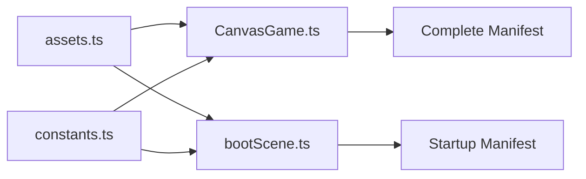

# Asset Management

<cite>
**Referenced Files in This Document**
- [assets.ts](file://src/app/assets.ts)
- [constants.ts](file://src/app/constants.ts)
- [CanvasGame.ts](file://src/app/game/CanvasGame.ts)
- [bootScene.ts](file://src/app/scenes/bootScene.ts)
- [asset_manifest.json (Complete Assets)](file://assets/images/sporelight_complete_assets_png/meta/asset_manifest.json)
- [asset_manifest.json (Naming Assets)](file://assets/images/sporelight_naming_page_assets/meta/asset_manifest.json)
- [asset_manifest.json (Settings Assets)](file://assets/images/sporelight_settings_popup_assets/sporelight_settings_assets/meta/asset_manifest.json)
- [manifest.json (Startup Assets)](file://assets/images/startup_page_assets_assets_only_png/manifest.json)
- [manifest.csv (Startup Assets)](file://assets/images/startup_page_assets_assets_only_png/manifest.csv)
- [manifest.json (Legacy Assets)](file://assets/images_old/sporelight_sliced_assets_web/manifest.json)
- [README_命名页切图说明.md](file://assets/images/sporelight_naming_page_assets/README_命名页切图说明.md)
</cite>

## Table of Contents
1. [Introduction](#introduction)
2. [Project Structure](#project-structure)
3. [Core Components](#core-components)
4. [Architecture Overview](#architecture-overview)
5. [Detailed Component Analysis](#detailed-component-analysis)
6. [Dependency Analysis](#dependency-analysis)
7. [Performance Considerations](#performance-considerations)
8. [Troubleshooting Guide](#troubleshooting-guide)
9. [Conclusion](#conclusion)
10. [Appendices](#appendices)

## Introduction
This document explains SporeLight’s asset management system. It covers how asset paths are resolved, how assets are centrally loaded, and how manifests organize resources. It also documents sprite sheet handling, image categorization, legacy asset support, constants and naming conventions, lazy loading strategies, caching, memory management for large images, and the relationship between assets and the canvas rendering pipeline, including batching and texture optimization.

## Project Structure
Assets are organized under assets/images with multiple roots:
- Complete game assets: sporelight_complete_assets_png
- Naming screen assets: sporelight_naming_page_assets
- Settings popup assets: sporelight_settings_popup_assets/sporelight_settings_assets
- Startup screen assets: startup_page_assets_assets_only_png
- Legacy assets: assets/images_old/sporelight_sliced_assets_web

Each major asset group includes a manifest (JSON or CSV) describing images, categories, sizes, and nine-slice metadata. The application resolves asset URLs via a central resolver and loads images into memory for fast rendering.

**Diagram sources**
- [assets.ts:1-3](file://src/app/assets.ts#L1-L3)
- [constants.ts:4-51](file://src/app/constants.ts#L4-L51)
- [CanvasGame.ts:76-102](file://src/app/game/CanvasGame.ts#L76-L102)
- [bootScene.ts:19-64](file://src/app/scenes/bootScene.ts#L19-L64)
- [asset_manifest.json (Complete Assets):1-1472](file://assets/images/sporelight_complete_assets_png/meta/asset_manifest.json#L1-L1472)
- [asset_manifest.json (Naming Assets):1-212](file://assets/images/sporelight_naming_page_assets/meta/asset_manifest.json#L1-L212)
- [asset_manifest.json (Settings Assets):1-653](file://assets/images/sporelight_settings_popup_assets/sporelight_settings_assets/meta/asset_manifest.json#L1-L653)
- [manifest.json (Startup Assets):1-266](file://assets/images/startup_page_assets_assets_only_png/manifest.json#L1-L266)
- [manifest.json (Legacy Assets):1-800](file://assets/images_old/sporelight_sliced_assets_web/manifest.json#L1-L800)

**Section sources**
- [assets.ts:1-3](file://src/app/assets.ts#L1-L3)
- [constants.ts:4-51](file://src/app/constants.ts#L4-L51)
- [asset_manifest.json (Complete Assets):1-1472](file://assets/images/sporelight_complete_assets_png/meta/asset_manifest.json#L1-L1472)
- [asset_manifest.json (Naming Assets):1-212](file://assets/images/sporelight_naming_page_assets/meta/asset_manifest.json#L1-L212)
- [asset_manifest.json (Settings Assets):1-653](file://assets/images/sporelight_settings_popup_assets/sporelight_settings_assets/meta/asset_manifest.json#L1-L653)
- [manifest.json (Startup Assets):1-266](file://assets/images/startup_page_assets_assets_only_png/manifest.json#L1-L266)
- [manifest.json (Legacy Assets):1-800](file://assets/images_old/sporelight_sliced_assets_web/manifest.json#L1-L800)

## Core Components
- Central asset path resolver: transforms logical asset paths into web-accessible URLs.
- Constants module: defines root asset folders and startup loading frame sequences.
- Manifests: describe assets with metadata (size, nine-slice, notes) enabling UI layout and scaling.
- Loading strategy: preloads critical images at boot and gameplay initialization.
- Rendering integration: draws images with fallbacks while checking completion and natural dimensions.

Key responsibilities:
- Path resolution: asset(path) prepends "/images/".
- Root definitions: COMPLETE_ASSET_ROOT, NAMING_ASSET_ROOT, STARTUP_ASSET_ROOT.
- Startup loading frames: STARTUP_LOADING_FRAME_FILES.
- Preloading: CanvasGame.loadImages() and bootScene rendering.

**Section sources**
- [assets.ts:1-3](file://src/app/assets.ts#L1-L3)
- [constants.ts:4-51](file://src/app/constants.ts#L4-L51)
- [CanvasGame.ts:76-102](file://src/app/game/CanvasGame.ts#L76-L102)
- [bootScene.ts:19-64](file://src/app/scenes/bootScene.ts#L19-L64)

## Architecture Overview
The asset pipeline follows a centralized resolution and loading pattern:
- Scenes and game code request assets using logical paths.
- constants.ts provides root names and frame lists.
- assets.ts resolves logical paths to "/images/<root>/<path>".
- Manifests guide categorization and sizing; legacy manifests provide slicing info.
- Images are stored in memory for immediate drawing.

**Diagram sources**
- [bootScene.ts:19-64](file://src/app/scenes/bootScene.ts#L19-L64)
- [constants.ts:4-51](file://src/app/constants.ts#L4-L51)
- [assets.ts:1-3](file://src/app/assets.ts#L1-L3)
- [CanvasGame.ts:76-102](file://src/app/game/CanvasGame.ts#L76-L102)

## Detailed Component Analysis

### Asset Path Resolution
- Purpose: Normalize asset URLs across roots and environments.
- Behavior: Prepend "/images/" to any logical path.
- Usage: Called by scenes and game code to obtain absolute URLs.

**Diagram sources**
- [assets.ts:1-3](file://src/app/assets.ts#L1-L3)

**Section sources**
- [assets.ts:1-3](file://src/app/assets.ts#L1-L3)

### Centralized Asset Loading Strategy
- CanvasGame.loadImages(): Preloads all required images for gameplay.
- bootScene.renderBootScene(): Renders startup visuals and loading UI.
- Both rely on constants for root names and frame sequences.

**Diagram sources**
- [CanvasGame.ts:76-102](file://src/app/game/CanvasGame.ts#L76-L102)
- [assets.ts:1-3](file://src/app/assets.ts#L1-L3)

**Section sources**
- [CanvasGame.ts:76-102](file://src/app/game/CanvasGame.ts#L76-L102)
- [bootScene.ts:19-64](file://src/app/scenes/bootScene.ts#L19-L64)

### Manifest-Based Resource Organization
Manifests define assets per category and include metadata:
- Complete assets: array of entries with file, size, nine_slice, desc, size_note.
- Naming assets: array with file, width, height, nine_slice, notes.
- Settings assets: dictionary keyed by file path with size, description, nine_slice (object or null).
- Startup assets: JSON and CSV manifests with fields like file, name, category, status, original_* and note.

**Diagram sources**
- [asset_manifest.json (Complete Assets):1-1472](file://assets/images/sporelight_complete_assets_png/meta/asset_manifest.json#L1-L1472)
- [asset_manifest.json (Naming Assets):1-212](file://assets/images/sporelight_naming_page_assets/meta/asset_manifest.json#L1-L212)
- [asset_manifest.json (Settings Assets):1-653](file://assets/images/sporelight_settings_popup_assets/sporelight_settings_assets/meta/asset_manifest.json#L1-L653)
- [manifest.json (Startup Assets):1-266](file://assets/images/startup_page_assets_assets_only_png/manifest.json#L1-L266)
- [manifest.csv (Startup Assets):1-26](file://assets/images/startup_page_assets_assets_only_png/manifest.csv#L1-L26)
- [manifest.json (Legacy Assets):1-800](file://assets/images_old/sporelight_sliced_assets_web/manifest.json#L1-L800)

**Section sources**
- [asset_manifest.json (Complete Assets):1-1472](file://assets/images/sporelight_complete_assets_png/meta/asset_manifest.json#L1-L1472)
- [asset_manifest.json (Naming Assets):1-212](file://assets/images/sporelight_naming_page_assets/meta/asset_manifest.json#L1-L212)
- [asset_manifest.json (Settings Assets):1-653](file://assets/images/sporelight_settings_popup_assets/sporelight_settings_assets/meta/asset_manifest.json#L1-L653)
- [manifest.json (Startup Assets):1-266](file://assets/images/startup_page_assets_assets_only_png/manifest.json#L1-L266)
- [manifest.csv (Startup Assets):1-26](file://assets/images/startup_page_assets_assets_only_png/manifest.csv#L1-L26)
- [manifest.json (Legacy Assets):1-800](file://assets/images_old/sporelight_sliced_assets_web/manifest.json#L1-L800)

### Sprite Sheet Management
- Startup loading uses a sprite sequence for the animated bar fill.
- The sequence is defined in constants and rendered by bootScene.
- This avoids loading many small images individually, reducing HTTP overhead.

**Diagram sources**
- [bootScene.ts:19-64](file://src/app/scenes/bootScene.ts#L19-L64)
- [constants.ts:10-51](file://src/app/constants.ts#L10-L51)
- [assets.ts:1-3](file://src/app/assets.ts#L1-L3)

**Section sources**
- [bootScene.ts:19-64](file://src/app/scenes/bootScene.ts#L19-L64)
- [constants.ts:10-51](file://src/app/constants.ts#L10-L51)

### Image Asset Categorization and Nine-Slice Metadata
- Complete and Naming manifests include nine_slice flags and notes to guide UI scaling.
- Settings manifest includes nine_slice as an object with insets for precise tiling.
- These fields inform whether an image supports nine-slice scaling and recommended insets.

Practical implications:
- UI controls can be scaled efficiently when nine_slice is enabled.
- Layout systems can avoid distorting critical areas.

**Section sources**
- [asset_manifest.json (Complete Assets):1-1472](file://assets/images/sporelight_complete_assets_png/meta/asset_manifest.json#L1-L1472)
- [asset_manifest.json (Naming Assets):1-212](file://assets/images/sporelight_naming_page_assets/meta/asset_manifest.json#L1-L212)
- [asset_manifest.json (Settings Assets):1-653](file://assets/images/sporelight_settings_popup_assets/sporelight_settings_assets/meta/asset_manifest.json#L1-L653)

### Legacy Asset Support
- Legacy manifest provides source boxes and sizes for sliced sprites.
- Useful for maintaining compatibility and reusing older art assets.
- Can be combined with modern manifests for gradual migration.

**Section sources**
- [manifest.json (Legacy Assets):1-800](file://assets/images_old/sporelight_sliced_assets_web/manifest.json#L1-L800)

### Asset Constants Configuration and Naming Conventions
- Root paths: COMPLETE_ASSET_ROOT, NAMING_ASSET_ROOT, STARTUP_ASSET_ROOT.
- Startup frame sequence: STARTUP_LOADING_FRAME_FILES.
- Naming convention: asset_manifest.json and manifest.json/csv indicate folder structure and naming patterns.

Best practices:
- Keep logical paths under each root consistent with manifest categories.
- Use descriptive names in manifests to simplify UI layout and scaling.

**Section sources**
- [constants.ts:4-51](file://src/app/constants.ts#L4-L51)
- [README_命名页切图说明.md:1-18](file://assets/images/sporelight_naming_page_assets/README_命名页切图说明.md#L1-L18)

### Lazy Loading Strategies
- Current implementation preloads assets during boot and initialization.
- Recommended lazy loading patterns:
  - Load assets on-demand when a scene becomes active.
  - Use placeholders and progressive enhancement for non-critical assets.
  - Implement asset pools to reuse frequently used images.

[No sources needed since this section provides general guidance]

### Asset Caching and Memory Management
- Loaded images are cached in a Map keyed by logical identifiers.
- drawImage() checks image.complete and naturalWidth before drawing, falling back to a placeholder otherwise.
- For large images, consider:
  - Using appropriately sized assets aligned with intended display sizes.
  - Reusing textures and minimizing redundant copies.
  - Monitoring memory usage and unloading unused assets when appropriate.

**Section sources**
- [CanvasGame.ts:27-28](file://src/app/game/CanvasGame.ts#L27-L28)
- [CanvasGame.ts:286-296](file://src/app/game/CanvasGame.ts#L286-L296)

### Relationship to Canvas Rendering System
- CanvasGame stores images in a Map and draws them via drawImage().
- Rendering uses globalAlpha and other canvas state for effects.
- Batching: Draw calls are sequential; grouping similar draw operations can reduce state changes.
- Texture optimization: Keep atlas-like layouts for frequently drawn sprites; minimize texture switches.

**Section sources**
- [CanvasGame.ts:27-28](file://src/app/game/CanvasGame.ts#L27-L28)
- [CanvasGame.ts:194-201](file://src/app/game/CanvasGame.ts#L194-L201)
- [CanvasGame.ts:286-296](file://src/app/game/CanvasGame.ts#L286-L296)

## Dependency Analysis
- assets.ts depends on no external modules; it is a pure URL builder.
- constants.ts provides shared configuration for roots and frame sequences.
- CanvasGame.ts depends on constants and assets.ts; it manages image loading and drawing.
- bootScene.ts depends on constants and assets.ts; it renders startup visuals.
- Manifests are consumed indirectly by UI/layout code and are authoritative for sizing and nine-slice metadata.

**Diagram sources**
- [assets.ts:1-3](file://src/app/assets.ts#L1-L3)
- [constants.ts:4-51](file://src/app/constants.ts#L4-L51)
- [CanvasGame.ts:76-102](file://src/app/game/CanvasGame.ts#L76-L102)
- [bootScene.ts:19-64](file://src/app/scenes/bootScene.ts#L19-L64)
- [asset_manifest.json (Complete Assets):1-1472](file://assets/images/sporelight_complete_assets_png/meta/asset_manifest.json#L1-L1472)
- [manifest.json (Startup Assets):1-266](file://assets/images/startup_page_assets_assets_only_png/manifest.json#L1-L266)

**Section sources**
- [assets.ts:1-3](file://src/app/assets.ts#L1-L3)
- [constants.ts:4-51](file://src/app/constants.ts#L4-L51)
- [CanvasGame.ts:76-102](file://src/app/game/CanvasGame.ts#L76-L102)
- [bootScene.ts:19-64](file://src/app/scenes/bootScene.ts#L19-L64)

## Performance Considerations
- Minimize HTTP requests by grouping assets and using sprite sequences where applicable.
- Cache assets aggressively; avoid reloading images unnecessarily.
- Prefer assets sized close to their display size to reduce scaling costs.
- Use nine-slice scaling for UI elements to avoid distortion and repeated artwork.
- Batch draw calls and reduce texture state changes in canvas rendering.

[No sources needed since this section provides general guidance]

## Troubleshooting Guide
Common issues and resolutions:
- Asset not found:
  - Verify the logical path matches the root and folder structure.
  - Confirm asset(path) is used consistently.
- Incorrect nine-slice behavior:
  - Check nine_slice flags in the manifest for the target asset.
  - Ensure UI layout respects insets and does not stretch critical regions.
- Blurry or pixelated images:
  - Use assets sized to the intended display size.
  - Avoid excessive scaling in CSS or canvas draw operations.
- Slow initial load:
  - Consider deferring non-critical assets.
  - Optimize manifest categories to load only what is needed first.
- Canvas rendering fallback:
  - drawImage() falls back to a placeholder when images are not ready; ensure assets are preloaded for critical scenes.

**Section sources**
- [assets.ts:1-3](file://src/app/assets.ts#L1-L3)
- [CanvasGame.ts:286-296](file://src/app/game/CanvasGame.ts#L286-L296)

## Conclusion
SporeLight’s asset management centers on a simple, reliable path resolver and a set of structured manifests. The system preloads essential assets for smooth gameplay and startup visuals, leverages sprite sequences for performance, and provides metadata for proper UI scaling. By adhering to naming conventions, leveraging manifests, and applying caching and batching strategies, developers can maintain a scalable and efficient asset pipeline.

## Appendices

### Practical Examples

- Adding a new image asset:
  - Place the image under the appropriate root (e.g., backgrounds/, characters/, ui/).
  - Update the corresponding manifest with file, size, nine_slice, and notes.
  - Reference the asset using asset(root/path) in code.

- Updating a manifest:
  - Modify the JSON or CSV manifest to reflect new assets or changes in categories.
  - Ensure widths/heights and nine_slice settings match the visual intent.

- Implementing asset preloading:
  - Extend CanvasGame.loadImages() to include new keys and sources.
  - Ensure all preloaded assets are used to avoid cache bloat.

- Implementing asset lazy loading:
  - Load assets on scene activation.
  - Use placeholders and progressive enhancement for non-critical assets.

- Troubleshooting asset loading:
  - Confirm asset URLs resolve correctly with asset().
  - Validate nine_slice settings and UI layout.
  - Monitor canvas fallback behavior and preload critical assets.

[No sources needed since this section provides general guidance]