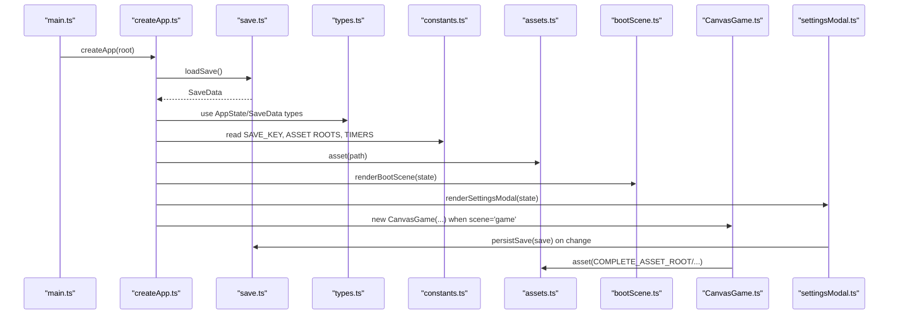
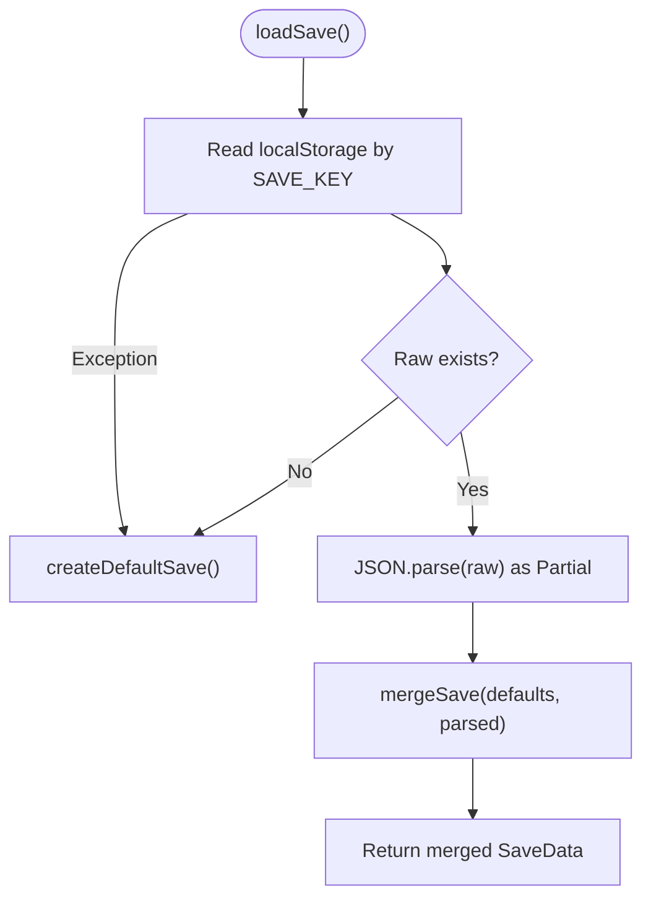
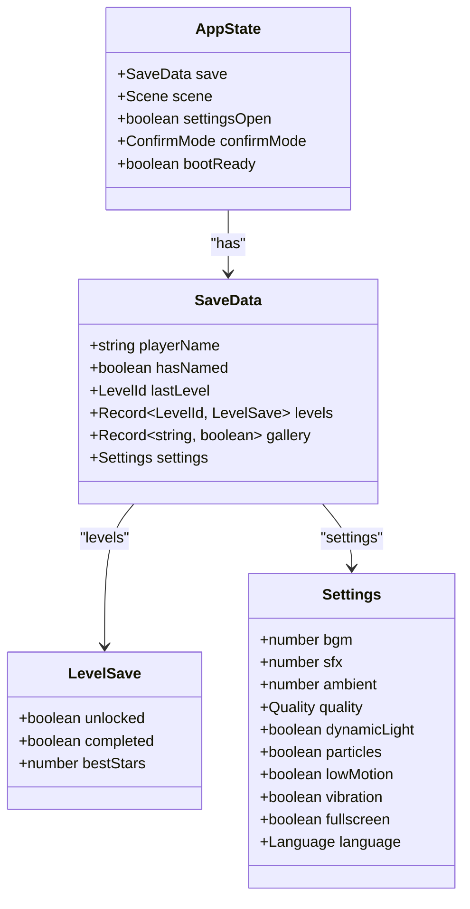
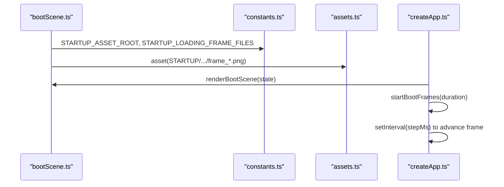
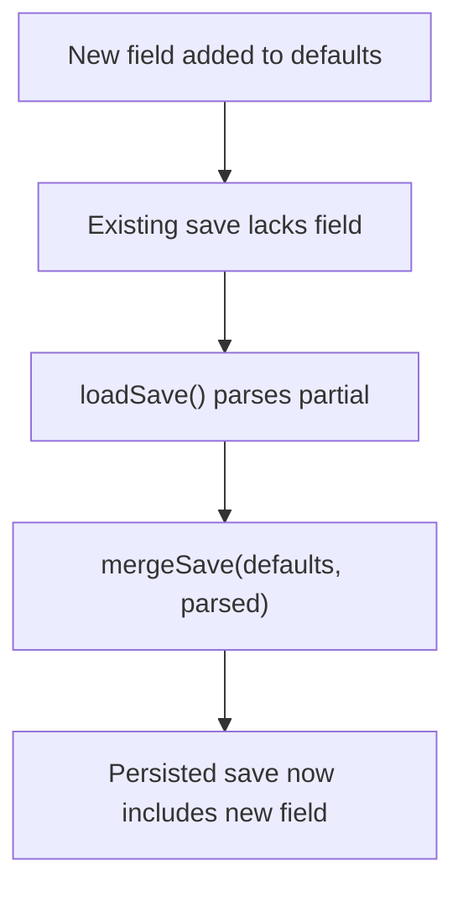
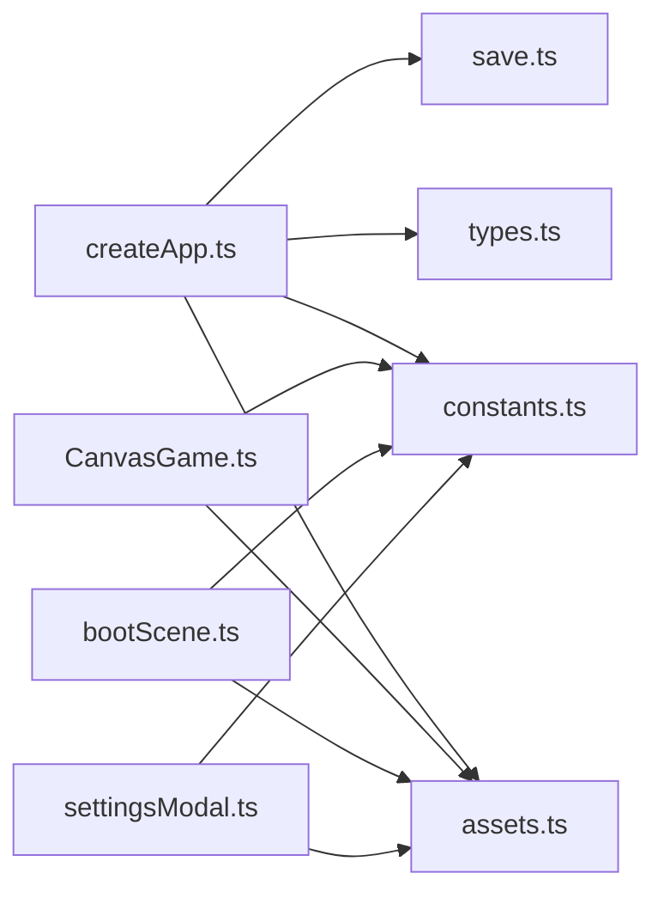

# Data Management

<cite>
**Referenced Files in This Document**
- [save.ts](file://src/app/save.ts)
- [types.ts](file://src/app/types.ts)
- [constants.ts](file://src/app/constants.ts)
- [assets.ts](file://src/app/assets.ts)
- [createApp.ts](file://src/app/createApp.ts)
- [CanvasGame.ts](file://src/app/game/CanvasGame.ts)
- [bootScene.ts](file://src/app/scenes/bootScene.ts)
- [settingsModal.ts](file://src/app/components/settingsModal.ts)
- [main.ts](file://src/main.ts)
- [asset_manifest.json (complete)](file://assets/images/sporelight_complete_assets_png/meta/asset_manifest.json)
- [asset_manifest.json (naming)](file://assets/images/sporelight_naming_page_assets/meta/asset_manifest.json)
- [manifest.json (startup)](file://assets/images/startup_page_assets_assets_only_png/manifest.json)
</cite>

## Table of Contents
1. [Introduction](#introduction)
2. [Project Structure](#project-structure)
3. [Core Components](#core-components)
4. [Architecture Overview](#architecture-overview)
5. [Detailed Component Analysis](#detailed-component-analysis)
6. [Dependency Analysis](#dependency-analysis)
7. [Performance Considerations](#performance-considerations)
8. [Troubleshooting Guide](#troubleshooting-guide)
9. [Conclusion](#conclusion)
10. [Appendices](#appendices)

## Introduction
This document explains SporeLight’s data management systems with a focus on:
- Save system architecture: SaveData structure, localStorage integration, migration and fallback, and error recovery
- Asset management: asset path resolution, manifest processing, lazy loading strategies, and performance optimization
- TypeScript interfaces: AppState and SaveData, validation rules, and business logic constraints
- Constants system: global configuration values, asset roots, timing values, and defaults
- Persistence patterns, backup strategies, and migration procedures for save file updates across versions

## Project Structure
The data management layer spans several modules:
- Save and state: save.ts, types.ts, constants.ts
- Asset path resolution: assets.ts
- Runtime app orchestration and persistence: createApp.ts
- Scenes and components that consume assets: bootScene.ts, CanvasGame.ts, settingsModal.ts
- Manifests for asset metadata: asset manifests under assets/images

```mermaid
graph TB
subgraph "Runtime"
APP["createApp.ts<br/>SporelightApp"]
TYPES["types.ts<br/>AppState, SaveData, enums"]
CONST["constants.ts<br/>SAVE_KEY, ASSET ROOTS, TIMERS"]
ASSETS["assets.ts<br/>asset()"]
end
subgraph "Persistence"
SAVE["save.ts<br/>loadSave(), persistSave(), createDefaultSave()"]
LS["localStorage"]
end
subgraph "Asset Consumers"
BOOT["bootScene.ts"]
GAME["CanvasGame.ts"]
SETTINGS["settingsModal.ts"]
end
subgraph "Assets"
MAN1["complete manifest.json"]
MAN2["naming manifest.json"]
MAN3["startup manifest.json"]
end
APP --> TYPES
APP --> CONST
APP --> ASSETS
APP --> SAVE
SAVE <- --> LS
BOOT --> ASSETS
GAME --> ASSETS
SETTINGS --> ASSETS
ASSETS --> MAN1
ASSETS --> MAN2
ASSETS --> MAN3
```

**Diagram sources**
- [createApp.ts:16-377](file://src/app/createApp.ts#L16-L377)
- [types.ts:1-45](file://src/app/types.ts#L1-L45)
- [constants.ts:1-71](file://src/app/constants.ts#L1-L71)
- [assets.ts:1-4](file://src/app/assets.ts#L1-L4)
- [save.ts:1-67](file://src/app/save.ts#L1-L67)
- [bootScene.ts:1-94](file://src/app/scenes/bootScene.ts#L1-L94)
- [CanvasGame.ts:1-318](file://src/app/game/CanvasGame.ts#L1-L318)
- [settingsModal.ts:1-158](file://src/app/components/settingsModal.ts#L1-L158)
- [asset_manifest.json (complete):1-800](file://assets/images/sporelight_complete_assets_png/meta/asset_manifest.json#L1-L800)
- [asset_manifest.json (naming):1-212](file://assets/images/sporelight_naming_page_assets/meta/asset_manifest.json#L1-L212)
- [manifest.json (startup):1-266](file://assets/images/startup_page_assets_assets_only_png/manifest.json#L1-L266)

**Section sources**
- [createApp.ts:16-377](file://src/app/createApp.ts#L16-L377)
- [save.ts:1-67](file://src/app/save.ts#L1-L67)
- [types.ts:1-45](file://src/app/types.ts#L1-L45)
- [constants.ts:1-71](file://src/app/constants.ts#L1-L71)
- [assets.ts:1-4](file://src/app/assets.ts#L1-L4)

## Core Components
- SaveData and AppState define the persisted and runtime state shapes, including player identity, level progression, gallery unlocks, and settings.
- localStorage-backed persistence provides immediate availability and resilience against page reloads.
- Asset path resolution centralizes asset root prefixes and manifest-driven metadata for robust asset discovery.
- Constants encapsulate global keys, asset roots, timing, and default values.

Key responsibilities:
- Save system: default initialization, merging partial saves, and robust load/persist with fallback.
- Asset system: path construction, on-demand image loading, and UI composition via manifests.
- Types: strict typing for enums, records, and nested settings to enforce validation and constraints.

**Section sources**
- [types.ts:1-45](file://src/app/types.ts#L1-L45)
- [save.ts:4-66](file://src/app/save.ts#L4-L66)
- [constants.ts:1-71](file://src/app/constants.ts#L1-L71)
- [assets.ts:1-4](file://src/app/assets.ts#L1-L4)

## Architecture Overview
The runtime initializes SporelightApp, loads SaveData from localStorage, and renders scenes. Assets are resolved via a single asset() function and consumed by scenes and components. Settings changes trigger immediate persistence.



**Diagram sources**
- [main.ts:1-11](file://src/main.ts#L1-L11)
- [createApp.ts:16-377](file://src/app/createApp.ts#L16-L377)
- [save.ts:49-66](file://src/app/save.ts#L49-L66)
- [types.ts:13-44](file://src/app/types.ts#L13-L44)
- [constants.ts:1-71](file://src/app/constants.ts#L1-L71)
- [assets.ts:1-4](file://src/app/assets.ts#L1-L4)
- [bootScene.ts:19-65](file://src/app/scenes/bootScene.ts#L19-L65)
- [CanvasGame.ts:32-47](file://src/app/game/CanvasGame.ts#L32-L47)
- [settingsModal.ts:10-118](file://src/app/components/settingsModal.ts#L10-L118)

## Detailed Component Analysis

### Save System
- SaveData shape: player identity, level progression, gallery unlocks, and settings.
- Default creation: establishes baseline values and unlocks initial level.
- Load with migration: merges stored partial data into defaults to add missing fields transparently.
- Persist: writes current SaveData to localStorage keyed by SAVE_KEY.
- Fallback and error recovery: invalid or missing data reverts to defaults.



**Diagram sources**
- [save.ts:49-62](file://src/app/save.ts#L49-L62)

**Section sources**
- [save.ts:4-66](file://src/app/save.ts#L4-L66)
- [constants.ts:1-2](file://src/app/constants.ts#L1-L2)
- [types.ts:13-31](file://src/app/types.ts#L13-L31)

### TypeScript Interfaces and Validation Rules
- Enums and literals:
  - Scene union for UI navigation
  - Quality and Language unions
  - LevelId union for levels
  - ConfirmMode for confirmation dialogs
- SaveData:
  - playerName and hasNamed for identity
  - lastLevel for navigation
  - levels as Record<LevelId, LevelSave> with unlocked, completed, bestStars
  - gallery as Record<string, boolean> for unlocks
  - settings with numeric ranges and booleans
- AppState:
  - save: SaveData
  - scene: Scene
  - settingsOpen, confirmMode, bootReady flags

Validation constraints observed in code:
- Name submission validates length and allowed characters.
- Settings sliders normalize 0–100 input to normalized 0–1 range.
- Settings toggles flip booleans.
- Quality selection accepts soft/standard/hd.
- Language selection accepts zh-CN/zh-TW/en.



**Diagram sources**
- [types.ts:1-45](file://src/app/types.ts#L1-L45)

**Section sources**
- [types.ts:1-45](file://src/app/types.ts#L1-L45)
- [createApp.ts:264-286](file://src/app/createApp.ts#L264-L286)
- [createApp.ts:129-163](file://src/app/createApp.ts#L129-L163)

### Asset Management System
- Path resolution: asset(path) prepends "/images/" to asset paths.
- Asset roots: constants expose COMPLETE_ASSET_ROOT, NAMING_ASSET_ROOT, STARTUP_ASSET_ROOT.
- Manifest processing: asset manifests describe assets, sizes, nine-slice, and notes for UI and layout.
- Lazy loading strategies:
  - On-demand image creation in CanvasGame for game assets.
  - Boot sequence animates a loading frame sequence using STARTUP_LOADING_FRAME_FILES.
  - UI scenes compose assets via asset() without preloading.



**Diagram sources**
- [bootScene.ts:1-94](file://src/app/scenes/bootScene.ts#L1-L94)
- [constants.ts:4-51](file://src/app/constants.ts#L4-L51)
- [assets.ts:1-4](file://src/app/assets.ts#L1-L4)
- [createApp.ts:321-351](file://src/app/createApp.ts#L321-L351)

**Section sources**
- [assets.ts:1-4](file://src/app/assets.ts#L1-L4)
- [constants.ts:4-51](file://src/app/constants.ts#L4-L51)
- [CanvasGame.ts:76-102](file://src/app/game/CanvasGame.ts#L76-L102)
- [bootScene.ts:19-65](file://src/app/scenes/bootScene.ts#L19-L65)

### Constants System
- Persistence key: SAVE_KEY
- Defaults: DEFAULT_NAME
- Asset roots: COMPLETE_ASSET_ROOT, NAMING_ASSET_ROOT, STARTUP_ASSET_ROOT
- Timing: BOOT_DURATION_MS, GAME_DEFAULT_TIP
- Startup frames: STARTUP_LOADING_FRAME_FILES array
- Random names: RANDOM_NAMES list

These constants unify configuration and reduce duplication across modules.

**Section sources**
- [constants.ts:1-71](file://src/app/constants.ts#L1-L71)

### Data Persistence Patterns, Backup Strategies, and Migration Procedures
- Persistence pattern:
  - Immediate write on user action or state change.
  - Centralized persistSave() writes SaveData to localStorage.
- Backup strategy:
  - Not implemented in code; recommended offload to external storage or export mechanism.
- Migration procedure:
  - mergeSave() ensures forward compatibility by filling missing fields from defaults.
  - Future-proofing: add new fields to defaults and rely on merge to populate existing saves.



**Diagram sources**
- [save.ts:39-47](file://src/app/save.ts#L39-L47)

**Section sources**
- [save.ts:49-66](file://src/app/save.ts#L49-L66)
- [constants.ts:1-2](file://src/app/constants.ts#L1-L2)

## Dependency Analysis
- createApp.ts depends on save.ts for initial state, constants.ts for keys and asset roots, assets.ts for path resolution, and types.ts for type safety.
- CanvasGame.ts depends on constants.ts for asset roots and assets.ts for path resolution.
- bootScene.ts and settingsModal.ts depend on constants.ts and assets.ts for asset composition.



**Diagram sources**
- [createApp.ts:1-15](file://src/app/createApp.ts#L1-L15)
- [save.ts:1-3](file://src/app/save.ts#L1-L3)
- [types.ts:1-15](file://src/app/types.ts#L1-L15)
- [constants.ts:1-7](file://src/app/constants.ts#L1-L7)
- [assets.ts:1-4](file://src/app/assets.ts#L1-L4)
- [CanvasGame.ts:1-6](file://src/app/game/CanvasGame.ts#L1-L6)
- [bootScene.ts:1-4](file://src/app/scenes/bootScene.ts#L1-L4)
- [settingsModal.ts:1-4](file://src/app/components/settingsModal.ts#L1-L4)

**Section sources**
- [createApp.ts:1-15](file://src/app/createApp.ts#L1-L15)
- [CanvasGame.ts:1-6](file://src/app/game/CanvasGame.ts#L1-L6)
- [bootScene.ts:1-4](file://src/app/scenes/bootScene.ts#L1-L4)
- [settingsModal.ts:1-4](file://src/app/components/settingsModal.ts#L1-L4)

## Performance Considerations
- Boot sequence animation:
  - Uses a fixed frame sequence mapped via asset() to avoid network latency during boot.
  - lowMotion setting short-circuits to the final frame.
- Canvas rendering:
  - Images are loaded once and cached in a Map keyed by identifiers.
  - drawImage() checks image completion to avoid rendering placeholders.
- Settings sliders:
  - Normalize 0–100 input to normalized 0–1 for audio settings.
- Asset manifests:
  - Nine-slice and sizing metadata enable efficient UI scaling and layout without recomputation.

Recommendations:
- Preload critical boot assets to minimize perceived load time.
- Debounce frequent settings updates if needed to reduce localStorage churn.
- Consider lazy-loading non-critical assets after boot completes.

**Section sources**
- [createApp.ts:321-351](file://src/app/createApp.ts#L321-L351)
- [CanvasGame.ts:76-102](file://src/app/game/CanvasGame.ts#L76-L102)
- [CanvasGame.ts:286-296](file://src/app/game/CanvasGame.ts#L286-L296)
- [bootScene.ts:67-93](file://src/app/scenes/bootScene.ts#L67-L93)
- [asset_manifest.json (complete):1-800](file://assets/images/sporelight_complete_assets_png/meta/asset_manifest.json#L1-L800)
- [asset_manifest.json (naming):1-212](file://assets/images/sporelight_naming_page_assets/meta/asset_manifest.json#L1-L212)
- [manifest.json (startup):1-266](file://assets/images/startup_page_assets_assets_only_png/manifest.json#L1-L266)

## Troubleshooting Guide
Common issues and remedies:
- Corrupted or missing save:
  - Behavior: falls back to defaults.
  - Resolution: user can continue playing; consider exporting current save externally.
- Invalid localStorage content:
  - Behavior: JSON parse failure triggers default creation.
  - Resolution: clear or repair localStorage entry; ensure SAVE_KEY correctness.
- Settings not persisting:
  - Verify persistSave() is called after each change.
  - Confirm event handlers update state and call persist().
- Asset not found:
  - Verify asset() path matches asset roots and manifest entries.
  - Ensure asset filenames match manifest exactly.

**Section sources**
- [save.ts:49-66](file://src/app/save.ts#L49-L66)
- [createApp.ts:129-163](file://src/app/createApp.ts#L129-L163)
- [assets.ts:1-4](file://src/app/assets.ts#L1-L4)

## Conclusion
SporeLight’s data management is intentionally simple and robust:
- SaveData and AppState are strongly typed and validated at runtime.
- localStorage provides reliable persistence with safe fallbacks.
- Asset paths are centralized and composed via a single resolver.
- Manifests offer metadata for UI and layout while enabling future enhancements.
- Migration relies on merging partial saves into defaults, ensuring forward compatibility.

## Appendices

### Appendix A: SaveData and AppState Field Reference
- SaveData
  - playerName: string
  - hasNamed: boolean
  - lastLevel: 'valley' | 'pond' | 'cave'
  - levels: Record<'valley'|'pond'|'cave', { unlocked: boolean; completed: boolean; bestStars: number }>
  - gallery: Record<string, boolean>
  - settings: { bgm, sfx, ambient (0–1), quality ('soft'|'standard'|'hd'), dynamicLight, particles, lowMotion, vibration, fullscreen, language }
- AppState
  - save: SaveData
  - scene: 'boot'|'naming'|'mainMenu'|'levelSelect'|'game'|'result'|'gallery'
  - settingsOpen: boolean
  - confirmMode: 'resetName'|'resetSettings'|null
  - bootReady: boolean

**Section sources**
- [types.ts:1-45](file://src/app/types.ts#L1-L45)