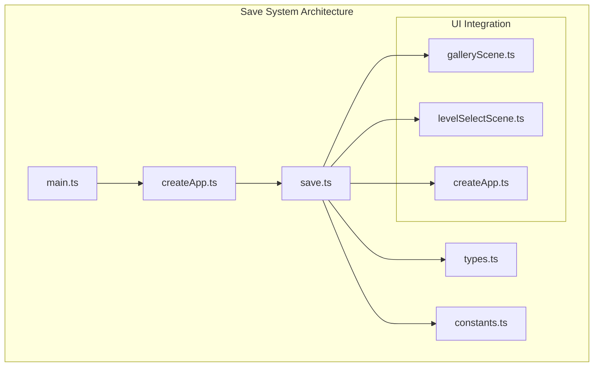
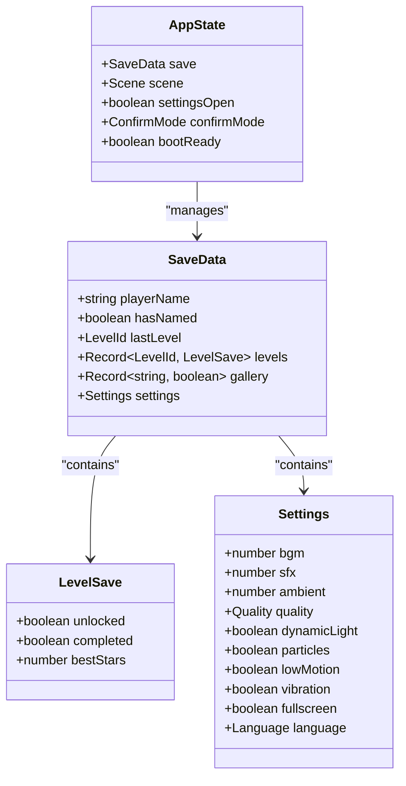
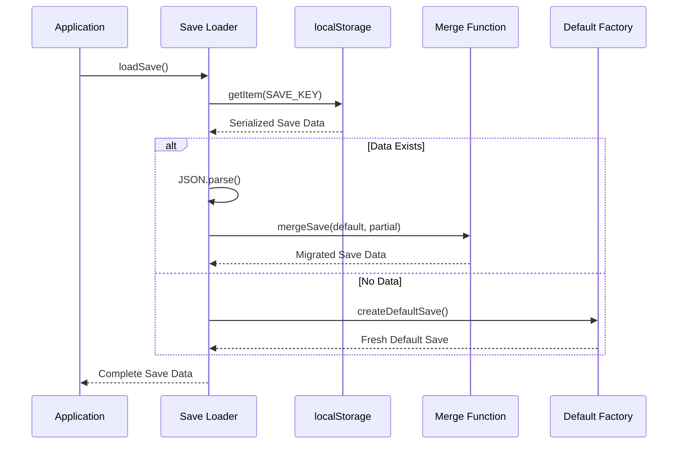
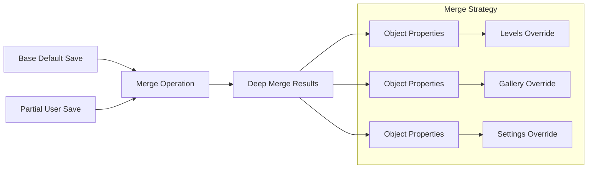
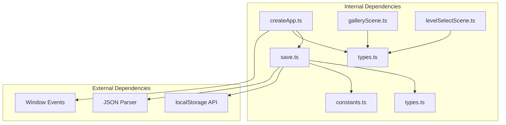

# Save System

<cite>
**Referenced Files in This Document**
- [save.ts](file://src/app/save.ts)
- [types.ts](file://src/app/types.ts)
- [constants.ts](file://src/app/constants.ts)
- [createApp.ts](file://src/app/createApp.ts)
- [galleryScene.ts](file://src/app/scenes/galleryScene.ts)
- [levelSelectScene.ts](file://src/app/scenes/levelSelectScene.ts)
- [main.ts](file://src/main.ts)
</cite>

## Table of Contents
1. [Introduction](#introduction)
2. [Project Structure](#project-structure)
3. [Core Components](#core-components)
4. [Architecture Overview](#architecture-overview)
5. [Detailed Component Analysis](#detailed-component-analysis)
6. [Dependency Analysis](#dependency-analysis)
7. [Performance Considerations](#performance-considerations)
8. [Troubleshooting Guide](#troubleshooting-guide)
9. [Conclusion](#conclusion)

## Introduction
SporeLight's save system provides persistent storage for player progress, level progression tracking, gallery collection state, and user settings. The system uses localStorage as the primary persistence mechanism with a robust migration strategy to maintain backward compatibility across game versions.

The save system follows a structured approach to data management, ensuring that player progress is preserved seamlessly while allowing for future enhancements without breaking existing saves.

## Project Structure
The save system is organized across several key files within the application architecture:



**Diagram sources**
- [main.ts:1-11](file://src/main.ts#L1-L11)
- [createApp.ts:16-377](file://src/app/createApp.ts#L16-L377)
- [save.ts:1-67](file://src/app/save.ts#L1-L67)

**Section sources**
- [main.ts:1-11](file://src/main.ts#L1-L11)
- [createApp.ts:16-377](file://src/app/createApp.ts#L16-L377)
- [save.ts:1-67](file://src/app/save.ts#L1-L67)

## Core Components

### SaveData Interface Structure
The SaveData interface defines the complete structure of persisted game state:



**Diagram sources**
- [types.ts:7-31](file://src/app/types.ts#L7-L31)
- [types.ts:38-44](file://src/app/types.ts#L38-L44)

### Key Data Categories

**Player Information**
- `playerName`: Stores the player's chosen character name
- `hasNamed`: Boolean flag indicating if player has completed naming process
- `lastLevel`: Tracks the last level accessed by the player

**Level Progression Tracking**
- `levels`: Object containing progress for each level (valley, pond, cave)
- Each level includes: unlock status, completion status, and best star rating
- Automatic unlocking of subsequent levels based on progression

**Gallery Collection State**
- `gallery`: Dynamic record of discovered collectible items
- Supports arbitrary item keys with boolean collection status
- Currently tracks 8 different flora and fauna items

**Settings Configuration**
- `settings`: Comprehensive audio/video preferences
- Audio controls: BGM, SFX, ambient sounds
- Quality settings: soft, standard, hd
- Visual preferences: dynamic lighting, particle effects
- Accessibility: low motion mode, vibration
- Interface: fullscreen, language selection

**Section sources**
- [types.ts:13-31](file://src/app/types.ts#L13-L31)
- [types.ts:7-11](file://src/app/types.ts#L7-L11)

## Architecture Overview

The save system follows a layered architecture with clear separation of concerns:



**Diagram sources**
- [save.ts:49-62](file://src/app/save.ts#L49-L62)
- [save.ts:39-47](file://src/app/save.ts#L39-L47)
- [save.ts:4-37](file://src/app/save.ts#L4-L37)

### Data Persistence Flow

```mermaid
flowchart TD
A[Game Event] --> B[State Change]
B --> C[Application State Update]
C --> D[persist() Method]
D --> E[JSON.stringify SaveData]
E --> F[localStorage.setItem]
F --> G[Browser Storage]
H[Application Startup] --> I[loadSave() Method]
I --> J[localStorage.getItem]
J --> K{Data Exists?}
K --> |Yes| L[JSON.parse]
L --> M[Merge with Defaults]
K --> |No| N[Create Default Save]
M --> O[Return Complete Save]
N --> O
O --> P[Application Ready]
```

**Diagram sources**
- [save.ts:64-66](file://src/app/save.ts#L64-L66)
- [save.ts:49-62](file://src/app/save.ts#L49-L62)

**Section sources**
- [save.ts:49-66](file://src/app/save.ts#L49-L66)
- [createApp.ts:215-217](file://src/app/createApp.ts#L215-L217)

## Detailed Component Analysis

### SaveData Interface Implementation

The SaveData interface provides a comprehensive structure for game state persistence:

**Player Identity Management**
- Name validation occurs during the naming scene with regex constraints
- Maximum 12 characters with support for Chinese, English, and numeric characters
- Default name fallback ensures continuity if validation fails

**Level Progression System**
- Hierarchical unlock mechanism prevents skipping levels
- Completion tracking with star ratings (0-3 stars)
- Best score preservation encourages replayability

**Gallery Collection Tracking**
- Dynamic item discovery system
- Arbitrary item keys allow for easy expansion
- Visual feedback in gallery interface based on collection status

**Settings Management**
- Comprehensive audio control with percentage-based values
- Quality scaling affects performance and visual fidelity
- Accessibility features improve user experience

### Save Migration Strategy

The mergeSave function implements a sophisticated migration system:



**Diagram sources**
- [save.ts:39-47](file://src/app/save.ts#L39-L47)

The migration strategy ensures backward compatibility by:

1. **Preserving New Fields**: Unknown properties in user saves are preserved
2. **Selective Overwrite**: Only known properties are merged from user data
3. **Nested Object Handling**: Complex objects (levels, gallery, settings) are deeply merged
4. **Type Safety**: TypeScript ensures compile-time validation of save structure

**Section sources**
- [save.ts:39-47](file://src/app/save.ts#L39-L47)
- [types.ts:13-31](file://src/app/types.ts#L13-L31)

### Error Handling and Recovery

The save system implements robust error handling:

**Corruption Recovery**
- Try-catch blocks around JSON parsing prevent crashes
- Automatic fallback to default save on parse failures
- Graceful degradation maintains game functionality

**Missing Data Handling**
- Empty storage returns fresh default save
- No special error handling required for missing keys
- Consistent behavior across browser environments

**Persistence Failures**
- Silent failures in localStorage are handled gracefully
- Application continues with in-memory state
- Future writes will retry automatically

### Save Key Management

The system uses a versioned key for clear save identification:

**Key Naming Convention**
- Versioned key: `sporelight.save.v1`
- Prevents conflicts with previous save formats
- Enables future migration strategies

**Version Control Strategy**
- Single version key prevents multiple save formats
- Simplifies migration logic
- Ensures clean upgrade paths

**Section sources**
- [constants.ts:1](file://src/app/constants.ts#L1)
- [save.ts:50-51](file://src/app/save.ts#L50-L51)

## Dependency Analysis

The save system maintains loose coupling with minimal external dependencies:



**Diagram sources**
- [save.ts:1-2](file://src/app/save.ts#L1-L2)
- [createApp.ts:5](file://src/app/createApp.ts#L5)
- [galleryScene.ts:3](file://src/app/scenes/galleryScene.ts#L3)
- [levelSelectScene.ts:3](file://src/app/scenes/levelSelectScene.ts#L3)

### Component Coupling Analysis

**Save Module Independence**
- Pure functions with no side effects
- Clear input/output contracts
- Easy to test and maintain

**Application Integration**
- Minimal coupling through dependency injection
- Event-driven persistence updates
- Centralized state management

**UI Integration**
- Declarative rendering based on save state
- Automatic UI updates on state changes
- Consistent user experience across scenes

**Section sources**
- [save.ts:1-67](file://src/app/save.ts#L1-L67)
- [createApp.ts:22-377](file://src/app/createApp.ts#L22-L377)

## Performance Considerations

### Serialization Efficiency
- JSON serialization occurs only on state changes
- Minimal memory footprint for save data
- Efficient deep merge operation for large objects

### Browser Storage Optimization
- Single localStorage write per state change
- No polling or background synchronization
- Efficient key-value storage model

### Memory Management
- Save data loaded once per session
- No caching overhead for frequently accessed data
- Garbage collection friendly object structure

## Troubleshooting Guide

### Common Issues and Solutions

**Save Data Corruption**
- Symptom: Game loads with default values
- Solution: Clear browser storage or reinstall game
- Prevention: Regular backup of save data

**Missing Player Name**
- Symptom: Name field appears empty
- Cause: Corrupted or missing name data
- Fix: Reset name through settings menu
- Prevention: Avoid manual save file editing

**Level Progression Reset**
- Symptom: Progress lost between sessions
- Cause: Storage quota exceeded or blocked
- Resolution: Free up storage space or enable cookies
- Prevention: Monitor storage usage regularly

**Gallery Items Not Showing**
- Symptom: Locked appearance despite collection
- Cause: Item ID mismatch or case sensitivity
- Fix: Restart game to refresh state
- Prevention: Use official collection methods

### Debugging Save Data

**Inspecting Current Save State**
- Open browser developer tools
- Navigate to Application tab
- Select Local Storage under Storage section
- Look for key: `sporelight.save.v1`

**Manual Save Data Inspection**
- Copy JSON content for analysis
- Validate against SaveData interface
- Check for missing or extra properties

**Save Data Validation Rules**
- All required fields present
- Numeric values within expected ranges
- String values match allowed enumerations
- Boolean values properly formatted

### Recovery Procedures

**Complete Save Reset**
1. Backup current save data
2. Clear localStorage entry
3. Restart application
4. Recreate progress from beginning

**Partial Save Restoration**
1. Identify corrupted properties
2. Manually edit JSON data
3. Validate against interface
4. Test application functionality

**Migration Issues**
1. Check save version compatibility
2. Verify migration function exists
3. Test fallback to default save
4. Report bugs with save data samples

**Section sources**
- [save.ts:49-62](file://src/app/save.ts#L49-L62)
- [createApp.ts:231-249](file://src/app/createApp.ts#L231-L249)

## Conclusion

SporeLight's save system demonstrates excellent software engineering practices through its clean architecture, robust error handling, and forward-compatible design. The system successfully balances simplicity with functionality, providing players with reliable progress persistence while maintaining flexibility for future enhancements.

Key strengths include the comprehensive SaveData interface, sophisticated migration strategy, and seamless integration with the application's UI components. The error handling mechanisms ensure graceful degradation, while the versioned key system provides clear upgrade paths for future development.

The modular design allows for easy testing and maintenance, while the event-driven persistence model minimizes performance impact. This foundation supports continued growth of the SporeLight experience while preserving player investments in their journey.