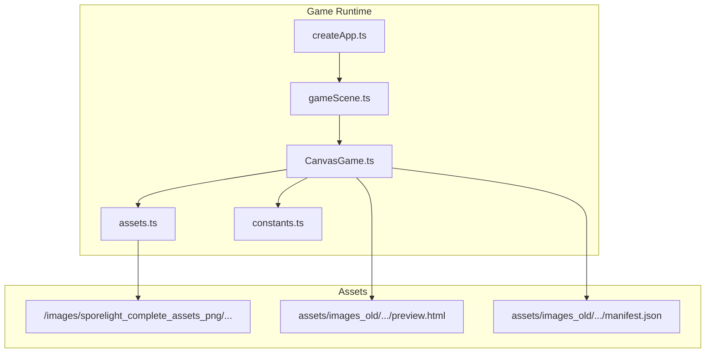
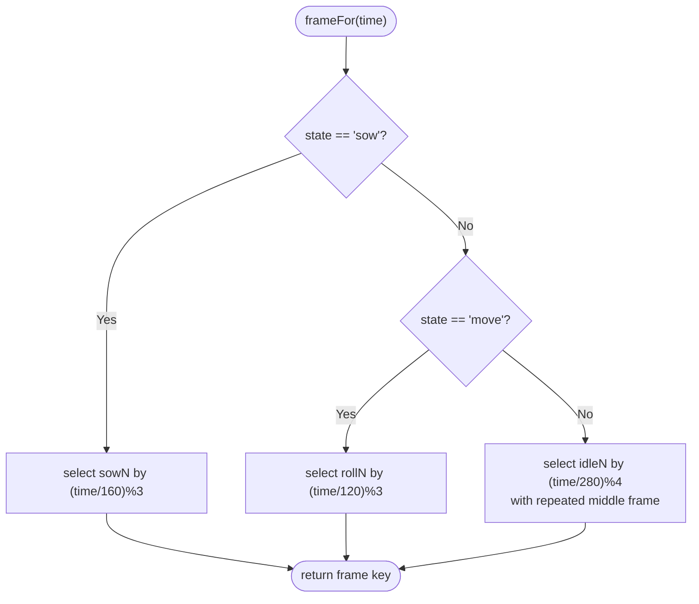
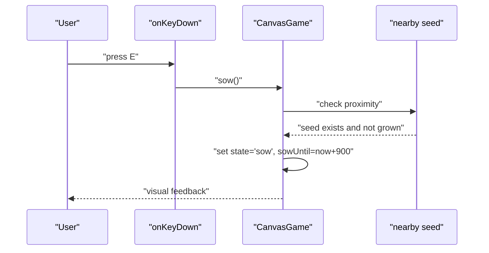
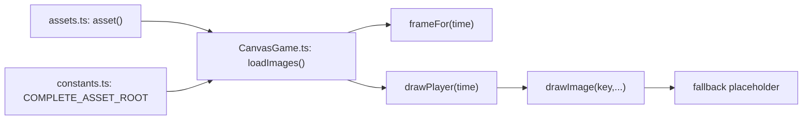

# Animation and Sprite Management

<cite>
**Referenced Files in This Document**
- [CanvasGame.ts](file://src/app/game/CanvasGame.ts)
- [assets.ts](file://src/app/assets.ts)
- [constants.ts](file://src/app/constants.ts)
- [gameScene.ts](file://src/app/scenes/gameScene.ts)
- [createApp.ts](file://src/app/createApp.ts)
- [preview.html](file://assets/images_old/sporelight_sliced_assets_web/preview.html)
- [manifest.json](file://assets/images_old/sporelight_sliced_assets_web/manifest.json)
</cite>

## Table of Contents
1. [Introduction](#introduction)
2. [Project Structure](#project-structure)
3. [Core Components](#core-components)
4. [Architecture Overview](#architecture-overview)
5. [Detailed Component Analysis](#detailed-component-analysis)
6. [Dependency Analysis](#dependency-analysis)
7. [Performance Considerations](#performance-considerations)
8. [Troubleshooting Guide](#troubleshooting-guide)
9. [Conclusion](#conclusion)

## Introduction
This document explains the animation system and sprite management in SporeLight. It focuses on the frame-based animation pipeline, including idle, walking, and sowing animations driven by sprite sheets. It documents the frame selection logic, timing calculations, sprite loading and caching, the animation state machine, and the fallback rendering strategy for incomplete images. It also covers animation timing precision, frame duration calculations, and how animation speed relates to game performance.

## Project Structure
The animation and sprite system spans several modules:
- Game loop and rendering orchestration
- Asset path resolution
- Scene scaffolding and canvas setup
- Legacy asset previews and manifests for historical sprite sheet layouts



**Diagram sources**
- [CanvasGame.ts:76-102](file://src/app/game/CanvasGame.ts#L76-L102)
- [assets.ts:1-3](file://src/app/assets.ts#L1-L3)
- [constants.ts:4-8](file://src/app/constants.ts#L4-L8)
- [gameScene.ts:3-21](file://src/app/scenes/gameScene.ts#L3-L21)
- [createApp.ts:96-96](file://src/app/createApp.ts#L96-L96)
- [preview.html:22-44](file://assets/images_old/sporelight_sliced_assets_web/preview.html#L22-L44)
- [manifest.json:627-676](file://assets/images_old/sporelight_sliced_assets_web/manifest.json#L627-L676)

**Section sources**
- [CanvasGame.ts:76-102](file://src/app/game/CanvasGame.ts#L76-L102)
- [assets.ts:1-3](file://src/app/assets.ts#L1-L3)
- [constants.ts:4-8](file://src/app/constants.ts#L4-L8)
- [gameScene.ts:3-21](file://src/app/scenes/gameScene.ts#L3-L21)
- [createApp.ts:96-96](file://src/app/createApp.ts#L96-L96)
- [preview.html:22-44](file://assets/images_old/sporelight_sliced_assets_web/preview.html#L22-L44)
- [manifest.json:627-676](file://assets/images_old/sporelight_sliced_assets_web/manifest.json#L627-L676)

## Core Components
- Sprite loader and cache: Loads sprite assets via resolved asset paths and stores them in a map keyed by logical names.
- Frame selector: Chooses the current animation frame based on elapsed time and the player's state.
- Renderer: Draws the shadow, optional trail, and the animated character sprite at computed positions and sizes.
- Fallback renderer: Draws a placeholder when a sprite is not yet loaded.
- State machine: Transitions between idle, move, and sow states, influencing which frames are selected.

Key responsibilities:
- Sprite loading and caching: Ensures assets are fetched once and reused.
- Timing and frame selection: Uses millisecond-precision timestamps to compute frame indices.
- Rendering robustness: Prevents drawing incomplete images.

**Section sources**
- [CanvasGame.ts:76-102](file://src/app/game/CanvasGame.ts#L76-L102)
- [CanvasGame.ts:271-284](file://src/app/game/CanvasGame.ts#L271-L284)
- [CanvasGame.ts:286-296](file://src/app/game/CanvasGame.ts#L286-L296)
- [CanvasGame.ts:148-192](file://src/app/game/CanvasGame.ts#L148-L192)

## Architecture Overview
The animation pipeline integrates input handling, state updates, and frame selection with rendering. The game loop computes a small delta, updates state, selects frames, and draws sprites.

```mermaid
sequenceDiagram
participant RAF as "requestAnimationFrame"
participant Loop as "loop(time)"
participant Upd as "update(delta,time)"
participant FSM as "player.state"
participant Frame as "frameFor(time)"
participant Draw as "draw(time)"
RAF->>Loop : "callback"
Loop->>Upd : "delta = min(0.04, dt/1000)"
Upd->>FSM : "compute state"
Loop->>Draw : "draw(time)"
Draw->>Frame : "select frame by state and time"
Draw-->>Draw : "draw shadow/trail/character"
```

**Diagram sources**
- [CanvasGame.ts:134-146](file://src/app/game/CanvasGame.ts#L134-L146)
- [CanvasGame.ts:148-192](file://src/app/game/CanvasGame.ts#L148-L192)
- [CanvasGame.ts:258-269](file://src/app/game/CanvasGame.ts#L258-L269)
- [CanvasGame.ts:271-284](file://src/app/game/CanvasGame.ts#L271-L284)

## Detailed Component Analysis

### Sprite Loading and Caching
- Asset path resolution: The asset function maps logical asset names to URLs under the images directory.
- Preloading strategy: Images are created and assigned their src immediately; they are cached in a Map keyed by logical names.
- Asset roots: The code references a complete asset root constant for sprite sheet locations.

Implementation highlights:
- Asset path construction uses a constant root for complete assets.
- Each sprite is stored in a Map for O(1) lookup during rendering.
- No explicit preload completion callback is used; rendering checks image readiness.

**Section sources**
- [assets.ts:1-3](file://src/app/assets.ts#L1-L3)
- [constants.ts:4](file://src/app/constants.ts#L4-L4)
- [CanvasGame.ts:76-102](file://src/app/game/CanvasGame.ts#L76-L102)

### Animation State Machine
The player state drives which animation sequence plays:
- States: idle, move, sow, done
- Transitions:
  - Movement keys or pointer target switch to move while in motion.
  - Idle when no movement input and no target.
  - Sow triggered by player action; remains in sow for a fixed duration before reverting to idle.
  - Completion sets done when the exit is reached.

State transitions influence frame selection and rendering order (e.g., trail drawn only when moving).

**Section sources**
- [CanvasGame.ts:20-20](file://src/app/game/CanvasGame.ts#L20-L20)
- [CanvasGame.ts:148-192](file://src/app/game/CanvasGame.ts#L148-L192)
- [CanvasGame.ts:258-269](file://src/app/game/CanvasGame.ts#L258-L269)

### Frame Selection and Timing
The frameFor method selects the current sprite based on elapsed time and state:
- Sow animation: Three frames cycled at a fixed period.
- Move animation: Three frames cycled at a different fixed period.
- Idle animation: Four frames cycled at another fixed period; includes a repeated middle frame for emphasis.

Timing mechanism:
- Uses a monotonically increasing time value (milliseconds).
- Integer division by a fixed period determines the frame index.
- Modulo ensures cyclic progression across frames.



**Diagram sources**
- [CanvasGame.ts:271-284](file://src/app/game/CanvasGame.ts#L271-L284)

**Section sources**
- [CanvasGame.ts:271-284](file://src/app/game/CanvasGame.ts#L271-L284)

### Rendering Pipeline
Rendering order and conditions:
- Background drawn first.
- Path outline drawn next.
- Seeds drawn with optional growth effects.
- Exit glow drawn next.
- Trail drawn when moving.
- Shadow drawn beneath the character.
- Character frame drawn last, sized according to state.

Fallback rendering:
- If a sprite is not ready, a placeholder color is drawn instead of the image.

**Section sources**
- [CanvasGame.ts:194-201](file://src/app/game/CanvasGame.ts#L194-L201)
- [CanvasGame.ts:222-240](file://src/app/game/CanvasGame.ts#L222-L240)
- [CanvasGame.ts:242-256](file://src/app/game/CanvasGame.ts#L242-L256)
- [CanvasGame.ts:258-269](file://src/app/game/CanvasGame.ts#L258-L269)
- [CanvasGame.ts:286-296](file://src/app/game/CanvasGame.ts#L286-L296)

### Player Interaction and Sow Trigger
- Keyboard event triggers sow when near a seed.
- Sow sets the player state to sow and schedules a sow duration.
- After the duration, the state reverts to idle automatically.



**Diagram sources**
- [CanvasGame.ts:122-128](file://src/app/game/CanvasGame.ts#L122-L128)
- [CanvasGame.ts:56-74](file://src/app/game/CanvasGame.ts#L56-L74)
- [CanvasGame.ts:148-155](file://src/app/game/CanvasGame.ts#L148-L155)

**Section sources**
- [CanvasGame.ts:122-128](file://src/app/game/CanvasGame.ts#L122-L128)
- [CanvasGame.ts:56-74](file://src/app/game/CanvasGame.ts#L56-L74)
- [CanvasGame.ts:148-155](file://src/app/game/CanvasGame.ts#L148-L155)

### Historical Sprite Sheet Layouts
Legacy preview and manifest files indicate original sprite sheet organization:
- Preview groups show idle, walk, run, sow, jump, and interact frames.
- Manifest entries define source boxes and sizes for walk and sow cycles.

These assets inform understanding of sprite sheet composition and sizing, even though the current implementation references different sprite filenames.

**Section sources**
- [preview.html:22-44](file://assets/images_old/sporelight_sliced_assets_web/preview.html#L22-L44)
- [manifest.json:627-676](file://assets/images_old/sporelight_sliced_assets_web/manifest.json#L627-L676)

## Dependency Analysis
The animation system depends on:
- Asset resolution for sprite paths
- Game loop timing for frame selection
- Player state for animation branch selection
- Rendering context for drawing and fallback



**Diagram sources**
- [assets.ts:1-3](file://src/app/assets.ts#L1-L3)
- [constants.ts:4](file://src/app/constants.ts#L4-L4)
- [CanvasGame.ts:76-102](file://src/app/game/CanvasGame.ts#L76-L102)
- [CanvasGame.ts:271-284](file://src/app/game/CanvasGame.ts#L271-L284)
- [CanvasGame.ts:258-269](file://src/app/game/CanvasGame.ts#L258-L269)
- [CanvasGame.ts:286-296](file://src/app/game/CanvasGame.ts#L286-L296)

**Section sources**
- [assets.ts:1-3](file://src/app/assets.ts#L1-L3)
- [constants.ts:4](file://src/app/constants.ts#L4-L4)
- [CanvasGame.ts:76-102](file://src/app/game/CanvasGame.ts#L76-L102)
- [CanvasGame.ts:271-284](file://src/app/game/CanvasGame.ts#L271-L284)
- [CanvasGame.ts:258-269](file://src/app/game/CanvasGame.ts#L258-L269)
- [CanvasGame.ts:286-296](file://src/app/game/CanvasGame.ts#L286-L296)

## Performance Considerations
- Timing precision: Uses millisecond-precision timestamps; frame selection relies on integer division and modulo arithmetic for deterministic cycling.
- Delta clamping: The game loop caps delta to avoid large jumps; this stabilizes movement and keeps frame selection smooth.
- Frame durations: Fixed periods per animation mode (e.g., sow, move, idle) directly control perceived animation speed.
- Rendering cost: Drawing order minimizes overdraw; fallback rendering avoids expensive operations when images are missing.
- Asset loading: Immediate assignment of image src allows asynchronous loading; rendering guards against incomplete images.

[No sources needed since this section provides general guidance]

## Troubleshooting Guide
Common issues and remedies:
- Missing or slow-loading sprites:
  - Symptom: Placeholder color appears instead of character.
  - Cause: Image not yet loaded (incomplete or naturalWidth zero).
  - Resolution: Ensure assets are preloaded and check network conditions.
- Stuttering or inconsistent animation speed:
  - Symptom: Frames change too fast/slow.
  - Cause: Timing reliance on fixed periods; large deltas can cause skipping.
  - Resolution: Keep delta clamped; verify frame periods align with intended FPS.
- Incorrect animation sequence:
  - Symptom: Wrong frames play for state.
  - Cause: State mismatch or incorrect frame arrays.
  - Resolution: Verify state transitions and frame arrays in frameFor.

**Section sources**
- [CanvasGame.ts:286-296](file://src/app/game/CanvasGame.ts#L286-L296)
- [CanvasGame.ts:139-140](file://src/app/game/CanvasGame.ts#L139-L140)
- [CanvasGame.ts:271-284](file://src/app/game/CanvasGame.ts#L271-L284)

## Conclusion
SporeLight’s animation system uses a straightforward, frame-based approach with clear state-driven frame selection and robust fallback rendering. Sprite sheets are loaded once and cached, and frame indices are computed using precise timing and fixed periods. The system balances simplicity and performance, relying on the game loop’s delta clamping and explicit state transitions to maintain smooth, predictable animations.