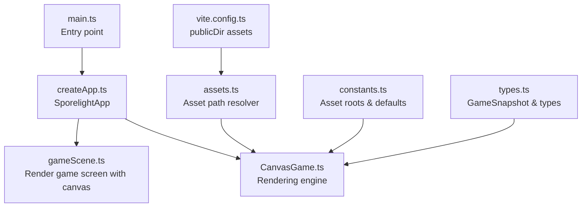
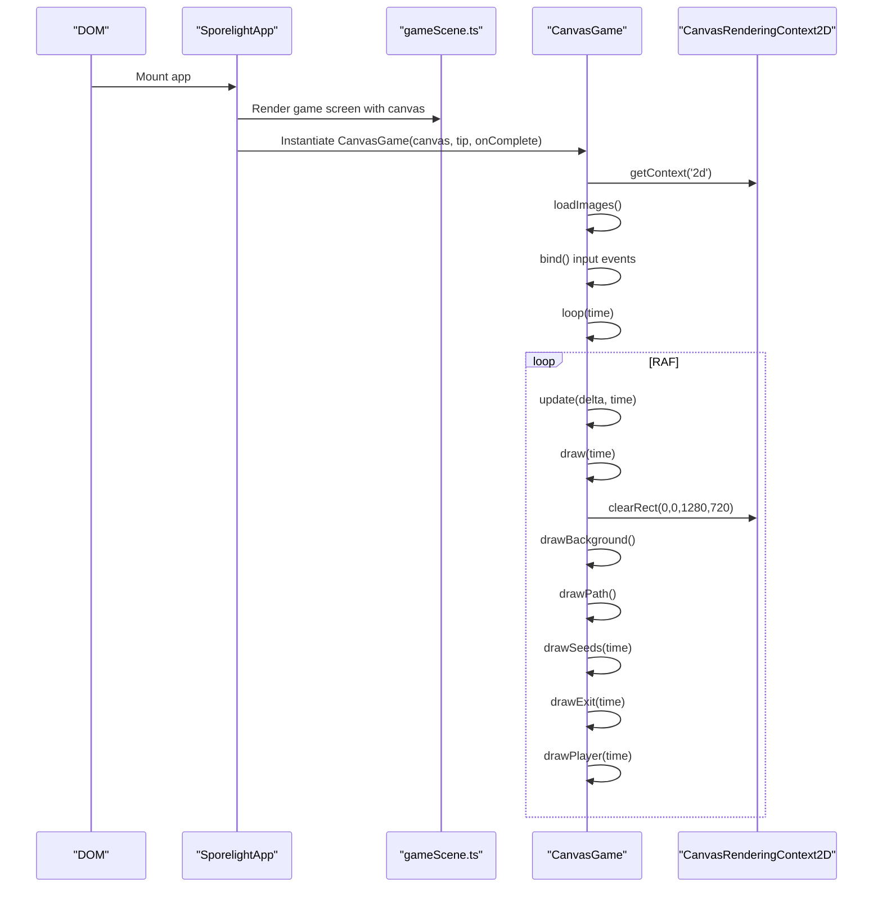
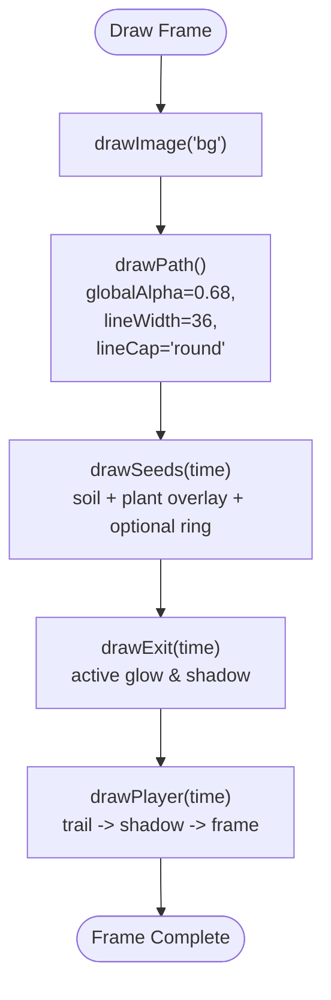
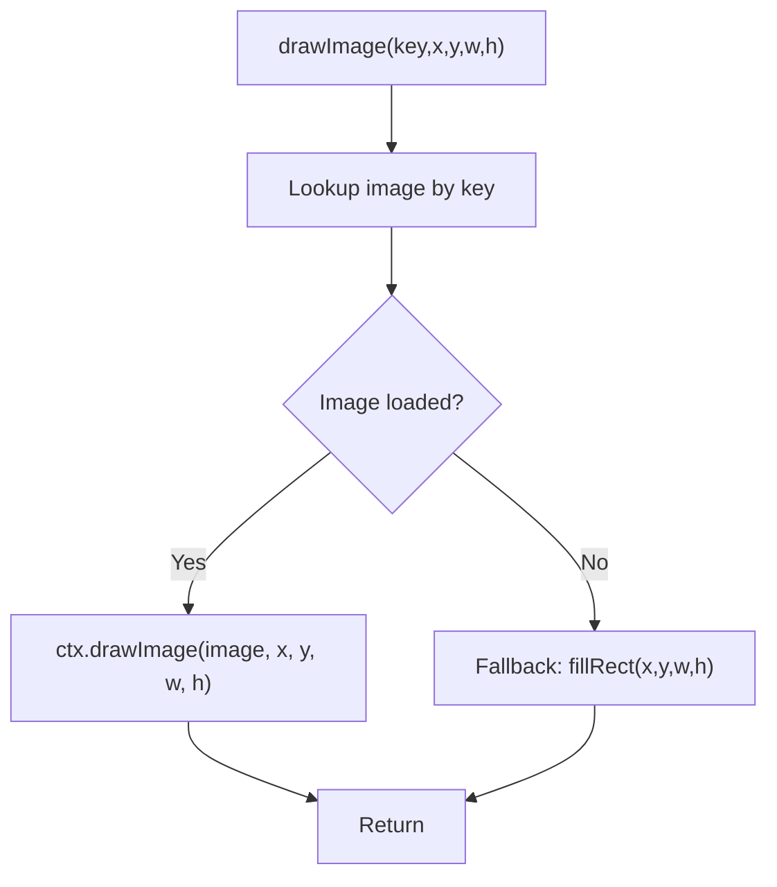
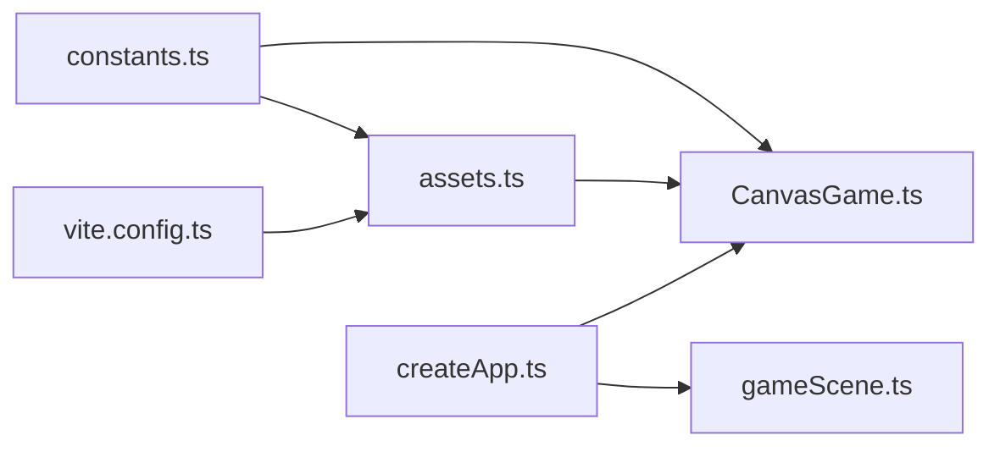

# Canvas Rendering Architecture

<cite>
**Referenced Files in This Document**
- [CanvasGame.ts](file://src/app/game/CanvasGame.ts)
- [createApp.ts](file://src/app/createApp.ts)
- [gameScene.ts](file://src/app/scenes/gameScene.ts)
- [assets.ts](file://src/app/assets.ts)
- [constants.ts](file://src/app/constants.ts)
- [types.ts](file://src/app/types.ts)
- [main.ts](file://src/main.ts)
- [vite.config.ts](file://vite.config.ts)
- [package.json](file://package.json)
</cite>

## Table of Contents
1. [Introduction](#introduction)
2. [Project Structure](#project-structure)
3. [Core Components](#core-components)
4. [Architecture Overview](#architecture-overview)
5. [Detailed Component Analysis](#detailed-component-analysis)
6. [Dependency Analysis](#dependency-analysis)
7. [Performance Considerations](#performance-considerations)
8. [Troubleshooting Guide](#troubleshooting-guide)
9. [Conclusion](#conclusion)

## Introduction
This document explains the Canvas 2D rendering system in SporeLight, focusing on the rendering pipeline, canvas context initialization, drawing operations, and optimization techniques. It covers the drawImage method, global alpha blending, shadow effects, stroke/path rendering, rendering order, sprite positioning, coordinate transformation, and visual effects such as growth rings and trail particles. It also documents the Canvas API usage, performance strategies for smooth 60fps rendering, and memory management for graphics resources.

## Project Structure
SporeLight initializes the application via a root entry point, mounts a scene containing a canvas, and delegates rendering to a dedicated CanvasGame class. The rendering pipeline is encapsulated within CanvasGame, which manages assets, input, animation loops, and drawing order.



**Diagram sources**
- [main.ts:1-11](file://src/main.ts#L1-L11)
- [createApp.ts:1-377](file://src/app/createApp.ts#L1-L377)
- [gameScene.ts:1-22](file://src/app/scenes/gameScene.ts#L1-L22)
- [CanvasGame.ts:1-318](file://src/app/game/CanvasGame.ts#L1-L318)
- [assets.ts:1-4](file://src/app/assets.ts#L1-L4)
- [constants.ts:1-71](file://src/app/constants.ts#L1-L71)
- [types.ts:1-45](file://src/app/types.ts#L1-L45)
- [vite.config.ts:1-10](file://vite.config.ts#L1-L10)

**Section sources**
- [main.ts:1-11](file://src/main.ts#L1-L11)
- [createApp.ts:101-108](file://src/app/createApp.ts#L101-L108)
- [gameScene.ts:3-21](file://src/app/scenes/gameScene.ts#L3-L21)
- [CanvasGame.ts:32-47](file://src/app/game/CanvasGame.ts#L32-L47)

## Core Components
- CanvasGame: Central renderer managing the Canvas 2D context, asset loading, input binding, animation loop, and drawing order.
- Asset management: Resolves asset paths and loads images into memory for rendering.
- Scene composition: The game scene defines the canvas and HUD elements; the app mounts the scene and instantiates CanvasGame.

Key responsibilities:
- Initialize Canvas 2D context and handle fallbacks.
- Load sprites and FX assets.
- Implement the update/draw loop with delta time and requestAnimationFrame.
- Draw in a strict order: background, path, seeds, exit, player.
- Apply globalAlpha, shadows, and transforms per-layer.
- Provide drawImage abstraction with safe fallback rendering.

**Section sources**
- [CanvasGame.ts:14-47](file://src/app/game/CanvasGame.ts#L14-L47)
- [CanvasGame.ts:76-102](file://src/app/game/CanvasGame.ts#L76-L102)
- [CanvasGame.ts:134-146](file://src/app/game/CanvasGame.ts#L134-L146)
- [CanvasGame.ts:194-201](file://src/app/game/CanvasGame.ts#L194-L201)
- [CanvasGame.ts:286-296](file://src/app/game/CanvasGame.ts#L286-L296)

## Architecture Overview
The rendering architecture follows a single-threaded game loop with explicit rendering order and layered visual effects. The CanvasGame orchestrates:
- Initialization: context creation, asset preload, event binding, RAF loop.
- Update: movement, state transitions, and completion detection.
- Draw: background, path, seeds, exit, player, with per-layer effects.



**Diagram sources**
- [createApp.ts:101-108](file://src/app/createApp.ts#L101-L108)
- [gameScene.ts:3-21](file://src/app/scenes/gameScene.ts#L3-L21)
- [CanvasGame.ts:32-47](file://src/app/game/CanvasGame.ts#L32-L47)
- [CanvasGame.ts:134-146](file://src/app/game/CanvasGame.ts#L134-L146)
- [CanvasGame.ts:194-201](file://src/app/game/CanvasGame.ts#L194-L201)

## Detailed Component Analysis

### CanvasGame: Rendering Engine
CanvasGame encapsulates the entire rendering pipeline. It initializes the Canvas 2D context, loads assets, binds input, runs the game loop, and draws all scene elements in a fixed order.

- Context initialization and fallback: Ensures a 2D context exists and throws if unsupported.
- Asset loading: Preloads background, character sprites, world tiles, FX, and stores them in a Map keyed by identifiers.
- Event binding: Pointer down for movement targeting and keyboard for actions (e.g., E to sow).
- Animation loop: Uses requestAnimationFrame with capped delta time to maintain stable updates.
- Drawing order: Background, path, seeds, exit, player.
- Per-layer effects: globalAlpha, stroke styles, shadows, and transforms applied per draw call.

```mermaid
classDiagram
class CanvasGame {
-ctx : CanvasRenderingContext2D
-raf : number
-destroyed : boolean
-completed : boolean
-keys : Set<string>
-target : {x,y} | null
-player : {x,y,state}
-seeds : Seed[]
-exit : {x,y,active}
-images : Map<string,HTMLImageElement>
-last : number
-sowUntil : number
-messageUntil : number
+constructor(canvas, tip, onComplete)
+destroy()
+sow()
-loadImages()
-bind()
-loop(time)
-update(delta, time)
-draw(time)
-drawPath()
-drawSeeds(time)
-drawExit(time)
-drawPlayer(time)
-frameFor(time) : string
-drawImage(key,x,y,width,height)
-nearSeed() : Seed | undefined
-say(message)
}
```

**Diagram sources**
- [CanvasGame.ts:14-318](file://src/app/game/CanvasGame.ts#L14-L318)

**Section sources**
- [CanvasGame.ts:14-47](file://src/app/game/CanvasGame.ts#L14-L47)
- [CanvasGame.ts:76-102](file://src/app/game/CanvasGame.ts#L76-L102)
- [CanvasGame.ts:104-132](file://src/app/game/CanvasGame.ts#L104-L132)
- [CanvasGame.ts:134-146](file://src/app/game/CanvasGame.ts#L134-L146)
- [CanvasGame.ts:194-201](file://src/app/game/CanvasGame.ts#L194-L201)

### Rendering Order System
The draw order ensures consistent layering and visual precedence:
1. Background: Full-screen background image.
2. Path: A stylized path drawn with rounded caps and semi-transparent stroke.
3. Seeds: Soil tiles and plant overlays (moss/vine), optionally with growth rings.
4. Exit: Exit portal with pulsating radius and glow/shadow.
5. Player: Trail particles, shadow, and animated sprite frames.



**Diagram sources**
- [CanvasGame.ts:194-201](file://src/app/game/CanvasGame.ts#L194-L201)
- [CanvasGame.ts:203-220](file://src/app/game/CanvasGame.ts#L203-L220)
- [CanvasGame.ts:222-240](file://src/app/game/CanvasGame.ts#L222-L240)
- [CanvasGame.ts:242-256](file://src/app/game/CanvasGame.ts#L242-L256)
- [CanvasGame.ts:258-269](file://src/app/game/CanvasGame.ts#L258-L269)

**Section sources**
- [CanvasGame.ts:194-201](file://src/app/game/CanvasGame.ts#L194-L201)

### drawImage Method Implementation
The drawImage method centralizes sprite rendering with safety checks:
- Lookup image by key in the internal Map.
- If the image is loaded (complete and naturalWidth > 0), draw it onto the canvas with specified rectangle.
- Otherwise, draw a placeholder colored rectangle as a fallback.

This pattern reduces branching in drawing routines and ensures robustness during asset loading.



**Diagram sources**
- [CanvasGame.ts:286-296](file://src/app/game/CanvasGame.ts#L286-L296)

**Section sources**
- [CanvasGame.ts:286-296](file://src/app/game/CanvasGame.ts#L286-L296)

### Global Alpha Blending
Global alpha is used extensively to achieve transparency and subtle animations:
- Path: globalAlpha set to a constant value for soft blending with the background.
- Seeds: When grown, globalAlpha is modulated sinusoidally to create a pulsating effect.
- Exit: Active vs inactive alpha values control visibility and emphasis.
- Player: Trail particles use globalAlpha to fade out over time.

Best practices:
- Save/restore context around scoped alpha changes to avoid leaking state.
- Keep alpha ranges reasonable to preserve visual fidelity.

**Section sources**
- [CanvasGame.ts:205](file://src/app/game/CanvasGame.ts#L205)
- [CanvasGame.ts:235](file://src/app/game/CanvasGame.ts#L235)
- [CanvasGame.ts:248](file://src/app/game/CanvasGame.ts#L248)
- [CanvasGame.ts:260](file://src/app/game/CanvasGame.ts#L260)

### Shadow Effects
Shadows are applied selectively to emphasize interactive elements:
- Exit portal: shadowBlur and shadowColor vary with activity state to indicate interactivity and highlight the exit.
- Player shadow: rendered beneath the player to ground them visually.

Shadow performance tips:
- Use moderate blur radii appropriate to the scene scale.
- Avoid excessive shadow updates per frame; compute once per draw call.

**Section sources**
- [CanvasGame.ts:250](file://src/app/game/CanvasGame.ts#L250)
- [CanvasGame.ts:251](file://src/app/game/CanvasGame.ts#L251)
- [CanvasGame.ts:263](file://src/app/game/CanvasGame.ts#L263)

### Stroke and Path Rendering
The path is drawn as a single continuous stroke with quadratic curves:
- Line width and cap are set for a soft, organic appearance.
- The path adapts dynamically based on whether the vine seed has grown, extending toward the exit.

Optimization:
- Use a single path and stroke operation to minimize state changes.
- Keep curve segments minimal and avoid unnecessary re-triangulation.

**Section sources**
- [CanvasGame.ts:203-220](file://src/app/game/CanvasGame.ts#L203-L220)

### Sprite Positioning and Coordinate Transformation
Sprite placement relies on precise centering and offsets:
- Player: Centered at (x, y) with configurable size; shadow is offset below the player.
- Seeds: Positioned at fixed coordinates with small wobble offsets for subtle animation.
- Exit: Translated to its world position before drawing.

Coordinate transformation:
- Pointer events are normalized to canvas coordinates using bounding rect and device pixel ratios.
- Player movement uses vector math with delta time to achieve smooth motion.

**Section sources**
- [CanvasGame.ts:266](file://src/app/game/CanvasGame.ts#L266)
- [CanvasGame.ts:268](file://src/app/game/CanvasGame.ts#L268)
- [CanvasGame.ts:263](file://src/app/game/CanvasGame.ts#L263)
- [CanvasGame.ts:224](file://src/app/game/CanvasGame.ts#L224)
- [CanvasGame.ts:244](file://src/app/game/CanvasGame.ts#L244)
- [CanvasGame.ts:105-116](file://src/app/game/CanvasGame.ts#L105-L116)

### Visual Effects: Growth Rings and Trail Particles
- Growth rings: When a seed has grown, a ring image is drawn with a sinusoidal globalAlpha to simulate pulsing.
- Trail particles: Drawn behind the player while moving, fading out with globalAlpha to create a dissipating effect.

These effects enhance narrative and feedback without heavy computation.

**Section sources**
- [CanvasGame.ts:234-239](file://src/app/game/CanvasGame.ts#L234-L239)
- [CanvasGame.ts:258-261](file://src/app/game/CanvasGame.ts#L258-L261)

### Canvas API Usage
Core APIs used:
- getContext('2d'): Obtain the 2D rendering context.
- drawImage: Draw preloaded images with scaling and clipping.
- fillRect: Fallback rendering when images are unavailable.
- save/restore: Preserve and restore context state for scoped effects.
- beginPath/moveTo/quadraticCurveTo/stroke: Construct and render the path.
- arc/fill: Draw the exit portal.
- globalAlpha, shadowBlur, shadowColor, lineWidth, lineCap: Style the visuals.

**Section sources**
- [CanvasGame.ts:37-43](file://src/app/game/CanvasGame.ts#L37-L43)
- [CanvasGame.ts:286-296](file://src/app/game/CanvasGame.ts#L286-L296)
- [CanvasGame.ts:209-219](file://src/app/game/CanvasGame.ts#L209-L219)
- [CanvasGame.ts:252-255](file://src/app/game/CanvasGame.ts#L252-L255)

## Dependency Analysis
The rendering system depends on:
- Asset resolution and loading: assets.ts and constants.ts supply asset roots and filenames.
- Scene mounting: createApp.ts renders the game scene and instantiates CanvasGame.
- Build configuration: vite.config.ts exposes assets under /images.



**Diagram sources**
- [constants.ts:1-71](file://src/app/constants.ts#L1-L71)
- [assets.ts:1-4](file://src/app/assets.ts#L1-L4)
- [CanvasGame.ts:76-102](file://src/app/game/CanvasGame.ts#L76-L102)
- [createApp.ts:101-108](file://src/app/createApp.ts#L101-L108)
- [gameScene.ts:3-21](file://src/app/scenes/gameScene.ts#L3-L21)
- [vite.config.ts:1-10](file://vite.config.ts#L1-L10)

**Section sources**
- [constants.ts:4](file://src/app/constants.ts#L4)
- [assets.ts:1-4](file://src/app/assets.ts#L1-L4)
- [CanvasGame.ts:76-102](file://src/app/game/CanvasGame.ts#L76-L102)
- [createApp.ts:101-108](file://src/app/createApp.ts#L101-L108)
- [vite.config.ts:4](file://vite.config.ts#L4)

## Performance Considerations
- Frame pacing: The loop caps delta time to prevent large jumps and stuttering.
- Minimal state changes: Grouping drawing operations and reusing styles reduces context switches.
- Efficient asset loading: Preloading images avoids runtime stalls and blank rectangles.
- Scoped context: Using save/restore limits the scope of style changes.
- Shadow cost: Limit shadow blur and only apply where necessary (e.g., exit).
- Avoid overdraw: Draw from back to front and reuse images to reduce redundant uploads.
- Memory management: Reuse the images Map; avoid creating new Image instances per frame.
- 60fps targets: Keep per-frame work proportional to screen size; prefer additive blending and simple transforms.

[No sources needed since this section provides general guidance]

## Troubleshooting Guide
Common issues and remedies:
- Canvas not supported: The constructor throws if getContext fails; ensure the environment supports 2D contexts.
- Images not appearing: drawImage falls back to a placeholder rectangle when images are not loaded; check asset paths and network.
- Input not responding: Pointer normalization uses canvas bounding rect and device pixel ratios; verify canvas sizing and scaling.
- Stuttering or jank: Delta time is capped; ensure no heavy synchronous work in the main thread.
- Exit glow not visible: Verify active state and alpha/shadow values; they change when the exit becomes active.

**Section sources**
- [CanvasGame.ts:39-41](file://src/app/game/CanvasGame.ts#L39-L41)
- [CanvasGame.ts:289-296](file://src/app/game/CanvasGame.ts#L289-L296)
- [CanvasGame.ts:105-116](file://src/app/game/CanvasGame.ts#L105-L116)
- [CanvasGame.ts:139](file://src/app/game/CanvasGame.ts#L139)
- [CanvasGame.ts:248](file://src/app/game/CanvasGame.ts#L248)

## Conclusion
SporeLight’s Canvas rendering system is a compact, efficient pipeline centered on CanvasGame. It establishes a clear rendering order, leverages globalAlpha and shadows for depth and emphasis, and uses a unified drawImage abstraction for robust sprite rendering. With careful asset management, minimal state changes, and disciplined use of context transforms, the system achieves smooth 60fps performance while maintaining visual richness through effects like growth rings and trail particles.