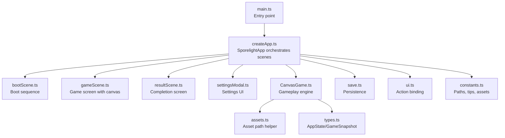
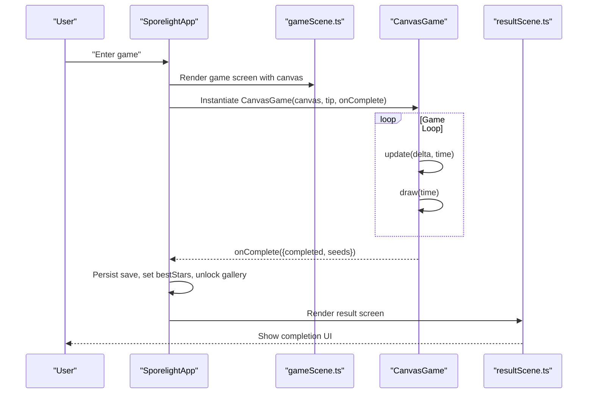
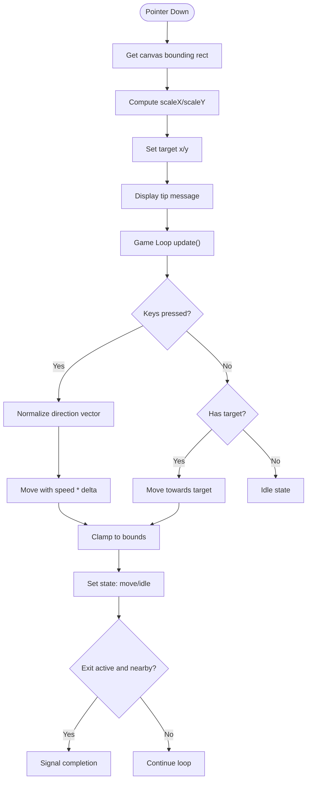
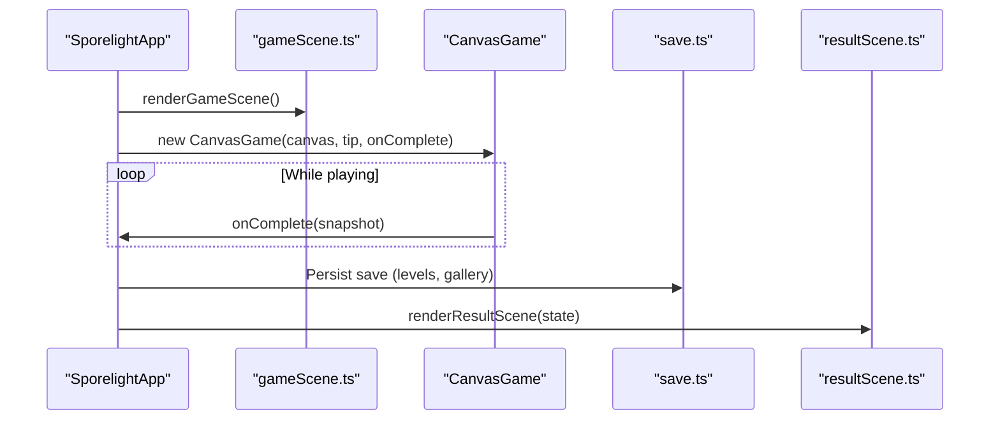
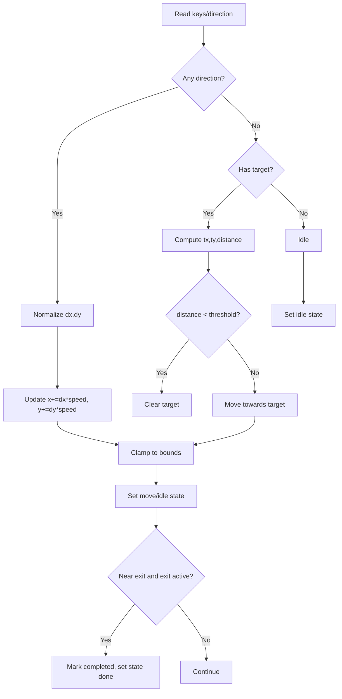
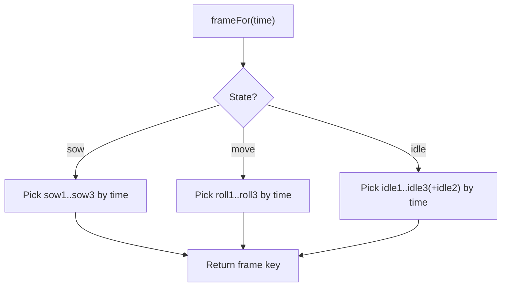
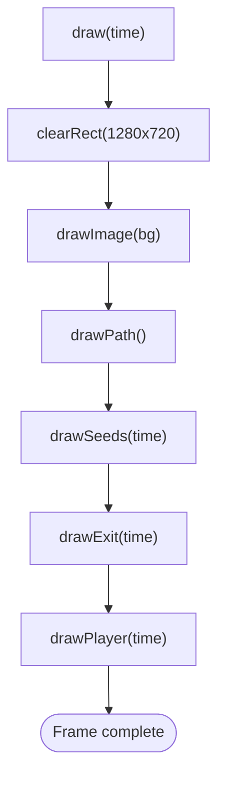
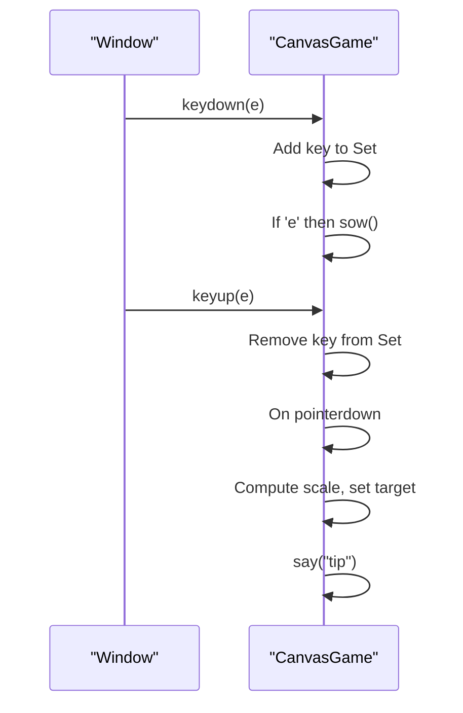
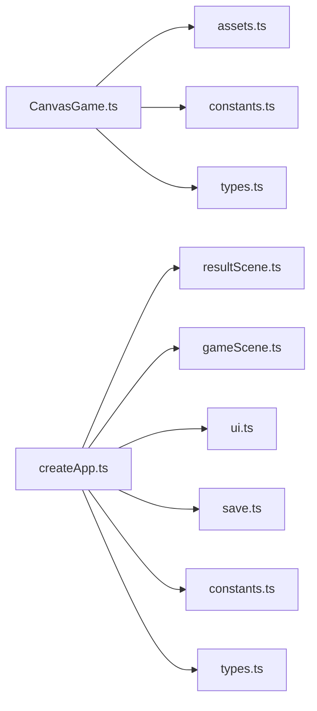

# Game Engine

<cite>
**Referenced Files in This Document**
- [CanvasGame.ts](file://src/app/game/CanvasGame.ts)
- [createApp.ts](file://src/app/createApp.ts)
- [gameScene.ts](file://src/app/scenes/gameScene.ts)
- [resultScene.ts](file://src/app/scenes/resultScene.ts)
- [constants.ts](file://src/app/constants.ts)
- [types.ts](file://src/app/types.ts)
- [assets.ts](file://src/app/assets.ts)
- [ui.ts](file://src/app/ui.ts)
- [save.ts](file://src/app/save.ts)
- [main.ts](file://src/main.ts)
- [bootScene.ts](file://src/app/scenes/bootScene.ts)
- [package.json](file://package.json)
</cite>

## Table of Contents
1. [Introduction](#introduction)
2. [Project Structure](#project-structure)
3. [Core Components](#core-components)
4. [Architecture Overview](#architecture-overview)
5. [Detailed Component Analysis](#detailed-component-analysis)
6. [Dependency Analysis](#dependency-analysis)
7. [Performance Considerations](#performance-considerations)
8. [Troubleshooting Guide](#troubleshooting-guide)
9. [Conclusion](#conclusion)
10. [Appendices](#appendices)

## Introduction
This document describes SporeLight’s Canvas-based game engine, focusing on the CanvasGame implementation and its integration with scene management. It explains the 2D rendering architecture, character movement and animation systems, input handling, and the game loop. It also covers collision detection, sprite rendering, frame-rate control, Canvas API usage, memory management for graphics resources, and optimization strategies for smooth performance.

## Project Structure
SporeLight is a TypeScript/Vite application with a modular architecture:
- Application bootstrap and scene orchestration live under src/app.
- The Canvas-based gameplay is encapsulated in CanvasGame.
- Scenes are rendered via dedicated renderers.
- Global constants, types, assets, UI helpers, and save/load logic support the engine.
- The main entry point initializes the app.



**Diagram sources**
- [main.ts:1-11](file://src/main.ts#L1-L11)
- [createApp.ts:16-82](file://src/app/createApp.ts#L16-L82)
- [bootScene.ts:19-64](file://src/app/scenes/bootScene.ts#L19-L64)
- [gameScene.ts:3-21](file://src/app/scenes/gameScene.ts#L3-L21)
- [resultScene.ts:8-30](file://src/app/scenes/resultScene.ts#L8-L30)
- [CanvasGame.ts:14-47](file://src/app/game/CanvasGame.ts#L14-L47)
- [assets.ts:1-4](file://src/app/assets.ts#L1-L4)
- [types.ts:33-44](file://src/app/types.ts#L33-L44)
- [save.ts:49-66](file://src/app/save.ts#L49-L66)
- [ui.ts:5-11](file://src/app/ui.ts#L5-L11)
- [constants.ts:4-10](file://src/app/constants.ts#L4-L10)

**Section sources**
- [main.ts:1-11](file://src/main.ts#L1-L11)
- [createApp.ts:16-82](file://src/app/createApp.ts#L16-L82)
- [CanvasGame.ts:14-47](file://src/app/game/CanvasGame.ts#L14-L47)
- [gameScene.ts:3-21](file://src/app/scenes/gameScene.ts#L3-L21)
- [resultScene.ts:8-30](file://src/app/scenes/resultScene.ts#L8-L30)
- [constants.ts:4-10](file://src/app/constants.ts#L4-L10)
- [types.ts:33-44](file://src/app/types.ts#L33-L44)
- [assets.ts:1-4](file://src/app/assets.ts#L1-L4)
- [ui.ts:5-11](file://src/app/ui.ts#L5-L11)
- [save.ts:49-66](file://src/app/save.ts#L49-L66)

## Core Components
- CanvasGame: Implements the game loop, input handling, movement, animation, rendering, and completion signaling.
- SporelightApp: Manages scenes, binds UI actions, instantiates CanvasGame, and transitions to result on completion.
- Scene renderers: Provide markup for game, result, and boot screens.
- Supporting modules: constants, types, assets, UI helpers, and save system.

Key responsibilities:
- CanvasGame: 2D rendering pipeline, keyboard/mouse input, movement with collision boundaries, animation frame selection, and completion detection.
- SporelightApp: Lifecycle management of scenes, asset loading, settings, persistence, and navigation.

**Section sources**
- [CanvasGame.ts:14-47](file://src/app/game/CanvasGame.ts#L14-L47)
- [createApp.ts:22-377](file://src/app/createApp.ts#L22-L377)
- [gameScene.ts:3-21](file://src/app/scenes/gameScene.ts#L3-L21)
- [resultScene.ts:8-30](file://src/app/scenes/resultScene.ts#L8-L30)

## Architecture Overview
CanvasGame is instantiated when the game scene is mounted. It manages:
- Rendering context and image assets
- Input events (keyboard and pointer)
- Movement and state updates
- Animation frame selection
- Completion callback to signal the app

SporelightApp controls scene transitions and persists state. On completion, it updates save data and navigates to the result scene.



**Diagram sources**
- [createApp.ts:75-108](file://src/app/createApp.ts#L75-L108)
- [CanvasGame.ts:134-146](file://src/app/game/CanvasGame.ts#L134-L146)
- [CanvasGame.ts:187-191](file://src/app/game/CanvasGame.ts#L187-L191)
- [createApp.ts:288-303](file://src/app/createApp.ts#L288-L303)
- [resultScene.ts:8-30](file://src/app/scenes/resultScene.ts#L8-L30)

## Detailed Component Analysis

### CanvasGame: 2D Rendering, Physics, Animation, and Input
CanvasGame encapsulates the entire gameplay loop and rendering pipeline.

- Rendering context and lifecycle
  - Acquires 2D context and throws if unsupported.
  - Loads images via asset helper and stores in a Map.
  - Binds keyboard and pointer events.
  - Starts the game loop using requestAnimationFrame.

- Game loop and frame-rate control
  - Computes delta capped to a maximum to stabilize movement.
  - Calls update and draw per frame.
  - Uses requestAnimationFrame for smooth timing.

- Input handling
  - Keyboard: tracks pressed keys and triggers planting action.
  - Pointer: sets a target position for movement on click/tap.
  - Movement logic: normalizes direction vector and moves at a constant speed; clamps to bounds.

- Physics and collision
  - Boundary checks clamp player position within defined min/max X/Y.
  - Completion check detects when player reaches exit when it is active.

- Animation and sprites
  - frameFor selects animation frames based on state and time.
  - drawImage renders sprites with fallback drawing when images are not yet loaded.
  - drawPlayer draws trail during movement, shadow beneath, and the animated character sprite.
  - drawSeeds renders soil and plant overlays with subtle wobble and growth rings.
  - drawExit renders a pulsating orb that activates when all seeds are grown.

- HUD messages
  - say displays contextual tips for a limited time.

```mermaid
classDiagram
class CanvasGame {
-ctx : CanvasRenderingContext2D
-keys : Set<string>
-target : {x,y}?
-player : {x,y,state}
-seeds : Seed[]
-exit : {x,y,active}
-images : Map
-last : number
-sowUntil : number
-messageUntil : number
+constructor(canvas, tip, complete)
+destroy()
+sow()
-loadImages()
-bind()
-onKeyDown(event)
-onKeyUp(event)
-loop(time)
-update(delta, time)
-draw(time)
-drawPath()
-drawSeeds(time)
-drawExit(time)
-drawPlayer(time)
-frameFor(time) : string
-drawImage(key,x,y,w,h)
-nearSeed() : Seed?
-say(message)
}
class Seed {
+x : number
+y : number
+grown : boolean
+type : "moss"|"vine"
}
CanvasGame --> Seed : "manages"
```

**Diagram sources**
- [CanvasGame.ts:14-47](file://src/app/game/CanvasGame.ts#L14-L47)
- [CanvasGame.ts:7-12](file://src/app/game/CanvasGame.ts#L7-L12)



**Diagram sources**
- [CanvasGame.ts:104-120](file://src/app/game/CanvasGame.ts#L104-L120)
- [CanvasGame.ts:134-146](file://src/app/game/CanvasGame.ts#L134-L146)
- [CanvasGame.ts:148-191](file://src/app/game/CanvasGame.ts#L148-L191)
- [CanvasGame.ts:183-184](file://src/app/game/CanvasGame.ts#L183-L184)
- [CanvasGame.ts:187-191](file://src/app/game/CanvasGame.ts#L187-L191)

**Section sources**
- [CanvasGame.ts:14-47](file://src/app/game/CanvasGame.ts#L14-L47)
- [CanvasGame.ts:76-102](file://src/app/game/CanvasGame.ts#L76-L102)
- [CanvasGame.ts:104-132](file://src/app/game/CanvasGame.ts#L104-L132)
- [CanvasGame.ts:134-146](file://src/app/game/CanvasGame.ts#L134-L146)
- [CanvasGame.ts:148-191](file://src/app/game/CanvasGame.ts#L148-L191)
- [CanvasGame.ts:194-201](file://src/app/game/CanvasGame.ts#L194-L201)
- [CanvasGame.ts:203-220](file://src/app/game/CanvasGame.ts#L203-L220)
- [CanvasGame.ts:222-240](file://src/app/game/CanvasGame.ts#L222-L240)
- [CanvasGame.ts:242-256](file://src/app/game/CanvasGame.ts#L242-L256)
- [CanvasGame.ts:258-269](file://src/app/game/CanvasGame.ts#L258-L269)
- [CanvasGame.ts:271-284](file://src/app/game/CanvasGame.ts#L271-L284)
- [CanvasGame.ts:286-296](file://src/app/game/CanvasGame.ts#L286-L296)
- [CanvasGame.ts:298-316](file://src/app/game/CanvasGame.ts#L298-L316)

### Scene Management Integration
SporelightApp coordinates scenes and integrates CanvasGame:
- Mounts the shell and stage, renders the current scene.
- Binds actions for navigation and gameplay.
- Instantiates CanvasGame when entering the game scene and passes the completion callback.
- On completion, updates save data and navigates to the result scene after a short delay.



**Diagram sources**
- [createApp.ts:75-108](file://src/app/createApp.ts#L75-L108)
- [createApp.ts:288-303](file://src/app/createApp.ts#L288-L303)
- [save.ts:49-66](file://src/app/save.ts#L49-L66)
- [resultScene.ts:8-30](file://src/app/scenes/resultScene.ts#L8-L30)

**Section sources**
- [createApp.ts:75-108](file://src/app/createApp.ts#L75-L108)
- [createApp.ts:288-303](file://src/app/createApp.ts#L288-L303)
- [save.ts:49-66](file://src/app/save.ts#L49-L66)
- [resultScene.ts:8-30](file://src/app/scenes/resultScene.ts#L8-L30)

### Collision Detection and Movement
- Movement uses normalized vectors to maintain consistent speed regardless of direction.
- Distance-based arrival threshold prevents jitter at close range.
- Boundary clamping ensures the player stays within the playable area.
- Completion detection compares player distance to exit center.



**Diagram sources**
- [CanvasGame.ts:157-185](file://src/app/game/CanvasGame.ts#L157-L185)
- [CanvasGame.ts:183-184](file://src/app/game/CanvasGame.ts#L183-L184)
- [CanvasGame.ts:187-191](file://src/app/game/CanvasGame.ts#L187-L191)

**Section sources**
- [CanvasGame.ts:157-185](file://src/app/game/CanvasGame.ts#L157-L185)
- [CanvasGame.ts:183-184](file://src/app/game/CanvasGame.ts#L183-L184)
- [CanvasGame.ts:187-191](file://src/app/game/CanvasGame.ts#L187-L191)

### Animation Frame Management
- Animation frames are selected based on state and elapsed time with periodic modulo indexing.
- Different frame arrays are used for idle, moving, and planting states.
- Player size differs slightly between states to keep visuals aligned.



**Diagram sources**
- [CanvasGame.ts:271-284](file://src/app/game/CanvasGame.ts#L271-L284)

**Section sources**
- [CanvasGame.ts:271-284](file://src/app/game/CanvasGame.ts#L271-L284)

### Sprite Rendering and Canvas API Usage
- Background and UI elements are drawn via drawImage with preloaded assets.
- drawImage includes a safety check: if the image is not ready, a placeholder color is drawn instead.
- Rendering uses global alpha, stroke styles, shadows, and transforms for visual effects.
- The renderer clears the canvas each frame and draws in order: background, path, seeds, exit, player.



**Diagram sources**
- [CanvasGame.ts:194-201](file://src/app/game/CanvasGame.ts#L194-L201)
- [CanvasGame.ts:203-220](file://src/app/game/CanvasGame.ts#L203-L220)
- [CanvasGame.ts:222-240](file://src/app/game/CanvasGame.ts#L222-L240)
- [CanvasGame.ts:242-256](file://src/app/game/CanvasGame.ts#L242-L256)
- [CanvasGame.ts:258-269](file://src/app/game/CanvasGame.ts#L258-L269)
- [CanvasGame.ts:286-296](file://src/app/game/CanvasGame.ts#L286-L296)

**Section sources**
- [CanvasGame.ts:194-201](file://src/app/game/CanvasGame.ts#L194-L201)
- [CanvasGame.ts:286-296](file://src/app/game/CanvasGame.ts#L286-L296)

### Input Handling Systems
- Keyboard input accumulates pressed keys and handles planting when the E key is pressed.
- Pointer input captures click/tap positions, converts to canvas coordinates, and sets a movement target.
- The tip message system provides contextual feedback.



**Diagram sources**
- [CanvasGame.ts:104-132](file://src/app/game/CanvasGame.ts#L104-L132)
- [CanvasGame.ts:302-316](file://src/app/game/CanvasGame.ts#L302-L316)

**Section sources**
- [CanvasGame.ts:104-132](file://src/app/game/CanvasGame.ts#L104-L132)
- [CanvasGame.ts:302-316](file://src/app/game/CanvasGame.ts#L302-L316)

## Dependency Analysis
- CanvasGame depends on:
  - assets.ts for resolving asset paths
  - constants.ts for asset roots and default tips
  - types.ts for GameSnapshot contract
- SporelightApp depends on:
  - scene renderers for UI composition
  - ui.ts for action binding
  - save.ts for persistence
  - constants.ts for asset roots and durations
  - types.ts for state typing



**Diagram sources**
- [CanvasGame.ts:1-3](file://src/app/game/CanvasGame.ts#L1-L3)
- [createApp.ts:1-14](file://src/app/createApp.ts#L1-L14)
- [assets.ts:1-4](file://src/app/assets.ts#L1-L4)
- [constants.ts:1-10](file://src/app/constants.ts#L1-L10)
- [types.ts:1-6](file://src/app/types.ts#L1-L6)

**Section sources**
- [CanvasGame.ts:1-3](file://src/app/game/CanvasGame.ts#L1-L3)
- [createApp.ts:1-14](file://src/app/createApp.ts#L1-L14)
- [assets.ts:1-4](file://src/app/assets.ts#L1-L4)
- [constants.ts:1-10](file://src/app/constants.ts#L1-L10)
- [types.ts:1-6](file://src/app/types.ts#L1-L6)

## Performance Considerations
- Frame-rate stability
  - Delta is capped to a maximum to avoid large jumps in movement and updates.
  - requestAnimationFrame drives the loop for smooth presentation.
- Rendering efficiency
  - Single clearRect per frame followed by ordered draw calls minimizes overdraw.
  - drawImage checks image readiness to avoid rendering artifacts.
- Asset management
  - Preloading images via a Map avoids repeated network requests.
  - Placeholder fill style ensures visible UI even if assets are pending.
- Input handling
  - Using a Set for keys reduces lookup overhead.
  - Pointer scaling accounts for device pixel ratio implicitly via bounding rect scaling.
- Scene transitions
  - Destroying CanvasGame on scene change prevents lingering timers and event listeners.

[No sources needed since this section provides general guidance]

## Troubleshooting Guide
- Canvas not supported
  - The constructor throws if 2D context acquisition fails. Ensure the environment supports Canvas.
- Images not appearing
  - drawImage falls back to a placeholder fill when images are not ready. Verify asset paths and network availability.
- Controls unresponsive
  - Confirm key bindings and pointer event registration. Check that the game scene is mounted and CanvasGame instantiated.
- Game does not complete
  - Ensure exit is active (all seeds grown) and player proximity threshold is met. Verify completion callback is wired.

**Section sources**
- [CanvasGame.ts:37-41](file://src/app/game/CanvasGame.ts#L37-L41)
- [CanvasGame.ts:286-296](file://src/app/game/CanvasGame.ts#L286-L296)
- [CanvasGame.ts:104-120](file://src/app/game/CanvasGame.ts#L104-L120)
- [CanvasGame.ts:187-191](file://src/app/game/CanvasGame.ts#L187-L191)

## Conclusion
SporeLight’s CanvasGame delivers a compact, efficient 2D experience with a clean separation of concerns. The engine stabilizes frame timing, manages assets and animations, and integrates smoothly with scene management. The modular design enables straightforward extension and optimization while maintaining readability and maintainability.

[No sources needed since this section summarizes without analyzing specific files]

## Appendices

### API and Data Contracts
- GameSnapshot: carries completion status and seed states to the app.
- SaveData: persisted state including levels, gallery unlocks, and settings.

**Section sources**
- [types.ts:33-44](file://src/app/types.ts#L33-L44)
- [save.ts:4-37](file://src/app/save.ts#L4-L37)

### Build and Runtime Notes
- Development server and build scripts are configured via Vite.
- Asset paths are resolved through the asset helper.

**Section sources**
- [package.json:6-10](file://package.json#L6-L10)
- [assets.ts:1-4](file://src/app/assets.ts#L1-L4)