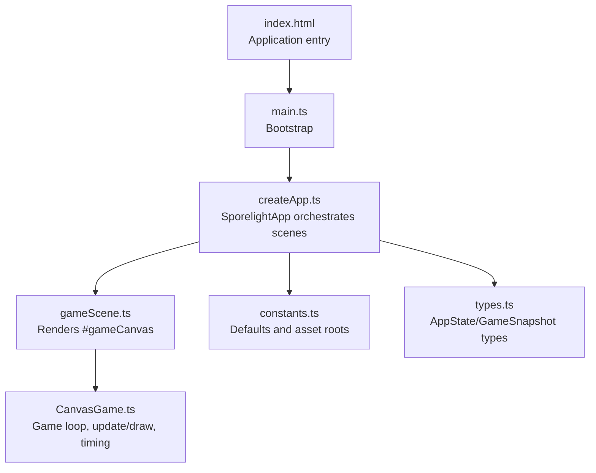
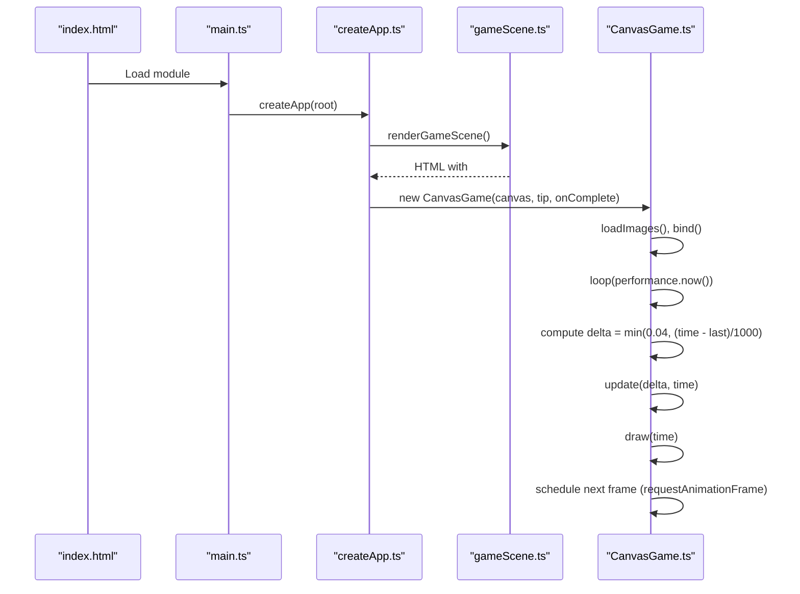
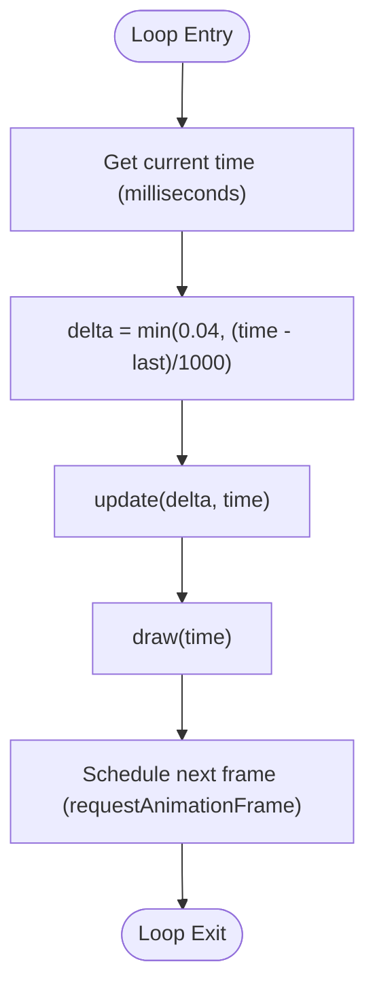
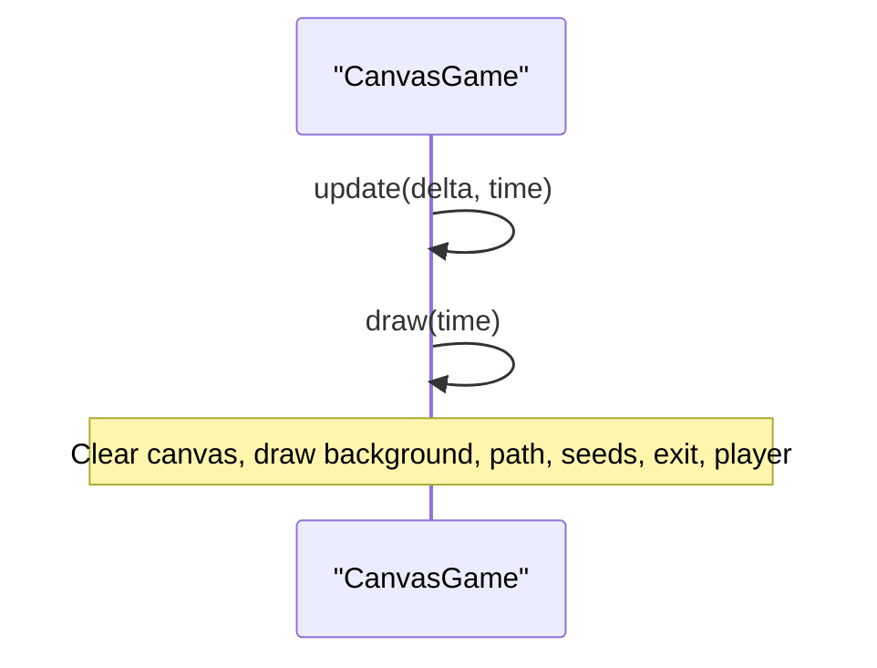
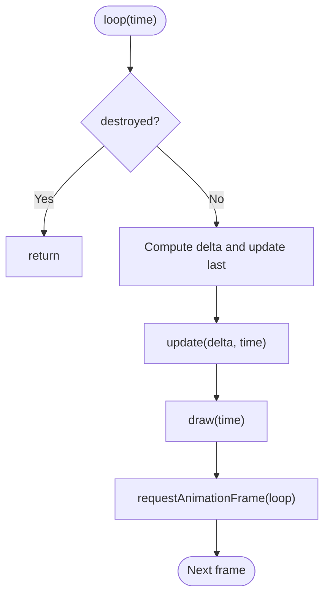
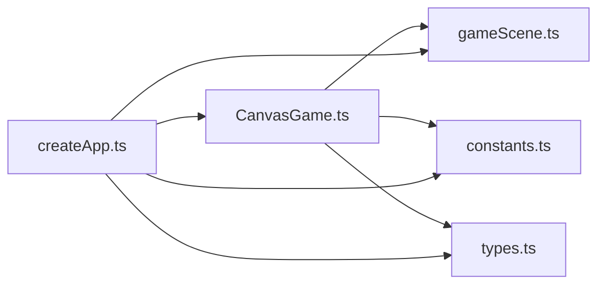

# Game Loop and Performance

<cite>
**Referenced Files in This Document**
- [CanvasGame.ts](file://src/app/game/CanvasGame.ts)
- [createApp.ts](file://src/app/createApp.ts)
- [gameScene.ts](file://src/app/scenes/gameScene.ts)
- [constants.ts](file://src/app/constants.ts)
- [types.ts](file://src/app/types.ts)
- [main.ts](file://src/main.ts)
- [index.html](file://index.html)
- [vite.config.ts](file://vite.config.ts)
- [package.json](file://package.json)
</cite>

## Table of Contents
1. [Introduction](#introduction)
2. [Project Structure](#project-structure)
3. [Core Components](#core-components)
4. [Architecture Overview](#architecture-overview)
5. [Detailed Component Analysis](#detailed-component-analysis)
6. [Dependency Analysis](#dependency-analysis)
7. [Performance Considerations](#performance-considerations)
8. [Troubleshooting Guide](#troubleshooting-guide)
9. [Conclusion](#conclusion)

## Introduction
This document explains the game loop architecture and performance optimization in SporeLight. It focuses on the requestAnimationFrame-based loop, delta time calculation for frame-rate independence, and the performance.now() timing system. It documents loop termination, cleanup, and resource management, the update-draw cycle, frame rate limiting (maximum 0.04 seconds per frame), and canvas rendering performance considerations. It also covers the destroy() method, cancelAnimationFrame usage, memory leak prevention, performance monitoring techniques, optimization strategies for different hardware configurations, and debugging approaches for frame rate issues.

## Project Structure
SporeLight organizes the game loop within a small set of focused modules:
- Application bootstrap and scene orchestration
- Game scene rendering and canvas lifecycle
- Game logic and rendering loop



**Diagram sources**
- [index.html:1-13](file://index.html#L1-L13)
- [main.ts:1-11](file://src/main.ts#L1-L11)
- [createApp.ts:1-377](file://src/app/createApp.ts#L1-L377)
- [gameScene.ts:1-22](file://src/app/scenes/gameScene.ts#L1-L22)
- [CanvasGame.ts:1-318](file://src/app/game/CanvasGame.ts#L1-L318)
- [constants.ts:1-71](file://src/app/constants.ts#L1-L71)
- [types.ts:1-45](file://src/app/types.ts#L1-L45)

**Section sources**
- [index.html:1-13](file://index.html#L1-L13)
- [main.ts:1-11](file://src/main.ts#L1-L11)
- [createApp.ts:16-109](file://src/app/createApp.ts#L16-L109)
- [gameScene.ts:3-21](file://src/app/scenes/gameScene.ts#L3-L21)

## Core Components
- CanvasGame: Implements the requestAnimationFrame loop, delta time computation, update-draw cycle, and cleanup.
- SporelightApp: Manages scenes, mounts/unmounts the game, and triggers CanvasGame lifecycle.
- Game scene: Provides the canvas element and HUD for the game screen.

Key responsibilities:
- Timing: Uses performance.now() for high-resolution timestamps and computes delta time.
- Frame rate independence: Scales movement and animations by delta time.
- Frame rate limiting: Caps delta to a maximum of 0.04 seconds per frame.
- Update-draw separation: Clear separation between logic updates and rendering.
- Cleanup: Properly cancels the animation frame and removes event listeners.

**Section sources**
- [CanvasGame.ts:14-47](file://src/app/game/CanvasGame.ts#L14-L47)
- [CanvasGame.ts:134-146](file://src/app/game/CanvasGame.ts#L134-L146)
- [CanvasGame.ts:49-54](file://src/app/game/CanvasGame.ts#L49-L54)
- [createApp.ts:316-319](file://src/app/createApp.ts#L316-L319)
- [gameScene.ts:3-21](file://src/app/scenes/gameScene.ts#L3-L21)

## Architecture Overview
The game loop is structured around requestAnimationFrame and performance.now(). The SporelightApp creates the game scene and instantiates CanvasGame when entering the game scene. CanvasGame sets up input bindings, loads assets, and starts the loop with the initial timestamp from performance.now(). The loop computes delta time, updates game state, draws to the canvas, and schedules the next frame.



**Diagram sources**
- [index.html:1-13](file://index.html#L1-L13)
- [main.ts:1-11](file://src/main.ts#L1-L11)
- [createApp.ts:95-108](file://src/app/createApp.ts#L95-L108)
- [gameScene.ts:3-21](file://src/app/scenes/gameScene.ts#L3-L21)
- [CanvasGame.ts:32-47](file://src/app/game/CanvasGame.ts#L32-L47)
- [CanvasGame.ts:134-146](file://src/app/game/CanvasGame.ts#L134-L146)

## Detailed Component Analysis

### CanvasGame: RequestAnimationFrame Loop and Delta Time
CanvasGame encapsulates the entire game loop:
- Initialization: Stores canvas context, loads images, binds input events, and starts the loop with performance.now().
- Loop: Computes delta time, caps it to 0.04 seconds, updates state, draws, and schedules the next frame.
- Update: Handles player movement, state transitions, and completion detection.
- Draw: Clears the canvas, renders background, path, seeds, exit, and player with animated frames.
- Cleanup: Cancels the animation frame and removes event listeners.

```mermaid
classDiagram
class CanvasGame {
-ctx : CanvasRenderingContext2D
-raf : number
-destroyed : boolean
-completed : boolean
-keys : Set<string>
-target : {x : number,y : number}|null
-player : {x : number,y : number,state : "idle"|"move"|"sow"|"done"}
-seeds : Seed[]
-exit : {x : number,y : number,active : boolean}
-images : Map<string,HTMLImageElement>
-last : number
-sowUntil : number
-messageUntil : number
+constructor(canvas,tip,complete)
+destroy() void
+sow() void
-loadImages() void
-bind() void
-onKeyDown(event) void
-onKeyUp(event) void
-loop(time) void
-update(delta,time) void
-draw(time) void
-drawPath() void
-drawSeeds(time) void
-drawExit(time) void
-drawPlayer(time) void
-frameFor(time) string
-drawImage(key,x,y,width,height) void
-nearSeed() Seed|null
-say(message) void
}
```

**Diagram sources**
- [CanvasGame.ts:14-318](file://src/app/game/CanvasGame.ts#L14-L318)

**Section sources**
- [CanvasGame.ts:32-47](file://src/app/game/CanvasGame.ts#L32-L47)
- [CanvasGame.ts:134-146](file://src/app/game/CanvasGame.ts#L134-L146)
- [CanvasGame.ts:148-192](file://src/app/game/CanvasGame.ts#L148-L192)
- [CanvasGame.ts:194-201](file://src/app/game/CanvasGame.ts#L194-L201)
- [CanvasGame.ts:49-54](file://src/app/game/CanvasGame.ts#L49-L54)

### Delta Time and Frame Rate Independence
Delta time is computed from the difference between the current and previous timestamps, normalized to seconds, and capped at 0.04 seconds. Movement and animations scale with delta time to remain frame-rate independent.



**Diagram sources**
- [CanvasGame.ts:134-146](file://src/app/game/CanvasGame.ts#L134-L146)

**Section sources**
- [CanvasGame.ts:139](file://src/app/game/CanvasGame.ts#L139)
- [CanvasGame.ts:168-169](file://src/app/game/CanvasGame.ts#L168-L169)
- [CanvasGame.ts:178-179](file://src/app/game/CanvasGame.ts#L178-L179)

### Update-Draw Cycle
The update-draw cycle separates logic from rendering:
- Update phase: Processes input, movement, state changes, and completion checks.
- Draw phase: Clears the canvas and renders all visual elements.



**Diagram sources**
- [CanvasGame.ts:148-192](file://src/app/game/CanvasGame.ts#L148-L192)
- [CanvasGame.ts:194-201](file://src/app/game/CanvasGame.ts#L194-L201)

**Section sources**
- [CanvasGame.ts:148-192](file://src/app/game/CanvasGame.ts#L148-L192)
- [CanvasGame.ts:194-201](file://src/app/game/CanvasGame.ts#L194-L201)

### Loop Termination and Cleanup
Loop termination occurs when the destroyed flag is set. The loop checks this flag early and returns without scheduling the next frame. Cleanup includes canceling the animation frame and removing event listeners.



**Diagram sources**
- [CanvasGame.ts:134-146](file://src/app/game/CanvasGame.ts#L134-L146)

**Section sources**
- [CanvasGame.ts:135-137](file://src/app/game/CanvasGame.ts#L135-L137)
- [CanvasGame.ts:49-54](file://src/app/game/CanvasGame.ts#L49-L54)

### Resource Management and Memory Leak Prevention
CanvasGame manages resources efficiently:
- Images are loaded once and cached in a Map keyed by identifiers.
- Event listeners are attached during initialization and removed during destroy().
- The loop uses a single animation frame handle and cancels it on destruction.

Best practices demonstrated:
- Avoid repeated DOM queries inside the loop.
- Reuse image objects and avoid creating new ones per frame.
- Remove event listeners to prevent leaks when switching scenes.

**Section sources**
- [CanvasGame.ts:76-102](file://src/app/game/CanvasGame.ts#L76-L102)
- [CanvasGame.ts:104-132](file://src/app/game/CanvasGame.ts#L104-L132)
- [CanvasGame.ts:49-54](file://src/app/game/CanvasGame.ts#L49-L54)

### Frame Rate Limiting (Max 0.04 Seconds Per Frame)
The loop caps delta time to 0.04 seconds to prevent large jumps in state progression during slow frames or when the browser throttles. This ensures stable gameplay regardless of frame rate.

**Section sources**
- [CanvasGame.ts:139](file://src/app/game/CanvasGame.ts#L139)

### Canvas Rendering Performance Considerations
Rendering uses a fixed 1280x720 coordinate space and clears the canvas each frame. Animations rely on time-based frame selection and alpha effects. The drawImage method gracefully handles missing image assets by drawing a placeholder color.

Optimization tips:
- Keep drawImage checks minimal; images are preloaded and cached.
- Use globalAlpha sparingly; it affects subsequent draw calls.
- Prefer vector shapes and sprites aligned to pixel boundaries to reduce blurriness.

**Section sources**
- [CanvasGame.ts:195](file://src/app/game/CanvasGame.ts#L195)
- [CanvasGame.ts:286-296](file://src/app/game/CanvasGame.ts#L286-L296)

### Performance Monitoring Techniques
While the code does not include explicit frame timing instrumentation, the following techniques can be applied:
- Measure frame durations by logging the delta values computed in the loop.
- Track average, min, and max delta over short windows to detect spikes.
- Use browser devtools profiling to identify heavy frames and hotspots.

[No sources needed since this section provides general guidance]

### Optimization Strategies for Different Hardware Configurations
- Low-motion mode: The application supports a low-motion setting that reduces animation complexity and boot sequence duration. This can be leveraged to improve performance on lower-end devices.
- Quality settings: The settings modal exposes quality controls that can be used to adjust rendering complexity. While the current game scene does not apply quality settings to rendering, future extensions can use these settings to scale effects.
- Asset loading: Preloading assets avoids runtime stalls and improves perceived performance.

**Section sources**
- [createApp.ts:151-157](file://src/app/createApp.ts#L151-L157)
- [constants.ts:8](file://src/app/constants.ts#L8)

### Debugging Approaches for Frame Rate Issues
- Verify that the loop runs continuously and that requestAnimationFrame is scheduled after each frame.
- Check for long-running synchronous operations in update/draw that could block the main thread.
- Monitor the delta values to detect unusual spikes indicating missed frames or browser throttling.
- Ensure event listeners are properly removed when leaving the game scene to avoid residual work.

**Section sources**
- [CanvasGame.ts:134-146](file://src/app/game/CanvasGame.ts#L134-L146)
- [CanvasGame.ts:49-54](file://src/app/game/CanvasGame.ts#L49-L54)
- [createApp.ts:316-319](file://src/app/createApp.ts#L316-L319)

## Dependency Analysis
The game loop depends on:
- DOM APIs: Canvas, requestAnimationFrame, performance.now, window events.
- Application orchestration: SporelightApp creates and destroys CanvasGame instances.
- Scene rendering: The game scene provides the canvas element and HUD.



**Diagram sources**
- [createApp.ts:101-108](file://src/app/createApp.ts#L101-L108)
- [CanvasGame.ts:1-3](file://src/app/game/CanvasGame.ts#L1-L3)
- [gameScene.ts:3-21](file://src/app/scenes/gameScene.ts#L3-L21)
- [constants.ts:1-10](file://src/app/constants.ts#L1-L10)
- [types.ts:1-45](file://src/app/types.ts#L1-L45)

**Section sources**
- [createApp.ts:101-108](file://src/app/createApp.ts#L101-L108)
- [CanvasGame.ts:1-3](file://src/app/game/CanvasGame.ts#L1-L3)

## Performance Considerations
- Use requestAnimationFrame for smooth, vsync-aligned updates.
- Cap delta time to prevent physics or animation jumps on slow frames.
- Minimize allocations inside the loop; reuse objects and arrays when possible.
- Keep draw operations simple and avoid unnecessary state changes.
- Preload assets and cache references to reduce runtime overhead.
- Remove event listeners and cancel animation frames when unmounting.

[No sources needed since this section provides general guidance]

## Troubleshooting Guide
Common issues and remedies:
- Stuttering or inconsistent movement: Verify delta time is used consistently in movement calculations and that the cap is functioning.
- Frames not stopping after leaving the game: Ensure destroy() is called and that cancelAnimationFrame is invoked.
- Memory leaks when switching scenes: Confirm event listeners are removed in destroy() and that the game instance is cleared by SporelightApp.
- Missing assets during rendering: The drawImage fallback ensures visuals remain present even if images are not yet loaded.

**Section sources**
- [CanvasGame.ts:139](file://src/app/game/CanvasGame.ts#L139)
- [CanvasGame.ts:168-169](file://src/app/game/CanvasGame.ts#L168-L169)
- [CanvasGame.ts:178-179](file://src/app/game/CanvasGame.ts#L178-L179)
- [CanvasGame.ts:49-54](file://src/app/game/CanvasGame.ts#L49-L54)
- [createApp.ts:316-319](file://src/app/createApp.ts#L316-L319)
- [CanvasGame.ts:286-296](file://src/app/game/CanvasGame.ts#L286-L296)

## Conclusion
SporeLight’s game loop is built on requestAnimationFrame and performance.now(), with a robust delta time system and a strict frame rate cap to ensure frame-rate independence. The update-draw cycle is cleanly separated, and the loop terminates safely with proper cleanup. Resource management is handled through preloading and careful event listener removal. By following the outlined performance monitoring and optimization strategies, developers can maintain smooth performance across diverse hardware configurations while preserving a responsive and visually coherent experience.