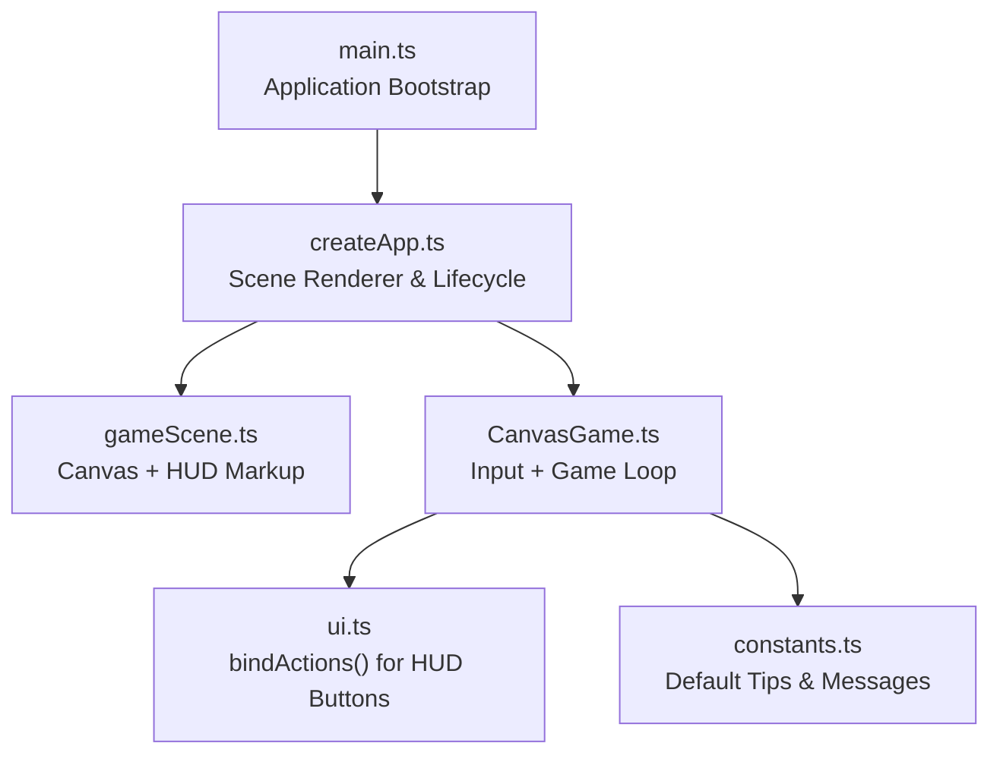
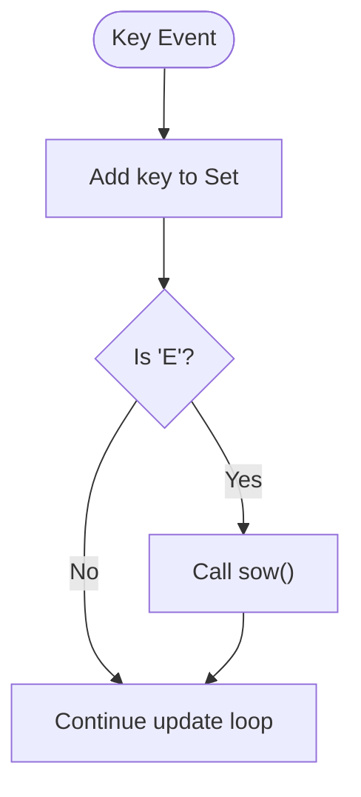
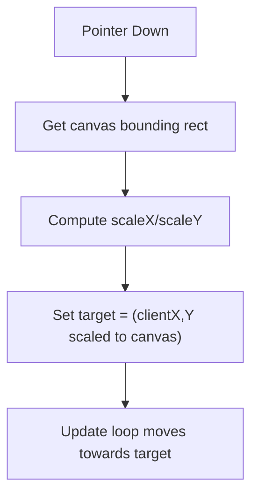
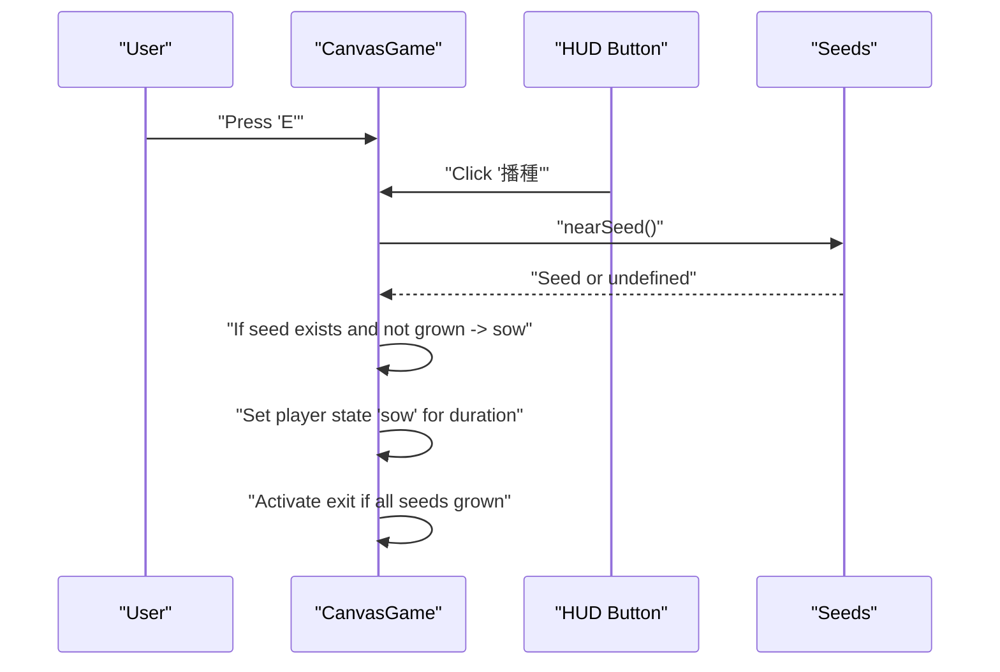
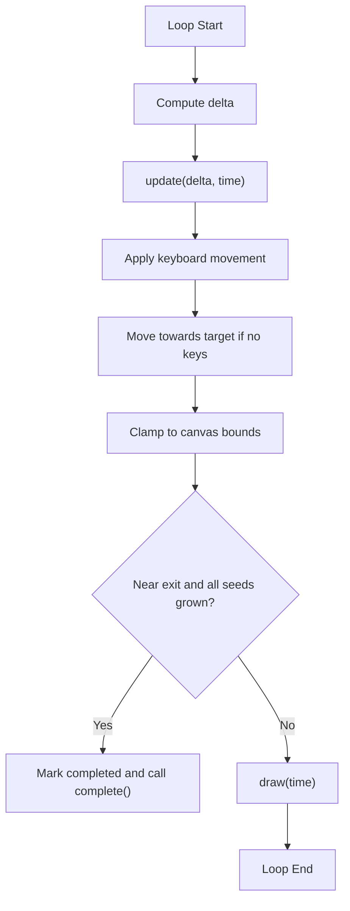
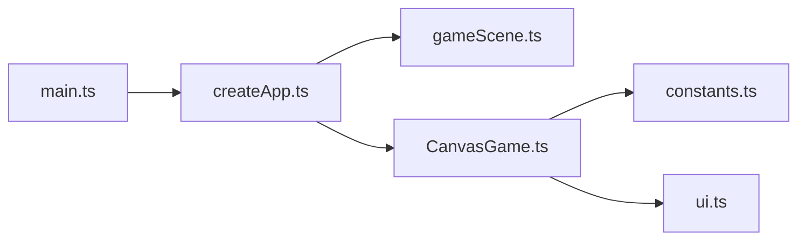

# Input Handling and Controls

<cite>
**Referenced Files in This Document**
- [CanvasGame.ts](file://src/app/game/CanvasGame.ts)
- [createApp.ts](file://src/app/createApp.ts)
- [gameScene.ts](file://src/app/scenes/gameScene.ts)
- [constants.ts](file://src/app/constants.ts)
- [ui.ts](file://src/app/ui.ts)
- [main.ts](file://src/main.ts)
</cite>

## Table of Contents
1. [Introduction](#introduction)
2. [Project Structure](#project-structure)
3. [Core Components](#core-components)
4. [Architecture Overview](#architecture-overview)
5. [Detailed Component Analysis](#detailed-component-analysis)
6. [Dependency Analysis](#dependency-analysis)
7. [Performance Considerations](#performance-considerations)
8. [Troubleshooting Guide](#troubleshooting-guide)
9. [Conclusion](#conclusion)

## Introduction
This document explains the input handling system in SporeLight, focusing on the dual input mechanism that combines keyboard controls (WASD/Arrow keys) and pointer controls (mouse/touch). It covers key state management using a Set for tracking pressed keys, event listener binding/unbinding, integration with the game loop, the sow action trigger mechanism using the 'E' key, pointer event processing with coordinate scaling, and the target-based movement system. It also documents the input event lifecycle, keyboard repeat handling, pointer interaction with canvas boundaries, and how input states are processed during each game update cycle. Finally, it includes troubleshooting guidance for input responsiveness and cross-platform compatibility considerations.

## Project Structure
The input system spans several modules:
- Application bootstrap initializes the UI and scene rendering.
- The game scene renders the canvas and HUD, including a "播種" (Sow) action button.
- The CanvasGame class encapsulates input handling, state updates, and rendering.
- UI utilities bind click handlers to action buttons.
- Constants define default tips and other game messages.



**Diagram sources**
- [main.ts:1-11](file://src/main.ts#L1-L11)
- [createApp.ts:84-109](file://src/app/createApp.ts#L84-L109)
- [gameScene.ts:3-21](file://src/app/scenes/gameScene.ts#L3-L21)
- [CanvasGame.ts:14-47](file://src/app/game/CanvasGame.ts#L14-L47)
- [ui.ts:5-11](file://src/app/ui.ts#L5-L11)
- [constants.ts:9](file://src/app/constants.ts#L9)

**Section sources**
- [main.ts:1-11](file://src/main.ts#L1-L11)
- [createApp.ts:84-109](file://src/app/createApp.ts#L84-L109)
- [gameScene.ts:3-21](file://src/app/scenes/gameScene.ts#L3-L21)
- [CanvasGame.ts:14-47](file://src/app/game/CanvasGame.ts#L14-L47)
- [ui.ts:5-11](file://src/app/ui.ts#L5-L11)
- [constants.ts:9](file://src/app/constants.ts#L9)

## Core Components
- CanvasGame: Central input and game loop controller. Manages key state, pointer targets, player movement, sow action, and rendering.
- createApp: Scene lifecycle manager that instantiates CanvasGame when the game scene is active.
- gameScene: Renders the canvas and HUD, including the sow action button.
- ui.ts: Utility for binding click handlers to action buttons.
- constants.ts: Provides default tips and messages displayed to the player.

Key responsibilities:
- Keyboard input: WASD and Arrow keys update movement vectors; 'E' triggers sow action.
- Pointer input: Mouse/touch pointerdown sets a target position for movement.
- Game loop: Delta-based updates process input states and move the player accordingly.
- Sow action: Proximity to seeds determines whether planting succeeds.

**Section sources**
- [CanvasGame.ts:14-47](file://src/app/game/CanvasGame.ts#L14-L47)
- [createApp.ts:84-109](file://src/app/createApp.ts#L84-L109)
- [gameScene.ts:3-21](file://src/app/scenes/gameScene.ts#L3-L21)
- [ui.ts:5-11](file://src/app/ui.ts#L5-L11)
- [constants.ts:9](file://src/app/constants.ts#L9)

## Architecture Overview
The input system follows a clean separation of concerns:
- Event capture occurs in CanvasGame.bind().
- Input state is stored in-memory (Set for keys, target position).
- The game loop reads input state and updates player position each frame.
- Sow action is triggered either by pressing 'E' or clicking the HUD "播種" button.

```mermaid
sequenceDiagram
participant User as "User"
participant Canvas as "CanvasGame"
participant Window as "Window Events"
participant Loop as "Game Loop"
participant Player as "Player State"
User->>Canvas : "Pointer Down (Mouse/Touch)"
Canvas->>Canvas : "Compute scaled target coordinates"
Canvas->>Player : "Set target position"
User->>Window : "Key Down (WASD/Arrow/E)"
Window-->>Canvas : "onKeyDown callback"
Canvas->>Canvas : "Add key to Set"
Canvas->>Canvas : "If 'E', trigger sow()"
Loop->>Canvas : "update(delta, time)"
Canvas->>Player : "Apply movement from keys or target"
Canvas->>Player : "Clamp to canvas bounds"
Canvas->>Canvas : "If near exit and all seeds grown, complete"
```

**Diagram sources**
- [CanvasGame.ts:104-132](file://src/app/game/CanvasGame.ts#L104-L132)
- [CanvasGame.ts:134-146](file://src/app/game/CanvasGame.ts#L134-L146)
- [CanvasGame.ts:148-191](file://src/app/game/CanvasGame.ts#L148-L191)
- [createApp.ts:97](file://src/app/createApp.ts#L97)

## Detailed Component Analysis

### CanvasGame: Input and Movement Engine
CanvasGame manages:
- Key state: A Set<string> tracks currently pressed keys.
- Target: A pointer target position set by pointerdown events.
- Player state: idle/move/sow/done, with movement logic and boundary checks.
- Sow action: Proximity detection to seeds and state transitions.

Key behaviors:
- Event binding: pointerdown on canvas and keydown/keyup on window.
- Movement logic: prioritizes keyboard input; falls back to target-based movement when no keys are pressed.
- Coordinate scaling: pointer positions are scaled to match canvas pixel density vs CSS layout.
- Boundary clamping: player stays within safe bounds.
- Sow action: triggered by 'E' key or HUD button, validates proximity to seeds.

```mermaid
classDiagram
class CanvasGame {
-ctx : CanvasRenderingContext2D
-keys : Set<string>
-target : {x : number, y : number} | null
-player : {x : number, y : number, state : string}
-seeds : Seed[]
-exit : {x : number, y : number, active : boolean}
-last : number
-sowUntil : number
-messageUntil : number
+constructor(canvas, tip, complete)
-bind() : void
-onKeyDown(event) : void
-onKeyUp(event) : void
-loop(time) : void
-update(delta, time) : void
-draw(time) : void
-nearSeed() : Seed | undefined
-say(message) : void
+sow() : void
+destroy() : void
}
class Seed {
+x : number
+y : number
+grown : boolean
+type : "moss"|"vine"
}
CanvasGame --> Seed : "manages"
```

**Diagram sources**
- [CanvasGame.ts:14-47](file://src/app/game/CanvasGame.ts#L14-L47)
- [CanvasGame.ts:56-74](file://src/app/game/CanvasGame.ts#L56-L74)

**Section sources**
- [CanvasGame.ts:14-47](file://src/app/game/CanvasGame.ts#L14-L47)
- [CanvasGame.ts:104-132](file://src/app/game/CanvasGame.ts#L104-L132)
- [CanvasGame.ts:134-146](file://src/app/game/CanvasGame.ts#L134-L146)
- [CanvasGame.ts:148-191](file://src/app/game/CanvasGame.ts#L148-L191)
- [CanvasGame.ts:56-74](file://src/app/game/CanvasGame.ts#L56-L74)

### Keyboard Input Handling
- Keys tracked: Lowercased key strings in a Set for O(1) add/remove.
- Triggered actions:
  - WASD and Arrow keys: update movement vector.
  - 'E' key: triggers sow action immediately upon keydown.
- No explicit keyboard repeat handling is implemented; repeated keys are handled by continuous presence in the Set.



**Diagram sources**
- [CanvasGame.ts:122-128](file://src/app/game/CanvasGame.ts#L122-L128)
- [CanvasGame.ts:160-163](file://src/app/game/CanvasGame.ts#L160-L163)

**Section sources**
- [CanvasGame.ts:122-128](file://src/app/game/CanvasGame.ts#L122-L128)
- [CanvasGame.ts:160-163](file://src/app/game/CanvasGame.ts#L160-L163)

### Pointer Input and Coordinate Scaling
- Pointer events: pointerdown on the canvas sets a target position.
- Coordinate scaling: computed from canvas pixel dimensions versus CSS layout bounding rectangle to support high-DPI displays.
- Target-based movement: when no keys are pressed, the player moves toward the target until close enough to snap to it.



**Diagram sources**
- [CanvasGame.ts:105-116](file://src/app/game/CanvasGame.ts#L105-L116)
- [CanvasGame.ts:170-181](file://src/app/game/CanvasGame.ts#L170-L181)

**Section sources**
- [CanvasGame.ts:105-116](file://src/app/game/CanvasGame.ts#L105-L116)
- [CanvasGame.ts:170-181](file://src/app/game/CanvasGame.ts#L170-L181)

### Sow Action Trigger Mechanism
- Triggered by:
  - Pressing 'E' key (keydown handler).
  - Clicking the HUD "播種" button (bound in createApp).
- Validation:
  - Must be near a seed; otherwise prompts a message.
  - Cannot sow on an already-grown seed.
- Effects:
  - Sets player state to 'sow' for a short duration.
  - Marks the seed as grown and activates the exit if all seeds are grown.
  - Updates HUD tip with contextual feedback.



**Diagram sources**
- [CanvasGame.ts:122-128](file://src/app/game/CanvasGame.ts#L122-L128)
- [createApp.ts:97](file://src/app/createApp.ts#L97)
- [CanvasGame.ts:56-74](file://src/app/game/CanvasGame.ts#L56-L74)

**Section sources**
- [CanvasGame.ts:122-128](file://src/app/game/CanvasGame.ts#L122-L128)
- [createApp.ts:97](file://src/app/createApp.ts#L97)
- [CanvasGame.ts:56-74](file://src/app/game/CanvasGame.ts#L56-L74)

### Game Loop Integration and Input Processing
- Loop: requestAnimationFrame drives a loop that computes delta time and calls update/draw.
- Update: processes input state, applies movement, clamps to bounds, and checks win condition.
- Draw: clears and redraws background, path, seeds, exit, and player.



**Diagram sources**
- [CanvasGame.ts:134-146](file://src/app/game/CanvasGame.ts#L134-L146)
- [CanvasGame.ts:148-191](file://src/app/game/CanvasGame.ts#L148-L191)
- [CanvasGame.ts:194-201](file://src/app/game/CanvasGame.ts#L194-L201)

**Section sources**
- [CanvasGame.ts:134-146](file://src/app/game/CanvasGame.ts#L134-L146)
- [CanvasGame.ts:148-191](file://src/app/game/CanvasGame.ts#L148-L191)
- [CanvasGame.ts:194-201](file://src/app/game/CanvasGame.ts#L194-L201)

### HUD Button Binding and Cross-Platform Considerations
- The HUD "播種" button is bound via ui.bindActions to call the game's sow method.
- Cross-platform considerations:
  - Pointer events are used for mouse and touch, ensuring touch devices receive pointerdown.
  - Keyboard input uses keydown/keyup on the window, which is standard for desktop browsers.
  - The default tip indicates both pointer movement and E-key planting.

**Section sources**
- [ui.ts:5-11](file://src/app/ui.ts#L5-L11)
- [createApp.ts:97](file://src/app/createApp.ts#L97)
- [constants.ts:9](file://src/app/constants.ts#L9)

## Dependency Analysis
The input system has minimal external dependencies:
- CanvasGame depends on DOM APIs for canvas rendering and event handling.
- createApp orchestrates scene lifecycle and instantiates CanvasGame.
- gameScene provides the canvas and HUD markup.
- ui.ts binds action buttons to handlers.
- constants.ts supplies default tips and messages.



**Diagram sources**
- [main.ts:1-11](file://src/main.ts#L1-L11)
- [createApp.ts:84-109](file://src/app/createApp.ts#L84-L109)
- [gameScene.ts:3-21](file://src/app/scenes/gameScene.ts#L3-L21)
- [CanvasGame.ts:14-47](file://src/app/game/CanvasGame.ts#L14-L47)
- [constants.ts:9](file://src/app/constants.ts#L9)
- [ui.ts:5-11](file://src/app/ui.ts#L5-L11)

**Section sources**
- [main.ts:1-11](file://src/main.ts#L1-L11)
- [createApp.ts:84-109](file://src/app/createApp.ts#L84-L109)
- [gameScene.ts:3-21](file://src/app/scenes/gameScene.ts#L3-L21)
- [CanvasGame.ts:14-47](file://src/app/game/CanvasGame.ts#L14-L47)
- [constants.ts:9](file://src/app/constants.ts#L9)
- [ui.ts:5-11](file://src/app/ui.ts#L5-L11)

## Performance Considerations
- Delta-based movement: Uses a capped delta to smooth movement across varying frame rates.
- Set-based key storage: Efficient O(1) add/remove for key state.
- Coordinate scaling: Computed once per pointerdown to avoid repeated layout measurements.
- Bound checking: Prevents unnecessary calculations by clamping early.
- Animation frames: requestAnimationFrame ensures efficient rendering cadence.

[No sources needed since this section provides general guidance]

## Troubleshooting Guide
Common issues and resolutions:
- Input not responding:
  - Ensure the canvas is focused and present in the DOM when the game starts.
  - Verify that CanvasGame.bind() is called and that event listeners are attached.
  - Confirm that the game scene is active and createApp instantiated CanvasGame.
- Keyboard 'E' not triggering sow:
  - Check that the keydown handler adds the key to the Set and that sow() is invoked.
  - Ensure the player is near a seed; otherwise sow() will show a message and not grow the seed.
- Pointer movement not working:
  - Confirm pointerdown fires and target is set.
  - Verify coordinate scaling factors are computed from canvas pixel dimensions vs layout.
- Movement feels sluggish or jittery:
  - Check that delta is being computed and movement is multiplied by delta.
  - Ensure boundary clamping is not preventing movement.
- Cross-platform issues:
  - On mobile, ensure pointer events are enabled and the canvas receives pointerdown/touch events.
  - Test keyboard input focus on desktop; ensure the window has focus for key events.

**Section sources**
- [CanvasGame.ts:104-132](file://src/app/game/CanvasGame.ts#L104-L132)
- [CanvasGame.ts:122-128](file://src/app/game/CanvasGame.ts#L122-L128)
- [CanvasGame.ts:105-116](file://src/app/game/CanvasGame.ts#L105-L116)
- [CanvasGame.ts:134-146](file://src/app/game/CanvasGame.ts#L134-L146)
- [CanvasGame.ts:148-191](file://src/app/game/CanvasGame.ts#L148-L191)
- [createApp.ts:97](file://src/app/createApp.ts#L97)

## Conclusion
SporeLight’s input system cleanly integrates keyboard and pointer controls with a simple yet robust architecture. The CanvasGame class centralizes input handling, state management, and game loop updates. Key state is tracked efficiently with a Set, pointer events are scaled appropriately for high-DPI displays, and sow actions are triggered both by keyboard and HUD button. The system is straightforward to extend and debug, with clear separation between input capture, state updates, and rendering.