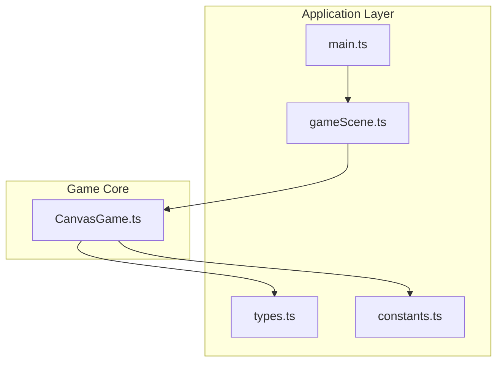
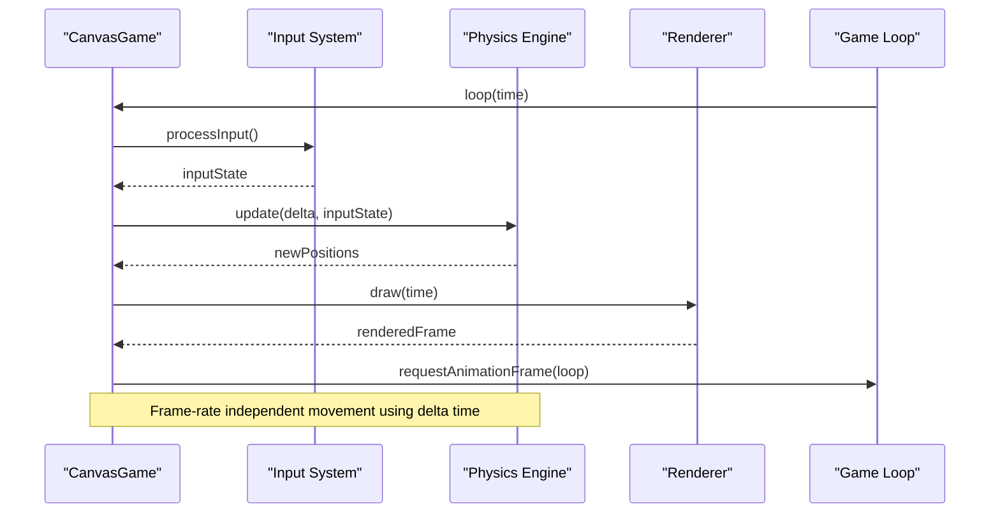
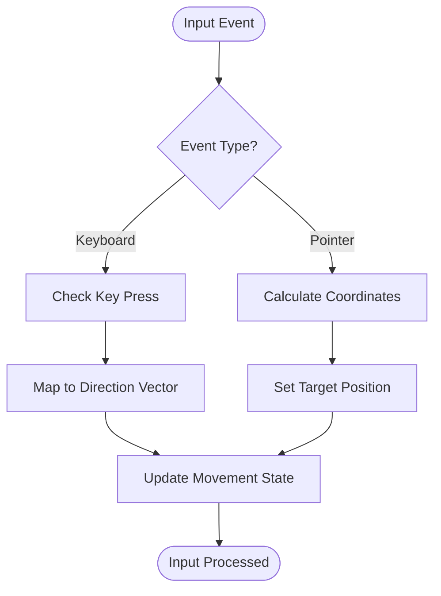
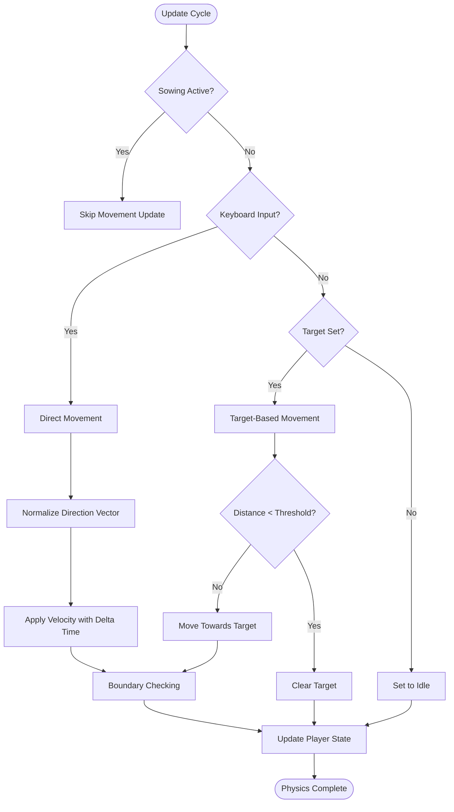
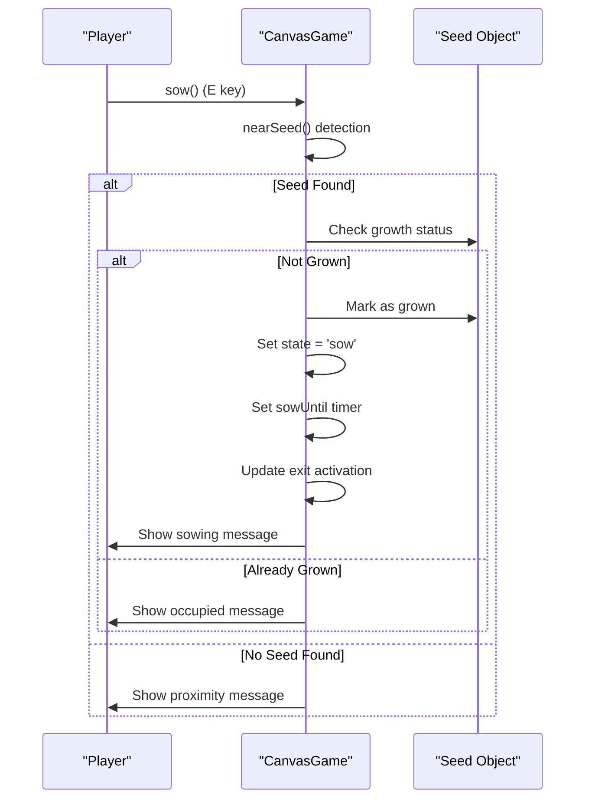
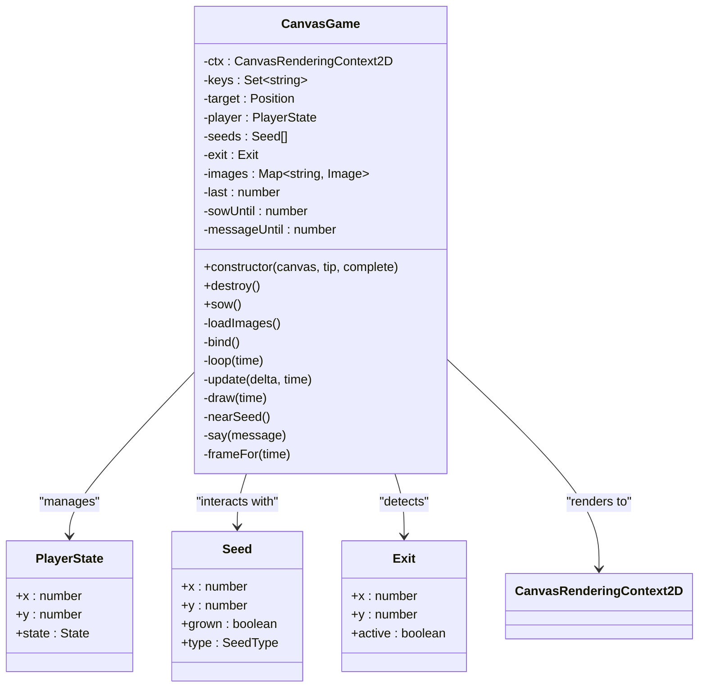

# Physics and Movement System

<cite>
**Referenced Files in This Document**
- [CanvasGame.ts](file://src/app/game/CanvasGame.ts)
- [gameScene.ts](file://src/app/scenes/gameScene.ts)
- [types.ts](file://src/app/types.ts)
- [constants.ts](file://src/app/constants.ts)
- [main.ts](file://src/main.ts)
</cite>

## Table of Contents
1. [Introduction](#introduction)
2. [Project Structure](#project-structure)
3. [Core Components](#core-components)
4. [Architecture Overview](#architecture-overview)
5. [Detailed Component Analysis](#detailed-component-analysis)
6. [Dependency Analysis](#dependency-analysis)
7. [Performance Considerations](#performance-considerations)
8. [Troubleshooting Guide](#troubleshooting-guide)
9. [Conclusion](#conclusion)

## Introduction
This document provides comprehensive documentation for the game's physics and character movement system in Sporelight. It covers the dual movement system (direct movement via keyboard/WASD/Arrow keys and target-based movement via mouse/touch), frame-rate independent calculations using delta time, boundary checking, seed proximity detection for sowing mechanics, exit detection for level completion, and integration with the game loop timing system.

## Project Structure
The movement system is implemented within a single cohesive class that manages input handling, physics updates, rendering, and game state transitions. The system integrates with the broader application through the game scene and constants.

**Diagram sources**
- [main.ts:1-11](file://src/main.ts#L1-L11)
- [gameScene.ts:1-22](file://src/app/scenes/gameScene.ts#L1-L22)
- [CanvasGame.ts:1-318](file://src/app/game/CanvasGame.ts#L1-L318)
- [types.ts:1-45](file://src/app/types.ts#L1-L45)
- [constants.ts:1-71](file://src/app/constants.ts#L1-L71)

**Section sources**
- [main.ts:1-11](file://src/main.ts#L1-L11)
- [gameScene.ts:1-22](file://src/app/scenes/gameScene.ts#L1-L22)
- [CanvasGame.ts:1-318](file://src/app/game/CanvasGame.ts#L1-L318)
- [types.ts:1-45](file://src/app/types.ts#L1-L45)
- [constants.ts:1-71](file://src/app/constants.ts#L1-L71)

## Core Components
The movement system centers around the CanvasGame class, which encapsulates all movement-related functionality:

### Player State Machine
The system implements a simple finite state machine with four states:
- **Idle**: Character is stationary
- **Move**: Character is actively moving
- **Sow**: Character is performing sowing action
- **Done**: Level completion state

### Movement Modes
The system supports two distinct movement modes:
1. **Direct Movement**: Controlled via keyboard input (WASD/Arrow keys)
2. **Target-Based Movement**: Controlled via mouse/touch pointer

### Physics Implementation
The system uses frame-rate independent calculations with delta time to ensure smooth movement across different hardware configurations.

**Section sources**
- [CanvasGame.ts:14-47](file://src/app/game/CanvasGame.ts#L14-L47)
- [CanvasGame.ts:148-192](file://src/app/game/CanvasGame.ts#L148-L192)
- [CanvasGame.ts:271-284](file://src/app/game/CanvasGame.ts#L271-L284)

## Architecture Overview
The movement system follows a classic game loop architecture with separate update and render phases:

**Diagram sources**
- [CanvasGame.ts:134-146](file://src/app/game/CanvasGame.ts#L134-L146)
- [CanvasGame.ts:148-192](file://src/app/game/CanvasGame.ts#L148-L192)
- [CanvasGame.ts:194-201](file://src/app/game/CanvasGame.ts#L194-L201)

## Detailed Component Analysis

### Input Handling System
The input system manages both keyboard and pointer events with debouncing and state tracking:

#### Keyboard Input Processing
- **Key Tracking**: Uses a Set to track currently pressed keys
- **Movement Keys**: Supports WASD and Arrow keys for directional input
- **Action Key**: 'E' key triggers sowing mechanics
- **Event Delegation**: Handles keydown and keyup events globally

#### Pointer Input Processing
- **Touch/Mouse Events**: Captures pointerdown events on canvas
- **Coordinate Transformation**: Converts screen coordinates to canvas coordinates
- **Target Setting**: Sets movement target position for target-based movement

**Diagram sources**
- [CanvasGame.ts:104-132](file://src/app/game/CanvasGame.ts#L104-L132)
- [CanvasGame.ts:122-132](file://src/app/game/CanvasGame.ts#L122-L132)

**Section sources**
- [CanvasGame.ts:104-132](file://src/app/game/CanvasGame.ts#L104-L132)
- [CanvasGame.ts:122-132](file://src/app/game/CanvasGame.ts#L122-L132)

### Physics Calculation Engine
The physics engine implements frame-rate independent movement using delta time calculations:

#### Velocity and Acceleration Model
- **Base Speed**: Direct movement uses 240 pixels per second
- **Target Movement Speed**: Target-based movement uses 230 pixels per second
- **Delta Time**: Normalized to maximum 0.04 seconds to prevent large jumps
- **Vector Normalization**: Movement vectors are normalized for consistent diagonal movement

#### Movement Logic Flow

**Diagram sources**
- [CanvasGame.ts:148-192](file://src/app/game/CanvasGame.ts#L148-L192)
- [CanvasGame.ts:165-181](file://src/app/game/CanvasGame.ts#L165-L181)

**Section sources**
- [CanvasGame.ts:139-140](file://src/app/game/CanvasGame.ts#L139-L140)
- [CanvasGame.ts:165-181](file://src/app/game/CanvasGame.ts#L165-L181)
- [CanvasGame.ts:183-185](file://src/app/game/CanvasGame.ts#L183-L185)

### Collision and Boundary System
The system implements boundary checking to keep the character within playable area:

#### Boundary Constraints
- **X-Axis Bounds**: 95 to 1150 pixels
- **Y-Axis Bounds**: 170 to 610 pixels
- **Immediate Clamping**: Values are clamped to prevent going out of bounds

#### Path Constraint Integration
The boundary system works in conjunction with the visual path representation, ensuring the character stays within the designated gameplay area.

**Section sources**
- [CanvasGame.ts:183-184](file://src/app/game/CanvasGame.ts#L183-L184)
- [CanvasGame.ts:203-220](file://src/app/game/CanvasGame.ts#L203-L220)

### Sowing Mechanics and Proximity Detection
The sowing system implements proximity-based interaction with environmental objects:

#### Seed Proximity Detection
- **Detection Radius**: 95 pixels for seed proximity
- **Closest Seed Selection**: Finds nearest seed within detection radius
- **Validation**: Checks if seed is already grown before allowing sowing

#### Sowing Animation and State Management
- **Animation Duration**: 900 milliseconds sowing animation
- **State Transitions**: Moves through sow → idle → normal states
- **Visual Feedback**: Provides contextual messages based on seed type

**Diagram sources**
- [CanvasGame.ts:56-74](file://src/app/game/CanvasGame.ts#L56-L74)
- [CanvasGame.ts:298-300](file://src/app/game/CanvasGame.ts#L298-L300)

**Section sources**
- [CanvasGame.ts:56-74](file://src/app/game/CanvasGame.ts#L56-L74)
- [CanvasGame.ts:298-300](file://src/app/game/CanvasGame.ts#L298-L300)

### Exit Detection and Level Completion
The system implements level completion detection through proximity to exit:

#### Exit Activation Mechanism
- **Activation Trigger**: All seeds must be grown to activate exit
- **Proximity Detection**: 70 pixel radius for exit detection
- **Completion State**: Triggers level completion and state change

#### Completion Integration
- **State Transition**: Changes to 'done' state upon completion
- **Data Export**: Returns completion status and seed states
- **Callback Integration**: Notifies parent component of completion

**Section sources**
- [CanvasGame.ts:69-73](file://src/app/game/CanvasGame.ts#L69-L73)
- [CanvasGame.ts:187-191](file://src/app/game/CanvasGame.ts#L187-L191)

### Rendering and Animation System
The movement system integrates with the rendering pipeline to provide visual feedback:

#### Frame-Based Animation
- **Idle Animation**: 4-frame cycle with varying durations
- **Moving Animation**: 3-frame rolling cycle
- **Sowing Animation**: 3-frame sowing cycle
- **Frame Timing**: Consistent frame rates using time-based calculations

#### Visual Effects
- **Trail Effect**: Particle trail during movement
- **Shadow Rendering**: Dynamic shadow positioning
- **State-Specific Rendering**: Different animations for each state

**Section sources**
- [CanvasGame.ts:258-269](file://src/app/game/CanvasGame.ts#L258-L269)
- [CanvasGame.ts:271-284](file://src/app/game/CanvasGame.ts#L271-L284)

## Dependency Analysis
The movement system has minimal external dependencies and maintains good separation of concerns:

**Diagram sources**
- [CanvasGame.ts:7-31](file://src/app/game/CanvasGame.ts#L7-L31)

**Section sources**
- [CanvasGame.ts:1-318](file://src/app/game/CanvasGame.ts#L1-L318)

## Performance Considerations
The movement system implements several optimizations for smooth performance:

### Frame-Rate Independence
- **Delta Time Normalization**: Maximum 0.04-second increments prevent large jumps
- **Consistent Movement Speed**: Movement speed remains constant regardless of frame rate
- **Physics Stability**: Prevents inconsistent behavior on different hardware

### Memory Management
- **Event Listener Cleanup**: Proper removal of event listeners on destruction
- **Image Caching**: Preloaded images stored in memory for fast rendering
- **State Management**: Minimal state objects to reduce memory overhead

### Computational Efficiency
- **Early Exit Conditions**: Quick checks prevent unnecessary calculations
- **Vector Operations**: Efficient vector math for movement calculations
- **Boundary Clamping**: Simple arithmetic operations for boundary checking

## Troubleshooting Guide

### Common Issues and Solutions

#### Movement Not Responding
- **Check Input Binding**: Verify keyboard and pointer events are properly bound
- **State Validation**: Ensure player state is not stuck in 'sow' state
- **Event Listener Status**: Confirm event listeners are attached during initialization

#### Character Stuck Outside Boundaries
- **Boundary Values**: Verify boundary coordinates match intended gameplay area
- **Clamping Logic**: Check that boundary clamping is functioning correctly
- **Coordinate System**: Ensure coordinate transformations are correct for different screen sizes

#### Sowing Mechanics Not Working
- **Proximity Detection**: Verify detection radius matches intended gameplay
- **Seed States**: Check that seed growth states are properly tracked
- **Animation Timing**: Ensure sow animation duration allows for proper completion

#### Exit Detection Problems
- **Activation Logic**: Verify all seeds must be grown before exit activates
- **Proximity Radius**: Check exit detection radius matches intended gameplay
- **State Transitions**: Ensure completion state transitions occur correctly

**Section sources**
- [CanvasGame.ts:49-54](file://src/app/game/CanvasGame.ts#L49-L54)
- [CanvasGame.ts:183-185](file://src/app/game/CanvasGame.ts#L183-L185)
- [CanvasGame.ts:298-300](file://src/app/game/CanvasGame.ts#L298-L300)

## Conclusion
The Sporelight movement system demonstrates a well-architected approach to 2D character movement with frame-rate independence, dual input support, and clean state management. The system successfully balances simplicity with functionality, providing smooth character control while maintaining performance across different hardware configurations. The modular design allows for easy extension and modification of movement behaviors while preserving the existing gameplay mechanics.

The implementation showcases effective use of delta time calculations, boundary checking, and state machines to create a responsive and predictable player experience. The integration with the broader game architecture demonstrates good separation of concerns and maintainable code structure.