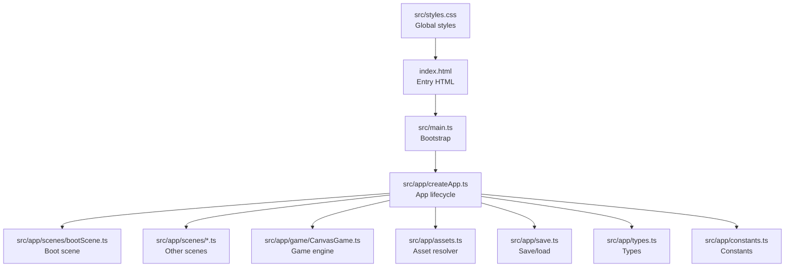
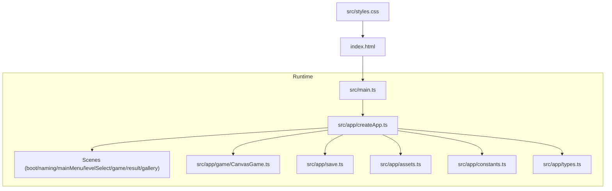
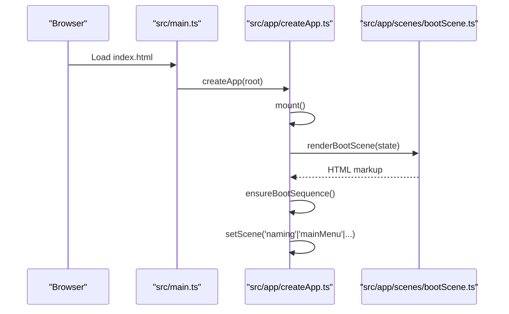
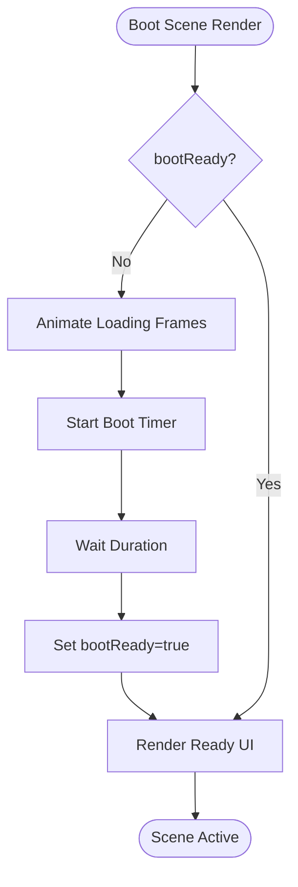
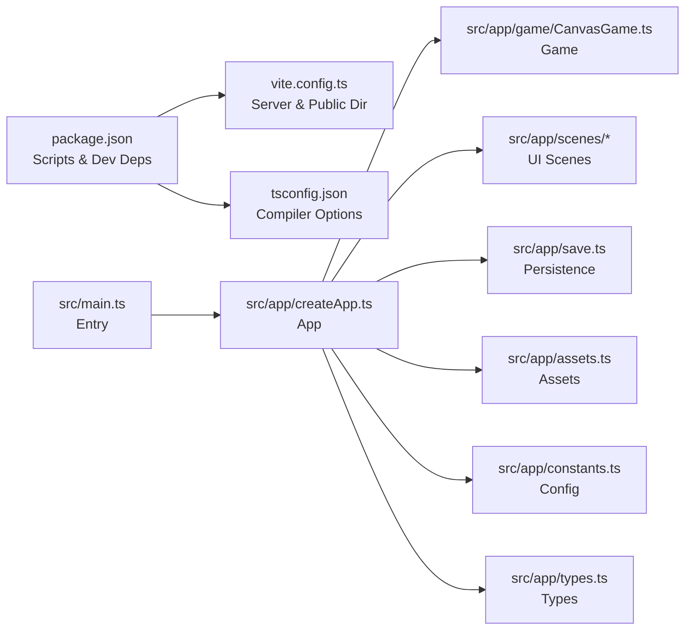

# Getting Started

<cite>
**Referenced Files in This Document**
- [package.json](file://package.json)
- [vite.config.ts](file://vite.config.ts)
- [tsconfig.json](file://tsconfig.json)
- [index.html](file://index.html)
- [src/main.ts](file://src/main.ts)
- [src/app/createApp.ts](file://src/app/createApp.ts)
- [src/app/game/CanvasGame.ts](file://src/app/game/CanvasGame.ts)
- [src/app/scenes/bootScene.ts](file://src/app/scenes/bootScene.ts)
- [src/app/assets.ts](file://src/app/assets.ts)
- [src/app/constants.ts](file://src/app/constants.ts)
- [src/app/types.ts](file://src/app/types.ts)
- [src/app/save.ts](file://src/app/save.ts)
- [src/styles.css](file://src/styles.css)
</cite>

## Table of Contents
1. [Introduction](#introduction)
2. [Prerequisites](#prerequisites)
3. [Installation](#installation)
4. [Development Server](#development-server)
5. [First Run](#first-run)
6. [Project Structure](#project-structure)
7. [Architecture Overview](#architecture-overview)
8. [Detailed Component Analysis](#detailed-component-analysis)
9. [Dependency Analysis](#dependency-analysis)
10. [Performance Considerations](#performance-considerations)
11. [Troubleshooting Guide](#troubleshooting-guide)
12. [Conclusion](#conclusion)

## Introduction
SporeLight is a single-page web application built with TypeScript and Vite. It renders a canvas-based mini-game and several UI scenes, orchestrated by a central application controller. The project uses a modern ES module setup and relies on Vite for fast development builds and previews.

## Prerequisites
- Operating system: Windows, macOS, or Linux
- Node.js: Version compatible with TypeScript 5.x and Vite 5.x (recommended LTS versions such as 18.x or 20.x)
- Package manager: npm (comes with Node.js) or Yarn
- Browser: Modern browser supporting ES modules and Canvas API (Chrome, Firefox, Safari, Edge)

Notes:
- The project sets module resolution to ESNext and uses ES2020+ features. Ensure your Node.js version supports these features.
- The application targets DOM APIs and Canvas rendering. No special browser flags are required beyond enabling JavaScript.

**Section sources**
- [package.json:11-14](file://package.json#L11-L14)
- [tsconfig.json:2-14](file://tsconfig.json#L2-L14)

## Installation
Follow these steps to prepare your development environment:

1. Clone the repository to your local machine.
2. Open a terminal in the project root.
3. Install dependencies using npm ci to ensure deterministic installs:
   - Command: npm ci
4. After installation completes, verify the environment:
   - Check Node.js version: node --version
   - Check npm version: npm --version

What happens during npm ci:
- Reads package-lock.json and installs exact dependency versions as defined.
- Ensures consistent environments across machines.

**Section sources**
- [package.json:6-10](file://package.json#L6-L10)
- [package.json:11-14](file://package.json#L11-L14)

## Development Server
Vite serves the app locally with hot module replacement and fast rebuilds.

How to run:
- Start the dev server: npm run dev
- Access the app at http://127.0.0.1:4173

Vite configuration highlights:
- Host binding: 127.0.0.1
- Port: 4173
- Public assets directory: assets

Build and preview:
- Build for production: npm run build
- Preview production build: npm run preview

**Section sources**
- [package.json:6-10](file://package.json#L6-L10)
- [vite.config.ts:3-9](file://vite.config.ts#L3-L9)

## First Run
Initial launch flow:

1. Open the development server URL in your browser.
2. The boot scene loads with animated startup visuals and a progress bar.
3. After the boot sequence completes, the naming scene appears.
4. Enter a name (1–12 characters, Chinese/English/digits allowed) and continue.
5. Navigate to the main menu, select a level, and enter the game scene.
6. In the game, move with arrow keys or WASD and press E or click to sow seeds.

Basic controls:
- Move: Arrow keys or WASD
- Sow: E key or click near a soil patch
- Interact: Click buttons in UI scenes

Understanding the boot sequence:
- The boot scene displays animated loading frames and ambient effects.
- Once ready, the UI transitions to the naming scene automatically.

**Section sources**
- [src/app/createApp.ts:165-183](file://src/app/createApp.ts#L165-L183)
- [src/app/scenes/bootScene.ts:19-65](file://src/app/scenes/bootScene.ts#L19-L65)
- [src/app/createApp.ts:264-286](file://src/app/createApp.ts#L264-L286)

## Project Structure
High-level layout:
- Root HTML: index.html
- Entry script: src/main.ts
- Application bootstrap: src/app/createApp.ts
- Scenes: src/app/scenes/*
- Game engine: src/app/game/CanvasGame.ts
- Assets helper: src/app/assets.ts
- Constants and assets roots: src/app/constants.ts
- Types: src/app/types.ts
- Save/load: src/app/save.ts
- Styles: src/styles.css and imported CSS files

Where to start:
- Entry point: src/main.ts
- App orchestration: src/app/createApp.ts
- Boot sequence: src/app/scenes/bootScene.ts
- Game logic: src/app/game/CanvasGame.ts
- Asset paths: src/app/assets.ts
- Types and constants: src/app/types.ts, src/app/constants.ts
- Save persistence: src/app/save.ts



**Diagram sources**
- [index.html:1-13](file://index.html#L1-L13)
- [src/main.ts:1-11](file://src/main.ts#L1-L11)
- [src/app/createApp.ts:16-82](file://src/app/createApp.ts#L16-L82)
- [src/app/scenes/bootScene.ts:19-65](file://src/app/scenes/bootScene.ts#L19-L65)
- [src/app/game/CanvasGame.ts:14-47](file://src/app/game/CanvasGame.ts#L14-L47)
- [src/app/assets.ts:1-4](file://src/app/assets.ts#L1-L4)
- [src/app/save.ts:49-66](file://src/app/save.ts#L49-L66)
- [src/app/types.ts:1-45](file://src/app/types.ts#L1-L45)
- [src/app/constants.ts:1-71](file://src/app/constants.ts#L1-L71)
- [src/styles.css:1-5](file://src/styles.css#L1-L5)

**Section sources**
- [index.html:1-13](file://index.html#L1-L13)
- [src/main.ts:1-11](file://src/main.ts#L1-L11)
- [src/app/createApp.ts:16-82](file://src/app/createApp.ts#L16-L82)
- [src/styles.css:1-5](file://src/styles.css#L1-L5)

## Architecture Overview
The app follows a modular structure:
- Entry initializes styles and mounts the app.
- createApp manages scenes, settings, and transitions.
- Scenes render UI and delegate interactions.
- CanvasGame handles the gameplay loop and rendering.
- assets resolves asset paths; constants define asset roots and timing.
- save persists user data to localStorage.



**Diagram sources**
- [src/main.ts:1-11](file://src/main.ts#L1-L11)
- [src/app/createApp.ts:16-82](file://src/app/createApp.ts#L16-L82)
- [src/app/game/CanvasGame.ts:14-47](file://src/app/game/CanvasGame.ts#L14-L47)
- [src/app/save.ts:49-66](file://src/app/save.ts#L49-L66)
- [src/app/assets.ts:1-4](file://src/app/assets.ts#L1-L4)
- [src/app/constants.ts:1-71](file://src/app/constants.ts#L1-L71)
- [src/app/types.ts:1-45](file://src/app/types.ts#L1-L45)
- [index.html:1-13](file://index.html#L1-L13)
- [src/styles.css:1-5](file://src/styles.css#L1-L5)

## Detailed Component Analysis

### Application Lifecycle and Scenes
- createApp orchestrates scene rendering and user interactions.
- Scene transitions are driven by state changes and action bindings.
- Settings modal and confirm modes are integrated into the main shell.



**Diagram sources**
- [src/main.ts:1-11](file://src/main.ts#L1-L11)
- [src/app/createApp.ts:16-82](file://src/app/createApp.ts#L16-L82)
- [src/app/scenes/bootScene.ts:19-65](file://src/app/scenes/bootScene.ts#L19-L65)

**Section sources**
- [src/app/createApp.ts:16-82](file://src/app/createApp.ts#L16-L82)
- [src/app/scenes/bootScene.ts:19-65](file://src/app/scenes/bootScene.ts#L19-L65)

### Canvas Game Engine
CanvasGame implements the core gameplay:
- Loads character and world sprites via the asset helper.
- Handles input (keyboard and pointer).
- Runs a fixed-step update loop with requestAnimationFrame.
- Renders background, seeds, exit, and player with animations.

```mermaid
classDiagram
class CanvasGame {
-ctx : CanvasRenderingContext2D
-raf : number
-destroyed : boolean
-completed : boolean
-keys : Set<string>
-target : {x : number, y : number} | null
-player : {x : number, y : number, state : string}
-seeds : Seed[]
-exit : {x : number, y : number, active : boolean}
-images : Map<string, HTMLImageElement>
-last : number
-sowUntil : number
-messageUntil : number
+constructor(canvas, tip, complete)
+destroy()
+sow()
-loadImages()
-bind()
-onKeyDown(event)
-onKeyUp(event)
-loop(time)
-update(delta, time)
-draw(time)
-drawPath()
-drawSeeds(time)
-drawExit(time)
-drawPlayer(time)
-frameFor(time) : string
-drawImage(key, x, y, width, height)
-nearSeed() : Seed | undefined
-say(message)
}
```

**Diagram sources**
- [src/app/game/CanvasGame.ts:14-318](file://src/app/game/CanvasGame.ts#L14-L318)

**Section sources**
- [src/app/game/CanvasGame.ts:14-318](file://src/app/game/CanvasGame.ts#L14-L318)

### Boot Sequence Flow
The boot sequence animates startup frames and transitions to interactive scenes after a configured duration.



**Diagram sources**
- [src/app/createApp.ts:165-183](file://src/app/createApp.ts#L165-L183)
- [src/app/scenes/bootScene.ts:19-65](file://src/app/scenes/bootScene.ts#L19-L65)

**Section sources**
- [src/app/createApp.ts:165-183](file://src/app/createApp.ts#L165-L183)
- [src/app/scene/bootScene.ts:19-65](file://src/app/scene/bootScene.ts#L19-L65)

## Dependency Analysis
Key runtime dependencies:
- TypeScript compiler and bundler toolchain
- Vite for dev server and build

TypeScript configuration:
- Targets ES2020 with DOM libraries
- Uses ESNext modules and strict mode
- No emit for type-only projects



**Diagram sources**
- [package.json:6-14](file://package.json#L6-L14)
- [vite.config.ts:3-9](file://vite.config.ts#L3-L9)
- [tsconfig.json:2-14](file://tsconfig.json#L2-L14)
- [src/main.ts:1-11](file://src/main.ts#L1-L11)
- [src/app/createApp.ts:16-82](file://src/app/createApp.ts#L16-L82)
- [src/app/game/CanvasGame.ts:14-47](file://src/app/game/CanvasGame.ts#L14-L47)
- [src/app/save.ts:49-66](file://src/app/save.ts#L49-L66)
- [src/app/assets.ts:1-4](file://src/app/assets.ts#L1-L4)
- [src/app/constants.ts:1-71](file://src/app/constants.ts#L1-L71)
- [src/app/types.ts:1-45](file://src/app/types.ts#L1-L45)

**Section sources**
- [package.json:6-14](file://package.json#L6-L14)
- [vite.config.ts:3-9](file://vite.config.ts#L3-L9)
- [tsconfig.json:2-14](file://tsconfig.json#L2-L14)
- [src/main.ts:1-11](file://src/main.ts#L1-L11)
- [src/app/createApp.ts:16-82](file://src/app/createApp.ts#L16-L82)

## Performance Considerations
- Keep assets organized under the public directory to avoid bundling overhead.
- Prefer sprite sheets and preloaded images for smooth animations.
- Limit DOM updates per frame; batch UI changes when possible.
- Use requestAnimationFrame consistently for rendering loops.
- Avoid frequent localStorage writes; coalesce save operations.

## Troubleshooting Guide
Common setup issues and fixes:

- Node.js version mismatch
  - Symptom: Build errors or unsupported syntax
  - Fix: Use Node.js 18.x or 20.x as recommended for TypeScript 5.x and Vite 5.x

- npm ci fails due to lockfile mismatch
  - Symptom: Dependency resolution errors
  - Fix: Remove node_modules and package-lock.json, then re-run npm ci

- Vite server not starting or port blocked
  - Symptom: Port 4173 in use or permission denied
  - Fix: Change port in vite.config.ts or kill the process using the port

- Blank screen on load
  - Symptom: App div missing or entry script not loaded
  - Fix: Ensure index.html contains the #app div and script tag pointing to src/main.ts

- Assets not found
  - Symptom: Broken images or missing textures
  - Fix: Verify asset paths resolve under /images and assets are present in assets/

- Game does not render or throws Canvas error
  - Symptom: Canvas context unavailable
  - Fix: Confirm the canvas element exists and is appended before initialization

- Name validation fails on naming scene
  - Symptom: Error message about name length or characters
  - Fix: Enter a name with 1–12 characters using allowed character set

**Section sources**
- [index.html:8-10](file://index.html#L8-L10)
- [src/main.ts:4-10](file://src/main.ts#L4-L10)
- [vite.config.ts:5-8](file://vite.config.ts#L5-L8)
- [src/app/assets.ts:1-4](file://src/app/assets.ts#L1-L4)
- [src/app/game/CanvasGame.ts:32-47](file://src/app/game/CanvasGame.ts#L32-L47)
- [src/app/createApp.ts:264-286](file://src/app/createApp.ts#L264-L286)

## Conclusion
You are now ready to develop and run SporeLight locally. Start the dev server, explore the boot and game scenes, and iterate on the UI and gameplay. Use the troubleshooting tips to resolve environment-specific issues quickly.