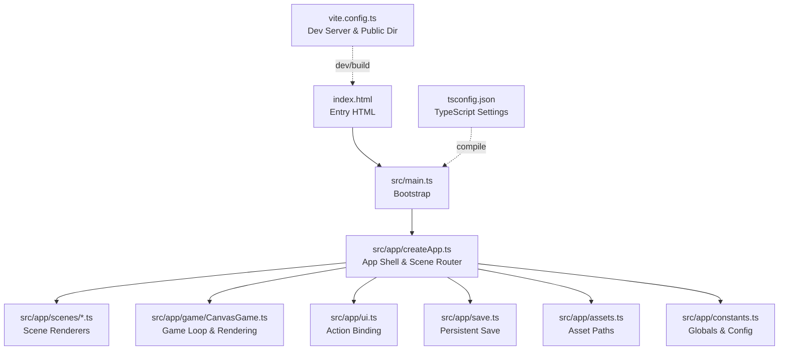
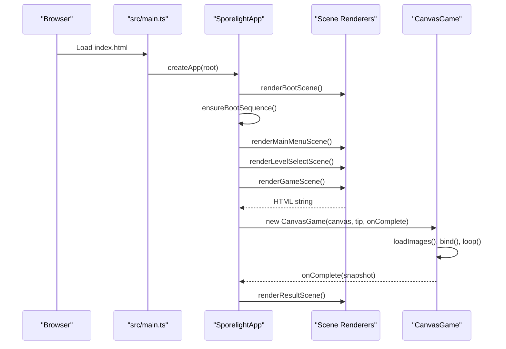
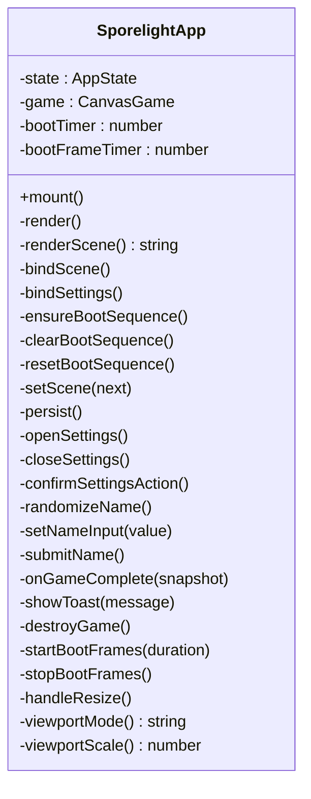
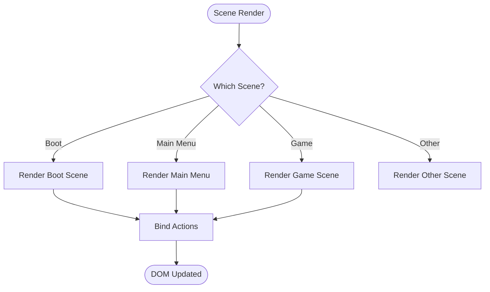
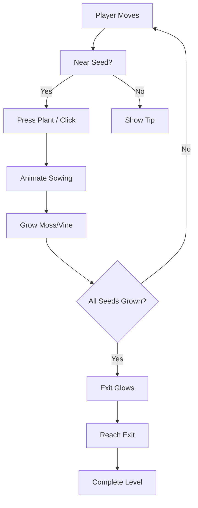
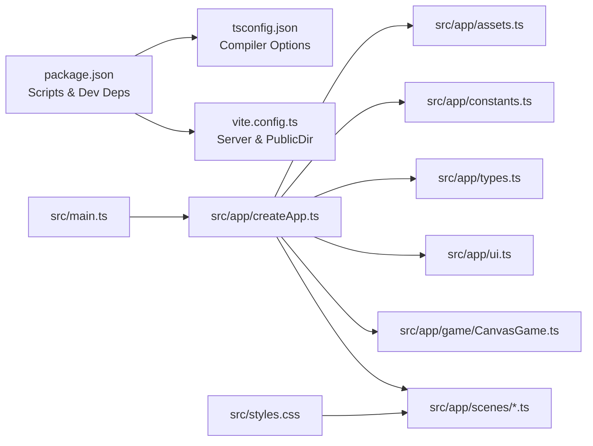

# Project Overview

<cite>
**Referenced Files in This Document**
- [package.json](file://package.json)
- [index.html](file://index.html)
- [vite.config.ts](file://vite.config.ts)
- [tsconfig.json](file://tsconfig.json)
- [src/main.ts](file://src/main.ts)
- [src/app/createApp.ts](file://src/app/createApp.ts)
- [src/app/game/CanvasGame.ts](file://src/app/game/CanvasGame.ts)
- [src/app/tiles.ts](file://src/app/tiles.ts)
- [src/app/types.ts](file://src/app/types.ts)
- [src/app/constants.ts](file://src/app/constants.ts)
- [src/app/assets.ts](file://src/app/assets.ts)
- [src/app/ui.ts](file://src/app/ui.ts)
- [src/app/scenes/bootScene.ts](file://src/app/scenes/bootScene.ts)
- [src/app/scenes/gameScene.ts](file://src/app/scenes/gameScene.ts)
- [src/app/scenes/mainMenuScene.ts](file://src/app/scenes/mainMenuScene.ts)
- [src/styles.css](file://src/styles.css)
</cite>

## Table of Contents
1. [Introduction](#introduction)
2. [Project Structure](#project-structure)
3. [Core Components](#core-components)
4. [Architecture Overview](#architecture-overview)
5. [Detailed Component Analysis](#detailed-component-analysis)
6. [Dependency Analysis](#dependency-analysis)
7. [Performance Considerations](#performance-considerations)
8. [Troubleshooting Guide](#troubleshooting-guide)
9. [Conclusion](#conclusion)

## Introduction
SporeLight is an interactive web-based adventure game set in a magical, moss-covered landscape. Players guide a small character through a serene world, cultivating plants, solving gentle environmental puzzles, and uncovering hidden beauty. The project emphasizes accessibility, charm, and modern web technologies to deliver a polished experience that runs directly in the browser.

Key goals:
- Deliver a relaxing, story-driven adventure suitable for casual and mobile players.
- Showcase Canvas-based rendering and a clean scene management system in a modern TypeScript stack.
- Provide a responsive, cross-browser experience with thoughtful controls and visual feedback.

Unique features distinguishing SporeLight from traditional web games:
- A dedicated Canvas-based mini-game with smooth 2D animations, particle effects, and stateful interactions.
- A layered scene management system that cleanly separates boot, menus, level selection, gameplay, and result screens.
- A settings modal with persistent save support, including audio sliders, quality toggles, and language preferences.
- A boot sequence with animated loading frames and ambient visuals to set the tone.

## Project Structure
The project follows a clear separation of concerns:
- Application bootstrap and runtime orchestration live under src/app.
- The main entry point initializes the app shell and mounts the scene renderer.
- Scenes are modular and rendered as HTML strings, enabling fast DOM updates and easy styling.
- The CanvasGame encapsulates the core gameplay loop, rendering, and input handling.



**Diagram sources**
- [index.html:1-13](file://index.html#L1-L13)
- [src/main.ts:1-11](file://src/main.ts#L1-L11)
- [src/app/createApp.ts:1-377](file://src/app/createApp.ts#L1-L377)
- [src/app/game/CanvasGame.ts:1-318](file://src/app/game/CanvasGame.ts#L1-L318)
- [src/app/ui.ts:1-16](file://src/app/ui.ts#L1-L16)
- [vite.config.ts:1-10](file://vite.config.ts#L1-L10)
- [tsconfig.json:1-17](file://tsconfig.json#L1-L17)

**Section sources**
- [index.html:1-13](file://index.html#L1-L13)
- [src/main.ts:1-11](file://src/main.ts#L1-L11)
- [src/app/createApp.ts:16-82](file://src/app/createApp.ts#L16-L82)
- [vite.config.ts:1-10](file://vite.config.ts#L1-L10)
- [tsconfig.json:1-17](file://tsconfig.json#L1-L17)

## Core Components
- App shell and scene router: Orchestrates scenes, settings, and lifecycle events. It binds UI actions, manages boot sequence, and instantiates the CanvasGame when entering the gameplay scene.
- CanvasGame: Implements the core gameplay loop, rendering, input handling, and completion detection. It loads assets, animates the player and environment, and communicates completion snapshots to the app.
- Scene renderers: Boot screen, main menu, level select, game screen, result screen, and gallery screen. Each renders its own HTML and integrates with the shared UI binding system.
- UI utilities: Provides safe button markup generation and centralized event binding for action handlers.
- Asset management: Centralized path resolution for static assets.
- Types and constants: Strongly typed application state, save data, and global constants for assets and UI behavior.

**Section sources**
- [src/app/createApp.ts:22-377](file://src/app/createApp.ts#L22-L377)
- [src/app/game/CanvasGame.ts:14-318](file://src/app/game/CanvasGame.ts#L14-L318)
- [src/app/scenes/bootScene.ts:19-65](file://src/app/scenes/bootScene.ts#L19-L65)
- [src/app/scenes/mainMenuScene.ts:8-23](file://src/app/scenes/mainMenuScene.ts#L8-L23)
- [src/app/scenes/gameScene.ts:3-21](file://src/app/scenes/gameScene.ts#L3-L21)
- [src/app/ui.ts:1-16](file://src/app/ui.ts#L1-L16)
- [src/app/assets.ts:1-4](file://src/app/assets.ts#L1-L4)
- [src/app/types.ts:1-45](file://src/app/types.ts#L1-L45)
- [src/app/constants.ts:1-71](file://src/app/constants.ts#L1-L71)

## Architecture Overview
The runtime architecture centers on a lightweight app shell that switches scenes and coordinates interactions. The CanvasGame operates independently within the game scene, managing its own rendering loop and input.



**Diagram sources**
- [src/main.ts:1-11](file://src/main.ts#L1-L11)
- [src/app/createApp.ts:16-109](file://src/app/createApp.ts#L16-L109)
- [src/app/scenes/bootScene.ts:19-65](file://src/app/scenes/bootScene.ts#L19-L65)
- [src/app/scenes/mainMenuScene.ts:8-23](file://src/app/scenes/mainMenuScene.ts#L8-L23)
- [src/app/scenes/gameScene.ts:3-21](file://src/app/scenes/gameScene.ts#L3-L21)
- [src/app/game/CanvasGame.ts:32-47](file://src/app/game/CanvasGame.ts#L32-L47)

## Detailed Component Analysis

### App Shell and Scene Management
The SporelightApp class maintains application state, orchestrates scene transitions, and wires UI actions. It supports:
- Boot sequence with animated loading frames and optional low-motion mode.
- Persistent save data via a dedicated key, with settings for audio, quality, motion, and language.
- Settings modal with sliders, toggles, and quality tabs.
- Action binding for navigation and gameplay commands.



**Diagram sources**
- [src/app/createApp.ts:22-377](file://src/app/createApp.ts#L22-L377)

**Section sources**
- [src/app/createApp.ts:22-377](file://src/app/createApp.ts#L22-L377)
- [src/app/types.ts:38-45](file://src/app/types.ts#L38-L45)
- [src/app/constants.ts:1-71](file://src/app/constants.ts#L1-L71)

### CanvasGame: Rendering and Gameplay Loop
CanvasGame encapsulates:
- Asset loading and caching for backgrounds, characters, world tiles, and FX.
- A fixed-size drawing area (1280x720) with pointer and keyboard input.
- Player movement with smooth interpolation, directional states, and planting mechanics.
- Dynamic FX: trails, growth rings, and glowing exit portal.
- Completion detection when all seeds are grown and the player reaches the exit.

```mermaid
classDiagram
class CanvasGame {
-ctx : CanvasRenderingContext2D
-raf : number
-destroyed : boolean
-completed : boolean
-keys : Set<string>
-target : {x,y} | null
-player : {x,y,state}
-seeds : Seed[]
-exit : {x,y,active}
-images : Map<string,HTMLImageElement>
-last : number
-sowUntil : number
-messageUntil : number
+destroy()
+sow()
-loadImages()
-bind()
-loop(time)
-update(delta,time)
-draw(time)
-drawPath()
-drawSeeds(time)
-drawExit(time)
-drawPlayer(time)
-frameFor(time) string
-drawImage(key,x,y,width,height)
-nearSeed() Seed
-say(message)
}
```

**Diagram sources**
- [src/app/game/CanvasGame.ts:14-318](file://src/app/game/CanvasGame.ts#L14-L318)

**Section sources**
- [src/app/game/CanvasGame.ts:14-318](file://src/app/game/CanvasGame.ts#L14-L318)
- [src/app/assets.ts:1-4](file://src/app/assets.ts#L1-L4)

### Scene Renderers and UI Binding
Scene renderers produce HTML strings for each screen:
- Boot scene: Animated loading bar, ambient particles, and title.
- Main menu: Background imagery, player greeting, and action buttons.
- Game scene: Canvas container, HUD, tips, and action buttons.

UI utilities:
- actionButton generates safe button markup with data-action attributes.
- bindActions attaches click handlers to matching elements.



**Diagram sources**
- [src/app/createApp.ts:65-109](file://src/app/createApp.ts#L65-L109)
- [src/app/scenes/bootScene.ts:19-65](file://src/app/scenes/bootScene.ts#L19-L65)
- [src/app/scenes/mainMenuScene.ts:8-23](file://src/app/scenes/mainMenuScene.ts#L8-L23)
- [src/app/scenes/gameScene.ts:3-21](file://src/app/scenes/gameScene.ts#L3-L21)
- [src/app/ui.ts:1-16](file://src/app/ui.ts#L1-L16)

**Section sources**
- [src/app/scenes/bootScene.ts:19-65](file://src/app/scenes/bootScene.ts#L19-L65)
- [src/app/scenes/mainMenuScene.ts:8-23](file://src/app/scenes/mainMenuScene.ts#L8-L23)
- [src/app/scenes/gameScene.ts:3-21](file://src/app/scenes/gameScene.ts#L3-L21)
- [src/app/ui.ts:1-16](file://src/app/ui.ts#L1-L16)

### Conceptual Overview
The game’s core loop revolves around guiding the character, interacting with the environment, and watching it bloom. The UI remains minimal and unobtrusive, letting the world speak for itself.



[No sources needed since this diagram shows conceptual workflow, not actual code structure]

## Dependency Analysis
The project relies on modern frontend tooling and standards:
- Vite for dev server and build pipeline, serving assets from the assets directory.
- TypeScript configured for ES2020 targets with strict mode and DOM libraries.
- A module-based architecture with clear boundaries between scenes, game logic, and UI.



**Diagram sources**
- [package.json:1-16](file://package.json#L1-L16)
- [vite.config.ts:1-10](file://vite.config.ts#L1-L10)
- [tsconfig.json:1-17](file://tsconfig.json#L1-L17)
- [src/main.ts:1-11](file://src/main.ts#L1-L11)
- [src/app/createApp.ts:1-15](file://src/app/createApp.ts#L1-L15)
- [src/styles.css:1-5](file://src/styles.css#L1-L5)

**Section sources**
- [package.json:1-16](file://package.json#L1-L16)
- [vite.config.ts:1-10](file://vite.config.ts#L1-L10)
- [tsconfig.json:1-17](file://tsconfig.json#L1-L17)
- [src/styles.css:1-5](file://src/styles.css#L1-L5)

## Performance Considerations
- Canvas rendering: Keep draw calls minimal and avoid unnecessary reflows. The game uses a single context and clears the canvas each frame before redrawing.
- Asset loading: Preload images and cache them in memory to prevent flicker during animation.
- Frame timing: Clamp delta time to a maximum to stabilize movement and reduce jitter on slower devices.
- Event cleanup: Remove listeners and cancel animation frames when destroying the game instance.
- Boot sequence: Provide a low-motion fallback for devices that cannot keep up with animated loading frames.

[No sources needed since this section provides general guidance]

## Troubleshooting Guide
Common issues and remedies:
- Missing app root: The bootstrap expects a root element with a specific ID; otherwise, initialization fails early.
- Canvas unsupported: Canvas context retrieval is mandatory; if unavailable, the game throws an error.
- No scenes rendered: Ensure the scene state transitions properly and that action bindings match data-action attributes.
- Settings not persisting: Verify the save key and that persistence functions are invoked after state changes.
- Boot stuck: Confirm the boot timer and frame interval are cleared on scene transitions.

**Section sources**
- [src/main.ts:4-10](file://src/main.ts#L4-L10)
- [src/app/game/CanvasGame.ts:37-47](file://src/app/game/CanvasGame.ts#L37-L47)
- [src/app/createApp.ts:316-319](file://src/app/createApp.ts#L316-L319)
- [src/app/constants.ts:1](file://src/app/constants.ts#L1)

## Conclusion
SporeLight blends a charming narrative with modern web technologies to create an immersive, accessible experience. Its Canvas-based gameplay, modular scene system, and TypeScript architecture demonstrate best practices for building contemporary browser games. With thoughtful controls, ambient visuals, and a focus on plant-based environmental storytelling, SporeLight offers a refreshing take on the genre.