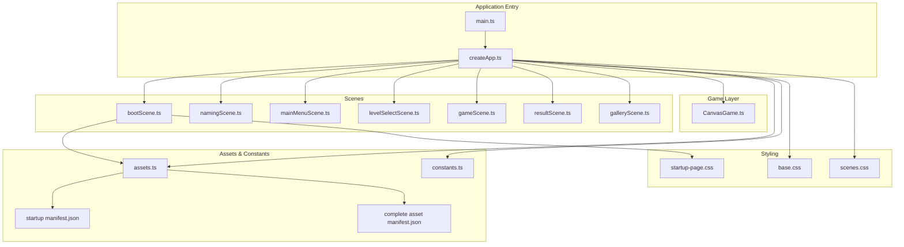
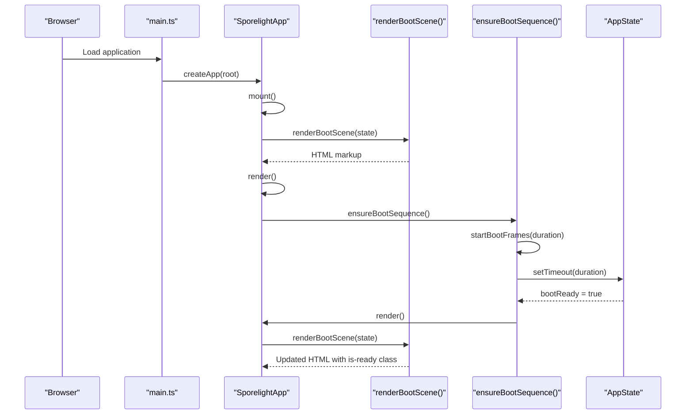
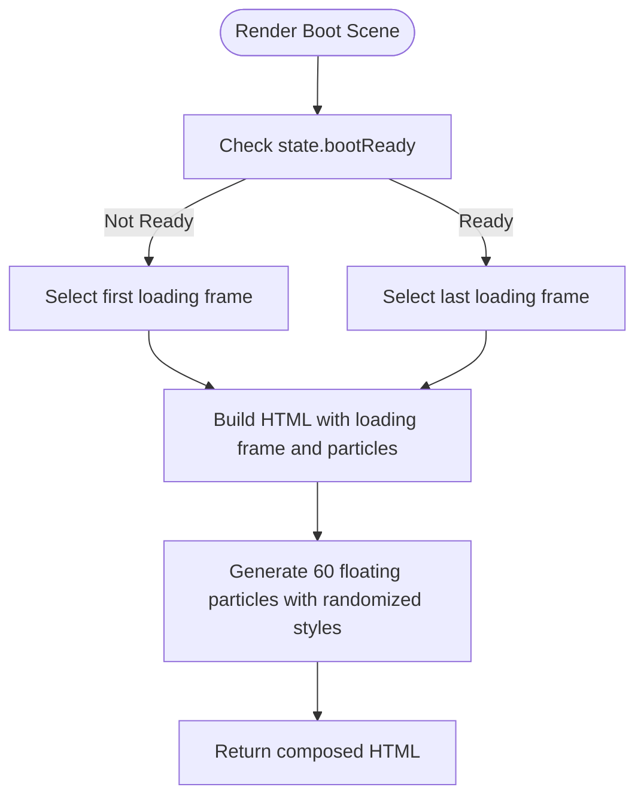
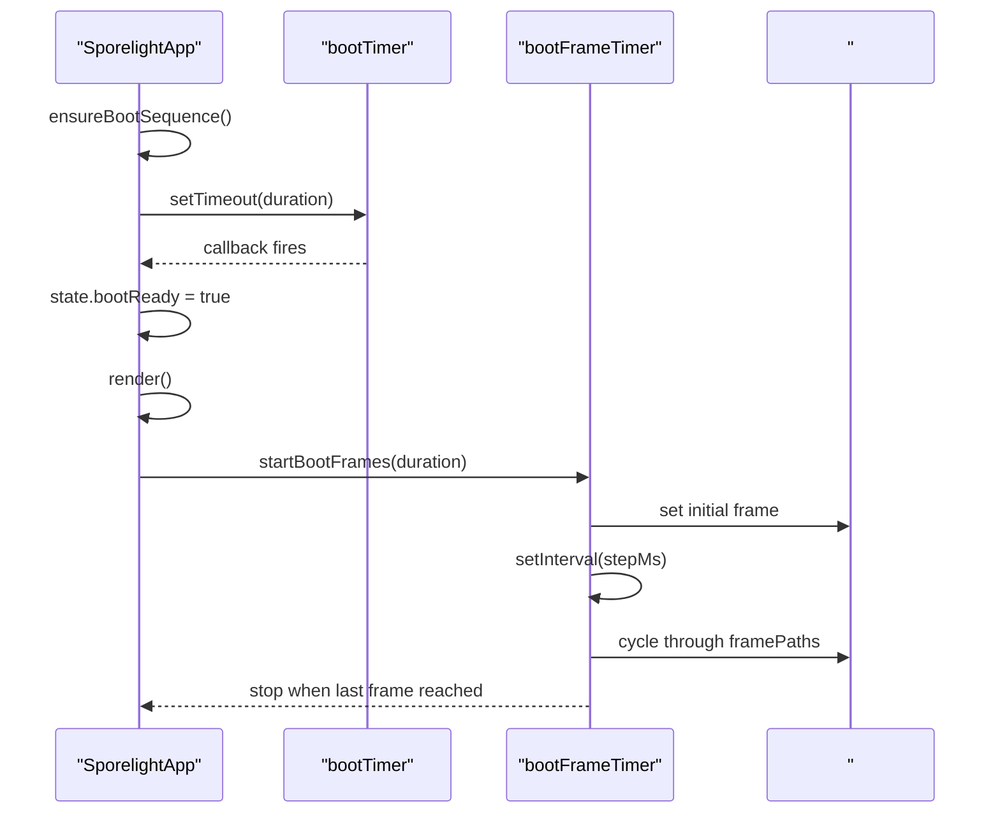
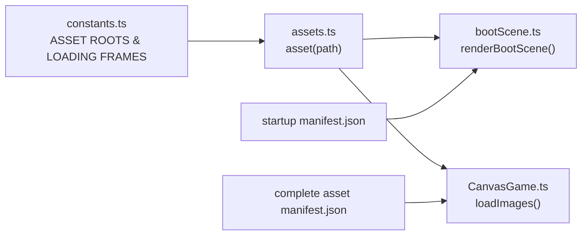
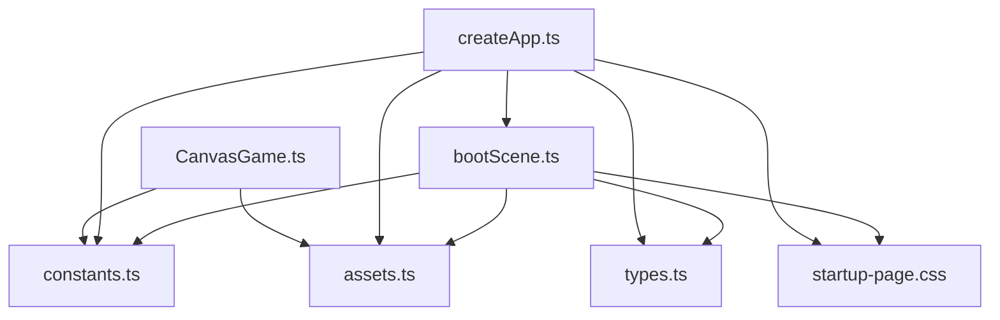

# Boot Scene

<cite>
**Referenced Files in This Document**
- [bootScene.ts](file://src/app/scenes/bootScene.ts)
- [createApp.ts](file://src/app/createApp.ts)
- [constants.ts](file://src/app/constants.ts)
- [assets.ts](file://src/app/assets.ts)
- [startup-page.css](file://src/styles/startup-page.css)
- [base.css](file://src/styles/base.css)
- [scenes.css](file://src/styles/scenes.css)
- [main.ts](file://src/main.ts)
- [CanvasGame.ts](file://src/app/game/CanvasGame.ts)
- [types.ts](file://src/app/types.ts)
- [manifest.json](file://assets/images/startup_page_assets_assets_only_png/manifest.json)
- [asset_manifest.json](file://assets/images/sporelight_complete_assets_png/meta/asset_manifest.json)
</cite>

## Table of Contents
1. [Introduction](#introduction)
2. [Project Structure](#project-structure)
3. [Core Components](#core-components)
4. [Architecture Overview](#architecture-overview)
5. [Detailed Component Analysis](#detailed-component-analysis)
6. [Dependency Analysis](#dependency-analysis)
7. [Performance Considerations](#performance-considerations)
8. [Troubleshooting Guide](#troubleshooting-guide)
9. [Conclusion](#conclusion)

## Introduction
This document provides comprehensive documentation for the Boot Scene implementation in SporeLight. It explains the startup sequence architecture, loading animation system, and asset preloading strategy. The Boot Scene orchestrates the initial application presentation, manages loading states, and transitions users into the main application flow. It covers the scene lifecycle from initialization through completion, including canvas setup, loading indicators, and transition timing. The UI rendering patterns, responsive design considerations, and integration with the main application controller are documented alongside practical troubleshooting guidance for common startup issues.

## Project Structure
The Boot Scene is part of a modular application architecture with clear separation between scene rendering, application orchestration, styling, and asset management.

**Diagram sources**
- [main.ts:1-11](file://src/main.ts#L1-L11)
- [createApp.ts:1-377](file://src/app/createApp.ts#L1-L377)
- [bootScene.ts:1-94](file://src/app/scenes/bootScene.ts#L1-L94)
- [CanvasGame.ts:1-318](file://src/app/game/CanvasGame.ts#L1-L318)
- [assets.ts:1-4](file://src/app/assets.ts#L1-L4)
- [constants.ts:1-71](file://src/app/constants.ts#L1-L71)
- [startup-page.css:1-338](file://src/styles/startup-page.css#L1-L338)
- [base.css:1-190](file://src/styles/base.css#L1-L190)
- [scenes.css:1-452](file://src/styles/scenes.css#L1-L452)
- [manifest.json:1-266](file://assets/images/startup_page_assets_assets_only_png/manifest.json#L1-L266)
- [asset_manifest.json:1-800](file://assets/images/sporelight_complete_assets_png/meta/asset_manifest.json#L1-L800)

**Section sources**
- [main.ts:1-11](file://src/main.ts#L1-L11)
- [createApp.ts:16-82](file://src/app/createApp.ts#L16-L82)
- [bootScene.ts:19-65](file://src/app/scenes/bootScene.ts#L19-L65)

## Core Components
- Boot Scene Renderer: Generates the HTML markup for the startup screen, including background, title, loading bar, particle effects, and hero sprite.
- Application Controller: Manages scene lifecycle, boot sequence timers, and transitions between scenes.
- Asset Management: Provides consistent asset path resolution for static images.
- Styles: Implements responsive animations and layout for the startup experience.
- Canvas Game: Initializes the interactive gameplay after boot completion.

Key responsibilities:
- Boot Scene: Renders UI elements and manages loading state visuals.
- Application Controller: Starts and stops the boot sequence, updates state, and triggers scene transitions.
- Assets: Ensures all image paths resolve to the correct asset root.
- Styles: Defines responsive breakpoints and animations for the startup page.
- Canvas Game: Loads game assets and initializes the interactive experience.

**Section sources**
- [bootScene.ts:19-94](file://src/app/scenes/bootScene.ts#L19-L94)
- [createApp.ts:22-377](file://src/app/createApp.ts#L22-L377)
- [assets.ts:1-4](file://src/app/assets.ts#L1-L4)
- [startup-page.css:1-338](file://src/styles/startup-page.css#L1-L338)
- [CanvasGame.ts:76-102](file://src/app/game/CanvasGame.ts#L76-L102)

## Architecture Overview
The Boot Scene participates in a layered architecture:
- Entry Point: Initializes the application and mounts the root container.
- Application Controller: Maintains application state, renders the current scene, binds actions, and manages boot sequence timers.
- Scene Rendering: Each scene module exports a render function that produces HTML for the current state.
- Asset Resolution: Centralized function resolves asset paths under a consistent root.
- Styling: CSS modules define responsive layouts and animations for each scene.
- Game Layer: Canvas-based game initializes after boot completes.

**Diagram sources**
- [main.ts:10-11](file://src/main.ts#L10-L11)
- [createApp.ts:38-82](file://src/app/createApp.ts#L38-L82)
- [createApp.ts:165-183](file://src/app/createApp.ts#L165-L183)
- [createApp.ts:321-351](file://src/app/createApp.ts#L321-L351)
- [bootScene.ts:19-65](file://src/app/scenes/bootScene.ts#L19-L65)

## Detailed Component Analysis

### Boot Scene Rendering
The Boot Scene renderer composes the startup UI:
- Background and title: Centered title with gradient background and subtle glow effects.
- Loading indicator: Animated loading bar with frame-by-frame progression and floating particles.
- Ambient elements: Animated fireflies and a looping hero sprite sheet.
- Helper copy: Dynamic text that appears when the boot process completes.

Rendering logic highlights:
- Conditional loading frame selection based on boot readiness.
- Dynamic helper copy text displayed upon completion.
- Particle generation with randomized positions, sizes, durations, delays, drift vectors, rotation, opacity, and scale.

**Diagram sources**
- [bootScene.ts:19-65](file://src/app/scenes/bootScene.ts#L19-L65)
- [bootScene.ts:67-93](file://src/app/scenes/bootScene.ts#L67-L93)

**Section sources**
- [bootScene.ts:19-94](file://src/app/scenes/bootScene.ts#L19-L94)

### Application Controller Boot Sequence
The application controller manages the boot lifecycle:
- State initialization: Boot scene, settings state, and readiness flag.
- Mount and render: Renders the current scene and binds actions.
- Boot sequence: Starts a timer and animates loading frames; sets readiness flag and re-renders.
- Frame animation: Iterates through a sequence of loading frames at calculated intervals.
- Scene transitions: Clears boot timers and resets state when leaving the boot scene.

Key behaviors:
- Low motion mode: Skips frame animation and jumps to the final frame immediately.
- Responsive timing: Duration adapts to user settings.
- Cleanup: Clears timeouts and intervals when transitioning away from the boot scene.

**Diagram sources**
- [createApp.ts:165-183](file://src/app/createApp.ts#L165-L183)
- [createApp.ts:321-351](file://src/app/createApp.ts#L321-L351)

**Section sources**
- [createApp.ts:22-377](file://src/app/createApp.ts#L22-L377)

### Asset Preloading Strategy
Asset management and preloading:
- Asset root constants define the base directories for different asset sets.
- Startup loading frames are enumerated and resolved to asset URLs.
- Complete game assets are loaded asynchronously by the CanvasGame after boot completion.
- Manifest files describe asset metadata for both startup and complete asset sets.

Implementation details:
- Asset function resolves paths under a consistent root.
- Startup manifest enumerates UI loading assets and decorative elements.
- Complete asset manifest enumerates character sprites and world assets.

**Diagram sources**
- [constants.ts:4-51](file://src/app/constants.ts#L4-L51)
- [assets.ts:1-4](file://src/app/assets.ts#L1-L4)
- [bootScene.ts:19-65](file://src/app/scenes/bootScene.ts#L19-L65)
- [CanvasGame.ts:76-102](file://src/app/game/CanvasGame.ts#L76-L102)
- [manifest.json:1-266](file://assets/images/startup_page_assets_assets_only_png/manifest.json#L1-L266)
- [asset_manifest.json:1-800](file://assets/images/sporelight_complete_assets_png/meta/asset_manifest.json#L1-L800)

**Section sources**
- [constants.ts:4-51](file://src/app/constants.ts#L4-L51)
- [assets.ts:1-4](file://src/app/assets.ts#L1-L4)
- [CanvasGame.ts:76-102](file://src/app/game/CanvasGame.ts#L76-L102)

### UI Rendering Patterns and Responsive Design
The Boot Scene employs CSS-driven rendering patterns:
- Absolute positioning for layered elements with z-index stacking.
- CSS animations for title reveal, firefly movement, hero sprite sheet playback, and particle floating.
- Responsive breakpoints adjust element sizes and positions across device widths and orientations.
- Blend modes and shadows enhance depth and visual polish.

Responsive considerations:
- Media queries adapt title, loading bar, and hero sprite sizes for smaller screens.
- Orientation-specific adjustments optimize layout for portrait devices.
- Flexible units (vw, rem, clamp) ensure scalable typography and spacing.

**Section sources**
- [startup-page.css:1-338](file://src/styles/startup-page.css#L1-L338)
- [base.css:72-92](file://src/styles/base.css#L72-L92)
- [scenes.css:186-189](file://src/styles/scenes.css#L186-L189)

### Integration with Main Application Controller
The Boot Scene integrates with the main controller through:
- Scene rendering: The controller switches to the boot scene initially and renders the Boot Scene output.
- Action binding: The controller binds UI actions and scene-specific handlers.
- State synchronization: The Boot Scene reads state flags (bootReady) to drive UI updates.
- Transition orchestration: On boot completion, the controller can transition to subsequent scenes.

**Section sources**
- [createApp.ts:65-82](file://src/app/createApp.ts#L65-L82)
- [createApp.ts:84-109](file://src/app/createApp.ts#L84-L109)
- [bootScene.ts:19-65](file://src/app/scenes/bootScene.ts#L19-L65)

## Dependency Analysis
The Boot Scene depends on:
- Constants for asset roots and loading frame sequences.
- Asset resolver for consistent path construction.
- Styles for layout and animations.
- Types for state shape and scene identifiers.

**Diagram sources**
- [bootScene.ts:1-3](file://src/app/scenes/bootScene.ts#L1-L3)
- [createApp.ts:1-14](file://src/app/createApp.ts#L1-L14)
- [constants.ts:1-71](file://src/app/constants.ts#L1-L71)
- [assets.ts:1-4](file://src/app/assets.ts#L1-L4)
- [types.ts:1-45](file://src/app/types.ts#L1-L45)
- [startup-page.css:1-338](file://src/styles/startup-page.css#L1-L338)
- [CanvasGame.ts:1-3](file://src/app/game/CanvasGame.ts#L1-L3)

**Section sources**
- [bootScene.ts:1-3](file://src/app/scenes/bootScene.ts#L1-L3)
- [createApp.ts:1-14](file://src/app/createApp.ts#L1-L14)

## Performance Considerations
- Boot sequence timing: The default duration is configurable and can be reduced for low-motion preferences. The frame animation interval is computed from the total duration divided by the number of frames.
- Particle rendering: The Boot Scene generates 60 animated particles with randomized styles. While visually appealing, this increases DOM nodes and CSS animations. Consider reducing particle count or disabling animations for lower-end devices.
- Asset loading: Game assets are loaded asynchronously by CanvasGame after boot completion. This prevents blocking the initial boot experience.
- CSS animations: Animations are optimized with transforms and opacity changes to leverage GPU acceleration. Disabling animations via the low-motion setting reduces CPU/GPU usage.
- Responsive scaling: The stage scales to fit the viewport while maintaining aspect ratio, minimizing layout thrashing.

[No sources needed since this section provides general guidance]

## Troubleshooting Guide
Common issues and resolutions:
- Boot sequence does not complete:
  - Verify the boot timer is started and the timeout callback sets the readiness flag.
  - Ensure the loading frame animation runs until the last frame is reached.
  - Check that the DOM element for the loading frame exists and receives updated sources.

- Loading frames not animating:
  - Confirm the frame paths are constructed correctly using the asset resolver.
  - Validate the step calculation for frame intervals and that the interval is cleared when reaching the last frame.
  - Test low-motion mode to ensure it bypasses frame animation and jumps to the final frame.

- UI not updating after completion:
  - Ensure the controller re-renders after setting the readiness flag.
  - Verify CSS classes for ready state are applied and trigger transitions.

- Asset paths incorrect:
  - Confirm asset root constants match the actual asset directories.
  - Validate that the asset function prefixes paths with the correct base.

- Canvas game not initializing:
  - Ensure the game scene is rendered and the CanvasGame constructor is invoked with a valid canvas element.
  - Check that image loading completes and drawing functions execute without errors.

**Section sources**
- [createApp.ts:165-183](file://src/app/createApp.ts#L165-L183)
- [createApp.ts:321-351](file://src/app/createApp.ts#L321-L351)
- [bootScene.ts:19-65](file://src/app/scenes/bootScene.ts#L19-L65)
- [CanvasGame.ts:32-47](file://src/app/game/CanvasGame.ts#L32-L47)

## Conclusion
The Boot Scene in SporeLight provides a polished, responsive startup experience with carefully orchestrated loading animations and asset management. The application controller ensures smooth transitions from the boot sequence to interactive gameplay, while CSS-driven animations deliver visual richness without compromising performance. By understanding the boot lifecycle, asset preloading strategy, and responsive design patterns, developers can maintain and extend the Boot Scene effectively.