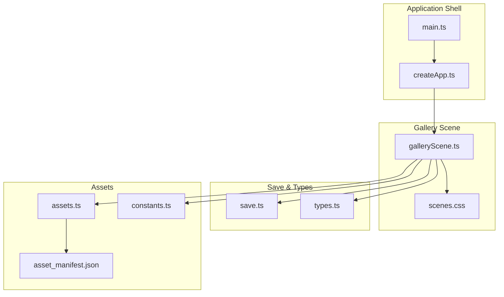
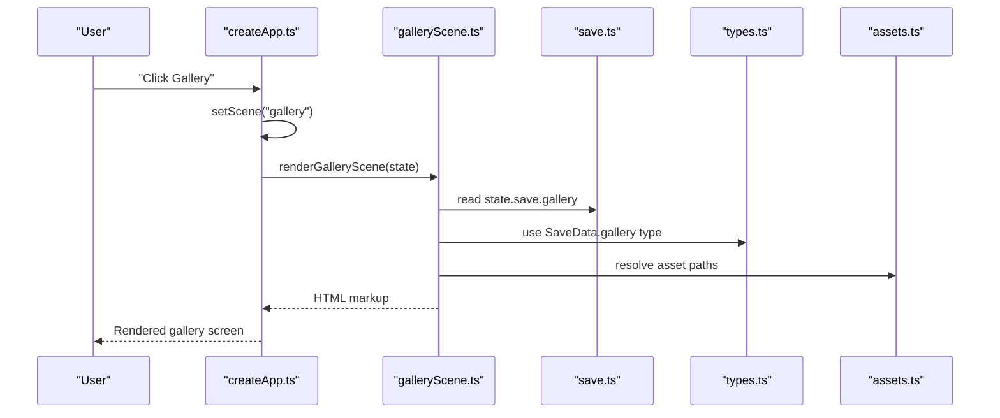
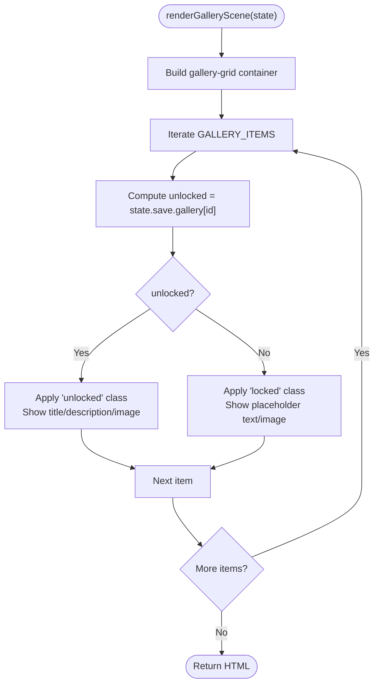
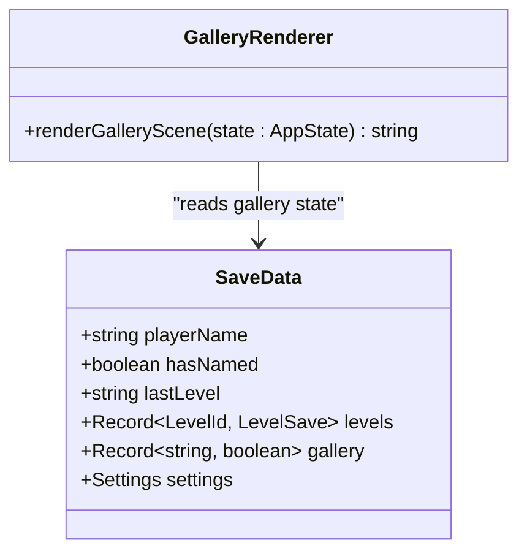
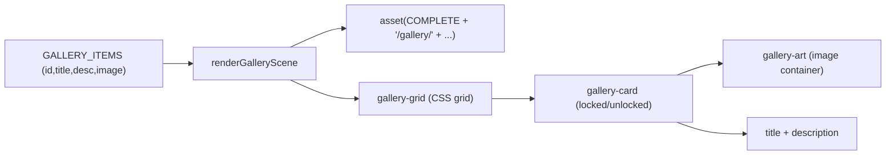
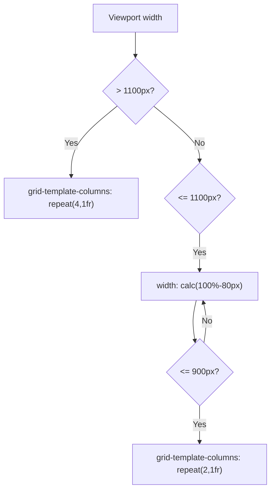
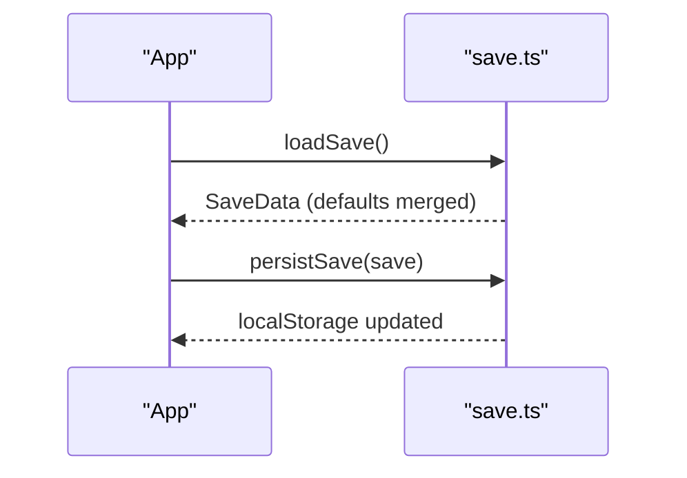
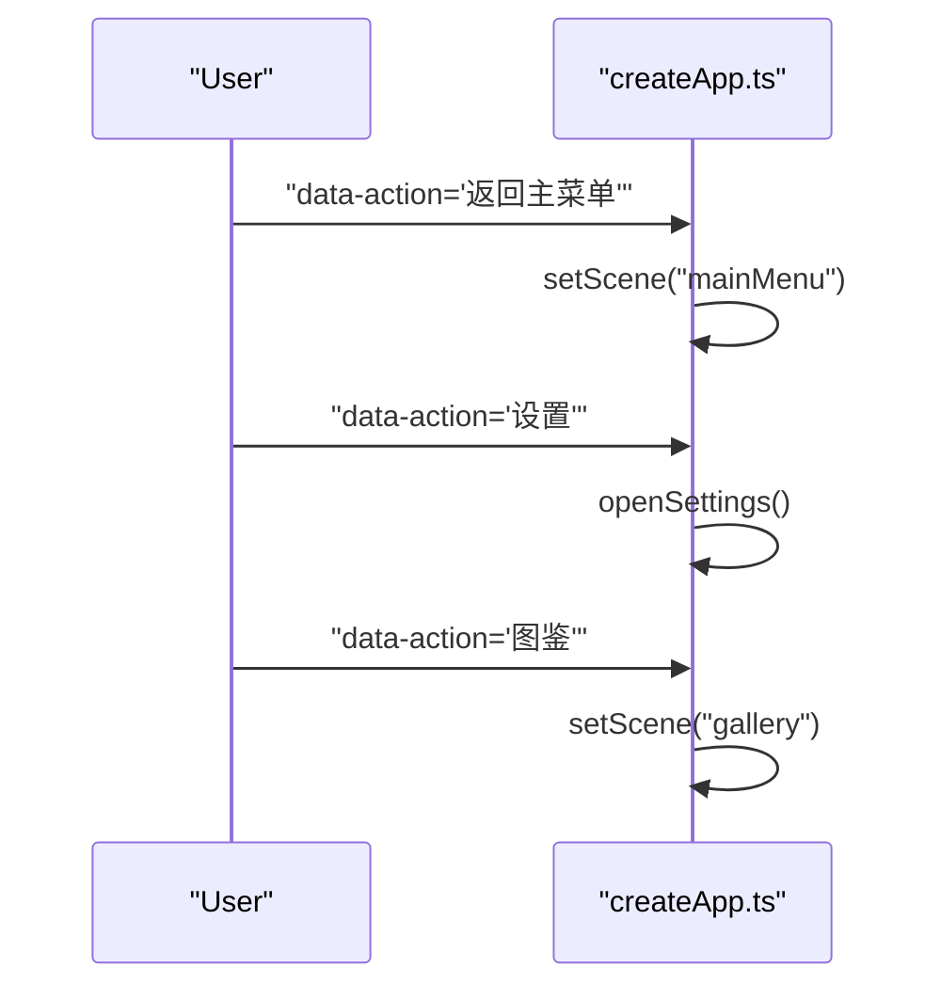
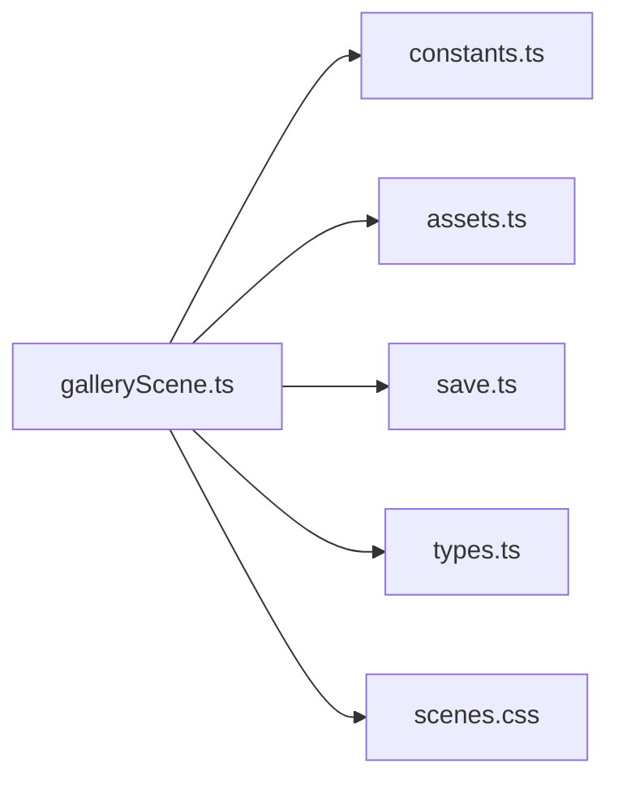

# Gallery Scene

<cite>
**Referenced Files in This Document**
- [galleryScene.ts](file://src/app/scenes/galleryScene.ts)
- [save.ts](file://src/app/save.ts)
- [types.ts](file://src/app/types.ts)
- [assets.ts](file://src/app/assets.ts)
- [constants.ts](file://src/app/constants.ts)
- [scenes.css](file://src/styles/scenes.css)
- [createApp.ts](file://src/app/createApp.ts)
- [main.ts](file://src/main.ts)
- [asset_manifest.json](file://assets/images/sporelight_complete_assets_png/meta/asset_manifest.json)
</cite>

## Table of Contents
1. [Introduction](#introduction)
2. [Project Structure](#project-structure)
3. [Core Components](#core-components)
4. [Architecture Overview](#architecture-overview)
5. [Detailed Component Analysis](#detailed-component-analysis)
6. [Dependency Analysis](#dependency-analysis)
7. [Performance Considerations](#performance-considerations)
8. [Troubleshooting Guide](#troubleshooting-guide)
9. [Conclusion](#conclusion)

## Introduction
This document explains the Gallery Scene implementation and collection display system. It covers how the gallery renders visual assets, tracks unlock status, integrates with the save system, and manages the collection interface. It also provides guidance on extending the gallery with new items, customizing layouts, and optimizing asset loading.

## Project Structure
The gallery is implemented as a scene renderer that composes HTML markup from a static list of gallery items and the current save state. It relies on:
- Scene composition and routing in the application shell
- Save data persisted in browser storage
- Asset path resolution and CSS styling for responsive display

**Diagram sources**
- [main.ts:1-11](file://src/main.ts#L1-L11)
- [createApp.ts:65-81](file://src/app/createApp.ts#L65-L81)
- [galleryScene.ts:18-42](file://src/app/scenes/galleryScene.ts#L18-L42)
- [scenes.css:352-396](file://src/styles/scenes.css#L352-L396)
- [save.ts:14-23](file://src/app/save.ts#L14-L23)
- [types.ts:13-31](file://src/app/types.ts#L13-L31)
- [assets.ts:1-4](file://src/app/assets.ts#L1-L4)
- [constants.ts:4](file://src/app/constants.ts#L4)
- [asset_manifest.json:1-10](file://assets/images/sporelight_complete_assets_png/meta/asset_manifest.json#L1-L10)

**Section sources**
- [main.ts:1-11](file://src/main.ts#L1-L11)
- [createApp.ts:65-81](file://src/app/createApp.ts#L65-L81)
- [galleryScene.ts:18-42](file://src/app/scenes/galleryScene.ts#L18-L42)
- [scenes.css:352-396](file://src/styles/scenes.css#L352-L396)
- [save.ts:14-23](file://src/app/save.ts#L14-L23)
- [types.ts:13-31](file://src/app/types.ts#L13-L31)
- [assets.ts:1-4](file://src/app/assets.ts#L1-L4)
- [constants.ts:4](file://src/app/constants.ts#L4)
- [asset_manifest.json:1-10](file://assets/images/sporelight_complete_assets_png/meta/asset_manifest.json#L1-L10)

## Core Components
- Gallery scene renderer: Builds the gallery screen HTML using a fixed item catalog and current save state.
- Save system: Provides default gallery state and persists/unmarshals save data.
- Types: Defines the save schema including the gallery record of booleans.
- Asset pipeline: Resolves asset paths and provides the complete asset root constant.
- Styles: Implements responsive grid layout and visual states for locked/unlocked items.

Key responsibilities:
- Render gallery cards with unlock-aware visuals and text.
- Reflect unlock progress from save data.
- Provide navigation controls to return to the main menu and open settings.

**Section sources**
- [galleryScene.ts:7-16](file://src/app/scenes/galleryScene.ts#L7-L16)
- [galleryScene.ts:18-42](file://src/app/scenes/galleryScene.ts#L18-L42)
- [save.ts:14-23](file://src/app/save.ts#L14-L23)
- [types.ts:18](file://src/app/types.ts#L18)
- [assets.ts:1-4](file://src/app/assets.ts#L1-L4)
- [constants.ts:4](file://src/app/constants.ts#L4)
- [scenes.css:352-396](file://src/styles/scenes.css#L352-L396)

## Architecture Overview
The gallery scene participates in the application’s scene rendering pipeline. The shell switches scenes based on action bindings and renders the appropriate scene. The gallery scene reads the current save to compute unlock states and selects appropriate assets.

**Diagram sources**
- [createApp.ts:84-99](file://src/app/createApp.ts#L84-L99)
- [createApp.ts:65-81](file://src/app/createApp.ts#L65-L81)
- [galleryScene.ts:18-42](file://src/app/scenes/galleryScene.ts#L18-L42)
- [save.ts:49-66](file://src/app/save.ts#L49-L66)
- [types.ts:13-31](file://src/app/types.ts#L13-L31)
- [assets.ts:1-4](file://src/app/assets.ts#L1-L4)

## Detailed Component Analysis

### Gallery Scene Renderer
The renderer defines a fixed catalog of gallery items and maps them to cards. Each card’s appearance depends on whether the corresponding save entry is true. It also sets the background image and navigation buttons.

**Diagram sources**
- [galleryScene.ts:7-16](file://src/app/scenes/galleryScene.ts#L7-L16)
- [galleryScene.ts:18-42](file://src/app/scenes/galleryScene.ts#L18-L42)

**Section sources**
- [galleryScene.ts:7-16](file://src/app/scenes/galleryScene.ts#L7-L16)
- [galleryScene.ts:18-42](file://src/app/scenes/galleryScene.ts#L18-L42)

### Unlock Tracking Mechanism
The gallery uses a simple boolean flag per item stored under the gallery record in save data. The renderer checks this flag to decide visuals and text.

- Data structure: SaveData.gallery is a record keyed by item id with boolean values.
- Default state: createDefaultSave initializes all gallery entries to false.
- Persistence: loadSave merges saved data into defaults; persistSave writes the current state.

**Diagram sources**
- [types.ts:13-31](file://src/app/types.ts#L13-L31)
- [save.ts:4-37](file://src/app/save.ts#L4-L37)
- [galleryScene.ts:18-42](file://src/app/scenes/galleryScene.ts#L18-L42)

**Section sources**
- [types.ts:18](file://src/app/types.ts#L18)
- [save.ts:14-23](file://src/app/save.ts#L14-L23)
- [save.ts:49-66](file://src/app/save.ts#L49-L66)

### Visual Asset Showcase and Collection Organization
- Item catalog: A static array of tuples defines id, title, description, and asset filename.
- Asset resolution: The renderer composes asset paths using the complete asset root constant and the assets helper.
- Locked vs unlocked visuals: When unlocked, the card displays the item image; otherwise, it shows a placeholder image.
- Layout: CSS grid organizes cards responsively across breakpoints.

**Diagram sources**
- [galleryScene.ts:7-16](file://src/app/scenes/galleryScene.ts#L7-L16)
- [galleryScene.ts:18-42](file://src/app/scenes/galleryScene.ts#L18-L42)
- [constants.ts:4](file://src/app/constants.ts#L4)
- [assets.ts:1-4](file://src/app/assets.ts#L1-L4)
- [scenes.css:352-396](file://src/styles/scenes.css#L352-L396)

**Section sources**
- [galleryScene.ts:7-16](file://src/app/scenes/galleryScene.ts#L7-L16)
- [galleryScene.ts:18-42](file://src/app/scenes/galleryScene.ts#L18-L42)
- [constants.ts:4](file://src/app/constants.ts#L4)
- [assets.ts:1-4](file://src/app/assets.ts#L1-L4)
- [scenes.css:352-396](file://src/styles/scenes.css#L352-L396)

### Responsive Gallery Layout and Visual States
- Grid layout: Four columns on wide screens; reduced columns on smaller screens via media queries.
- Visual states: Unlocked cards appear normal; locked cards are desaturated to indicate concealment.
- Typography and spacing: Consistent padding, font sizes, and line heights for readability.

**Diagram sources**
- [scenes.css:398-425](file://src/styles/scenes.css#L398-L425)

**Section sources**
- [scenes.css:352-396](file://src/styles/scenes.css#L352-L396)
- [scenes.css:398-425](file://src/styles/scenes.css#L398-L425)

### Integration with Save System
- Initialization: createDefaultSave provides initial gallery state.
- Loading: loadSave merges saved data into defaults to ensure schema compatibility.
- Persistence: persistSave writes the current save state to local storage.

**Diagram sources**
- [save.ts:4-37](file://src/app/save.ts#L4-L37)
- [save.ts:49-66](file://src/app/save.ts#L49-L66)

**Section sources**
- [save.ts:4-37](file://src/app/save.ts#L4-L37)
- [save.ts:49-66](file://src/app/save.ts#L49-L66)

### Asset Loading Optimization
- Path resolution: The assets helper centralizes asset path construction, ensuring consistency and simplifying updates.
- Manifest availability: The asset manifest documents asset metadata, aiding future validation or tooling.

Recommendations:
- Lazy-load images if the gallery grows large.
- Use placeholders or skeleton states while images load.
- Consider sprite sheets or atlas-based loading for many small assets.

**Section sources**
- [assets.ts:1-4](file://src/app/assets.ts#L1-L4)
- [asset_manifest.json:1-10](file://assets/images/sporelight_complete_assets_png/meta/asset_manifest.json#L1-L10)

### User Interaction Patterns
- Navigation: Back and Settings buttons allow returning to the main menu and opening settings.
- Scene transitions: The shell routes to the gallery scene when the “Gallery” action is triggered.

**Diagram sources**
- [createApp.ts:84-99](file://src/app/createApp.ts#L84-L99)

**Section sources**
- [createApp.ts:84-99](file://src/app/createApp.ts#L84-L99)

## Dependency Analysis
The gallery scene depends on:
- constants.ts for the complete asset root
- assets.ts for asset path resolution
- save.ts and types.ts for unlock state and type safety
- scenes.css for layout and visual styling

**Diagram sources**
- [galleryScene.ts:1-3](file://src/app/scenes/galleryScene.ts#L1-L3)
- [constants.ts:4](file://src/app/constants.ts#L4)
- [assets.ts:1-4](file://src/app/assets.ts#L1-L4)
- [save.ts:14-23](file://src/app/save.ts#L14-L23)
- [types.ts:18](file://src/app/types.ts#L18)
- [scenes.css:352-396](file://src/styles/scenes.css#L352-L396)

**Section sources**
- [galleryScene.ts:1-3](file://src/app/scenes/galleryScene.ts#L1-L3)
- [constants.ts:4](file://src/app/constants.ts#L4)
- [assets.ts:1-4](file://src/app/assets.ts#L1-L4)
- [save.ts:14-23](file://src/app/save.ts#L14-L23)
- [types.ts:18](file://src/app/types.ts#L18)
- [scenes.css:352-396](file://src/styles/scenes.css#L352-L396)

## Performance Considerations
- Rendering cost: The gallery iterates a small fixed list; performance impact is negligible.
- Image bandwidth: Using a single placeholder for locked items reduces unnecessary image requests.
- Future improvements: Consider virtualization or lazy-loading for larger galleries.

## Troubleshooting Guide
- Items remain locked after progression:
  - Verify the corresponding gallery id exists in SaveData.gallery and is set to true.
  - Confirm the save is persisted and loaded correctly.
- Incorrect asset paths:
  - Ensure the asset root constant matches the deployed asset folder.
  - Confirm asset filenames match the catalog entries.
- Visual regressions:
  - Check CSS media queries and class names applied to locked/unlocked cards.

**Section sources**
- [save.ts:49-66](file://src/app/save.ts#L49-L66)
- [galleryScene.ts:18-42](file://src/app/scenes/galleryScene.ts#L18-L42)
- [scenes.css:352-396](file://src/styles/scenes.css#L352-L396)

## Conclusion
The gallery scene provides a clean, save-backed showcase for discoverable items. Its design separates concerns between data (save), presentation (renderer), and styling (CSS), enabling straightforward extension and maintenance. By following the patterns documented here, developers can add new items, adjust unlock conditions, and refine the visual presentation.