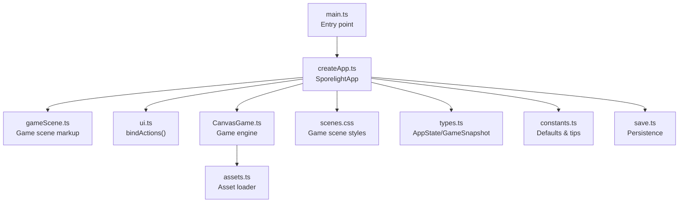
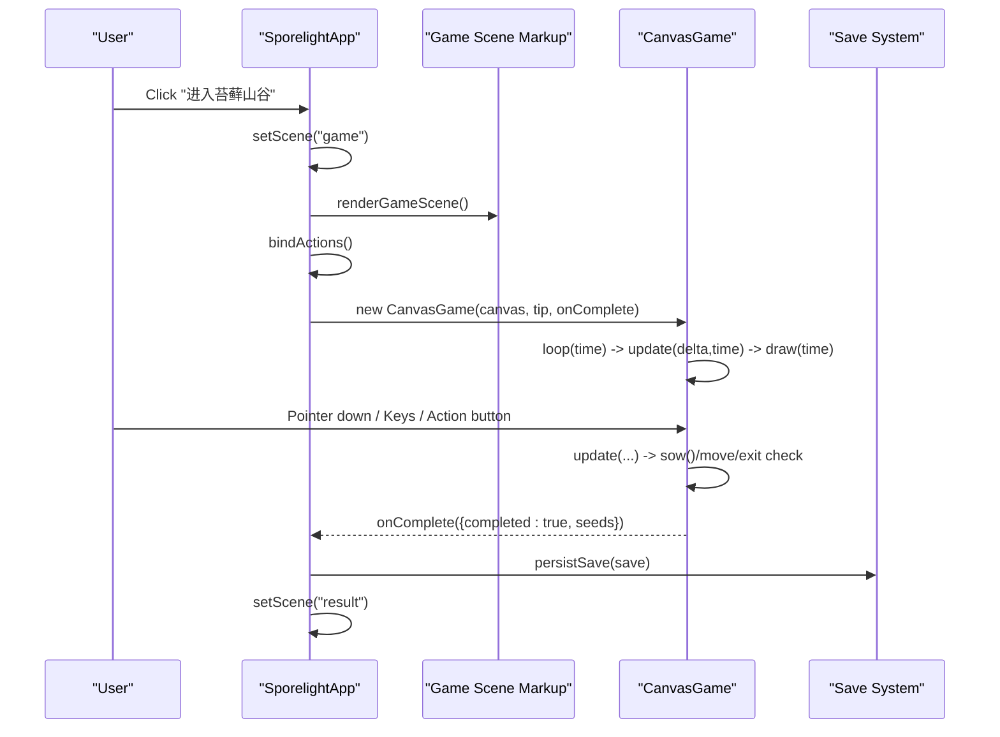
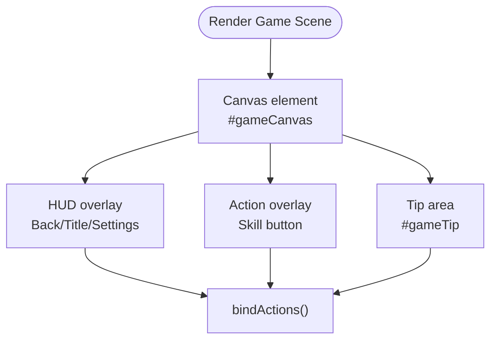
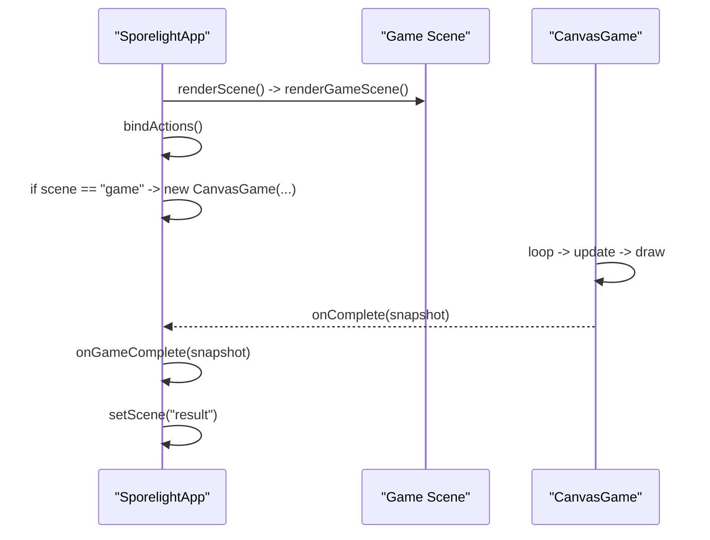
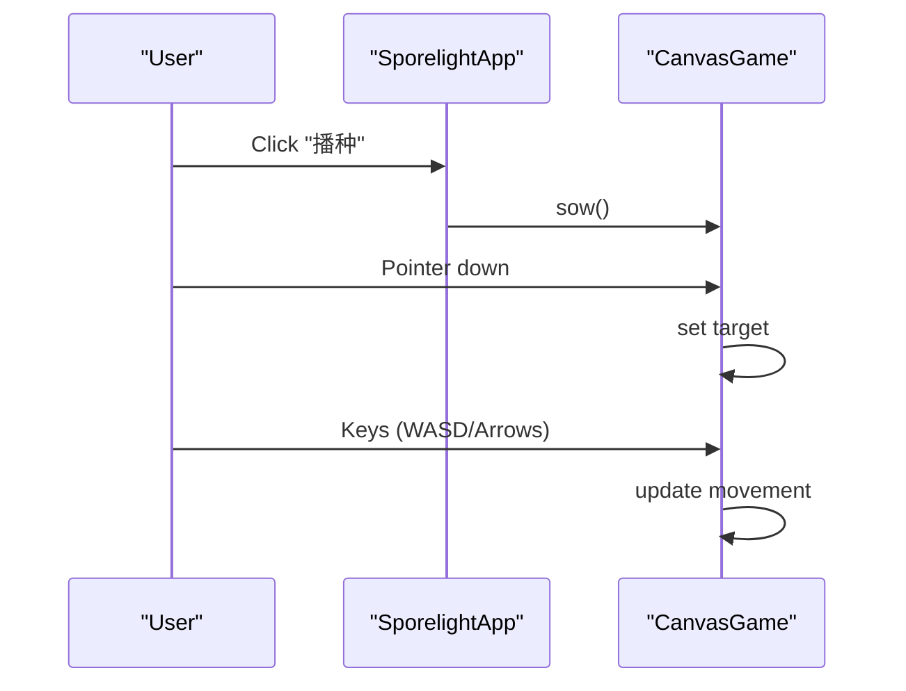
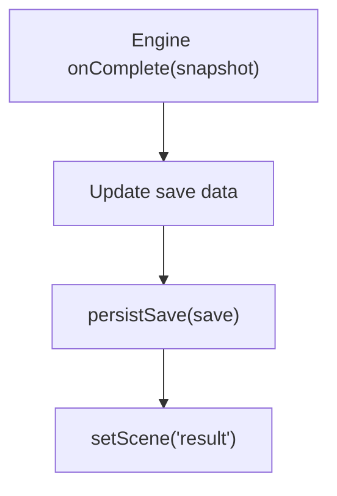
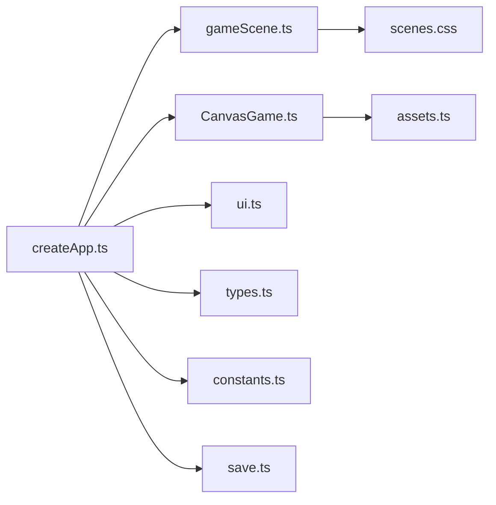

# Game Scene

<cite>
**Referenced Files in This Document**
- [CanvasGame.ts](file://src/app/game/CanvasGame.ts)
- [gameScene.ts](file://src/app/scenes/gameScene.ts)
- [createApp.ts](file://src/app/createApp.ts)
- [types.ts](file://src/app/types.ts)
- [constants.ts](file://src/app/constants.ts)
- [ui.ts](file://src/app/ui.ts)
- [scenes.css](file://src/styles/scenes.css)
- [assets.ts](file://src/app/assets.ts)
- [save.ts](file://src/app/save.ts)
- [main.ts](file://src/main.ts)
</cite>

## Table of Contents
1. [Introduction](#introduction)
2. [Project Structure](#project-structure)
3. [Core Components](#core-components)
4. [Architecture Overview](#architecture-overview)
5. [Detailed Component Analysis](#detailed-component-analysis)
6. [Dependency Analysis](#dependency-analysis)
7. [Performance Considerations](#performance-considerations)
8. [Troubleshooting Guide](#troubleshooting-guide)
9. [Conclusion](#conclusion)
10. [Appendices](#appendices)

## Introduction
This document explains the Game Scene implementation and its integration with the CanvasGame engine. It covers how the scene serves as the primary gameplay interface, how the HUD integrates with the engine, and how the scene communicates with the game engine. It documents the scene lifecycle during gameplay (initialization, update cycles, and cleanup), the UI overlay system, game state display, and player feedback mechanisms. It also provides examples of engine integration, event handling between the scene and the game, state synchronization, performance considerations, and guidance for extending the scene with additional UI elements and new gameplay features.

## Project Structure
The Game Scene is part of a modular application built around a scene-based architecture. The main entry point initializes the application, which manages scenes and transitions. The Game Scene renders a canvas-based game and overlays HUD and tips. The CanvasGame engine encapsulates rendering, input handling, and game logic.



**Diagram sources**
- [main.ts:1-11](file://src/main.ts#L1-L11)
- [createApp.ts:16-377](file://src/app/createApp.ts#L16-L377)
- [gameScene.ts:1-22](file://src/app/scenes/gameScene.ts#L1-L22)
- [CanvasGame.ts:14-318](file://src/app/game/CanvasGame.ts#L14-L318)
- [assets.ts:1-4](file://src/app/assets.ts#L1-L4)
- [scenes.css:254-307](file://src/styles/scenes.css#L254-L307)
- [types.ts:1-45](file://src/app/types.ts#L1-L45)
- [constants.ts:1-71](file://src/app/constants.ts#L1-L71)
- [save.ts:1-67](file://src/app/save.ts#L1-L67)
- [ui.ts:1-16](file://src/app/ui.ts#L1-L16)

**Section sources**
- [main.ts:1-11](file://src/main.ts#L1-L11)
- [createApp.ts:16-377](file://src/app/createApp.ts#L16-L377)
- [gameScene.ts:1-22](file://src/app/scenes/gameScene.ts#L1-L22)
- [CanvasGame.ts:14-318](file://src/app/game/CanvasGame.ts#L14-L318)
- [scenes.css:254-307](file://src/styles/scenes.css#L254-L307)

## Core Components
- Game Scene markup: Provides the canvas, HUD, tip area, and action buttons.
- CanvasGame engine: Manages rendering, input, game state, and completion callbacks.
- App orchestration: Creates the scene, binds actions, instantiates the engine, and handles state transitions.
- UI binding: Connects DOM actions to app handlers.
- Asset management: Resolves asset paths for images.
- Styles: Defines layout and overlay positioning for HUD and tips.

Key responsibilities:
- Scene lifecycle: Render, bind actions, initialize engine, and cleanup on scene change.
- HUD integration: Exposes HUD buttons and tip area for navigation and feedback.
- Engine integration: Passes canvas, tip element, and completion callback to CanvasGame.
- State synchronization: Updates save data upon completion and navigates to result scene.

**Section sources**
- [gameScene.ts:1-22](file://src/app/scenes/gameScene.ts#L1-L22)
- [CanvasGame.ts:14-318](file://src/app/game/CanvasGame.ts#L14-L318)
- [createApp.ts:84-109](file://src/app/createApp.ts#L84-L109)
- [ui.ts:5-11](file://src/app/ui.ts#L5-L11)
- [assets.ts:1-4](file://src/app/assets.ts#L1-L4)
- [scenes.css:260-307](file://src/styles/scenes.css#L260-L307)

## Architecture Overview
The Game Scene is rendered when the app’s scene is set to “game”. The app creates the scene markup, binds actions, and instantiates the CanvasGame engine with references to the canvas and tip element. The engine runs a render loop, updates game state, and triggers completion when the exit is reached. On completion, the app persists save data and transitions to the result scene.



**Diagram sources**
- [createApp.ts:84-109](file://src/app/createApp.ts#L84-L109)
- [createApp.ts:288-303](file://src/app/createApp.ts#L288-L303)
- [CanvasGame.ts:134-192](file://src/app/game/CanvasGame.ts#L134-L192)
- [gameScene.ts:1-22](file://src/app/scenes/gameScene.ts#L1-L22)
- [save.ts:64-66](file://src/app/save.ts#L64-L66)

## Detailed Component Analysis

### Game Scene Markup and HUD
The Game Scene markup defines:
- A fixed-size canvas for the game world.
- A HUD overlay with back and settings buttons and a title.
- A tip area for contextual messages.
- An action overlay with a skill button for planting.

The styles define absolute positioning and pointer behavior so HUD buttons receive clicks while allowing the canvas to capture pointer events.



**Diagram sources**
- [gameScene.ts:3-21](file://src/app/scenes/gameScene.ts#L3-L21)
- [scenes.css:260-307](file://src/styles/scenes.css#L260-L307)

**Section sources**
- [gameScene.ts:1-22](file://src/app/scenes/gameScene.ts#L1-L22)
- [scenes.css:260-307](file://src/styles/scenes.css#L260-L307)

### CanvasGame Engine
CanvasGame encapsulates:
- Rendering context and image assets.
- Player state, seeds, and exit logic.
- Input handling for keyboard and pointer events.
- A render loop using requestAnimationFrame.
- Completion callback to notify the app when the exit is reached.

Key behaviors:
- Initialization loads images and binds events, then starts the loop.
- Update computes movement, checks for planting proximity, and detects completion.
- Draw clears and renders background, path, seeds, exit, and player.
- Player feedback via tip messages and visual effects.

```mermaid
classDiagram
class CanvasGame {
-ctx : CanvasRenderingContext2D
-raf : number
-destroyed : boolean
-completed : boolean
-keys : Set<string>
-target : {x,y}?
-player : {x,y,state}
-seeds : Seed[]
-exit : {x,y,active}
-images : Map<string,HTMLImageElement>
-last : number
-sowUntil : number
-messageUntil : number
+constructor(canvas, tip, onComplete)
+destroy()
+sow()
-loadImages()
-bind()
-onKeyDown(event)
-onKeyUp(event)
-loop(time)
-update(delta, time)
-draw(time)
-drawPath()
-drawSeeds(time)
-drawExit(time)
-drawPlayer(time)
-frameFor(time) : string
-drawImage(key,x,y,w,h)
-nearSeed() : Seed?
-say(message)
}
```

**Diagram sources**
- [CanvasGame.ts:14-318](file://src/app/game/CanvasGame.ts#L14-L318)

**Section sources**
- [CanvasGame.ts:14-318](file://src/app/game/CanvasGame.ts#L14-L318)

### App Orchestration and Scene Lifecycle
The app manages the Game Scene lifecycle:
- Render: Switches to the game scene and binds actions.
- Bind actions: Connects UI actions to handlers, including starting the game engine.
- Instantiate engine: Creates CanvasGame with canvas, tip, and completion callback.
- Cleanup: Destroys the engine when leaving the scene.

Completion flow:
- Engine calls onComplete with snapshot data.
- App updates save data and navigates to result scene.



**Diagram sources**
- [createApp.ts:65-82](file://src/app/createApp.ts#L65-L82)
- [createApp.ts:84-109](file://src/app/createApp.ts#L84-L109)
- [createApp.ts:288-303](file://src/app/createApp.ts#L288-L303)
- [CanvasGame.ts:134-192](file://src/app/game/CanvasGame.ts#L134-L192)

**Section sources**
- [createApp.ts:65-82](file://src/app/createApp.ts#L65-L82)
- [createApp.ts:84-109](file://src/app/createApp.ts#L84-L109)
- [createApp.ts:288-303](file://src/app/createApp.ts#L288-L303)

### Event Handling Between Scene and Game
- UI actions: The app binds actions for HUD buttons and the skill button. The “播种” action delegates to the engine’s sow method.
- Pointer input: The engine captures pointer down to set a movement target.
- Keyboard input: The engine listens for keydown/keyup to move the player and trigger planting.



**Diagram sources**
- [createApp.ts:97-98](file://src/app/createApp.ts#L97-L98)
- [CanvasGame.ts:104-132](file://src/app/game/CanvasGame.ts#L104-L132)
- [CanvasGame.ts:148-192](file://src/app/game/CanvasGame.ts#L148-L192)

**Section sources**
- [createApp.ts:97-98](file://src/app/createApp.ts#L97-L98)
- [CanvasGame.ts:104-132](file://src/app/game/CanvasGame.ts#L104-L132)
- [CanvasGame.ts:148-192](file://src/app/game/CanvasGame.ts#L148-L192)

### State Synchronization and Persistence
On completion, the app:
- Updates save data (last level, completion flags, gallery unlocks).
- Persists the save to storage.
- Navigates to the result scene after a short delay.



**Diagram sources**
- [CanvasGame.ts:187-191](file://src/app/game/CanvasGame.ts#L187-L191)
- [createApp.ts:288-303](file://src/app/createApp.ts#L288-L303)
- [save.ts:64-66](file://src/app/save.ts#L64-L66)

**Section sources**
- [CanvasGame.ts:187-191](file://src/app/game/CanvasGame.ts#L187-L191)
- [createApp.ts:288-303](file://src/app/createApp.ts#L288-L303)
- [save.ts:64-66](file://src/app/save.ts#L64-L66)

## Dependency Analysis
The Game Scene depends on:
- App orchestration for rendering and binding.
- CanvasGame for rendering and gameplay logic.
- UI binding for action wiring.
- Styles for overlay layout.
- Asset resolution for image paths.
- Types for state and snapshot contracts.
- Constants for default tips and asset roots.
- Save system for persistence.



**Diagram sources**
- [createApp.ts:16-377](file://src/app/createApp.ts#L16-L377)
- [gameScene.ts:1-22](file://src/app/scenes/gameScene.ts#L1-L22)
- [CanvasGame.ts:14-318](file://src/app/game/CanvasGame.ts#L14-L318)
- [ui.ts:1-16](file://src/app/ui.ts#L1-L16)
- [assets.ts:1-4](file://src/app/assets.ts#L1-L4)
- [types.ts:1-45](file://src/app/types.ts#L1-L45)
- [constants.ts:1-71](file://src/app/constants.ts#L1-L71)
- [save.ts:1-67](file://src/app/save.ts#L1-L67)
- [scenes.css:254-307](file://src/styles/scenes.css#L254-L307)

**Section sources**
- [createApp.ts:16-377](file://src/app/createApp.ts#L16-L377)
- [CanvasGame.ts:14-318](file://src/app/game/CanvasGame.ts#L14-L318)
- [gameScene.ts:1-22](file://src/app/scenes/gameScene.ts#L1-L22)
- [scenes.css:254-307](file://src/styles/scenes.css#L254-L307)

## Performance Considerations
- Continuous rendering: The engine uses requestAnimationFrame to drive a tight loop. Delta time clamping prevents large jumps and stabilizes movement.
- Input handling: Keyboard and pointer events are lightweight; avoid heavy computations in event handlers.
- Asset loading: Images are preloaded into a map; drawing falls back to a placeholder if images are not yet loaded.
- Canvas clearing and drawing: Clearing and drawing order are minimal; avoid unnecessary globalAlpha changes outside drawImage.
- Memory management: Cancel the animation frame and remove listeners on destroy to prevent leaks.
- UI overlays: Keep DOM updates minimal; the tip area is updated only when messages are shown.

[No sources needed since this section provides general guidance]

## Troubleshooting Guide
Common issues and remedies:
- Canvas not supported: The engine throws an error if 2D context is unavailable. Ensure the canvas element is valid and attached.
- No response to actions: Verify that bindActions is called after rendering and that the “播种” action is bound to the engine’s sow method.
- Tips not appearing: Confirm the tip element exists and the say method is invoked; messages are cleared after a timeout.
- Exit not triggering completion: Ensure the player’s position intersects the exit radius and that the exit is active after all seeds are grown.
- Scene not transitioning: Check that the completion callback updates save data and navigates to the result scene.

**Section sources**
- [CanvasGame.ts:39-41](file://src/app/game/CanvasGame.ts#L39-L41)
- [createApp.ts:97-98](file://src/app/createApp.ts#L97-L98)
- [CanvasGame.ts:302-316](file://src/app/game/CanvasGame.ts#L302-L316)
- [CanvasGame.ts:187-191](file://src/app/game/CanvasGame.ts#L187-L191)
- [createApp.ts:288-303](file://src/app/createApp.ts#L288-L303)

## Conclusion
The Game Scene integrates tightly with the CanvasGame engine to deliver a responsive, canvas-based gameplay experience. The app orchestrates scene rendering, action binding, engine instantiation, and state persistence. The HUD and tip areas provide clear navigation and feedback, while the engine’s update/draw cycle ensures smooth visuals. Following the performance and extension guidelines below will help maintain a polished experience as new features are added.

[No sources needed since this section summarizes without analyzing specific files]

## Appendices

### Extending the Game Scene with Additional UI Elements
- Add overlays: Extend the scene markup with new containers and bind actions for new buttons.
- Integrate with engine: Pass additional DOM references to the engine if needed, or keep UI updates within the app layer.
- Style overlays: Use existing scene styles as templates; ensure pointer events are configured correctly for interactive elements.

**Section sources**
- [gameScene.ts:3-21](file://src/app/scenes/gameScene.ts#L3-L21)
- [scenes.css:260-307](file://src/styles/scenes.css#L260-L307)

### Integrating New Gameplay Features
- Add new states: Extend the player state machine in the engine and update drawing logic accordingly.
- New mechanics: Implement new update logic (e.g., new interactions) and ensure completion conditions remain consistent.
- Feedback: Use the tip system for contextual messages and consider adding visual effects or audio cues.

**Section sources**
- [CanvasGame.ts:148-192](file://src/app/game/CanvasGame.ts#L148-L192)
- [CanvasGame.ts:302-316](file://src/app/game/CanvasGame.ts#L302-L316)

### Example References
- Scene initialization and binding: [createApp.ts:84-109](file://src/app/createApp.ts#L84-L109)
- Engine loop and update: [CanvasGame.ts:134-192](file://src/app/game/CanvasGame.ts#L134-L192)
- Completion callback and save persistence: [createApp.ts:288-303](file://src/app/createApp.ts#L288-L303), [save.ts:64-66](file://src/app/save.ts#L64-L66)
- HUD and tip styles: [scenes.css:260-307](file://src/styles/scenes.css#L260-L307)