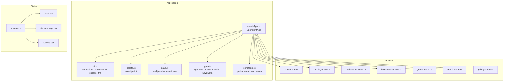
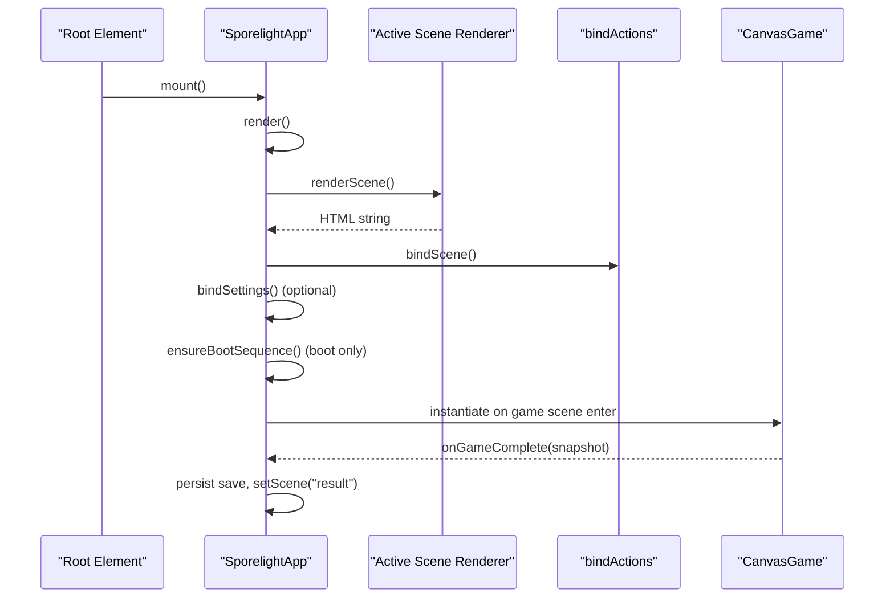
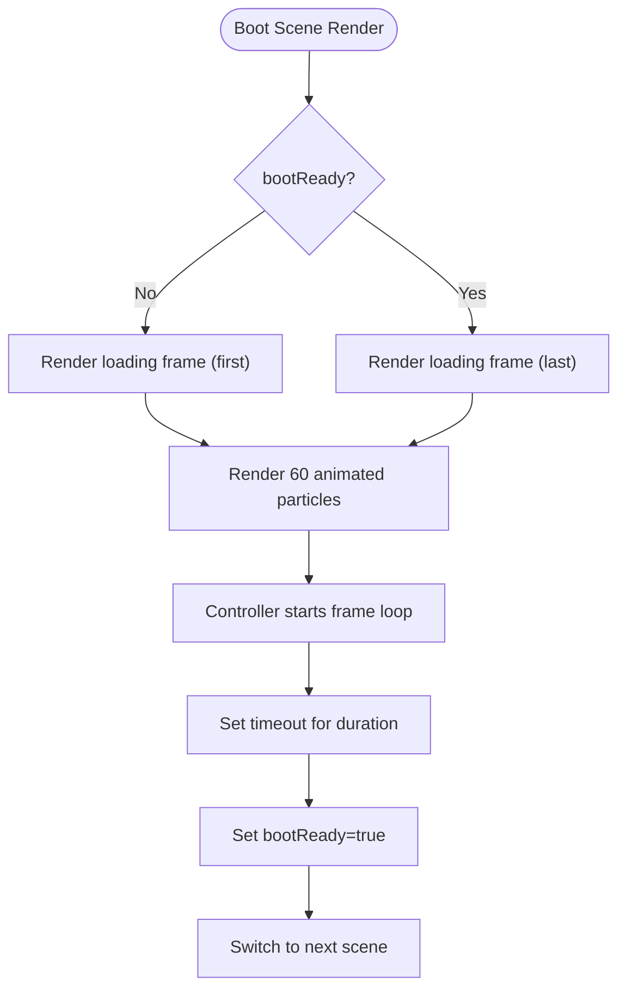
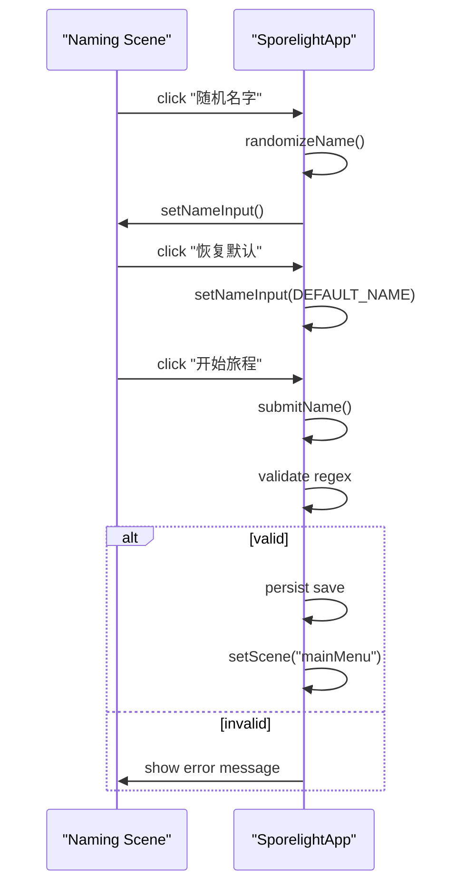
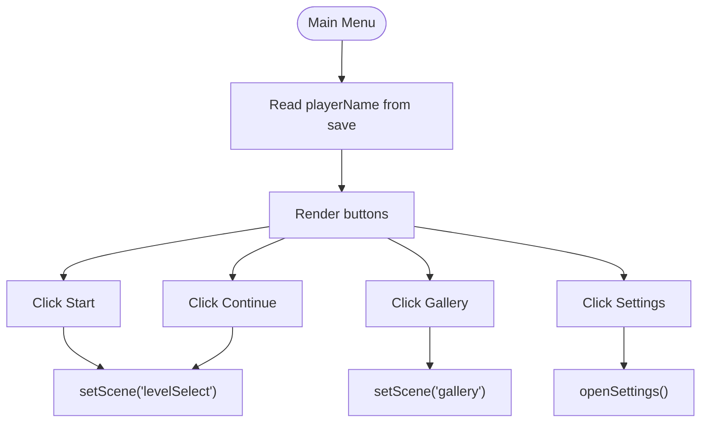
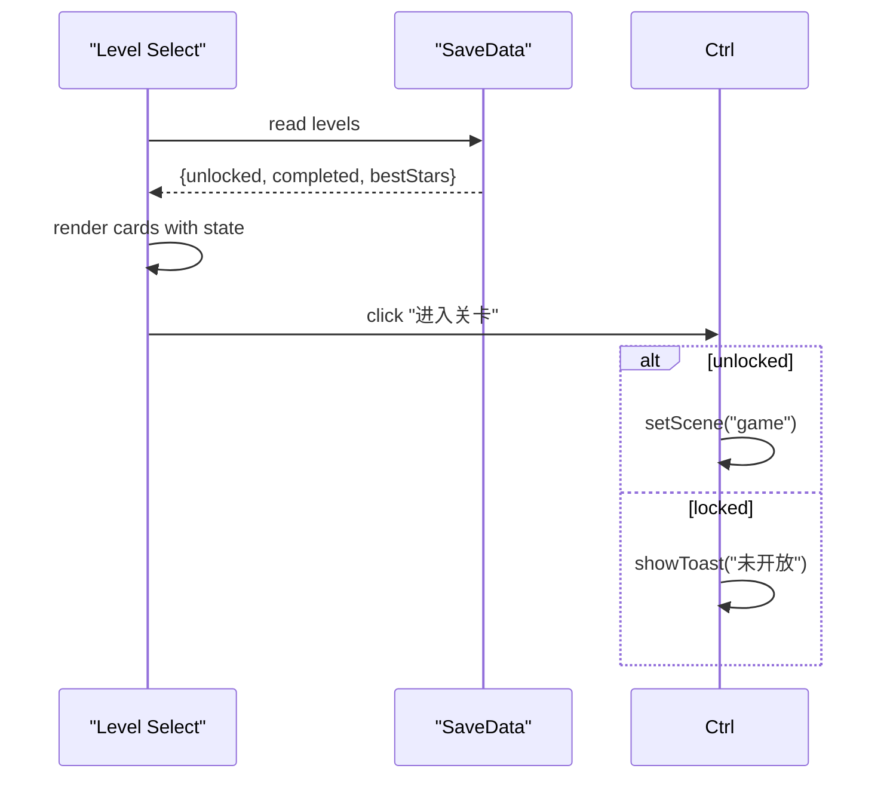
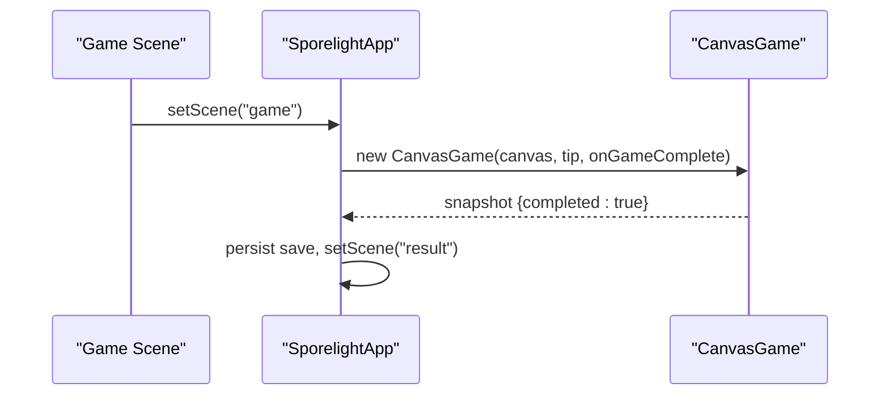
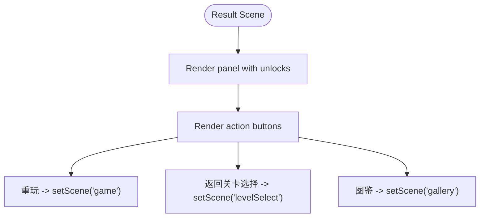
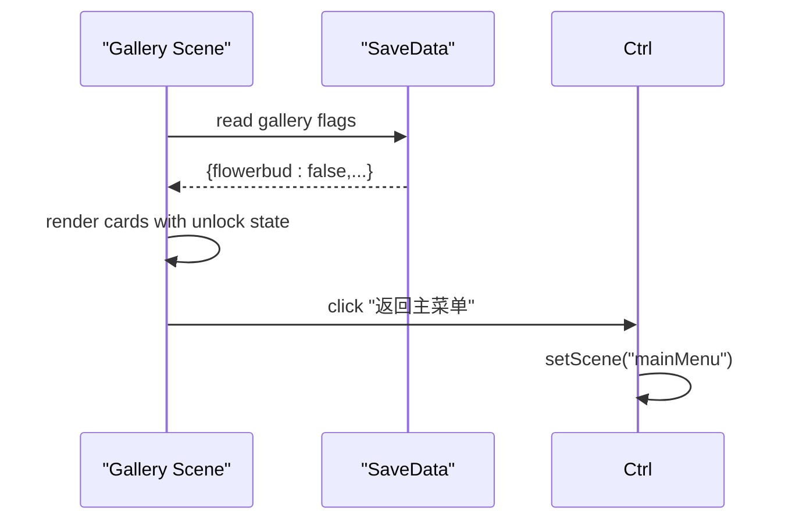
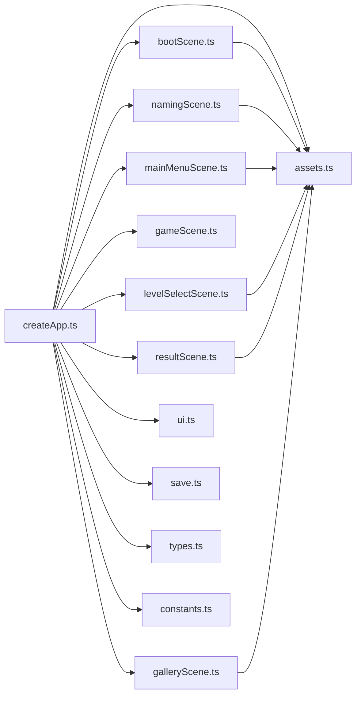

# Individual Scenes

<cite>
**Referenced Files in This Document**
- [bootScene.ts](file://src/app/scenes/bootScene.ts)
- [namingScene.ts](file://src/app/scenes/namingScene.ts)
- [mainMenuScene.ts](file://src/app/scenes/mainMenuScene.ts)
- [levelSelectScene.ts](file://src/app/scenes/levelSelectScene.ts)
- [gameScene.ts](file://src/app/scenes/gameScene.ts)
- [resultScene.ts](file://src/app/scenes/resultScene.ts)
- [galleryScene.ts](file://src/app/scenes/galleryScene.ts)
- [createApp.ts](file://src/app/createApp.ts)
- [ui.ts](file://src/app/ui.ts)
- [constants.ts](file://src/app/constants.ts)
- [types.ts](file://src/app/types.ts)
- [assets.ts](file://src/app/assets.ts)
- [save.ts](file://src/app/save.ts)
- [base.css](file://src/styles/base.css)
- [startup-page.css](file://src/styles/startup-page.css)
- [scenes.css](file://src/styles/scenes.css)
- [styles.css](file://src/styles.css)
</cite>

## Table of Contents
1. [Introduction](#introduction)
2. [Project Structure](#project-structure)
3. [Core Components](#core-components)
4. [Architecture Overview](#architecture-overview)
5. [Detailed Component Analysis](#detailed-component-analysis)
6. [Dependency Analysis](#dependency-analysis)
7. [Performance Considerations](#performance-considerations)
8. [Troubleshooting Guide](#troubleshooting-guide)
9. [Conclusion](#conclusion)

## Introduction
This document provides a deep dive into SporeLight’s scene system, detailing the implementation and behavior of each of the seven scenes: bootScene, namingScene, mainMenuScene, levelSelectScene, gameScene, resultScene, and galleryScene. It explains UI composition, user interactions, state management, event handling, and integration with the central application controller. It also covers scene-specific styling, responsive design, and unique patterns used across scenes.

## Project Structure
SporeLight organizes scenes under a dedicated module with a central application controller orchestrating rendering, state transitions, and event binding. Styles are split into base, startup page, and per-scene CSS files. Assets are resolved via a small helper that prepends a static path.

**Diagram sources**
- [createApp.ts:16-82](file://src/app/createApp.ts#L16-L82)
- [bootScene.ts:19-65](file://src/app/scenes/bootScene.ts#L19-L65)
- [namingScene.ts:8-35](file://src/app/scenes/namingScene.ts#L8-L35)
- [mainMenuScene.ts:8-23](file://src/app/scenes/mainMenuScene.ts#L8-L23)
- [levelSelectScene.ts:13-38](file://src/app/scenes/levelSelectScene.ts#L13-L38)
- [gameScene.ts:3-21](file://src/app/scenes/gameScene.ts#L3-L21)
- [resultScene.ts:8-30](file://src/app/scenes/resultScene.ts#L8-L30)
- [galleryScene.ts:18-42](file://src/app/scenes/galleryScene.ts#L18-L42)
- [ui.ts:1-16](file://src/app/ui.ts#L1-L16)
- [assets.ts:1-4](file://src/app/assets.ts#L1-L4)
- [save.ts:49-66](file://src/app/save.ts#L49-L66)
- [types.ts:1-45](file://src/app/types.ts#L1-L45)
- [constants.ts:1-71](file://src/app/constants.ts#L1-L71)
- [styles.css:1-5](file://src/styles.css#L1-L5)

**Section sources**
- [createApp.ts:16-82](file://src/app/createApp.ts#L16-L82)
- [styles.css:1-5](file://src/styles.css#L1-L5)

## Core Components
- Central controller: SporelightApp manages AppState, renders the active scene, binds actions, handles settings, boot sequence, and game lifecycle.
- Scene renderers: Pure renderers produce HTML strings for each scene, using asset paths and constants.
- UI utilities: Action binding, button generation, and HTML escaping.
- State and persistence: Save data model, defaults, merging, and local storage persistence.
- Asset resolution: Centralized asset path builder.
- Constants: Asset roots, startup frames, durations, default name, and random names.

**Section sources**
- [createApp.ts:22-377](file://src/app/createApp.ts#L22-L377)
- [ui.ts:1-16](file://src/app/ui.ts#L1-L16)
- [save.ts:4-66](file://src/app/save.ts#L4-L66)
- [assets.ts:1-4](file://src/app/assets.ts#L1-L4)
- [constants.ts:1-71](file://src/app/constants.ts#L1-L71)
- [types.ts:1-45](file://src/app/types.ts#L1-L45)

## Architecture Overview
The application follows a minimal reactive pattern:
- AppState drives rendering via a single render method.
- Scene switching occurs by updating state.scene and re-rendering.
- Event handlers are bound per scene via a generic action dispatcher.
- Boot scene controls a timed loading sequence and animated frames.
- Settings modal overlays during settings interactions.
- Game scene integrates CanvasGame, emitting snapshots on completion.

**Diagram sources**
- [createApp.ts:38-109](file://src/app/createApp.ts#L38-L109)
- [createApp.ts:288-303](file://src/app/createApp.ts#L288-L303)
- [gameScene.ts:3-21](file://src/app/scenes/gameScene.ts#L3-L21)

**Section sources**
- [createApp.ts:38-109](file://src/app/createApp.ts#L38-L109)
- [createApp.ts:288-303](file://src/app/createApp.ts#L288-L303)

## Detailed Component Analysis

### bootScene
- Purpose: Startup loading sequence with animated frames and particle effects.
- UI implementation:
  - Background image and layered ambient elements.
  - Animated title and hero sprite sheet.
  - Loading bar with animated frame progression and floating particles.
  - Helper copy text that appears when ready.
- User interactions: None during boot; handled by controller timers.
- State management:
  - bootReady flag toggled after a duration.
  - Frame animation loop controlled by interval timing.
- Event handling: Boot frames are started/stopped by controller methods.
- Integration: Controller triggers boot sequence and switches to next scene when ready.
- Styling and responsiveness:
  - Uses startup-page.css animations and media queries.
  - Responsive layout adapts to portrait/landscape and smaller viewports.
- Unique patterns:
  - Dynamic particle generation with randomized attributes.
  - Frame sequence playback with optional low-motion mode.

**Diagram sources**
- [bootScene.ts:19-94](file://src/app/scenes/bootScene.ts#L19-L94)
- [createApp.ts:165-183](file://src/app/createApp.ts#L165-L183)
- [createApp.ts:321-351](file://src/app/createApp.ts#L321-L351)

**Section sources**
- [bootScene.ts:19-94](file://src/app/scenes/bootScene.ts#L19-L94)
- [createApp.ts:165-183](file://src/app/createApp.ts#L165-L183)
- [createApp.ts:321-351](file://src/app/createApp.ts#L321-L351)
- [startup-page.css:1-338](file://src/styles/startup-page.css#L1-L338)

### namingScene
- Purpose: Player name input and validation.
- UI implementation:
  - Background overlay and branding.
  - Name card with input field and validation error area.
  - Action buttons: randomize, reset, and start journey.
- User interactions:
  - Input validation enforces length and character constraints.
  - Randomization and reset update the input field.
  - Submitting a valid name persists save and navigates to main menu.
- State management:
  - Uses escapeHtml to sanitize display.
  - Persists player name and naming flag.
- Event handling: Bound via data-action keys.
- Integration: Controller validates input and transitions to main menu.
- Styling and responsiveness:
  - Uses scenes.css for layout and typography.
  - Adapts to smaller screens with adjusted spacing and sizes.
- Unique patterns:
  - Input sanitization and error messaging.
  - Random name selection from curated list.

**Diagram sources**
- [namingScene.ts:8-35](file://src/app/scenes/namingScene.ts#L8-L35)
- [createApp.ts:251-286](file://src/app/createApp.ts#L251-L286)
- [constants.ts:53-70](file://src/app/constants.ts#L53-L70)

**Section sources**
- [namingScene.ts:8-35](file://src/app/scenes/namingScene.ts#L8-L35)
- [createApp.ts:251-286](file://src/app/createApp.ts#L251-L286)
- [constants.ts:53-70](file://src/app/constants.ts#L53-L70)
- [scenes.css:26-115](file://src/styles/scenes.css#L26-L115)

### mainMenuScene
- Purpose: Navigation hub and player info display.
- UI implementation:
  - Background clouds and logo.
  - Player greeting using saved name.
  - Action buttons for Start, Continue, Gallery, and Settings.
- User interactions:
  - Buttons route to level select, continue journey, gallery, or settings.
  - Continue button conditionally disabled until prerequisites are met.
- State management:
  - Reads saved player name and applies escaping.
- Event handling: Bound via data-action keys.
- Integration: Controller sets scene transitions and opens settings modal.
- Styling and responsiveness:
  - Uses shared scene layout and responsive adjustments.
- Unique patterns:
  - Conditional button enablement based on save state.

**Diagram sources**
- [mainMenuScene.ts:8-23](file://src/app/scenes/mainMenuScene.ts#L8-L23)
- [createApp.ts:89-98](file://src/app/createApp.ts#L89-L98)
- [createApp.ts:219-229](file://src/app/createApp.ts#L219-L229)

**Section sources**
- [mainMenuScene.ts:8-23](file://src/app/scenes/mainMenuScene.ts#L8-L23)
- [createApp.ts:89-98](file://src/app/createApp.ts#L89-L98)
- [createApp.ts:219-229](file://src/app/createApp.ts#L219-L229)
- [scenes.css:117-151](file://src/styles/scenes.css#L117-L151)

### levelSelectScene
- Purpose: Gameplay selection with progress tracking.
- UI implementation:
  - Grid of level cards with background images and state indicators.
  - Unlocked/completed/locked states reflect save data.
- User interactions:
  - Enter button enabled only when unlocked.
  - Back and Settings navigation.
- State management:
  - Reads save levels to determine card state.
- Event handling: Bound via data-action keys.
- Integration: Controller transitions to game scene for unlocked levels.
- Styling and responsiveness:
  - Responsive grid adjusts to viewport and breakpoints.
- Unique patterns:
  - Card state derived from save data and mapped to UI classes.

**Diagram sources**
- [levelSelectScene.ts:13-38](file://src/app/scenes/levelSelectScene.ts#L13-L38)
- [createApp.ts:95-96](file://src/app/createApp.ts#L95-L96)
- [createApp.ts:305-314](file://src/app/createApp.ts#L305-L314)

**Section sources**
- [levelSelectScene.ts:13-38](file://src/app/scenes/levelSelectScene.ts#L13-L38)
- [createApp.ts:95-96](file://src/app/createApp.ts#L95-L96)
- [createApp.ts:305-314](file://src/app/createApp.ts#L305-L314)
- [scenes.css:185-253](file://src/styles/scenes.css#L185-L253)

### gameScene
- Purpose: Gameplay integration with CanvasGame.
- UI implementation:
  - Full-viewport canvas with HUD and tips.
  - Navigation and settings buttons; skill button for planting.
- User interactions:
  - Returns to level select, opens settings, triggers planting.
- State management:
  - Controller instantiates CanvasGame on scene enter.
  - Receives snapshot callback on completion.
- Event handling: Bound via data-action keys.
- Integration: Controller manages game lifecycle and transitions to result scene.
- Styling and responsiveness:
  - Canvas fills screen; HUD and tips positioned absolutely.
- Unique patterns:
  - CanvasGame encapsulates game logic; controller reacts to completion.

**Diagram sources**
- [gameScene.ts:3-21](file://src/app/scenes/gameScene.ts#L3-L21)
- [createApp.ts:101-108](file://src/app/createApp.ts#L101-L108)
- [createApp.ts:288-303](file://src/app/createApp.ts#L288-L303)

**Section sources**
- [gameScene.ts:3-21](file://src/app/scenes/gameScene.ts#L3-L21)
- [createApp.ts:101-108](file://src/app/createApp.ts#L101-L108)
- [createApp.ts:288-303](file://src/app/createApp.ts#L288-L303)
- [scenes.css:254-307](file://src/styles/scenes.css#L254-L307)

### resultScene
- Purpose: Completion screen with unlock notifications and actions.
- UI implementation:
  - Centered panel with character illustration and completion text.
  - Unlock row for newly discovered items.
  - Action buttons to return to level select, replay, or open gallery.
- User interactions:
  - Buttons navigate to appropriate scenes.
- State management:
  - Controller updates save on completion (level flags, gallery unlocks).
- Event handling: Bound via data-action keys.
- Integration: Controller persists save and schedules scene transition.
- Styling and responsiveness:
  - Centered panel with rounded corners and soft shadows.
- Unique patterns:
  - Immediate post-run save mutation and delayed scene switch.

**Diagram sources**
- [resultScene.ts:8-30](file://src/app/scenes/resultScene.ts#L8-L30)
- [createApp.ts:288-303](file://src/app/createApp.ts#L288-L303)

**Section sources**
- [resultScene.ts:8-30](file://src/app/scenes/resultScene.ts#L8-L30)
- [createApp.ts:288-303](file://src/app/createApp.ts#L288-L303)
- [scenes.css:309-351](file://src/styles/scenes.css#L309-L351)

### galleryScene
- Purpose: Collection display and unlock tracking.
- UI implementation:
  - Grid of gallery cards with unlock state.
  - Locked vs unlocked visuals and descriptions.
- User interactions:
  - Back and Settings navigation.
- State management:
  - Reads save gallery flags to determine card state.
- Event handling: Bound via data-action keys.
- Integration: Controller routes to main menu and settings.
- Styling and responsiveness:
  - Responsive grid with breakpoint adjustments.
- Unique patterns:
  - Locked cards hide titles and descriptions, showing placeholder art.

**Diagram sources**
- [galleryScene.ts:18-42](file://src/app/scenes/galleryScene.ts#L18-L42)
- [createApp.ts:93-94](file://src/app/createApp.ts#L93-L94)

**Section sources**
- [galleryScene.ts:18-42](file://src/app/scenes/galleryScene.ts#L18-L42)
- [createApp.ts:93-94](file://src/app/createApp.ts#L93-L94)
- [scenes.css:352-396](file://src/styles/scenes.css#L352-L396)

## Dependency Analysis
- Controller-to-scene: The controller selects the renderer based on state.scene and passes AppState where applicable.
- Controller-to-game: Instantiates CanvasGame only on game scene enter and listens for completion.
- Controller-to-save: Loads, merges, persists, and updates save data.
- Controller-to-assets: Uses asset helper for all image paths.
- Controller-to-ui: Uses bindActions and actionButton helpers for consistent interaction and styling.
- Scene-to-assets: Scenes import asset helper and constants for paths.
- Styles: Shared base styles, startup page animations, and per-scene layouts.

**Diagram sources**
- [createApp.ts:6-12](file://src/app/createApp.ts#L6-L12)
- [bootScene.ts:1-3](file://src/app/scenes/bootScene.ts#L1-L3)
- [namingScene.ts:1-4](file://src/app/scenes/namingScene.ts#L1-L4)
- [mainMenuScene.ts:1-4](file://src/app/scenes/mainMenuScene.ts#L1-L4)
- [levelSelectScene.ts:1-3](file://src/app/scenes/levelSelectScene.ts#L1-L3)
- [resultScene.ts:1-4](file://src/app/scenes/resultScene.ts#L1-L4)
- [galleryScene.ts:1-4](file://src/app/scenes/galleryScene.ts#L1-L4)
- [assets.ts:1-4](file://src/app/assets.ts#L1-L4)

**Section sources**
- [createApp.ts:6-12](file://src/app/createApp.ts#L6-L12)
- [assets.ts:1-4](file://src/app/assets.ts#L1-L4)

## Performance Considerations
- Boot sequence:
  - Frame animation interval is throttled by duration and frame count; low-motion setting short-circuits animation.
  - Particle rendering uses inline styles; keep particle count reasonable for mobile devices.
- Rendering:
  - Single render per state change; avoid unnecessary reflows by minimizing DOM churn.
  - Use CSS transforms and opacity for animations to leverage GPU acceleration.
- Game scene:
  - CanvasGame should manage its own draw/update loops efficiently; controller defers to CanvasGame for heavy work.
- Save persistence:
  - Persist only on meaningful changes to reduce I/O overhead.
- Responsive scaling:
  - Stage scaling uses CSS variables; ensure calculations match device pixel ratio for crispness.

[No sources needed since this section provides general guidance]

## Troubleshooting Guide
- Name validation fails:
  - Ensure input matches allowed characters and length constraints; check error message display and clearing.
  - Verify escapeHtml is applied for display contexts.
- Boot sequence does not advance:
  - Confirm duration calculation and timeout firing; verify low-motion setting effect.
  - Ensure frame loop is started and stopped correctly.
- Settings not applying:
  - Check slider and toggle listeners; verify save settings keys and persistence.
  - Confirm confirmMode transitions and modal closure.
- Game scene not initializing:
  - Verify canvas element exists and CanvasGame constructor receives correct arguments.
  - Ensure snapshot callback updates save and transitions to result scene.
- Toast messages not appearing:
  - Confirm toast creation and removal timers; ensure unique toast element is appended and removed.

**Section sources**
- [createApp.ts:264-286](file://src/app/createApp.ts#L264-L286)
- [createApp.ts:165-183](file://src/app/createApp.ts#L165-L183)
- [createApp.ts:321-351](file://src/app/createApp.ts#L321-L351)
- [createApp.ts:111-163](file://src/app/createApp.ts#L111-L163)
- [createApp.ts:305-314](file://src/app/createApp.ts#L305-L314)
- [createApp.ts:101-108](file://src/app/createApp.ts#L101-L108)
- [createApp.ts:288-303](file://src/app/createApp.ts#L288-L303)

## Conclusion
SporeLight’s scene system is a compact, state-driven UI framework. Each scene is a pure renderer with minimal logic, orchestrated by a central controller that manages state, events, assets, and integrations. The system emphasizes consistent styling, responsive behavior, and clear user pathways between scenes. Boot, naming, menus, level selection, gameplay, results, and gallery each serve distinct UX roles while sharing common patterns for asset resolution, action binding, and save management.