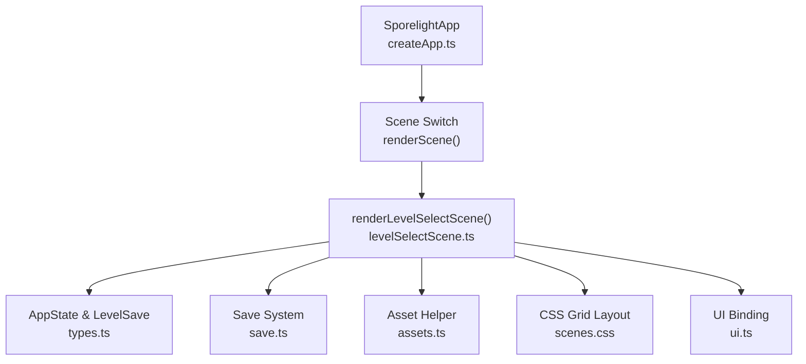
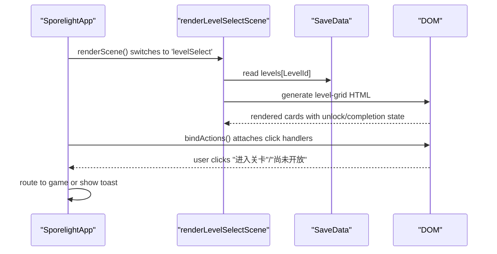
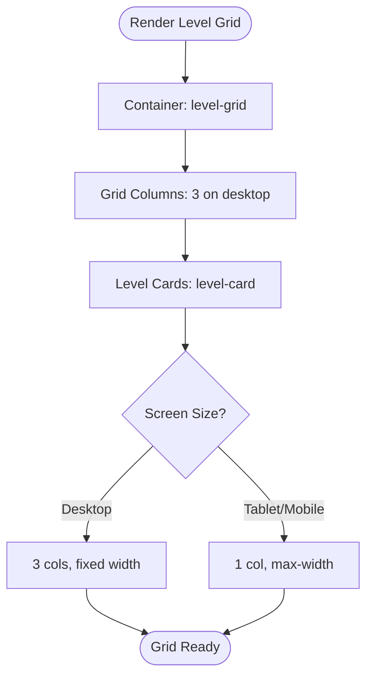
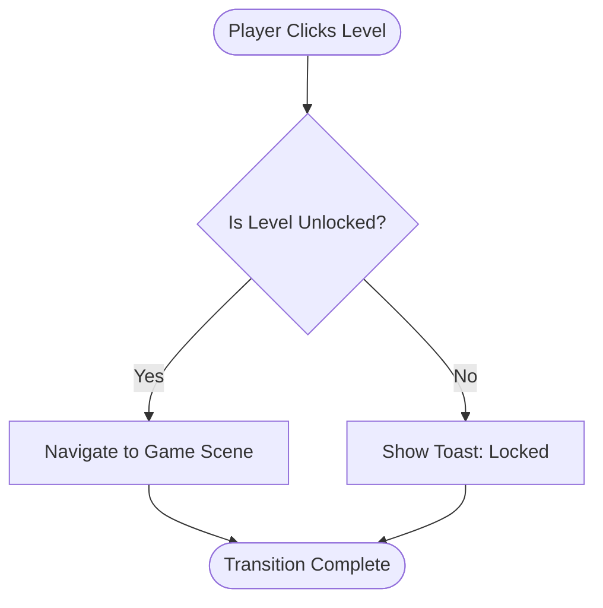
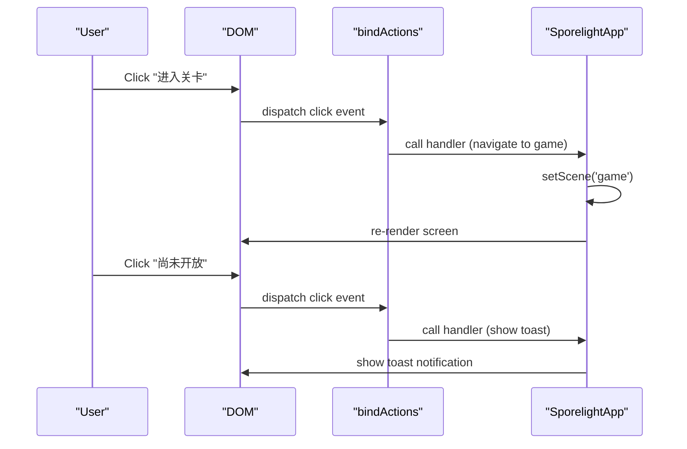
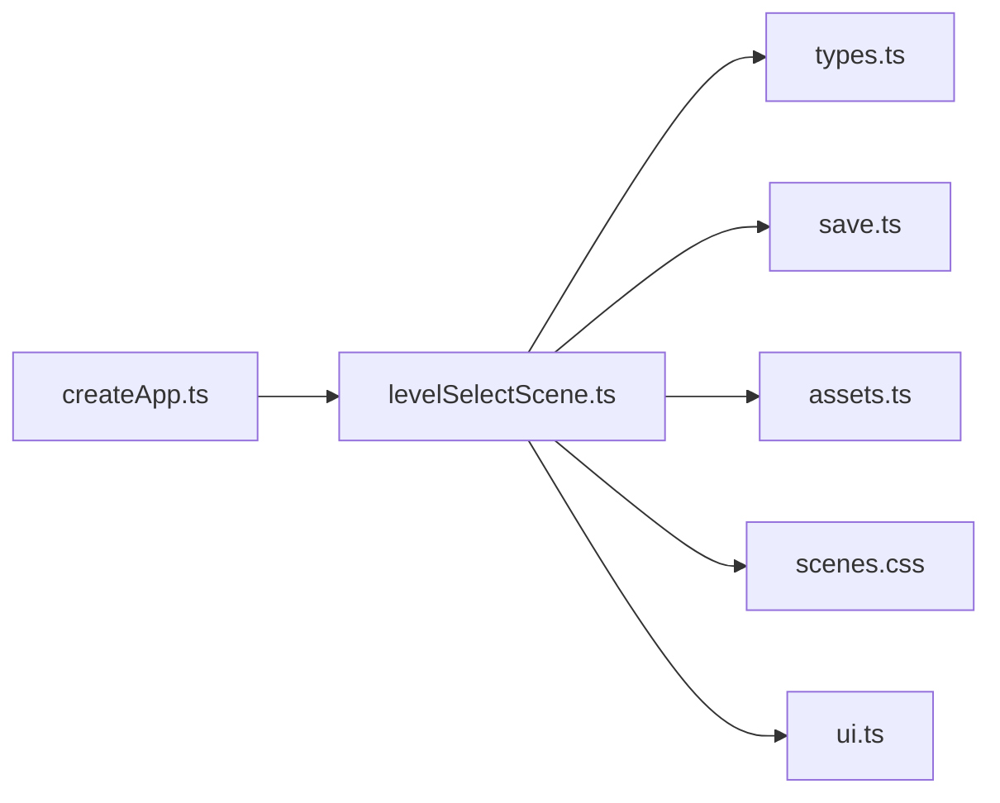

# Level Select Scene

<cite>
**Referenced Files in This Document**
- [levelSelectScene.ts](file://src/app/scenes/levelSelectScene.ts)
- [types.ts](file://src/app/types.ts)
- [save.ts](file://src/app/save.ts)
- [assets.ts](file://src/app/assets.ts)
- [constants.ts](file://src/app/constants.ts)
- [createApp.ts](file://src/app/createApp.ts)
- [scenes.css](file://src/styles/scenes.css)
- [base.css](file://src/styles/base.css)
- [ui.ts](file://src/app/ui.ts)
</cite>

## Table of Contents
1. [Introduction](#introduction)
2. [Project Structure](#project-structure)
3. [Core Components](#core-components)
4. [Architecture Overview](#architecture-overview)
5. [Detailed Component Analysis](#detailed-component-analysis)
6. [Dependency Analysis](#dependency-analysis)
7. [Performance Considerations](#performance-considerations)
8. [Troubleshooting Guide](#troubleshooting-guide)
9. [Conclusion](#conclusion)

## Introduction
The Level Select Scene provides players with an interactive grid-based interface to navigate through available levels in the game. This document explains the level grid system, progress tracking display, and level unlocking logic. It covers the grid layout architecture, level state management, visual representation of unlock/locked states, interaction patterns, responsive design, and accessibility considerations.

## Project Structure
The Level Select Scene is implemented as a pure HTML-rendering function that composes UI markup from static level definitions and the current save state. It integrates with the global application state and uses CSS Grid for responsive layout.



**Diagram sources**
- [createApp.ts:65-82](file://src/app/createApp.ts#L65-L82)
- [levelSelectScene.ts:13-38](file://src/app/scenes/levelSelectScene.ts#L13-L38)
- [scenes.css:185-193](file://src/styles/scenes.css#L185-L193)
- [ui.ts:5-11](file://src/app/ui.ts#L5-L11)

**Section sources**
- [levelSelectScene.ts:1-39](file://src/app/scenes/levelSelectScene.ts#L1-L39)
- [createApp.ts:65-82](file://src/app/createApp.ts#L65-L82)
- [scenes.css:185-193](file://src/styles/scenes.css#L185-L193)

## Core Components
- Level definitions: Static array of level metadata including identifiers, titles, descriptions, and background assets.
- Level card rendering: Generates HTML cards for each level using save state to determine unlock/completion status.
- Progress tracking: Uses LevelSave data to display completion state and unlock status.
- Unlock logic: Determines whether a level is unlocked based on the previous level's completion.

Key data structures:
- LevelId: Enumerated level identifiers ('valley', 'pond', 'cave').
- LevelSave: Tracks unlock status, completion status, and best star rating per level.
- SaveData: Aggregates player progress, gallery unlocks, and settings.

**Section sources**
- [levelSelectScene.ts:7-11](file://src/app/scenes/levelSelectScene.ts#L7-L11)
- [types.ts:7-11](file://src/app/types.ts#L7-L11)
- [types.ts:13-31](file://src/app/types.ts#L13-L31)

## Architecture Overview
The Level Select Scene follows a unidirectional data flow:
- Application state (AppState) holds the current save data.
- The scene renders level cards by mapping over the static level definitions.
- Each card reads its state from the save data and conditionally renders unlock/locked visuals and actions.
- UI actions are bound globally and route to the application controller.



**Diagram sources**
- [createApp.ts:65-82](file://src/app/createApp.ts#L65-L82)
- [levelSelectScene.ts:13-38](file://src/app/scenes/levelSelectScene.ts#L13-L38)
- [ui.ts:5-11](file://src/app/ui.ts#L5-L11)

## Detailed Component Analysis

### Level Grid System
The grid layout is implemented using CSS Grid with a fixed column count on desktop and responsive adjustments on smaller screens.

- Desktop: 3-column grid with fixed width container.
- Tablet/Mobile: Single column layout with constrained max-width.
- Gap spacing and card sizing are defined for consistent visual rhythm.



**Diagram sources**
- [scenes.css:185-193](file://src/styles/scenes.css#L185-L193)
- [scenes.css:418-421](file://src/styles/scenes.css#L418-L421)

**Section sources**
- [scenes.css:185-193](file://src/styles/scenes.css#L185-L193)
- [scenes.css:418-421](file://src/styles/scenes.css#L418-L421)

### Progress Tracking Display
Progress is represented by three states per level:
- Unlocked: Player can enter the level.
- Completed: Player finished the level.
- Locked: Player cannot enter yet.

The display logic:
- Visual state: Card receives 'unlocked' or 'locked' class.
- Text state: Shows "已完成" (completed), "可进入" (unlocked), or "锁定" (locked).
- Action text: "进入关卡" for unlocked, "尚未开放" for locked.



**Diagram sources**
- [levelSelectScene.ts:20-35](file://src/app/scenes/levelSelectScene.ts#L20-L35)
- [createApp.ts:84-99](file://src/app/createApp.ts#L84-L99)

**Section sources**
- [levelSelectScene.ts:20-35](file://src/app/scenes/levelSelectScene.ts#L20-L35)
- [createApp.ts:84-99](file://src/app/createApp.ts#L84-L99)

### Level Unlocking Logic
The unlock logic is implicit in the save initialization:
- The first level ('valley') starts as unlocked.
- Subsequent levels start as locked until progression conditions are met.

Current implementation details:
- Default save initializes 'valley' as unlocked and others as locked.
- Completion of a level updates save data (example shown in game completion handler).

```mermaid
classDiagram
class SaveData {
+string playerName
+boolean hasNamed
+LevelId lastLevel
+Record~LevelId, LevelSave~ levels
+Record~string, boolean~ gallery
+Settings settings
}
class LevelSave {
+boolean unlocked
+boolean completed
+number bestStars
}
class LevelId {
<<enumeration>>
"valley"
"pond"
"cave"
}
SaveData --> LevelSave : "contains"
LevelSave --> LevelId : "indexed by"
```

**Diagram sources**
- [types.ts:13-31](file://src/app/types.ts#L13-L31)
- [types.ts:7-11](file://src/app/types.ts#L7-L11)
- [save.ts:4-37](file://src/app/save.ts#L4-L37)

**Section sources**
- [save.ts:4-37](file://src/app/save.ts#L4-L37)
- [createApp.ts:288-303](file://src/app/createApp.ts#L288-L303)

### Visual Representation of Unlock/Locked States
Visual indicators:
- Locked card: Grayscale filter applied to background image.
- Unlocked card: Normal color with gradient overlay.
- Hover/focus states: Buttons receive hover and focus effects for interactivity.

Accessibility:
- Buttons use semantic roles and keyboard focus styles.
- Focus outlines ensure keyboard navigation visibility.

**Section sources**
- [levelSelectScene.ts:20-35](file://src/app/scenes/levelSelectScene.ts#L20-L35)
- [scenes.css:217-219](file://src/styles/scenes.css#L217-L219)
- [base.css:116-138](file://src/styles/base.css#L116-L138)

### Interaction Patterns
Interaction model:
- Navigation buttons: Back to main menu, Settings modal.
- Level cards: Clicking the enter button triggers navigation or a toast for locked levels.
- Global action binding: All buttons with data-action attributes are bound to handlers.



**Diagram sources**
- [ui.ts:5-11](file://src/app/ui.ts#L5-L11)
- [createApp.ts:84-99](file://src/app/createApp.ts#L84-L99)

**Section sources**
- [ui.ts:5-11](file://src/app/ui.ts#L5-L11)
- [createApp.ts:84-99](file://src/app/createApp.ts#L84-L99)

### Responsive Grid Layout
Responsive behavior:
- Desktop: 3-column grid with fixed width container.
- Tablet: Single column with constrained max-width.
- Mobile: Adjustments ensure readability and tap targets.

Media queries:
- Max-width breakpoints adjust grid template columns and container widths.

**Section sources**
- [scenes.css:398-403](file://src/styles/scenes.css#L398-L403)
- [scenes.css:418-421](file://src/styles/scenes.css#L418-L421)

### Touch Interaction Support
Touch support considerations:
- Button sizes and spacing accommodate finger taps.
- Visual feedback (hover/focus) improves touch target discoverability.
- Pointer events are handled via standard click events for broad device compatibility.

**Section sources**
- [scenes.css:101-138](file://src/styles/base.css#L101-L138)
- [scenes.css:195-252](file://src/styles/scenes.css#L195-L252)

### Accessibility Considerations
Accessibility features:
- Keyboard navigation: Focusable buttons with visible focus styles.
- Semantic structure: Buttons and headings organized for screen readers.
- Contrast and readability: Color palette designed for legibility.

**Section sources**
- [base.css:116-138](file://src/styles/base.css#L116-L138)
- [scenes.css:174-183](file://src/styles/scenes.css#L174-L183)

## Dependency Analysis
The Level Select Scene depends on:
- Types for type safety (AppState, LevelSave, LevelId).
- Save system for persistent state.
- Asset helper for resolving image paths.
- CSS for layout and visual states.
- UI binding for action routing.



**Diagram sources**
- [levelSelectScene.ts:1-3](file://src/app/scenes/levelSelectScene.ts#L1-L3)
- [createApp.ts:9-14](file://src/app/createApp.ts#L9-L14)

**Section sources**
- [levelSelectScene.ts:1-3](file://src/app/scenes/levelSelectScene.ts#L1-L3)
- [createApp.ts:9-14](file://src/app/createApp.ts#L9-L14)

## Performance Considerations
- Rendering cost: The level grid is generated via a simple map over a small static array, minimizing overhead.
- CSS Grid: Efficient layout with minimal JavaScript intervention.
- Asset loading: Background images are preloaded via asset helper; ensure appropriate image sizes for performance.

## Troubleshooting Guide
Common issues and resolutions:
- Levels not unlocking: Verify default save initialization and ensure progression logic updates save data upon completion.
- Locked state not reflected: Check that the 'locked' class is applied when unlocked is false.
- Action handlers not firing: Confirm that data-action attributes match the keys registered in bindActions.

**Section sources**
- [save.ts:4-37](file://src/app/save.ts#L4-L37)
- [levelSelectScene.ts:20-35](file://src/app/scenes/levelSelectScene.ts#L20-L35)
- [ui.ts:5-11](file://src/app/ui.ts#L5-L11)

## Conclusion
The Level Select Scene provides a clean, responsive grid interface for level navigation with clear progress indicators and unlock states. Its architecture emphasizes simplicity and maintainability while offering room for customization and extension.