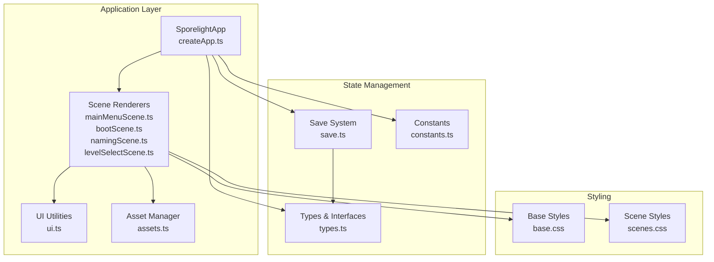
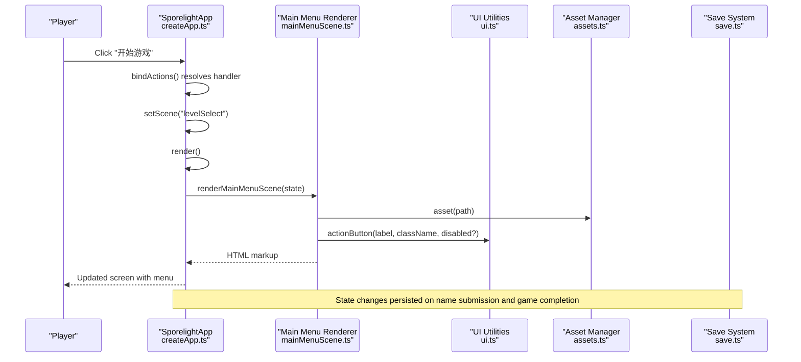
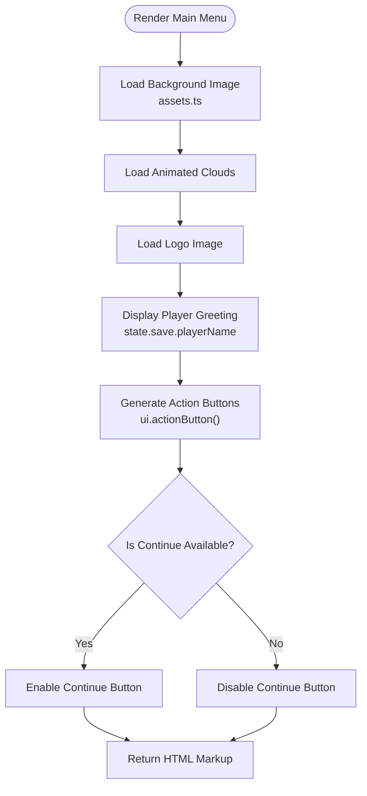
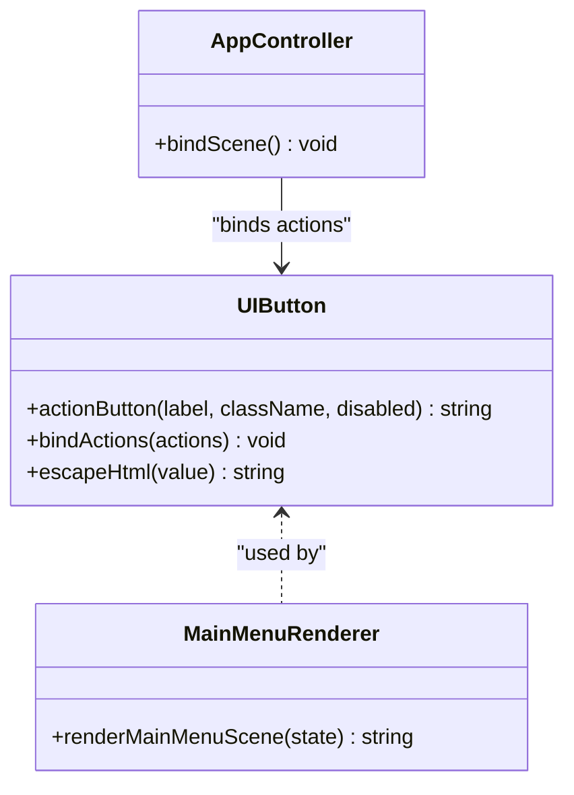
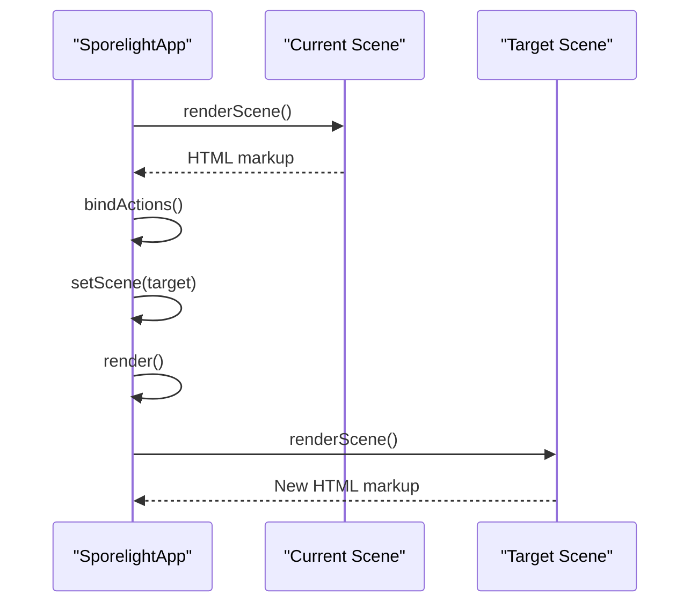
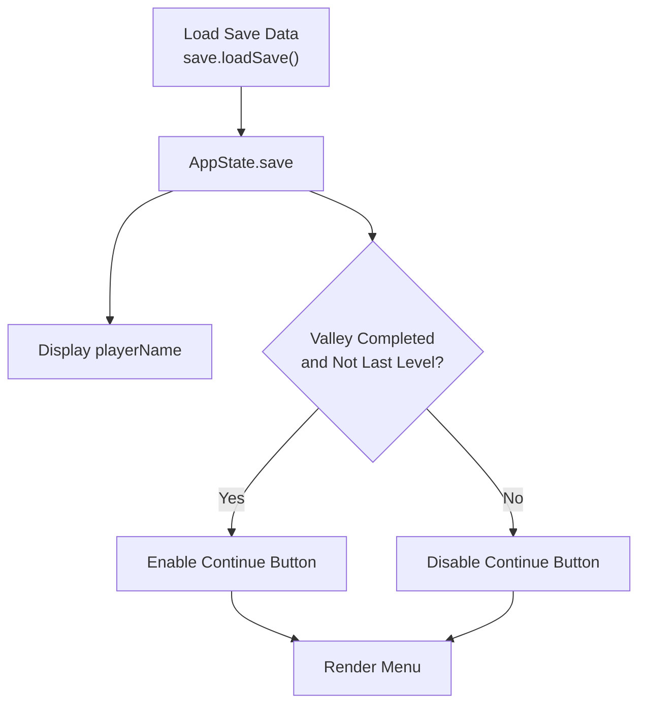
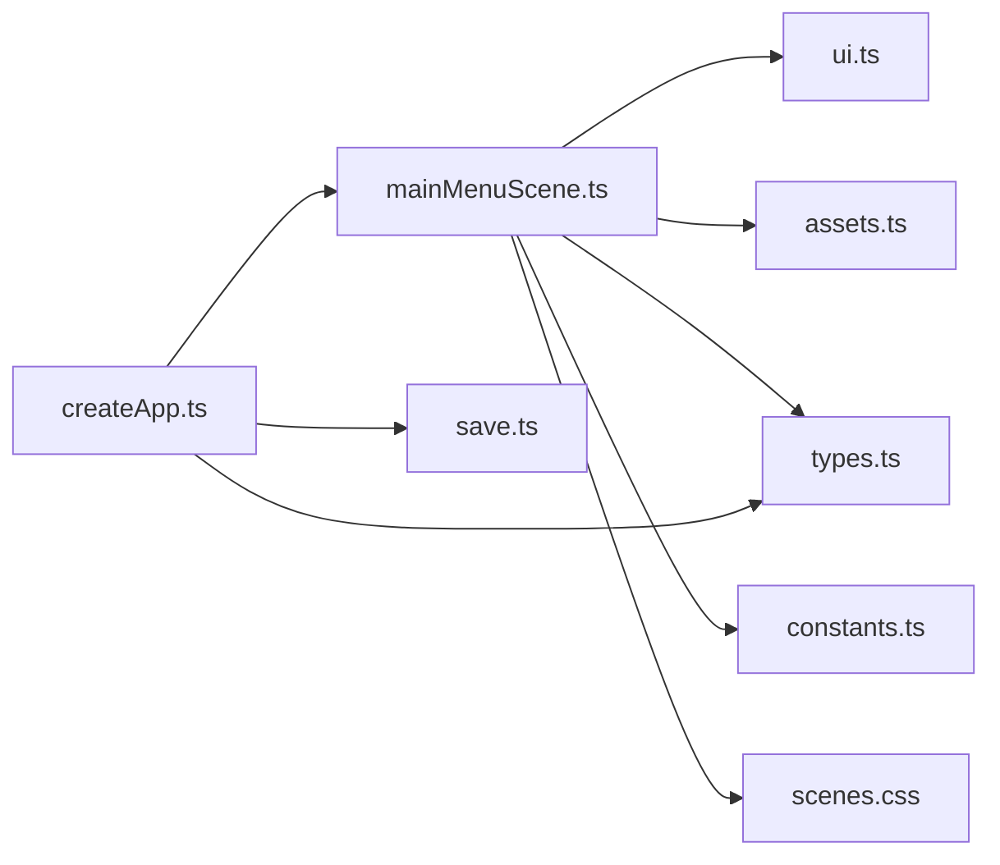

# Main Menu Scene

<cite>
**Referenced Files in This Document**
- [mainMenuScene.ts](file://src/app/scenes/mainMenuScene.ts)
- [createApp.ts](file://src/app/createApp.ts)
- [ui.ts](file://src/app/ui.ts)
- [save.ts](file://src/app/save.ts)
- [types.ts](file://src/app/types.ts)
- [constants.ts](file://src/app/constants.ts)
- [assets.ts](file://src/app/assets.ts)
- [scenes.css](file://src/styles/scenes.css)
- [base.css](file://src/styles/base.css)
- [bootScene.ts](file://src/app/scenes/bootScene.ts)
- [namingScene.ts](file://src/app/scenes/namingScene.ts)
- [levelSelectScene.ts](file://src/app/scenes/levelSelectScene.ts)
</cite>

## Table of Contents
1. [Introduction](#introduction)
2. [Project Structure](#project-structure)
3. [Core Components](#core-components)
4. [Architecture Overview](#architecture-overview)
5. [Detailed Component Analysis](#detailed-component-analysis)
6. [Dependency Analysis](#dependency-analysis)
7. [Performance Considerations](#performance-considerations)
8. [Troubleshooting Guide](#troubleshooting-guide)
9. [Conclusion](#conclusion)
10. [Appendices](#appendices)

## Introduction
The Main Menu Scene serves as the central navigation hub for the game, providing players with quick access to core gameplay features. This document explains how the main menu integrates with the game state to display player progress, manages interactive action buttons with hover and selection feedback, and coordinates navigation between scenes. It also covers responsive design considerations, accessibility features, and practical guidance for extending the menu with new items.

## Project Structure
The main menu is implemented as a scene renderer that composes HTML markup with embedded assets and interactive elements. The application lifecycle is managed by a central controller that renders scenes, binds actions, and persists state.

**Diagram sources**
- [createApp.ts:16-82](file://src/app/createApp.ts#L16-L82)
- [mainMenuScene.ts:8-23](file://src/app/scenes/mainMenuScene.ts#L8-L23)
- [ui.ts:1-16](file://src/app/ui.ts#L1-L16)
- [assets.ts:1-4](file://src/app/assets.ts#L1-L4)
- [save.ts:4-67](file://src/app/save.ts#L4-L67)
- [types.ts:1-45](file://src/app/types.ts#L1-L45)
- [constants.ts:1-71](file://src/app/constants.ts#L1-L71)
- [scenes.css:117-151](file://src/styles/scenes.css#L117-L151)
- [base.css:53-92](file://src/styles/base.css#L53-L92)

**Section sources**
- [createApp.ts:16-82](file://src/app/createApp.ts#L16-L82)
- [mainMenuScene.ts:8-23](file://src/app/scenes/mainMenuScene.ts#L8-L23)
- [scenes.css:117-151](file://src/styles/scenes.css#L117-L151)
- [base.css:53-92](file://src/styles/base.css#L53-L92)

## Core Components
- Main Menu Renderer: Composes the menu screen with background imagery, logo, player greeting, and action buttons.
- Action Button Utility: Generates standardized button elements with accessibility attributes and click handlers.
- Scene Controller: Manages scene transitions, binds action handlers, and maintains application state.
- Save System: Provides persistent storage for player progress, unlocks, and settings.
- Asset Manager: Resolves asset paths for images and UI elements.

Key responsibilities:
- Navigation hub: Presents primary actions and routes to other scenes.
- Player information display: Shows the player’s name and progress indicators.
- Interactive feedback: Uses hover, focus, and disabled states for buttons.
- State integration: Reads and writes save data to reflect progress and unlocks.

**Section sources**
- [mainMenuScene.ts:8-23](file://src/app/scenes/mainMenuScene.ts#L8-L23)
- [ui.ts:1-16](file://src/app/ui.ts#L1-L16)
- [createApp.ts:84-109](file://src/app/createApp.ts#L84-L109)
- [save.ts:4-67](file://src/app/save.ts#L4-L67)

## Architecture Overview
The main menu participates in a scene-based architecture where the application controller decides which scene to render and binds actions accordingly. The menu renderer depends on UI utilities for button creation and the asset manager for image paths. Player progress is stored in the save system and accessed through the application state.

**Diagram sources**
- [createApp.ts:84-109](file://src/app/createApp.ts#L84-L109)
- [mainMenuScene.ts:8-23](file://src/app/scenes/mainMenuScene.ts#L8-L23)
- [ui.ts:1-16](file://src/app/ui.ts#L1-L16)
- [assets.ts:1-4](file://src/app/assets.ts#L1-L4)
- [save.ts:64-66](file://src/app/save.ts#L64-L66)

## Detailed Component Analysis

### Main Menu Renderer
The main menu renderer constructs the screen layout with:
- Background image and animated clouds
- Logo positioned at the top-left
- Player greeting displaying the saved player name
- Action buttons for core navigation

It uses the action button utility to generate buttons with appropriate classes and data-action attributes. Disabled states are conditionally applied based on save data (e.g., continue journey button is disabled until the player completes the first level).

**Diagram sources**
- [mainMenuScene.ts:8-23](file://src/app/scenes/mainMenuScene.ts#L8-L23)
- [ui.ts:1-3](file://src/app/ui.ts#L1-L3)
- [assets.ts:1-4](file://src/app/assets.ts#L1-L4)

**Section sources**
- [mainMenuScene.ts:8-23](file://src/app/scenes/mainMenuScene.ts#L8-L23)

### Action Button Implementation
The action button utility creates standardized buttons with:
- Asset-based styling classes
- Accessible label and data-action attribute
- Optional disabled state for conditional availability

The scene controller binds these actions globally, enabling consistent event handling across scenes.

**Diagram sources**
- [ui.ts:1-16](file://src/app/ui.ts#L1-L16)
- [mainMenuScene.ts:8-23](file://src/app/scenes/mainMenuScene.ts#L8-L23)
- [createApp.ts:84-109](file://src/app/createApp.ts#L84-L109)

**Section sources**
- [ui.ts:1-16](file://src/app/ui.ts#L1-L16)
- [createApp.ts:84-109](file://src/app/createApp.ts#L84-L109)

### Navigation Hub and Scene Transitions
The application controller manages scene transitions and action bindings. The main menu routes to:
- Level Select scene for gameplay
- Gallery scene for achievements/artifacts
- Settings modal for configuration

Navigation is handled through the bindActions mechanism, which maps human-readable labels to handler functions.

**Diagram sources**
- [createApp.ts:65-82](file://src/app/createApp.ts#L65-L82)
- [createApp.ts:201-213](file://src/app/createApp.ts#L201-L213)

**Section sources**
- [createApp.ts:65-82](file://src/app/createApp.ts#L65-L82)
- [createApp.ts:201-213](file://src/app/createApp.ts#L201-L213)

### Player Information Display System
The main menu displays the player’s name and integrates with the save system to reflect progress:
- Player greeting reads from state.save.playerName
- Continue button visibility depends on state.save.levels.valley.completed and state.save.lastLevel
- Progress updates occur when the game completes a level

**Diagram sources**
- [save.ts:49-62](file://src/app/save.ts#L49-L62)
- [types.ts:13-44](file://src/app/types.ts#L13-L44)
- [mainMenuScene.ts:13](file://src/app/scenes/mainMenuScene.ts#L13)
- [mainMenuScene.ts:17](file://src/app/scenes/mainMenuScene.ts#L17)

**Section sources**
- [save.ts:49-62](file://src/app/save.ts#L49-L62)
- [types.ts:13-44](file://src/app/types.ts#L13-L44)
- [mainMenuScene.ts:13](file://src/app/scenes/mainMenuScene.ts#L13)
- [mainMenuScene.ts:17](file://src/app/scenes/mainMenuScene.ts#L17)

### Hover States and Selection Feedback
The UI provides visual feedback for interactive elements:
- Hover effects increase brightness and lift buttons slightly
- Focus-visible outlines indicate keyboard navigation targets
- Disabled buttons reduce opacity and desaturate

These behaviors are defined in the base and scene stylesheets.

**Section sources**
- [base.css:116-138](file://src/styles/base.css#L116-L138)
- [scenes.css:153-156](file://src/styles/scenes.css#L153-L156)

### Responsive Design Considerations
The main menu adapts to different screen sizes:
- Logo and action panel adjust widths below 900px
- Grid layouts for galleries and levels adapt to smaller screens
- Stage scaling maintains aspect ratio using viewport mode and scale calculations

Viewport scaling logic considers whether to cover or contain the content based on orientation and applies a CSS variable for consistent scaling across scenes.

**Section sources**
- [scenes.css:405-426](file://src/styles/scenes.css#L405-L426)
- [createApp.ts:362-376](file://src/app/createApp.ts#L362-L376)

### Accessibility Features
Accessibility is addressed through:
- Semantic labels on buttons via data-action attributes
- Focus-visible outlines for keyboard navigation
- ARIA attributes on decorative images
- Live regions for dynamic messages (e.g., boot sequence readiness)
- Escape sequences for player names to prevent XSS

**Section sources**
- [ui.ts:13-15](file://src/app/ui.ts#L13-L15)
- [bootScene.ts:57](file://src/app/scenes/bootScene.ts#L57)
- [bootScene.ts:46](file://src/app/scenes/bootScene.ts#L46)

### Integration with Game State
The main menu integrates with game state for:
- Player name display and validation
- Continue button enablement based on level completion
- Persistent save data for unlocks and settings
- Toast notifications for locked areas

State updates are persisted to local storage and reflected immediately in subsequent renders.

**Section sources**
- [createApp.ts:264-286](file://src/app/createApp.ts#L264-L286)
- [createApp.ts:288-303](file://src/app/createApp.ts#L288-L303)
- [save.ts:64-66](file://src/app/save.ts#L64-L66)

## Dependency Analysis
The main menu renderer depends on:
- UI utilities for button generation and action binding
- Asset manager for resolving image paths
- Types for compile-time safety of state structures
- Constants for asset roots and defaults
- Stylesheets for visual presentation and responsiveness

**Diagram sources**
- [mainMenuScene.ts:1-6](file://src/app/scenes/mainMenuScene.ts#L1-L6)
- [ui.ts:1-16](file://src/app/ui.ts#L1-L16)
- [assets.ts:1-4](file://src/app/assets.ts#L1-L4)
- [types.ts:1-45](file://src/app/types.ts#L1-L45)
- [constants.ts:1-71](file://src/app/constants.ts#L1-L71)
- [scenes.css:117-151](file://src/styles/scenes.css#L117-L151)
- [createApp.ts:16-30](file://src/app/createApp.ts#L16-L30)
- [save.ts:4-67](file://src/app/save.ts#L4-L67)

**Section sources**
- [mainMenuScene.ts:1-6](file://src/app/scenes/mainMenuScene.ts#L1-L6)
- [createApp.ts:16-30](file://src/app/createApp.ts#L16-L30)

## Performance Considerations
- Efficient rendering: The main menu uses lightweight HTML composition and avoids heavy DOM manipulation.
- Event delegation: Actions are bound once per scene via bindActions, reducing listener overhead.
- Asset caching: Images are served from preloaded asset paths; ensure assets are optimized for fast loading.
- Minimal reflows: CSS transforms and opacity changes are hardware-accelerated for smooth hover and focus states.
- Local storage persistence: Save data is persisted asynchronously to avoid blocking the UI thread.

[No sources needed since this section provides general guidance]

## Troubleshooting Guide
Common issues and resolutions:
- Action handlers not firing: Verify that data-action attributes match keys registered in bindActions.
- Missing images: Confirm asset paths generated by the asset manager resolve correctly under the images directory.
- Disabled continue button: Ensure save data reflects level completion and last level progression.
- Accessibility warnings: Add aria-live regions for dynamic content and ensure focus order remains logical.

**Section sources**
- [createApp.ts:84-109](file://src/app/createApp.ts#L84-L109)
- [assets.ts:1-4](file://src/app/assets.ts#L1-L4)
- [mainMenuScene.ts:17](file://src/app/scenes/mainMenuScene.ts#L17)

## Conclusion
The Main Menu Scene provides a streamlined navigation hub that integrates player identity, progress, and interactive controls. Its modular design, combined with robust state management and responsive styling, ensures a consistent and accessible user experience across devices. The architecture supports easy extension with new menu items and customization of appearance while maintaining performance and usability.

[No sources needed since this section summarizes without analyzing specific files]

## Appendices

### Adding New Menu Items
To add a new menu item:
1. Define the action label and handler in the scene controller’s bindActions mapping.
2. Create a new button using the action button utility with a unique class for styling.
3. Optionally disable the button based on save data conditions.
4. Bind the action to trigger the desired scene transition or behavior.

Example steps:
- Register action in bindActions for the new label.
- Call actionButton with the label and a distinct class.
- Conditionally pass disabled based on state.save.

**Section sources**
- [createApp.ts:84-109](file://src/app/createApp.ts#L84-L109)
- [ui.ts:1-3](file://src/app/ui.ts#L1-L3)

### Customizing Appearance
To customize the main menu appearance:
- Adjust logo and action panel positions and sizes in scenes.css.
- Modify button styles and hover/focus effects in base.css.
- Use media queries to adapt layout for various screen sizes.

**Section sources**
- [scenes.css:117-151](file://src/styles/scenes.css#L117-L151)
- [base.css:116-138](file://src/styles/base.css#L116-L138)