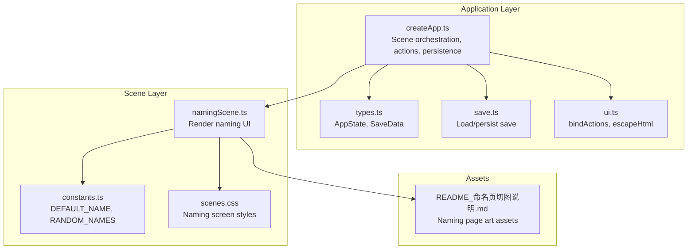
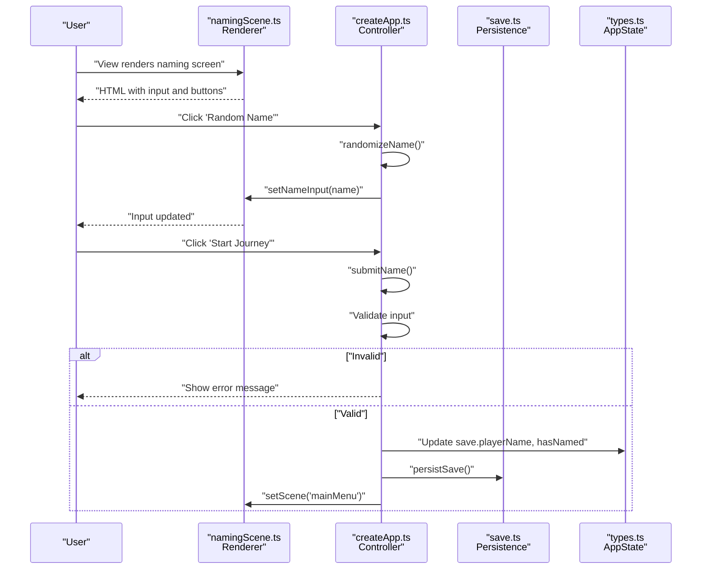
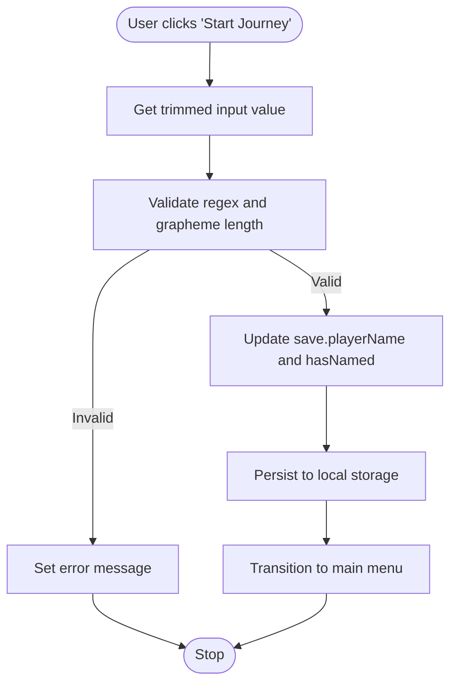
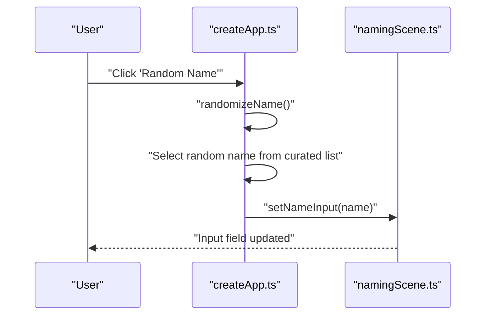
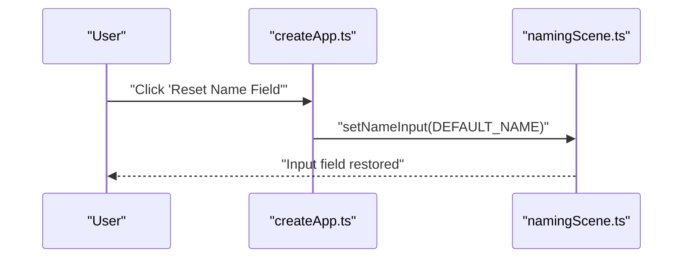
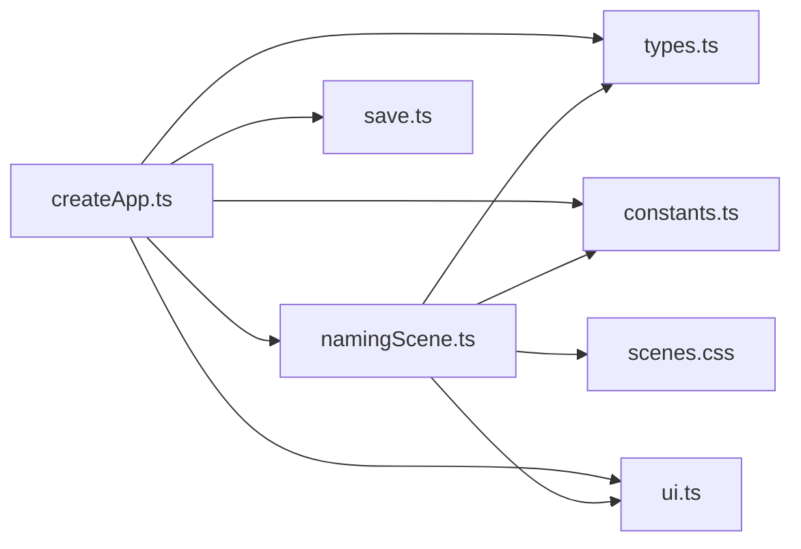

# Naming Scene

<cite>
**Referenced Files in This Document**
- [namingScene.ts](file://src/app/scenes/namingScene.ts)
- [createApp.ts](file://src/app/createApp.ts)
- [constants.ts](file://src/app/constants.ts)
- [types.ts](file://src/app/types.ts)
- [save.ts](file://src/app/save.ts)
- [ui.ts](file://src/app/ui.ts)
- [scenes.css](file://src/styles/scenes.css)
- [README_命名页切图说明.md](file://assets/images/sporelight_naming_page_assets/README_命名页切图说明.md)
</cite>

## Table of Contents
1. [Introduction](#introduction)
2. [Project Structure](#project-structure)
3. [Core Components](#core-components)
4. [Architecture Overview](#architecture-overview)
5. [Detailed Component Analysis](#detailed-component-analysis)
6. [Dependency Analysis](#dependency-analysis)
7. [Performance Considerations](#performance-considerations)
8. [Troubleshooting Guide](#troubleshooting-guide)
9. [Conclusion](#conclusion)
10. [Appendices](#appendices)

## Introduction
This document describes the Naming Scene implementation, covering the player name input system, random name generation, and validation mechanisms. It explains the UI components, form handling patterns, error state management, accessibility considerations, input sanitization, and extension points for adding new validation rules or custom name sources.

## Project Structure
The Naming Scene is part of the application's scene rendering system. It integrates with the global application state, binds interactive actions, and persists user input to local storage.

**Diagram sources**
- [createApp.ts](file://src/app/createApp.ts)
- [namingScene.ts](file://src/app/scenes/namingScene.ts)
- [constants.ts](file://src/app/constants.ts)
- [types.ts](file://src/app/types.ts)
- [save.ts](file://src/app/save.ts)
- [ui.ts](file://src/app/ui.ts)
- [scenes.css](file://src/styles/scenes.css)
- [README_命名页切图说明.md](file://assets/images/sporelight_naming_page_assets/README_命名页切图说明.md)

**Section sources**
- [namingScene.ts](file://src/app/scenes/namingScene.ts)
- [createApp.ts](file://src/app/createApp.ts)
- [constants.ts](file://src/app/constants.ts)
- [types.ts](file://src/app/types.ts)
- [save.ts](file://src/app/save.ts)
- [ui.ts](file://src/app/ui.ts)
- [scenes.css](file://src/styles/scenes.css)
- [README_命名页切图说明.md](file://assets/images/sporelight_naming_page_assets/README_命名页切图说明.md)

## Core Components
- Render function for the naming scene, including input field, validation feedback, and action buttons.
- Application controller methods for randomizing names, resetting the input, and submitting the name.
- Validation logic enforcing length and character set rules.
- Persistence of the player name and naming state to local storage.
- UI utilities for binding actions and escaping HTML.

Key responsibilities:
- UI rendering and layout for the naming screen.
- Form handling and validation feedback.
- Integration with application state and persistence.
- Accessibility support via ARIA live region.

**Section sources**
- [namingScene.ts](file://src/app/scenes/namingScene.ts)
- [createApp.ts](file://src/app/createApp.ts)
- [constants.ts](file://src/app/constants.ts)
- [types.ts](file://src/app/types.ts)
- [save.ts](file://src/app/save.ts)
- [ui.ts](file://src/app/ui.ts)

## Architecture Overview
The Naming Scene follows a unidirectional data flow:
- The renderer produces HTML with input and action elements.
- The controller binds click handlers to actions.
- Actions update the application state and persist it.
- Rendering updates in response to state changes.

**Diagram sources**
- [namingScene.ts](file://src/app/scenes/namingScene.ts)
- [createApp.ts](file://src/app/createApp.ts)
- [save.ts](file://src/app/save.ts)
- [types.ts](file://src/app/types.ts)

## Detailed Component Analysis

### Player Name Input System
- Input field:
  - ID: "playerNameInput"
  - Max length: 12 characters
  - Value initialized from application state or default name
  - Uses HTML escaping when rendering to prevent XSS
- Action buttons:
  - "Random Name": selects a random name from a curated list
  - "Reset Name Field": restores the default name
  - "Start Journey": submits the name and transitions to the main menu

Validation rules enforced during submission:
- Length: 1 to 12 characters
- Characters: Chinese characters, Latin letters, digits, and spaces only
- Unicode grapheme cluster count: enforced to ensure display length does not exceed 12

Accessibility:
- Error message area uses an ARIA live region to announce validation feedback to assistive technologies.

Security:
- HTML escaping is applied when rendering the initial input value to mitigate XSS risks.

**Section sources**
- [namingScene.ts](file://src/app/scenes/namingScene.ts)
- [createApp.ts](file://src/app/createApp.ts)
- [ui.ts](file://src/app/ui.ts)

### Random Name Generation
- Curated list of names is defined centrally and used to select a random entry.
- Selection uses a uniform distribution over the list indices.
- The selected name is immediately reflected in the input field.

Extensibility:
- To add more names, append entries to the curated list.
- To introduce categories or weighting, extend the selection logic accordingly.

**Section sources**
- [constants.ts](file://src/app/constants.ts)
- [createApp.ts](file://src/app/createApp.ts)

### Name Validation Mechanisms
Validation occurs on submission:
- Trimmed input is tested against a regex allowing Chinese characters, Latin letters, digits, and spaces.
- A secondary check ensures the Unicode grapheme cluster length does not exceed 12.

Feedback:
- On invalid input, the error area displays a localized message.
- On valid input, the error area clears and the state is persisted.

Edge cases handled:
- Whitespace trimming before validation.
- Unicode grapheme clusters vs byte length distinction to match display constraints.

**Section sources**
- [createApp.ts](file://src/app/createApp.ts)

### UI Components and Styling
- Layout:
  - Background image and overlay for thematic presentation
  - Centered card containing prompts, input, and action buttons
- Input styling:
  - Custom nine-patch-like background for the input container
  - Large, centered input with custom font size and color
- Buttons:
  - Two small action buttons for randomization and reset
  - Primary button for submission
- Responsive design:
  - Adjustments for smaller screens to ensure readability and usability

**Section sources**
- [namingScene.ts](file://src/app/scenes/namingScene.ts)
- [scenes.css](file://src/styles/scenes.css)
- [README_命名页切图说明.md](file://assets/images/sporelight_naming_page_assets/README_命名页切图说明.md)

### Integration with Application State and Persistence
- State model includes:
  - playerName: current player name
  - hasNamed: flag indicating whether the player has named themselves
  - lastLevel, levels, gallery, settings: other game state
- Submission flow:
  - Update state fields
  - Persist to local storage
  - Transition to the next scene

Settings integration:
- Resetting the name from settings modal resets playerName and hasNamed, then re-renders the naming scene.

**Section sources**
- [types.ts](file://src/app/types.ts)
- [createApp.ts](file://src/app/createApp.ts)
- [save.ts](file://src/app/save.ts)

### Form Handling Patterns and Error State Management
- Action binding:
  - Centralized mapping of action keys to handlers
  - Event delegation via a shared binding utility
- Error messaging:
  - Dedicated paragraph element with ARIA live region semantics
  - Clearing error messages on successful validation
- State updates:
  - Immediate UI updates upon randomization or reset
  - Deferred state updates until validation passes

**Section sources**
- [createApp.ts](file://src/app/createApp.ts)
- [ui.ts](file://src/app/ui.ts)
- [namingScene.ts](file://src/app/scenes/namingScene.ts)

### User Interaction Flows

#### Submitting a Name

**Diagram sources**
- [createApp.ts](file://src/app/createApp.ts)
- [save.ts](file://src/app/save.ts)

#### Randomizing a Name

**Diagram sources**
- [createApp.ts](file://src/app/createApp.ts)
- [constants.ts](file://src/app/constants.ts)
- [namingScene.ts](file://src/app/scenes/namingScene.ts)

#### Resetting the Name Field

**Diagram sources**
- [createApp.ts](file://src/app/createApp.ts)
- [constants.ts](file://src/app/constants.ts)
- [namingScene.ts](file://src/app/scenes/namingScene.ts)

## Dependency Analysis
The Naming Scene depends on:
- Constants for default name and curated names
- Types for state shape
- UI utilities for action binding and HTML escaping
- Styles for visual presentation
- Save system for persistence

**Diagram sources**
- [namingScene.ts](file://src/app/scenes/namingScene.ts)
- [createApp.ts](file://src/app/createApp.ts)
- [constants.ts](file://src/app/constants.ts)
- [types.ts](file://src/app/types.ts)
- [save.ts](file://src/app/save.ts)
- [ui.ts](file://src/app/ui.ts)
- [scenes.css](file://src/styles/scenes.css)

**Section sources**
- [namingScene.ts](file://src/app/scenes/namingScene.ts)
- [createApp.ts](file://src/app/createApp.ts)
- [constants.ts](file://src/app/constants.ts)
- [types.ts](file://src/app/types.ts)
- [save.ts](file://src/app/save.ts)
- [ui.ts](file://src/app/ui.ts)
- [scenes.css](file://src/styles/scenes.css)

## Performance Considerations
- Rendering cost: The naming scene is lightweight; rendering occurs only on scene change or action binding.
- Validation cost: Regex and grapheme length checks are O(n) with n equal to input length; acceptable for typical short inputs.
- DOM updates: Minimal DOM manipulation; primarily updating input value and error text.
- Asset loading: Background and UI assets are preloaded via the asset pipeline; no runtime fetching in the naming scene.

## Troubleshooting Guide
Common issues and resolutions:
- Input not updating after clicking "Random Name":
  - Verify action binding for "randomName" is present and functional.
  - Ensure the input element exists and the setNameInput method targets the correct ID.
- Error message not clearing:
  - Confirm the error element exists and the submit handler clears its text content on success.
- Name not saved:
  - Check that the submit handler updates state fields and calls persistence.
  - Verify local storage is accessible and not blocked by browser settings.
- Accessibility announcements not working:
  - Ensure the error element has the ARIA live region role and receives text content on validation failure.

**Section sources**
- [createApp.ts](file://src/app/createApp.ts)
- [namingScene.ts](file://src/app/scenes/namingScene.ts)

## Conclusion
The Naming Scene provides a focused, accessible, and secure way to capture the player’s name. It enforces clear validation rules, offers helpful feedback, and integrates seamlessly with the application state and persistence layer. The modular design allows straightforward extensions for additional validation rules or custom name sources.

## Appendices

### Validation Rules Reference
- Allowed characters: Chinese characters, Latin letters, digits, and spaces
- Maximum display length: 12 characters (Unicode grapheme clusters)
- Minimum length: 1 character
- Input is trimmed before validation

**Section sources**
- [createApp.ts](file://src/app/createApp.ts)

### Extending the Naming System
- Adding new validation rules:
  - Extend the validation predicate in the submit handler while preserving existing behavior.
  - Update the error message to reflect new constraints.
- Adding custom name sources:
  - Introduce a new curated list or external source.
  - Modify the randomization logic to select from multiple sources or apply weights.
- Enhancing accessibility:
  - Add ARIA attributes to the input and error elements.
  - Provide keyboard navigation and focus management for the input field.

**Section sources**
- [createApp.ts](file://src/app/createApp.ts)
- [constants.ts](file://src/app/constants.ts)
- [namingScene.ts](file://src/app/scenes/namingScene.ts)