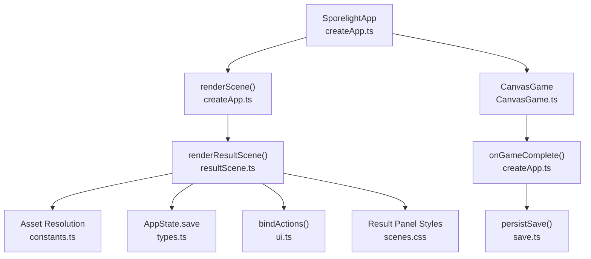
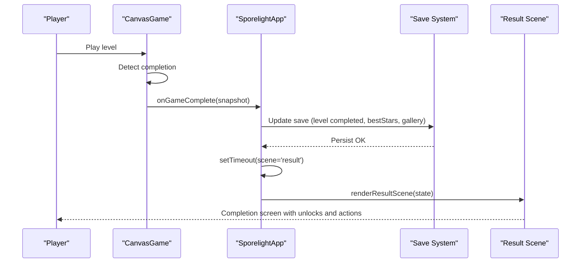
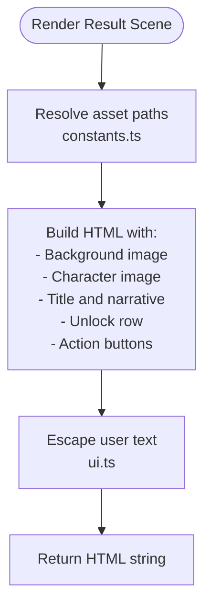
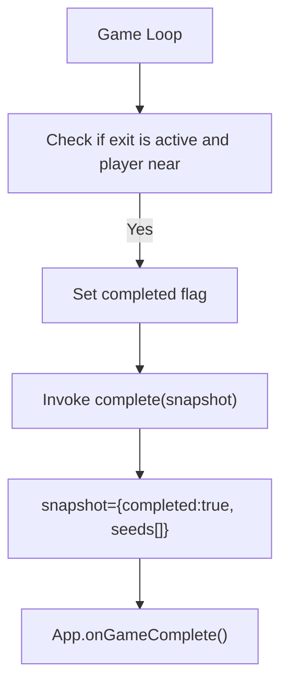
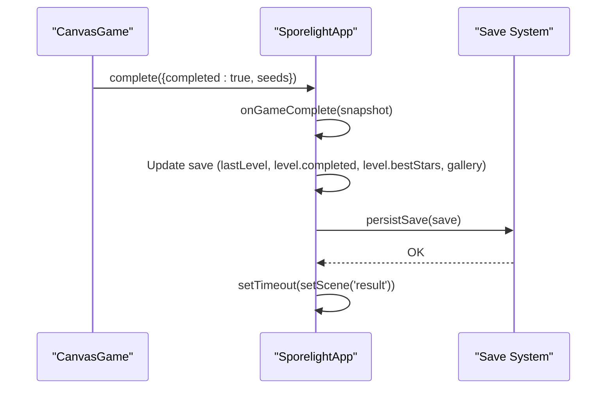
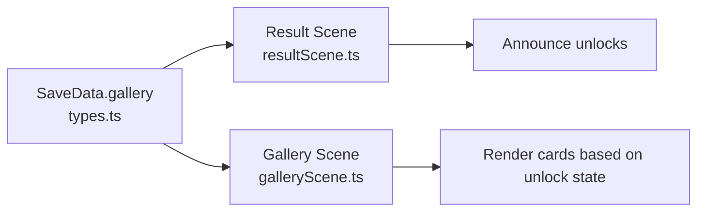
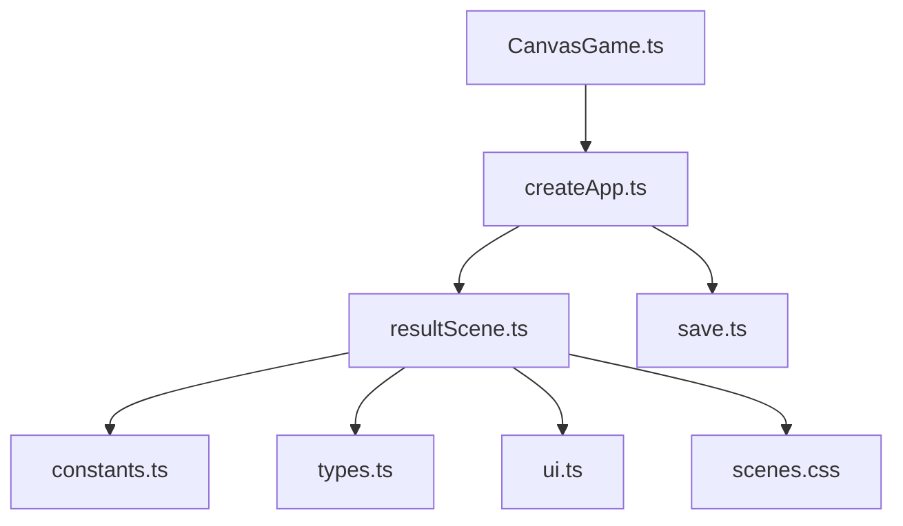

# Result Scene

<cite>
**Referenced Files in This Document**
- [resultScene.ts](file://src/app/scenes/resultScene.ts)
- [createApp.ts](file://src/app/createApp.ts)
- [CanvasGame.ts](file://src/app/game/CanvasGame.ts)
- [save.ts](file://src/app/save.ts)
- [types.ts](file://src/app/types.ts)
- [constants.ts](file://src/app/constants.ts)
- [ui.ts](file://src/app/ui.ts)
- [scenes.css](file://src/styles/scenes.css)
- [galleryScene.ts](file://src/app/scenes/galeryScene.ts)
</cite>

## Table of Contents
1. [Introduction](#introduction)
2. [Project Structure](#project-structure)
3. [Core Components](#core-components)
4. [Architecture Overview](#architecture-overview)
5. [Detailed Component Analysis](#detailed-component-analysis)
6. [Dependency Analysis](#dependency-analysis)
7. [Performance Considerations](#performance-considerations)
8. [Troubleshooting Guide](#troubleshooting-guide)
9. [Conclusion](#conclusion)
10. [Appendices](#appendices)

## Introduction
This document explains the Result Scene implementation and completion screen logic. It covers how gameplay completion is detected, how the completion screen presents feedback, and how progress and statistics are persisted. It also documents the UI layout, interaction model, and integration with the save system. Guidance is included for customizing result displays, adding new completion criteria, and extending the achievement system.

## Project Structure
The Result Scene is part of a modular scene-based UI system. Scenes are rendered by a central renderer and switched via the application state machine. The Result Scene depends on:
- Asset resolution and constants for asset roots
- The global application state for save data
- UI utilities for safe HTML rendering and action binding
- Styles for responsive layout and visual polish



**Diagram sources**
- [createApp.ts:65-82](file://src/app/createApp.ts#L65-L82)
- [resultScene.ts:8-30](file://src/app/scenes/resultScene.ts#L8-L30)
- [constants.ts:4](file://src/app/constants.ts#L4)
- [types.ts:38-44](file://src/app/types.ts#L38-L44)
- [CanvasGame.ts:14](file://src/app/game/CanvasGame.ts#L14)
- [createApp.ts:288-303](file://src/app/createApp.ts#L288-L303)
- [save.ts:64-66](file://src/app/save.ts#L64-L66)
- [ui.ts:5-11](file://src/app/ui.ts#L5-L11)
- [scenes.css:309-350](file://src/styles/scenes.css#L309-L350)

**Section sources**
- [createApp.ts:65-82](file://src/app/createApp.ts#L65-L82)
- [resultScene.ts:8-30](file://src/app/scenes/resultScene.ts#L8-L30)
- [constants.ts:4](file://src/app/constants.ts#L4)
- [types.ts:38-44](file://src/app/types.ts#L38-L44)
- [ui.ts:5-11](file://src/app/ui.ts#L5-L11)
- [scenes.css:309-350](file://src/styles/scenes.css#L309-L350)

## Core Components
- Result Scene renderer: Builds the HTML for the completion screen, including character illustration, title, narrative text, unlock indicators, and action buttons.
- Application state machine: Drives scene transitions and persists save data after completion.
- Game completion callback: Receives completion signals from the game engine and updates save data accordingly.
- Save system: Provides default save creation, persistence to local storage, and merging of partial saves.
- UI utilities: Safe HTML escaping and action binding for interactive elements.
- Styles: Responsive layout and visual design for the result panel and action buttons.

Key responsibilities:
- Present completion feedback and unlock announcements
- Persist progress and statistics
- Provide navigation actions to continue the journey

**Section sources**
- [resultScene.ts:8-30](file://src/app/scenes/resultScene.ts#L8-L30)
- [createApp.ts:288-303](file://src/app/createApp.ts#L288-L303)
- [save.ts:49-66](file://src/app/save.ts#L49-L66)
- [ui.ts:13-15](file://src/app/ui.ts#L13-L15)
- [scenes.css:309-350](file://src/styles/scenes.css#L309-L350)

## Architecture Overview
The Result Scene participates in a clear flow:
- The game detects completion and invokes a completion callback.
- The application updates save data (marking level as completed, setting best stars, unlocking gallery items).
- After a short delay, the application switches to the Result Scene.
- The Result Scene renders the completion screen using the current save state.



**Diagram sources**
- [CanvasGame.ts:187-191](file://src/app/game/CanvasGame.ts#L187-L191)
- [createApp.ts:288-303](file://src/app/createApp.ts#L288-L303)
- [save.ts:64-66](file://src/app/save.ts#L64-L66)
- [resultScene.ts:8-30](file://src/app/scenes/resultScene.ts#L8-L30)

## Detailed Component Analysis

### Result Scene Renderer
The Result Scene renderer composes:
- Background image from the complete asset root
- Character illustration
- Title and narrative text using the player’s name
- Unlock row indicating newly discovered gallery entries
- Action buttons for navigation and replay

Rendering logic highlights:
- Uses asset resolution constants for consistent asset paths
- Escapes user-provided text to prevent XSS
- Presents unlock announcements for gallery items



**Diagram sources**
- [resultScene.ts:8-30](file://src/app/scenes/resultScene.ts#L8-L30)
- [constants.ts:4](file://src/app/constants.ts#L4)
- [ui.ts:13-15](file://src/app/ui.ts#L13-L15)

**Section sources**
- [resultScene.ts:8-30](file://src/app/scenes/resultScene.ts#L8-L30)
- [constants.ts:4](file://src/app/constants.ts#L4)
- [ui.ts:13-15](file://src/app/ui.ts#L13-L15)

### Completion Detection and Callback
Completion detection occurs inside the game loop. When the player reaches the exit and all conditions are met, the game invokes the completion callback with a snapshot indicating completion and the state of seeds.



**Diagram sources**
- [CanvasGame.ts:187-191](file://src/app/game/CanvasGame.ts#L187-L191)

**Section sources**
- [CanvasGame.ts:187-191](file://src/app/game/CanvasGame.ts#L187-L191)

### Progress Update Mechanism
After completion, the application updates the save data:
- Sets the last level played
- Marks the level as completed
- Assigns best stars
- Unlocks gallery items
- Persists the updated save to local storage



**Diagram sources**
- [createApp.ts:288-303](file://src/app/createApp.ts#L288-L303)
- [save.ts:64-66](file://src/app/save.ts#L64-L66)

**Section sources**
- [createApp.ts:288-303](file://src/app/createApp.ts#L288-L303)
- [save.ts:64-66](file://src/app/save.ts#L64-L66)

### Star Rating System
Current implementation assigns a fixed star rating upon completion. The star rating is stored in the save data for the completed level.

- Best stars are set to a fixed value when the level is completed.
- The result screen currently displays unlock announcements but does not visually render star ratings.

Recommendations for future enhancement:
- Introduce star calculation logic based on performance metrics (e.g., time, resource usage, optional objectives).
- Store and display stars per level in the result screen.
- Add UI elements to visualize star ratings.

**Section sources**
- [createApp.ts:294-295](file://src/app/createApp.ts#L294-L295)
- [types.ts:7-11](file://src/app/types.ts#L7-L11)

### Achievement Display and Gallery Integration
The result screen announces unlocks for gallery items. The gallery scene reflects the persistent state of unlocked items.

- Result screen announces new gallery unlocks.
- Gallery scene reads save data to decide whether items are locked or unlocked.
- Items are presented with appropriate imagery and descriptions.



**Diagram sources**
- [types.ts:18](file://src/app/types.ts#L18)
- [resultScene.ts:16-20](file://src/app/scenes/resultScene.ts#L16-L20)
- [galleryScene.ts:26-38](file://src/app/scenes/galeryScene.ts#L26-L38)

**Section sources**
- [resultScene.ts:16-20](file://src/app/scenes/resultScene.ts#L16-L20)
- [galleryScene.ts:26-38](file://src/app/scenes/galeryScene.ts#L26-L38)
- [types.ts:18](file://src/app/types.ts#L18)

### UI Presentation and Interaction Patterns
The result panel is styled with a centered card layout and action buttons. Interaction is driven by data-action attributes bound by the UI system.

- Result panel layout and styling are defined in the scenes stylesheet.
- Action buttons trigger scene transitions or in-game actions.
- The escape utility ensures safe rendering of user text.

```mermaid
classDiagram
class ResultSceneRenderer {
+renderResultScene(state) : string
}
class UISystem {
+bindActions(map)
+escapeHtml(text) : string
}
class Styles {
<<stylesheet>>
".result-panel"
".result-actions"
}
ResultSceneRenderer --> UISystem : "uses escapeHtml"
ResultSceneRenderer --> Styles : "applies"
```

**Diagram sources**
- [resultScene.ts:8-30](file://src/app/scenes/resultScene.ts#L8-L30)
- [ui.ts:5-11](file://src/app/ui.ts#L5-L11)
- [scenes.css:309-350](file://src/styles/scenes.css#L309-L350)

**Section sources**
- [scenes.css:309-350](file://src/styles/scenes.css#L309-L350)
- [ui.ts:5-11](file://src/app/ui.ts#L5-L11)
- [resultScene.ts:8-30](file://src/app/scenes/resultScene.ts#L8-L30)

### Scene Transitions and Navigation
Navigation from the result screen is handled by the shared action binding system. Buttons with data-action attributes route to specific handlers that change the active scene.

- Back-to-level-select, re-play, and gallery navigation are supported.
- The action binding system listens for clicks and invokes the associated handler.

**Section sources**
- [createApp.ts:84-109](file://src/app/createApp.ts#L84-L109)
- [resultScene.ts:22-26](file://src/app/scenes/resultScene.ts#L22-L26)

## Dependency Analysis
The Result Scene has clear, focused dependencies:
- Asset resolution constants for consistent asset paths
- Application state for save data
- UI utilities for safety and interactivity
- Styles for presentation



**Diagram sources**
- [resultScene.ts:1-6](file://src/app/scenes/resultScene.ts#L1-L6)
- [constants.ts:4](file://src/app/constants.ts#L4)
- [types.ts:38-44](file://src/app/types.ts#L38-L44)
- [ui.ts:5-11](file://src/app/ui.ts#L5-L11)
- [scenes.css:309-350](file://src/styles/scenes.css#L309-L350)
- [createApp.ts:65-82](file://src/app/createApp.ts#L65-L82)
- [save.ts:64-66](file://src/app/save.ts#L64-L66)
- [CanvasGame.ts:14](file://src/app/game/CanvasGame.ts#L14)

**Section sources**
- [resultScene.ts:1-6](file://src/app/scenes/resultScene.ts#L1-L6)
- [createApp.ts:65-82](file://src/app/createApp.ts#L65-L82)
- [save.ts:64-66](file://src/app/save.ts#L64-L66)
- [CanvasGame.ts:14](file://src/app/game/CanvasGame.ts#L14)

## Performance Considerations
- Rendering the result scene is lightweight, involving simple DOM construction and asset loading.
- The completion callback triggers a delayed scene transition to allow animations to finish.
- Local storage persistence is synchronous; keep save objects compact to minimize overhead.

[No sources needed since this section provides general guidance]

## Troubleshooting Guide
Common issues and resolutions:
- Result screen not appearing after completion
  - Verify the completion callback is invoked and the save is updated.
  - Ensure the scene transition timeout completes before switching to the result scene.
  - Confirm the action bindings are attached after rendering.

- Incorrect or unsafe text in the result screen
  - Ensure user-provided text is escaped before insertion into the DOM.

- Gallery unlocks not reflected in the gallery scene
  - Confirm the save data reflects the unlock state.
  - Verify the gallery scene reads from the save and applies appropriate classes.

**Section sources**
- [createApp.ts:288-303](file://src/app/createApp.ts#L288-L303)
- [ui.ts:13-15](file://src/app/ui.ts#L13-L15)
- [galleryScene.ts:26-38](file://src/app/scenes/galeryScene.ts#L26-L38)

## Conclusion
The Result Scene provides a clean, extensible foundation for presenting completion feedback. It integrates tightly with the save system to persist progress and unlocks, and with the UI system to deliver responsive interactions. Future enhancements can introduce dynamic star ratings, richer completion metrics, and expanded achievement displays.

[No sources needed since this section summarizes without analyzing specific files]

## Appendices

### Customization Guidelines
- To customize the result display:
  - Modify the result scene renderer to adjust content, assets, or layout.
  - Update styles to reflect new visual designs.
- To add new completion criteria:
  - Extend the game completion detection logic to compute additional metrics.
  - Update the completion callback to set new save fields (e.g., best time, optional objectives).
- To implement additional achievements:
  - Add new gallery items and unlock conditions in the save data.
  - Update the result scene to announce new unlocks and the gallery scene to render them.

[No sources needed since this section provides general guidance]