# Scene Architecture

<cite>
**Referenced Files in This Document**
- [src/main.ts](file://src/main.ts)
- [src/app/createApp.ts](file://src/app/createApp.ts)
- [src/app/types.ts](file://src/app/types.ts)
- [src/app/constants.ts](file://src/app/constants.ts)
- [src/app/assets.ts](file://src/app/assets.ts)
- [src/app/save.ts](file://src/app/save.ts)
- [src/app/ui.ts](file://src/app/ui.ts)
- [src/app/game/CanvasGame.ts](file://src/app/game/CanvasGame.ts)
- [src/app/scenes/bootScene.ts](file://src/app/scenes/bootScene.ts)
- [src/app/scenes/namingScene.ts](file://src/app/scenes/namingScene.ts)
- [src/app/scenes/mainMenuScene.ts](file://src/app/scenes/mainMenuScene.ts)
- [src/app/scenes/levelSelectScene.ts](file://src/app/scenes/levelSelectScene.ts)
- [src/app/scenes/gameScene.ts](file://src/app/scenes/gameScene.ts)
- [src/app/scenes/resultScene.ts](file://src/app/scenes/resultScene.ts)
- [src/app/scenes/galleryScene.ts](file://src/app/scenes/galleryScene.ts)
</cite>

## Table of Contents
1. [Introduction](#introduction)
2. [Project Structure](#project-structure)
3. [Core Components](#core-components)
4. [Architecture Overview](#architecture-overview)
5. [Detailed Component Analysis](#detailed-component-analysis)
6. [Dependency Analysis](#dependency-analysis)
7. [Performance Considerations](#performance-considerations)
8. [Troubleshooting Guide](#troubleshooting-guide)
9. [Conclusion](#conclusion)
10. [Appendices](#appendices)

## Introduction
This document explains SporeLight’s scene-based architecture and navigation system. It focuses on how scenes are rendered, how the central application controller manages state and transitions, and how scenes communicate via the controller. It also documents the viewport scaling and responsive design implementation, the scene state container, transition mechanics, and error handling patterns. Examples of scene creation, destruction, and state persistence are included to guide developers in extending the system.

## Project Structure
SporeLight organizes presentation logic around a small set of scene renderers and a single application controller. The entry point initializes the app and mounts it into the DOM. Scenes are pure renderers that receive the global state and return HTML strings. The controller orchestrates state updates, binds UI actions, and manages lifecycle hooks such as boot sequence and game instance lifecycle.

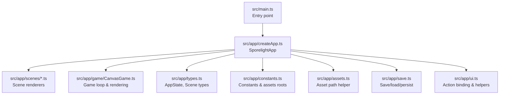

**Diagram sources**
- [src/main.ts:1-11](file://src/main.ts#L1-L11)
- [src/app/createApp.ts:16-377](file://src/app/createApp.ts#L16-L377)
- [src/app/types.ts:1-45](file://src/app/types.ts#L1-L45)
- [src/app/constants.ts:1-71](file://src/app/constants.ts#L1-L71)
- [src/app/assets.ts:1-4](file://src/app/assets.ts#L1-L4)
- [src/app/save.ts:1-67](file://src/app/save.ts#L1-L67)
- [src/app/ui.ts:1-16](file://src/app/ui.ts#L1-L16)
- [src/app/game/CanvasGame.ts:1-318](file://src/app/game/CanvasGame.ts#L1-L318)
- [src/app/scenes/bootScene.ts:1-94](file://src/app/scenes/bootScene.ts#L1-L94)
- [src/app/scenes/namingScene.ts:1-36](file://src/app/scenes/namingScene.ts#L1-L36)
- [src/app/scenes/mainMenuScene.ts:1-24](file://src/app/scenes/mainMenuScene.ts#L1-L24)
- [src/app/scenes/levelSelectScene.ts:1-39](file://src/app/scenes/levelSelectScene.ts#L1-L39)
- [src/app/scenes/gameScene.ts:1-22](file://src/app/scenes/gameScene.ts#L1-L22)
- [src/app/scenes/resultScene.ts:1-31](file://src/app/scenes/resultScene.ts#L1-L31)
- [src/app/scenes/galleryScene.ts:1-43](file://src/app/scenes/galleryScene.ts#L1-L43)

**Section sources**
- [src/main.ts:1-11](file://src/main.ts#L1-L11)
- [src/app/createApp.ts:16-377](file://src/app/createApp.ts#L16-L377)

## Core Components
- Central Application Controller: A single class that holds AppState, renders the shell and current scene, binds actions, manages boot sequence, and controls the game instance lifecycle.
- Scene Renderers: Pure functions that accept AppState and return HTML strings for each scene.
- Game Instance: A dedicated CanvasGame class that encapsulates the game loop, input handling, rendering, and completion callback.
- State Container: AppState and SaveData define the persistent state shape and default values.
- UI Binding: A lightweight action binding utility that attaches event handlers to DOM elements marked with data-action attributes.
- Asset Path Helper: A simple helper to resolve asset URLs.
- Save System: LocalStorage-backed persistence with safe merging against defaults.

Key responsibilities:
- Navigation: Controlled by the controller’s scene setter, which triggers re-render and optional lifecycle cleanup.
- Rendering: The controller composes the shell, applies viewport scaling, and delegates scene rendering.
- Lifecycle: Boot sequence, settings modal, and game instance are managed by the controller.
- Persistence: Save data is loaded at startup, mutated during gameplay, and persisted on changes.

**Section sources**
- [src/app/createApp.ts:22-377](file://src/app/createApp.ts#L22-L377)
- [src/app/types.ts:1-45](file://src/app/types.ts#L1-L45)
- [src/app/save.ts:1-67](file://src/app/save.ts#L1-L67)
- [src/app/ui.ts:1-16](file://src/app/ui.ts#L1-L16)
- [src/app/assets.ts:1-4](file://src/app/assets.ts#L1-L4)
- [src/app/game/CanvasGame.ts:14-318](file://src/app/game/CanvasGame.ts#L14-L318)

## Architecture Overview
The system follows a unidirectional data flow:
- The controller owns AppState and reacts to user actions.
- Actions either update state or trigger lifecycle events (boot, settings, game).
- The controller re-renders the shell and current scene.
- Scenes render their UI and delegate interactive parts to the controller’s action bindings.

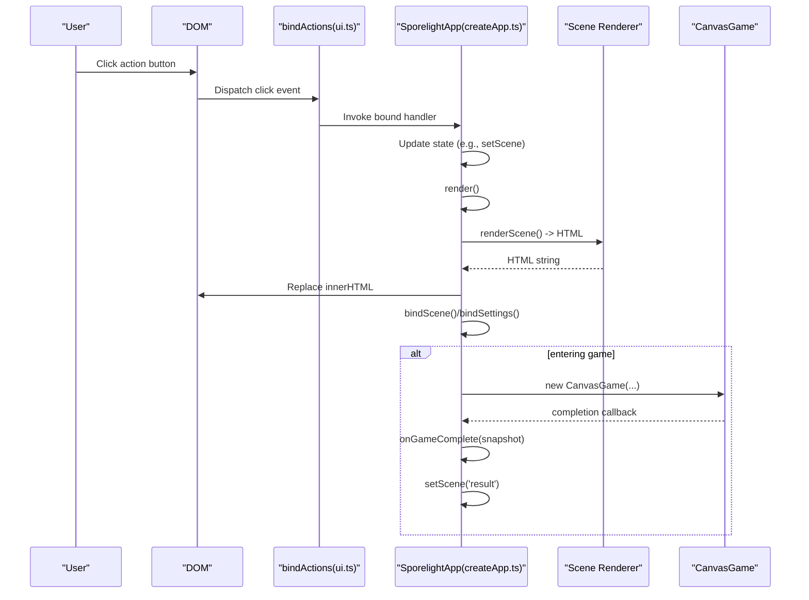

**Diagram sources**
- [src/app/createApp.ts:84-109](file://src/app/createApp.ts#L84-L109)
- [src/app/ui.ts:5-11](file://src/app/ui.ts#L5-L11)
- [src/app/scenes/gameScene.ts:3-21](file://src/app/scenes/gameScene.ts#L3-L21)
- [src/app/game/CanvasGame.ts:32-47](file://src/app/game/CanvasGame.ts#L32-L47)
- [src/app/createApp.ts:288-303](file://src/app/createApp.ts#L288-L303)

## Detailed Component Analysis

### Central Application Controller (SporelightApp)
- Responsibilities:
  - Holds AppState and orchestrates rendering, boot sequence, settings, and scene transitions.
  - Manages a CanvasGame instance for the game scene and cleans it up on transitions.
  - Applies viewport scaling and orientation-aware layout mode.
  - Persists save data and handles confirm modes for destructive settings.
- State Management:
  - Scene enumeration defines navigable screens.
  - Settings modal and confirm modes are part of the state machine.
- Transition Mechanics:
  - setScene updates the current scene and triggers re-render.
  - Boot sequence is controlled by timers and frame animation.
- Viewport Scaling:
  - Computes scale based on device size and orientation.
  - Uses CSS variable injection to scale the stage.

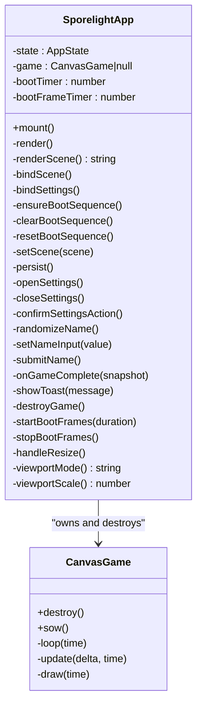

**Diagram sources**
- [src/app/createApp.ts:22-377](file://src/app/createApp.ts#L22-L377)
- [src/app/game/CanvasGame.ts:14-318](file://src/app/game/CanvasGame.ts#L14-L318)

**Section sources**
- [src/app/createApp.ts:22-377](file://src/app/createApp.ts#L22-L377)

### Scene Renderers
- Boot Scene: Renders the startup screen with animated loading frames and ambient effects.
- Naming Scene: Collects player name, validates input, and transitions to the main menu.
- Main Menu Scene: Presents actions to start, continue, open gallery, or settings.
- Level Select Scene: Lists levels with unlock/completion state and navigation actions.
- Game Scene: Provides the canvas and HUD for the game instance.
- Result Scene: Shows completion summary and actions to continue.
- Gallery Scene: Displays discovered items based on save state.

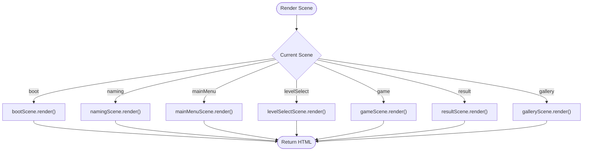

**Diagram sources**
- [src/app/createApp.ts:65-82](file://src/app/createApp.ts#L65-L82)
- [src/app/scenes/bootScene.ts:19-65](file://src/app/scenes/bootScene.ts#L19-L65)
- [src/app/scenes/namingScene.ts:8-35](file://src/app/scenes/namingScene.ts#L8-L35)
- [src/app/scenes/mainMenuScene.ts:8-23](file://src/app/scenes/mainMenuScene.ts#L8-L23)
- [src/app/scenes/levelSelectScene.ts:13-38](file://src/app/scenes/levelSelectScene.ts#L13-L38)
- [src/app/scenes/gameScene.ts:3-21](file://src/app/scenes/gameScene.ts#L3-L21)
- [src/app/scenes/resultScene.ts:8-30](file://src/app/scenes/resultScene.ts#L8-L30)
- [src/app/scenes/galleryScene.ts:18-42](file://src/app/scenes/galleryScene.ts#L18-L42)

**Section sources**
- [src/app/createApp.ts:65-82](file://src/app/createApp.ts#L65-L82)
- [src/app/scenes/bootScene.ts:19-65](file://src/app/scenes/bootScene.ts#L19-L65)
- [src/app/scenes/namingScene.ts:8-35](file://src/app/scenes/namingScene.ts#L8-L35)
- [src/app/scenes/mainMenuScene.ts:8-23](file://src/app/scenes/mainMenuScene.ts#L8-L23)
- [src/app/scenes/levelSelectScene.ts:13-38](file://src/app/scenes/levelSelectScene.ts#L13-L38)
- [src/app/scenes/gameScene.ts:3-21](file://src/app/scenes/gameScene.ts#L3-L21)
- [src/app/scenes/resultScene.ts:8-30](file://src/app/scenes/resultScene.ts#L8-L30)
- [src/app/scenes/galleryScene.ts:18-42](file://src/app/scenes/galleryScene.ts#L18-L42)

### Game Loop and CanvasGame
- Lifecycle:
  - Construction loads images, binds input, starts the animation loop.
  - Destruction cancels the loop and removes listeners.
- Update Cycle:
  - Processes input, movement, and completion conditions.
  - Triggers completion callback when the exit is reached with all seeds grown.
- Rendering:
  - Clears and draws background, path, seeds, exit, and player with sprite frames.
- Interaction:
  - Pointer down sets a move target; keyboard E triggers planting.

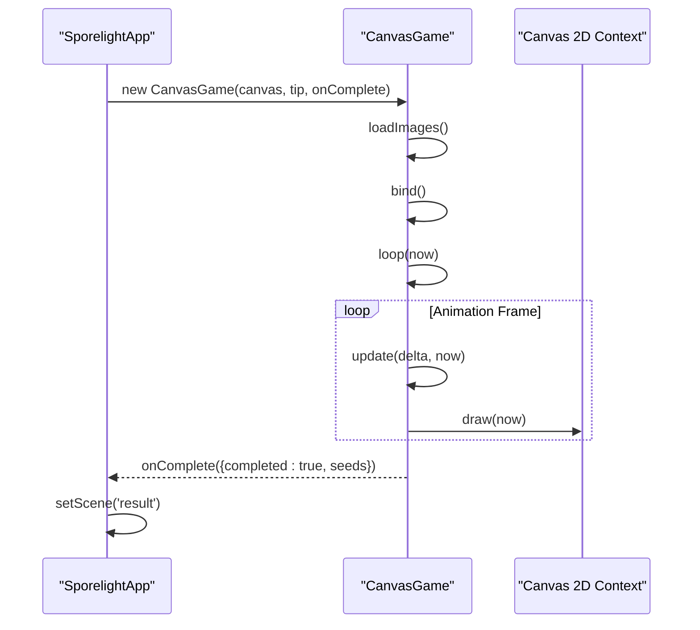

**Diagram sources**
- [src/app/createApp.ts:101-108](file://src/app/createApp.ts#L101-L108)
- [src/app/game/CanvasGame.ts:32-47](file://src/app/game/CanvasGame.ts#L32-L47)
- [src/app/game/CanvasGame.ts:134-146](file://src/app/game/CanvasGame.ts#L134-L146)
- [src/app/game/CanvasGame.ts:194-201](file://src/app/game/CanvasGame.ts#L194-L201)
- [src/app/game/CanvasGame.ts:286-296](file://src/app/game/CanvasGame.ts#L286-L296)
- [src/app/createApp.ts:288-303](file://src/app/createApp.ts#L288-L303)

**Section sources**
- [src/app/game/CanvasGame.ts:14-318](file://src/app/game/CanvasGame.ts#L14-L318)
- [src/app/createApp.ts:101-108](file://src/app/createApp.ts#L101-L108)

### State Machine Pattern for Navigation
- States: Defined by the Scene union type. Transitions are initiated by actions bound in the controller.
- Transitions:
  - Boot → Naming → Main Menu → Level Select → Game → Result → Level Select/Gallery/Main Menu.
  - Settings opens/closes without changing scene state but affects rendering.
- Guards:
  - Some actions are disabled based on save state (e.g., Continue Journey).
- Confirmation Mode:
  - Certain destructive actions set a confirm mode that changes the UI until confirmed.

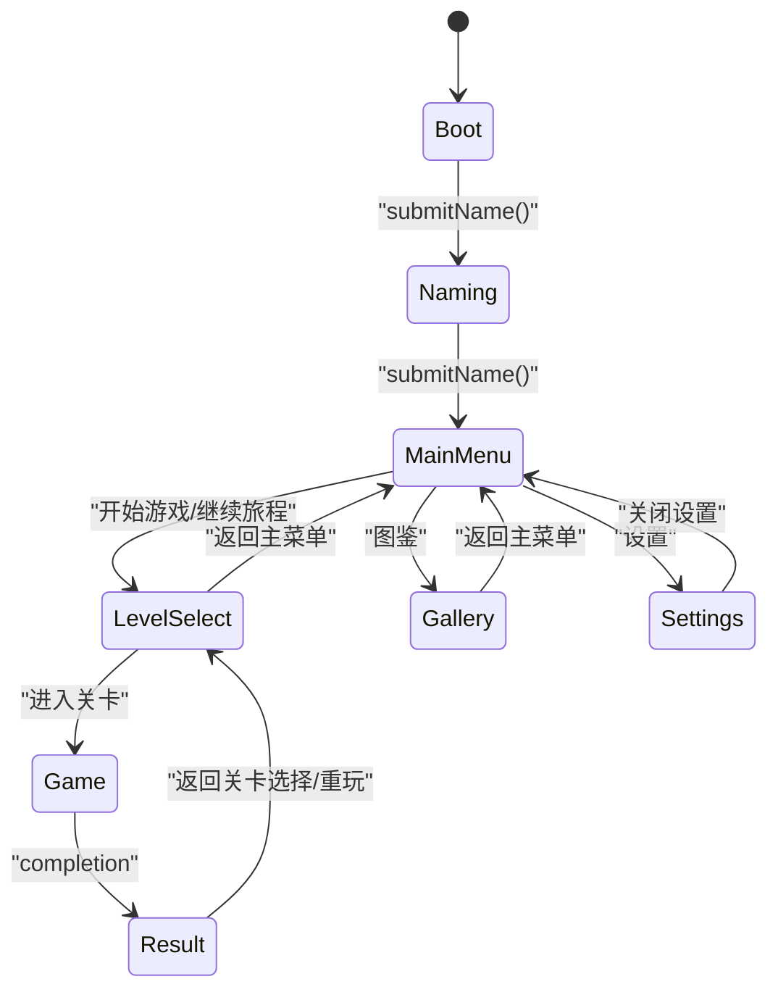

**Diagram sources**
- [src/app/types.ts:1](file://src/app/types.ts#L1)
- [src/app/createApp.ts:201-213](file://src/app/createApp.ts#L201-L213)
- [src/app/createApp.ts:84-99](file://src/app/createApp.ts#L84-L99)
- [src/app/createApp.ts:111-163](file://src/app/createApp.ts#L111-L163)

**Section sources**
- [src/app/types.ts:1-45](file://src/app/types.ts#L1-L45)
- [src/app/createApp.ts:201-213](file://src/app/createApp.ts#L201-L213)
- [src/app/createApp.ts:84-99](file://src/app/createApp.ts#L84-L99)
- [src/app/createApp.ts:111-163](file://src/app/createApp.ts#L111-L163)

### Scene Lifecycle: Initialization, Rendering, Update, Cleanup
- Initialization:
  - Boot sequence initializes assets and frames; transitions to ready state.
  - Settings modal and confirm modes initialize UI overlays.
- Rendering:
  - Controller composes shell, applies viewport scaling, and renders current scene.
- Update Cycles:
  - Game loop runs at ~60fps; updates position, state, and triggers completion.
- Cleanup:
  - CanvasGame is destroyed on scene change; timers and intervals are cleared.

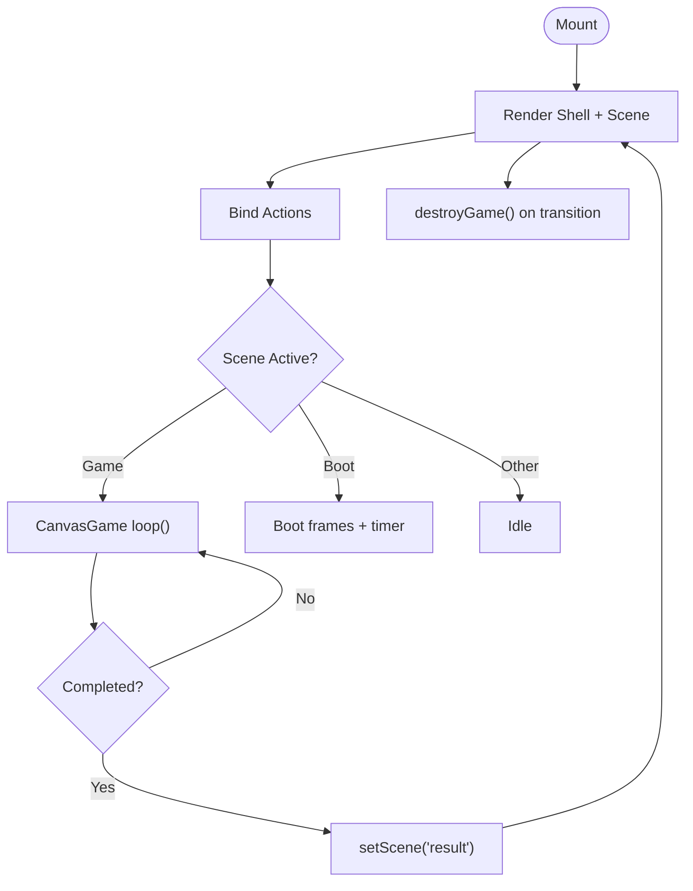

**Diagram sources**
- [src/app/createApp.ts:38-63](file://src/app/createApp.ts#L38-L63)
- [src/app/createApp.ts:165-183](file://src/app/createApp.ts#L165-L183)
- [src/app/game/CanvasGame.ts:134-146](file://src/app/game/CanvasGame.ts#L134-L146)
- [src/app/createApp.ts:316-319](file://src/app/createApp.ts#L316-L319)

**Section sources**
- [src/app/createApp.ts:38-63](file://src/app/createApp.ts#L38-L63)
- [src/app/createApp.ts:165-183](file://src/app/createApp.ts#L165-L183)
- [src/app/game/CanvasGame.ts:134-146](file://src/app/game/CanvasGame.ts#L134-L146)
- [src/app/createApp.ts:316-319](file://src/app/createApp.ts#L316-L319)

### Scene Registration and Communication
- Registration:
  - Scenes are registered in the controller’s renderScene switch statement.
- Communication:
  - Scenes expose render functions; the controller invokes them with AppState.
  - Actions are bound centrally; handlers call controller methods (e.g., setScene, openSettings).
  - GameScene defers interactive logic to CanvasGame; completion callback feeds back to controller.

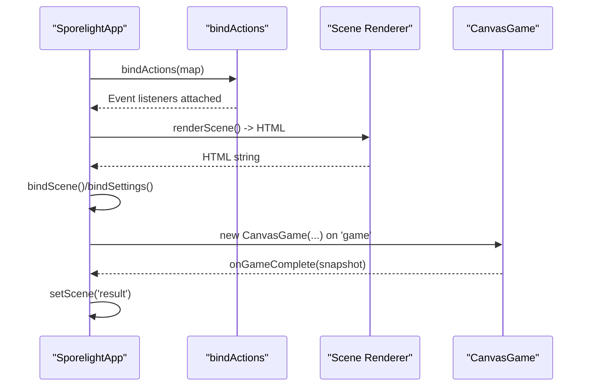

**Diagram sources**
- [src/app/createApp.ts:65-82](file://src/app/createApp.ts#L65-L82)
- [src/app/createApp.ts:84-109](file://src/app/createApp.ts#L84-L109)
- [src/app/ui.ts:5-11](file://src/app/ui.ts#L5-L11)
- [src/app/scenes/gameScene.ts:3-21](file://src/app/scenes/gameScene.ts#L3-L21)
- [src/app/game/CanvasGame.ts:32-47](file://src/app/game/CanvasGame.ts#L32-L47)
- [src/app/createApp.ts:288-303](file://src/app/createApp.ts#L288-L303)

**Section sources**
- [src/app/createApp.ts:65-82](file://src/app/createApp.ts#L65-L82)
- [src/app/createApp.ts:84-109](file://src/app/createApp.ts#L84-L109)
- [src/app/ui.ts:5-11](file://src/app/ui.ts#L5-L11)
- [src/app/scenes/gameScene.ts:3-21](file://src/app/scenes/gameScene.ts#L3-L21)
- [src/app/game/CanvasGame.ts:32-47](file://src/app/game/CanvasGame.ts#L32-L47)

### Viewport Scaling and Responsive Design
- Orientation Detection:
  - Determines cover vs. contain mode based on device aspect ratio.
- Scale Calculation:
  - Scales based on 1280×720 design resolution; uses min/max depending on mode.
- CSS Integration:
  - Injects a CSS variable for stage scaling so scenes can adapt layout.

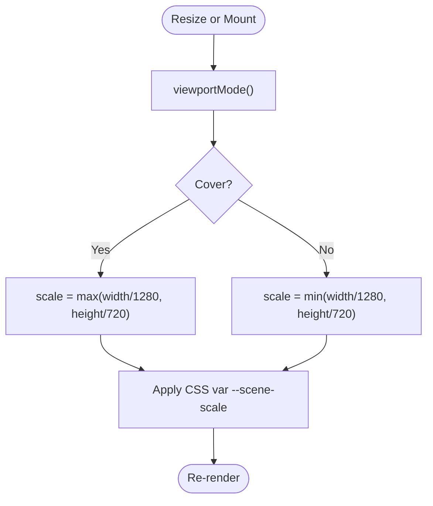

**Diagram sources**
- [src/app/createApp.ts:362-376](file://src/app/createApp.ts#L362-L376)

**Section sources**
- [src/app/createApp.ts:362-376](file://src/app/createApp.ts#L362-L376)

### Scene State Container and Persistence
- AppState:
  - Holds save, current scene, settings open flag, confirm mode, and boot readiness.
- SaveData:
  - Player name, level unlocks/completions, gallery discovery, and settings.
- Defaults and Merge:
  - Default save provides baseline; partial saves are merged safely.
- Persistence:
  - Load on startup; persist on settings changes and gameplay completion.

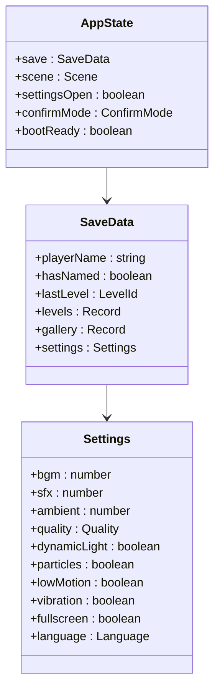

**Diagram sources**
- [src/app/types.ts:38-44](file://src/app/types.ts#L38-L44)
- [src/app/types.ts:13-31](file://src/app/types.ts#L13-L31)
- [src/app/save.ts:4-37](file://src/app/save.ts#L4-L37)

**Section sources**
- [src/app/types.ts:1-45](file://src/app/types.ts#L1-L45)
- [src/app/save.ts:1-67](file://src/app/save.ts#L1-L67)

### Transition Animations and Effects
- Boot Sequence:
  - Animated loading frames play until boot duration completes; then scene becomes ready.
- Scene Ready State:
  - Boot scene toggles ready class to enable static title and UI.
- Settings Modal:
  - Opens/closes with overlay; confirm modes show confirmation prompts.

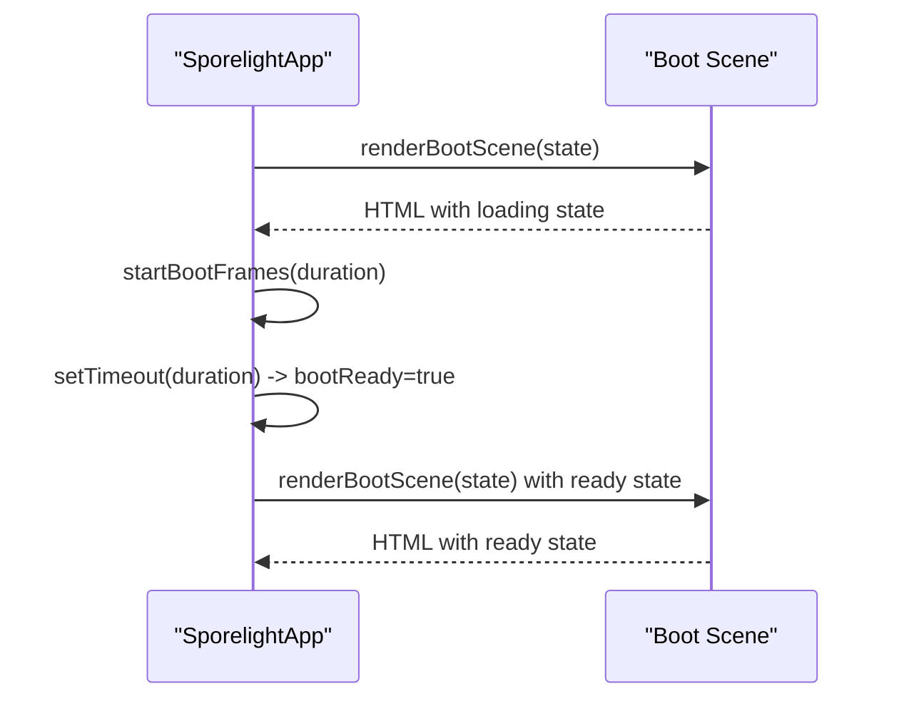

**Diagram sources**
- [src/app/createApp.ts:165-183](file://src/app/createApp.ts#L165-L183)
- [src/app/createApp.ts:321-351](file://src/app/createApp.ts#L321-L351)
- [src/app/scenes/bootScene.ts:19-65](file://src/app/scenes/bootScene.ts#L19-L65)

**Section sources**
- [src/app/createApp.ts:165-183](file://src/app/createApp.ts#L165-L183)
- [src/app/createApp.ts:321-351](file://src/app/createApp.ts#L321-L351)
- [src/app/scenes/bootScene.ts:19-65](file://src/app/scenes/bootScene.ts#L19-L65)

### Error Handling Mechanisms
- Name Validation:
  - Input is validated against a pattern; errors are shown via aria-live element.
- Toast Notifications:
  - Non-fatal messages are shown briefly and auto-dismissed.
- Asset Fallbacks:
  - CanvasGame draws placeholder when images are not yet loaded.
- Settings Sliders/Toggles:
  - Updates are persisted immediately; invalid states are prevented by guards.

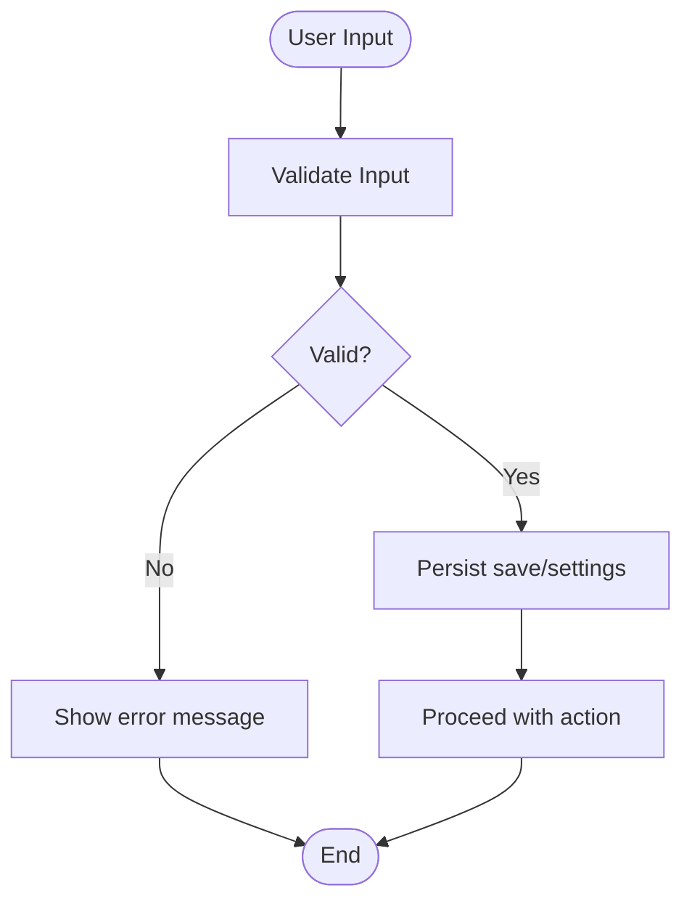

**Diagram sources**
- [src/app/createApp.ts:264-286](file://src/app/createApp.ts#L264-L286)
- [src/app/createApp.ts:305-314](file://src/app/createApp.ts#L305-L314)
- [src/app/game/CanvasGame.ts:286-296](file://src/app/game/CanvasGame.ts#L286-L296)

**Section sources**
- [src/app/createApp.ts:264-286](file://src/app/createApp.ts#L264-L286)
- [src/app/createApp.ts:305-314](file://src/app/createApp.ts#L305-L314)
- [src/app/game/CanvasGame.ts:286-296](file://src/app/game/CanvasGame.ts#L286-L296)

## Dependency Analysis
- Entry point depends on the controller factory.
- Controller depends on:
  - Scene renderers for HTML composition.
  - UI binding for action wiring.
  - Save system for persistence.
  - Constants and asset helper for resources.
  - CanvasGame for the game scene.
- Scenes depend on:
  - Constants for asset roots.
  - Asset helper for URLs.
  - UI helpers for action buttons and escaping.

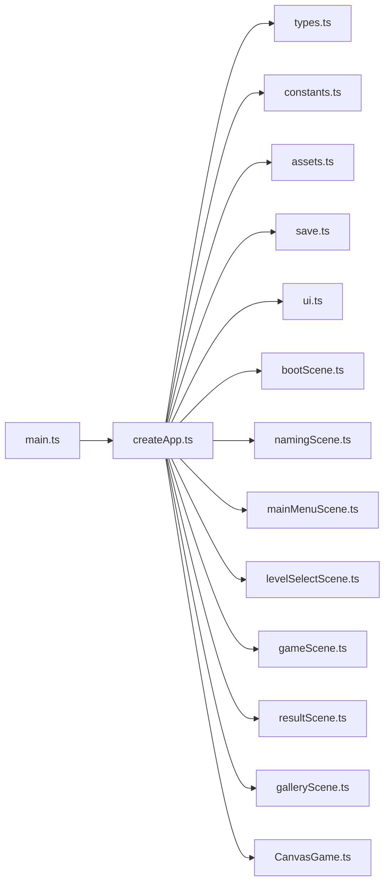

**Diagram sources**
- [src/main.ts:1-11](file://src/main.ts#L1-L11)
- [src/app/createApp.ts:1-14](file://src/app/createApp.ts#L1-L14)
- [src/app/types.ts:1-45](file://src/app/types.ts#L1-L45)
- [src/app/constants.ts:1-71](file://src/app/constants.ts#L1-L71)
- [src/app/assets.ts:1-4](file://src/app/assets.ts#L1-L4)
- [src/app/save.ts:1-67](file://src/app/save.ts#L1-L67)
- [src/app/ui.ts:1-16](file://src/app/ui.ts#L1-L16)
- [src/app/scenes/bootScene.ts:1-94](file://src/app/scenes/bootScene.ts#L1-L94)
- [src/app/scenes/namingScene.ts:1-36](file://src/app/scenes/namingScene.ts#L1-L36)
- [src/app/scenes/mainMenuScene.ts:1-24](file://src/app/scenes/mainMenuScene.ts#L1-L24)
- [src/app/scenes/levelSelectScene.ts:1-39](file://src/app/scenes/levelSelectScene.ts#L1-L39)
- [src/app/scenes/gameScene.ts:1-22](file://src/app/scenes/gameScene.ts#L1-L22)
- [src/app/scenes/resultScene.ts:1-31](file://src/app/scenes/resultScene.ts#L1-L31)
- [src/app/scenes/galleryScene.ts:1-43](file://src/app/scenes/galleryScene.ts#L1-L43)
- [src/app/game/CanvasGame.ts:1-318](file://src/app/game/CanvasGame.ts#L1-L318)

**Section sources**
- [src/main.ts:1-11](file://src/main.ts#L1-L11)
- [src/app/createApp.ts:1-14](file://src/app/createApp.ts#L1-L14)

## Performance Considerations
- Boot Sequence:
  - Frame animation rate is capped to avoid excessive updates; low-motion setting short-circuits to final frame.
- Game Loop:
  - Delta time clamped to a maximum to stabilize movement; requestAnimationFrame ensures smooth rendering.
- Rendering Scope:
  - Scenes return lightweight HTML; heavy work is delegated to the game instance.
- Asset Loading:
  - Images are preloaded; fallback drawing prevents stalls.
- Resize Handling:
  - Minimal re-layout; CSS variable update suffices for scaling.

[No sources needed since this section provides general guidance]

## Troubleshooting Guide
- Scene does not change:
  - Verify action handlers are bound and setScene is called.
  - Check confirm mode flags that might block transitions.
- Game does not render:
  - Ensure CanvasGame is constructed only for the game scene.
  - Confirm canvas element exists and context is available.
- Settings not persisting:
  - Confirm persistSave is invoked after updates and localStorage is writable.
- Name input errors:
  - Validate against the expected pattern and ensure aria-live error element exists.
- Toast messages not appearing:
  - Ensure toast element is appended and removal timeout is scheduled.

**Section sources**
- [src/app/createApp.ts:84-109](file://src/app/createApp.ts#L84-L109)
- [src/app/createApp.ts:215-217](file://src/app/createApp.ts#L215-L217)
- [src/app/createApp.ts:264-286](file://src/app/createApp.ts#L264-L286)
- [src/app/createApp.ts:305-314](file://src/app/createApp.ts#L305-L314)
- [src/app/game/CanvasGame.ts:32-47](file://src/app/game/CanvasGame.ts#L32-L47)

## Conclusion
SporeLight’s architecture centers on a clean separation of concerns: the controller owns state and orchestration, scenes are pure renderers, and the game is encapsulated in a dedicated class. The state machine pattern enables predictable navigation, while viewport scaling and responsive design keep layouts consistent across devices. Persistence and error handling are integrated at the edges, ensuring a robust user experience.

[No sources needed since this section summarizes without analyzing specific files]

## Appendices

### Example Patterns

- Creating a New Scene
  - Add a renderer function that returns HTML for the new scene.
  - Register the scene in the controller’s renderScene switch.
  - Add actions to navigate to and from the scene.
  - Reference: [src/app/createApp.ts:65-82](file://src/app/createApp.ts#L65-L82), [src/app/scenes/namingScene.ts:8-35](file://src/app/scenes/namingScene.ts#L8-L35)

- Destroying a Scene
  - On transition, the controller destroys the game instance and clears timers.
  - Reference: [src/app/createApp.ts:316-319](file://src/app/createApp.ts#L316-L319), [src/app/game/CanvasGame.ts:49-54](file://src/app/game/CanvasGame.ts#L49-L54)

- State Persistence
  - Load defaults, merge partial saves, and persist on changes.
  - Reference: [src/app/save.ts:49-66](file://src/app/save.ts#L49-L66)

- Transition Animation
  - Boot frames animate until ready; ready state switches UI.
  - Reference: [src/app/createApp.ts:165-183](file://src/app/createApp.ts#L165-L183), [src/app/scenes/bootScene.ts:19-65](file://src/app/scenes/bootScene.ts#L19-L65)