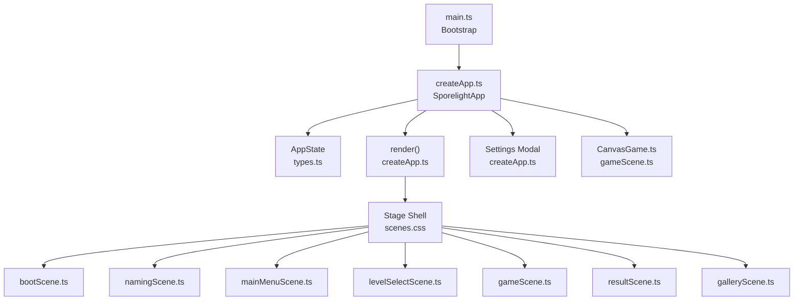
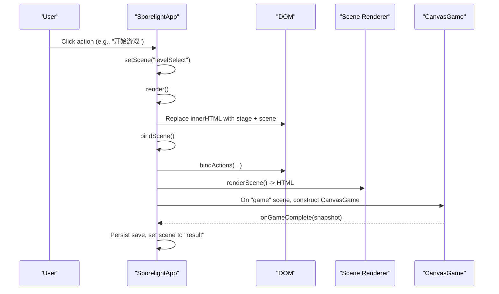
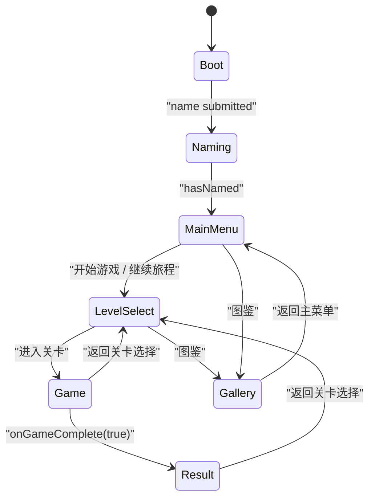
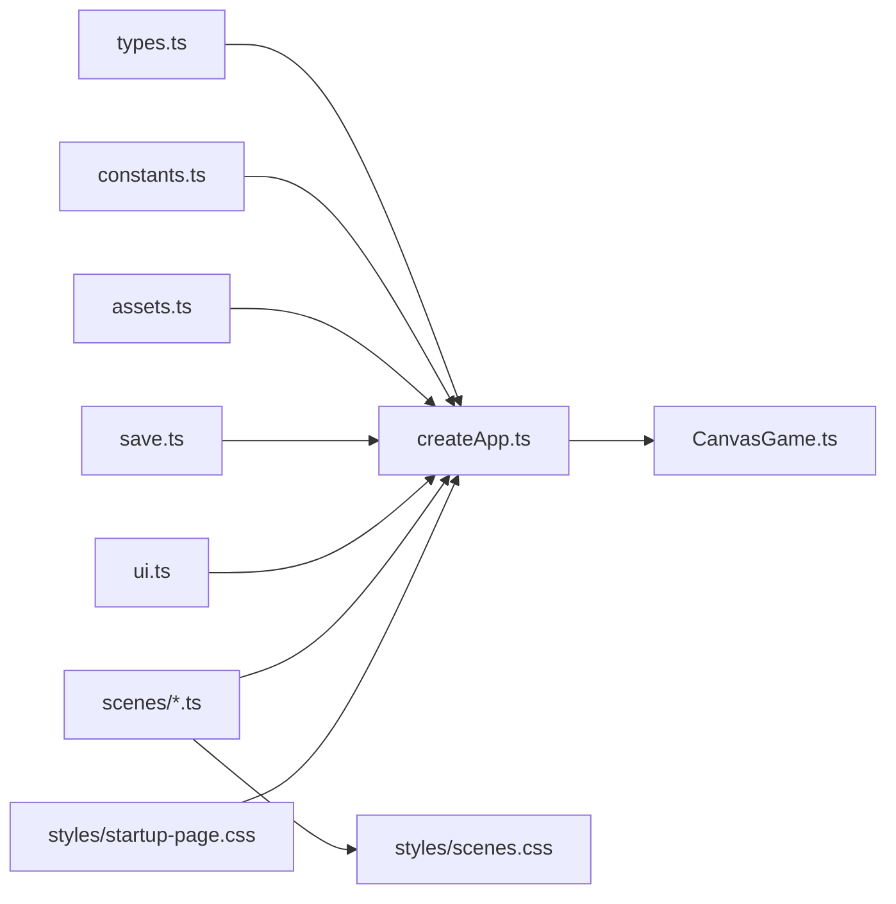

# Scene System

<cite>
**Referenced Files in This Document**
- [bootScene.ts](file://src/app/scenes/bootScene.ts)
- [namingScene.ts](file://src/app/scenes/namingScene.ts)
- [mainMenuScene.ts](file://src/app/scenes/mainMenuScene.ts)
- [levelSelectScene.ts](file://src/app/scenes/levelSelectScene.ts)
- [gameScene.ts](file://src/app/scenes/gameScene.ts)
- [resultScene.ts](file://src/app/scenes/resultScene.ts)
- [galleryScene.ts](file://src/app/scenes/galleryScene.ts)
- [createApp.ts](file://src/app/createApp.ts)
- [CanvasGame.ts](file://src/app/game/CanvasGame.ts)
- [types.ts](file://src/app/types.ts)
- [constants.ts](file://src/app/constants.ts)
- [assets.ts](file://src/app/assets.ts)
- [save.ts](file://src/app/save.ts)
- [ui.ts](file://src/app/ui.ts)
- [scenes.css](file://src/styles/scenes.css)
- [startup-page.css](file://src/styles/startup-page.css)
- [styles.css](file://src/styles.css)
- [main.ts](file://src/main.ts)
</cite>

## Table of Contents
1. [Introduction](#introduction)
2. [Project Structure](#project-structure)
3. [Core Components](#core-components)
4. [Architecture Overview](#architecture-overview)
5. [Detailed Component Analysis](#detailed-component-analysis)
6. [Dependency Analysis](#dependency-analysis)
7. [Performance Considerations](#performance-considerations)
8. [Troubleshooting Guide](#troubleshooting-guide)
9. [Conclusion](#conclusion)

## Introduction
This document explains SporeLight’s scene-based architecture and how scenes are managed using a State Machine Pattern. It covers the lifecycle of each scene, state transitions, UI rendering updates, and inter-scene communication. It also documents viewport scaling, responsive design, and how scenes adapt to different screen sizes and orientations.

## Project Structure
SporeLight organizes scenes as pure renderers that produce HTML strings based on the global AppState. The application bootstraps via a single entry point, initializes the global state, and renders the current scene into the DOM. Scenes communicate by updating AppState and triggering re-renders.

**Diagram sources**
- [main.ts:1-11](file://src/main.ts#L1-L11)
- [createApp.ts:16-82](file://src/app/createApp.ts#L16-L82)
- [types.ts:38-44](file://src/app/types.ts#L38-L44)
- [bootScene.ts:19-65](file://src/app/scenes/bootScene.ts#L19-L65)
- [namingScene.ts:8-35](file://src/app/scenes/namingScene.ts#L8-L35)
- [mainMenuScene.ts:8-23](file://src/app/scenes/mainMenuScene.ts#L8-L23)
- [levelSelectScene.ts:13-38](file://src/app/scenes/levelSelectScene.ts#L13-L38)
- [gameScene.ts:3-21](file://src/app/scenes/gameScene.ts#L3-L21)
- [resultScene.ts:8-30](file://src/app/scenes/resultScene.ts#L8-L30)
- [galleryScene.ts:18-42](file://src/app/scenes/galleryScene.ts#L18-L42)
- [scenes.css:1-452](file://src/styles/scenes.css#L1-L452)

**Section sources**
- [main.ts:1-11](file://src/main.ts#L1-L11)
- [createApp.ts:16-82](file://src/app/createApp.ts#L16-L82)
- [styles.css:1-5](file://src/styles.css#L1-L5)

## Core Components
- SporelightApp: Central orchestrator managing AppState, rendering, scene transitions, settings, and the CanvasGame instance.
- Scene renderers: Pure functions returning HTML strings for each scene, consuming AppState and constants.
- CanvasGame: Dedicated game loop and rendering for the gameplay scene.
- Global state: Typed AppState with scene identity, save data, settings, and UI flags.

Key responsibilities:
- State machine transitions: setScene updates the scene field and triggers re-render.
- Action binding: bindActions wires UI events to handlers inside SporelightApp.
- Asset resolution: asset helper resolves image paths.
- Persistence: save/load utilities manage localStorage-backed SaveData.

**Section sources**
- [createApp.ts:22-377](file://src/app/createApp.ts#L22-L377)
- [types.ts:1-45](file://src/app/types.ts#L1-L45)
- [ui.ts:5-11](file://src/app/ui.ts#L5-L11)
- [assets.ts:1-4](file://src/app/assets.ts#L1-L4)
- [save.ts:49-67](file://src/app/save.ts#L49-L67)

## Architecture Overview
The scene system follows a State Machine Pattern:
- States: boot, naming, mainMenu, levelSelect, game, result, gallery.
- Transitions: explicit setScene calls in response to user actions.
- Rendering: renderScene switch selects the current renderer; bindScene attaches event listeners per scene.
- Communication: Handlers update AppState (scene, save, settings) and re-render; CanvasGame invokes a completion callback to finalize gameplay.

**Diagram sources**
- [createApp.ts:201-213](file://src/app/createApp.ts#L201-L213)
- [createApp.ts:42-82](file://src/app/createApp.ts#L42-L82)
- [createApp.ts:84-109](file://src/app/createApp.ts#L84-L109)
- [CanvasGame.ts:32-47](file://src/app/game/CanvasGame.ts#L32-L47)

## Detailed Component Analysis

### Boot Scene
Purpose:
- Presents a startup animation and loading bar before transitioning to naming or main menu.

Lifecycle:
- On mount, ensureBootSequence starts a timed boot process and animates the loading frame.
- When ready, bootReady flips and triggers re-render to show “is-ready” UI.

Rendering:
- Uses asset paths under STARTUP_ASSET_ROOT and renders animated particles and hero sprites.

Transitions:
- After bootReady, user can proceed to naming or main menu depending on save state.

Viewport and responsiveness:
- Startup page CSS defines responsive layout and portrait adjustments.

**Section sources**
- [bootScene.ts:19-94](file://src/app/scenes/bootScene.ts#L19-L94)
- [createApp.ts:165-183](file://src/app/createApp.ts#L165-L183)
- [createApp.ts:321-360](file://src/app/createApp.ts#L321-L360)
- [startup-page.css:1-338](file://src/styles/startup-page.css#L1-L338)

### Naming Scene
Purpose:
- Collects player name, validates input, and transitions to main menu.

Lifecycle:
- Renders input field with default or saved name.
- Validates against a Unicode-friendly pattern and enforces length limits.
- Persists name and navigates to main menu on success.

UI:
- Provides randomize and reset actions, plus a submit button.

**Section sources**
- [namingScene.ts:8-35](file://src/app/scenes/namingScene.ts#L8-L35)
- [createApp.ts:251-286](file://src/app/createApp.ts#L251-L286)
- [constants.ts:2,53-70](file://src/app/constants.ts#L2,L53-L70)

### Main Menu Scene
Purpose:
- Navigation hub displaying player name and action buttons.

Lifecycle:
- Reads save data to greet the player.
- Buttons route to level select, continue journey, gallery, or settings.

Accessibility:
- Uses escapeHtml to sanitize text content.

**Section sources**
- [mainMenuScene.ts:8-23](file://src/app/scenes/mainMenuScene.ts#L8-L23)
- [ui.ts:13-15](file://src/app/ui.ts#L13-L15)
- [createApp.ts:89-93](file://src/app/createApp.ts#L89-L93)

### Level Select Scene
Purpose:
- Presents unlockable levels with state indicators and entry actions.

Lifecycle:
- Builds a grid of level cards using save state to reflect unlocked/completed status.
- Routes to game scene when a level is selected.

**Section sources**
- [levelSelectScene.ts:7-38](file://src/app/scenes/levelSelectScene.ts#L7-L38)
- [createApp.ts:95-96](file://src/app/createApp.ts#L95-L96)

### Game Scene
Purpose:
- Hosts the CanvasGame instance and HUD.

Lifecycle:
- Creates CanvasGame on first render when scene is "game".
- Destroys CanvasGame when leaving the scene.
- Handles gameplay actions (e.g., sow) and returns to level select or result.

HUD:
- Displays level title, back and settings controls, and tips.

**Section sources**
- [gameScene.ts:3-21](file://src/app/scenes/gameScene.ts#L3-L21)
- [createApp.ts:101-108](file://src/app/createApp.ts#L101-L108)
- [createApp.ts:316-319](file://src/app/createApp.ts#L316-L319)
- [CanvasGame.ts:14-318](file://src/app/game/CanvasGame.ts#L14-L318)

### Result Scene
Purpose:
- Shows completion summary and unlocks gallery items after a successful run.

Lifecycle:
- Receives snapshot from CanvasGame, updates save (last level, stars, gallery), and schedules transition to result scene.

**Section sources**
- [resultScene.ts:8-30](file://src/app/scenes/resultScene.ts#L8-L30)
- [createApp.ts:288-303](file://src/app/createApp.ts#L288-L303)

### Gallery Scene
Purpose:
- Displays discovered items from the world, gated by save state.

Lifecycle:
- Renders a grid of items, showing locked vs unlocked visuals based on gallery flags.

**Section sources**
- [galleryScene.ts:18-42](file://src/app/scenes/galleryScene.ts#L18-L42)
- [createApp.ts:91-92](file://src/app/createApp.ts#L91-L92)

### Scene Lifecycle and State Machine
State machine definition:
- States: boot, naming, mainMenu, levelSelect, game, result, gallery.
- Transitions: explicit setScene calls in response to actions.

Lifecycle hooks:
- Mount: createApp constructs SporelightApp and mounts initial state.
- Render: renderScene switch renders the active scene; bindScene attaches per-scene actions.
- Destroy: destroyGame tears down CanvasGame when leaving the game scene.

**Diagram sources**
- [types.ts:1](file://src/app/types.ts#L1)
- [createApp.ts:201-213](file://src/app/createApp.ts#L201-L213)
- [createApp.ts:288-303](file://src/app/createApp.ts#L288-L303)

**Section sources**
- [createApp.ts:201-213](file://src/app/createApp.ts#L201-L213)
- [createApp.ts:42-82](file://src/app/createApp.ts#L42-L82)
- [types.ts:1](file://src/app/types.ts#L1)

### UI Rendering Updates and Action Binding
- bindActions attaches click handlers to elements marked with data-action attributes.
- Each scene renderer emits elements with data-action keys that map to handlers in SporelightApp.
- Settings modal is rendered conditionally when settingsOpen is true.

**Section sources**
- [ui.ts:5-11](file://src/app/ui.ts#L5-L11)
- [createApp.ts:84-109](file://src/app/createApp.ts#L84-L109)
- [createApp.ts:42-63](file://src/app/createApp.ts#L42-L63)

### Scene-Specific State Handling
- SaveData: persisted across sessions; includes player name, levels, gallery, and settings.
- AppState: runtime state including current scene, settings visibility, confirm mode, and boot readiness.
- Constants: asset roots, boot duration, default tip, and startup loading frames.

**Section sources**
- [save.ts:4-67](file://src/app/save.ts#L4-L67)
- [types.ts:13-44](file://src/app/types.ts#L13-L44)
- [constants.ts:1-71](file://src/app/constants.ts#L1-L71)

## Dependency Analysis
High-level dependencies:
- createApp.ts depends on all scene renderers, CanvasGame, constants, assets, save, and ui.
- Scene renderers depend on constants and assets, and on AppState for data.
- CanvasGame depends on assets and constants, and calls back into SporelightApp via a completion handler.

**Diagram sources**
- [createApp.ts:1-15](file://src/app/createApp.ts#L1-L15)
- [types.ts:1-45](file://src/app/types.ts#L1-L45)
- [constants.ts:1-71](file://src/app/constants.ts#L1-L71)
- [assets.ts:1-4](file://src/app/assets.ts#L1-L4)
- [save.ts:1-67](file://src/app/save.ts#L1-L67)
- [ui.ts:1-16](file://src/app/ui.ts#L1-L16)
- [bootScene.ts:1-94](file://src/app/scenes/bootScene.ts#L1-L94)
- [namingScene.ts:1-36](file://src/app/scenes/namingScene.ts#L1-L36)
- [mainMenuScene.ts:1-24](file://src/app/scenes/mainMenuScene.ts#L1-L24)
- [levelSelectScene.ts:1-39](file://src/app/scenes/levelSelectScene.ts#L1-L39)
- [gameScene.ts:1-22](file://src/app/scenes/gameScene.ts#L1-L22)
- [resultScene.ts:1-31](file://src/app/scenes/resultScene.ts#L1-L31)
- [galleryScene.ts:1-43](file://src/app/scenes/galleryScene.ts#L1-L43)
- [CanvasGame.ts:1-318](file://src/app/game/CanvasGame.ts#L1-L318)
- [scenes.css:1-452](file://src/styles/scenes.css#L1-L452)
- [startup-page.css:1-338](file://src/styles/startup-page.css#L1-L338)

**Section sources**
- [createApp.ts:1-15](file://src/app/createApp.ts#L1-L15)

## Performance Considerations
- Boot sequence animation: frame stepping is throttled by computed stepMs; low motion setting short-circuits animation.
- CanvasGame: uses requestAnimationFrame and caps delta time to stabilize movement and drawing.
- Re-rendering: renderScene switch avoids unnecessary work by only rendering the active scene and attaching per-scene bindings.

Recommendations:
- Keep scene renderers pure and fast; avoid heavy computations in render functions.
- Debounce resize handling if needed; current implementation re-renders on every resize.
- Consider lazy-loading assets for scenes that are off-screen.

**Section sources**
- [createApp.ts:321-360](file://src/app/createApp.ts#L321-L360)
- [CanvasGame.ts:134-146](file://src/app/game/CanvasGame.ts#L134-L146)
- [createApp.ts:362-364](file://src/app/createApp.ts#L362-L364)

## Troubleshooting Guide
Common issues and resolutions:
- Name validation errors: The naming scene displays an error message when input fails validation. Ensure input matches the allowed pattern and length.
- CanvasGame not rendering: Verify the canvas element exists and that CanvasGame is constructed only when the scene is "game".
- Scene transitions not working: Confirm that data-action attributes match keys registered in bindActions and that setScene is called from the correct handler.
- Settings not persisting: Check that persistSave writes to localStorage and that loadSave merges defaults with saved data.

**Section sources**
- [createApp.ts:264-286](file://src/app/createApp.ts#L264-L286)
- [createApp.ts:101-108](file://src/app/createApp.ts#L101-L108)
- [createApp.ts:84-109](file://src/app/createApp.ts#L84-L109)
- [save.ts:49-67](file://src/app/save.ts#L49-L67)

## Conclusion
SporeLight’s scene system cleanly separates concerns: each scene is a pure renderer, transitions are explicit state changes, and the central orchestrator manages persistence, settings, and the game instance. The responsive design and viewport scaling ensure consistent presentation across devices, while the state machine pattern makes navigation predictable and maintainable.