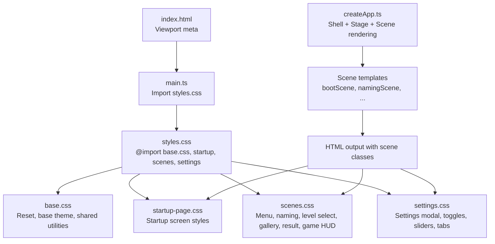
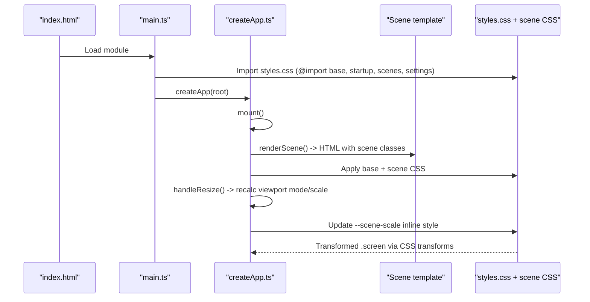
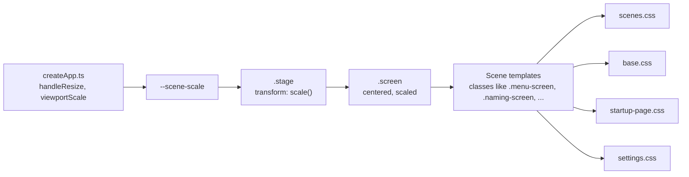

# Styling System

<cite>
**Referenced Files in This Document**
- [styles.css](file://src/styles.css)
- [base.css](file://src/styles/base.css)
- [startup-page.css](file://src/styles/startup-page.css)
- [scenes.css](file://src/styles/scenes.css)
- [settings.css](file://src/styles/settings.css)
- [index.html](file://index.html)
- [main.ts](file://src/main.ts)
- [createApp.ts](file://src/app/createApp.ts)
- [bootScene.ts](file://src/app/scenes/bootScene.ts)
- [namingScene.ts](file://src/app/scenes/namingScene.ts)
- [mainMenuScene.ts](file://src/app/scenes/mainMenuScene.ts)
- [levelSelectScene.ts](file://src/app/scenes/levelSelectScene.ts)
- [galleryScene.ts](file://src/app/scenes/galleryScene.ts)
- [resultScene.ts](file://src/app/scenes/resultScene.ts)
- [gameScene.ts](file://src/app/scenes/gameScene.ts)
- [settingsModal.ts](file://src/app/components/settingsModal.ts)
- [CanvasGame.ts](file://src/app/game/CanvasGame.ts)
</cite>

## Table of Contents
1. [Introduction](#introduction)
2. [Project Structure](#project-structure)
3. [Core Components](#core-components)
4. [Architecture Overview](#architecture-overview)
5. [Detailed Component Analysis](#detailed-component-analysis)
6. [Dependency Analysis](#dependency-analysis)
7. [Performance Considerations](#performance-considerations)
8. [Troubleshooting Guide](#troubleshooting-guide)
9. [Conclusion](#conclusion)
10. [Appendices](#appendices)

## Introduction
This document describes SporeLight’s CSS architecture and styling system. It explains the base/reset system, scene-specific styling patterns, component-based CSS organization, and responsive design principles. It also documents the styling approach for the startup page, settings interface, and game scene, along with methodology, specificity management, maintainability practices, responsive scaling, and guidelines for adding new styles while keeping the system consistent and performant.

## Project Structure
The styling system is organized into modular CSS files imported via a single entry point. The application injects a shell and stage container with dynamic scene content, and CSS applies layout, animations, and scene-specific visuals.

**Diagram sources**
- [index.html:1-13](file://index.html#L1-L13)
- [main.ts:1-11](file://src/main.ts#L1-L11)
- [styles.css:1-5](file://src/styles.css#L1-L5)
- [base.css:1-190](file://src/styles/base.css#L1-L190)
- [startup-page.css:1-338](file://src/styles/startup-page.css#L1-L338)
- [scenes.css:1-452](file://src/styles/scenes.css#L1-L452)
- [settings.css:1-660](file://src/styles/settings.css#L1-L660)
- [createApp.ts:38-82](file://src/app/createApp.ts#L38-L82)

**Section sources**
- [styles.css:1-5](file://src/styles.css#L1-L5)
- [main.ts:1-11](file://src/main.ts#L1-L11)
- [createApp.ts:38-82](file://src/app/createApp.ts#L38-L82)

## Core Components
- Base reset and theme: Establishes global resets, root color scheme, body gradients, and foundational utilities (grid shell, stage, screen, gem buttons, toasts, and low-motion support).
- Scene-specific styles: Encapsulate per-scene layouts, grids, overlays, and interactive elements.
- Startup page: Fullscreen loader with animated hero and particle effects.
- Settings modal: Complex grid-based dialog with sliders, toggles, tabs, and responsive adjustments.
- Responsive viewport scaling: Dynamic scene scaling based on device orientation and viewport size.

Key implementation highlights:
- Shared utilities and tokens are defined in base.css (colors, shadows, radii, transitions).
- Scene classes (.screen, .menu-screen, .naming-screen, .level-screen, .gallery-screen, .result-screen, .game-screen) provide scene-level containers and backgrounds.
- The stage scales scenes via CSS custom property (--scene-scale) computed in JavaScript.

**Section sources**
- [base.css:1-190](file://src/styles/base.css#L1-L190)
- [scenes.css:1-452](file://src/styles/scenes.css#L1-L452)
- [startup-page.css:1-338](file://src/styles/startup-page.css#L1-L338)
- [settings.css:1-660](file://src/styles/settings.css#L1-L660)
- [createApp.ts:362-376](file://src/app/createApp.ts#L362-L376)

## Architecture Overview
The runtime architecture ties DOM rendering to CSS classes and dynamic scaling:

**Diagram sources**
- [index.html:1-13](file://index.html#L1-L13)
- [main.ts:1-11](file://src/main.ts#L1-L11)
- [styles.css:1-5](file://src/styles.css#L1-L5)
- [createApp.ts:362-376](file://src/app/createApp.ts#L362-L376)

## Detailed Component Analysis

### Base Styles and Reset System
- Global reset: Border-box sizing, root color-scheme, full-size body and app container.
- Body theme: Radial and linear gradients; font stack; form controls inherit fonts.
- Interactive primitives: Buttons with transitions, disabled states; pointer events disabled on decorative layers.
- Layout scaffolding: Shell grid container, Stage absolute positioning, Screen centered with CSS variable-driven scaling.
- Motion accessibility: Low-motion class disables long-running animations/transitions.
- Shared utilities: Gem buttons, HUD buttons, round nav, skill buttons, toast notifications, parallax/cloud layers.
- Animations: Drift, floaty, and popIn keyframes for layered motion.

Best practices:
- Keep resets minimal and centralized in base.css.
- Prefer CSS variables for theme tokens and scaling.
- Use class modifiers (e.g., .is-low-motion) for accessibility overrides.

**Section sources**
- [base.css:1-190](file://src/styles/base.css#L1-L190)

### Startup Page Styling
- Fullscreen container with gradient overlays and layered backgrounds.
- Animated title reveal, floating fireflies, and sprite hero.
- Loading bar with animated frames and particle effects driven by inline styles.
- Responsive variants for portrait and smaller widths.

Responsive behavior:
- Adjusts track width, hero size, and copy spacing at multiple breakpoints.
- Uses clamp and min/max utilities for fluid sizing.

Accessibility:
- Uses aria-hidden on decorative elements and aria-live for helper text.

**Section sources**
- [startup-page.css:1-338](file://src/styles/startup-page.css#L1-L338)
- [bootScene.ts:19-94](file://src/app/scenes/bootScene.ts#L19-L94)

### Settings Interface Styling
- Modal overlay with backdrop blur and centered modal.
- Ornamental borders and floating elements (character scene, firefly, luvie).
- Card-based layout with rows for audio/video/operation/general settings.
- Sliders with custom track/thumb styling; toggle switches with active states.
- Tabs for quality selection; footer with action buttons; confirm dialogs.
- Responsive adjustments: stacked layout on narrow screens, reduced modal size, reflowed footer.

Implementation notes:
- JavaScript updates slider percentages and persists settings; CSS handles visual states.
- Toggle components use a pseudo-element to animate the knob.

**Section sources**
- [settings.css:1-660](file://src/styles/settings.css#L1-L660)
- [settingsModal.ts:10-158](file://src/app/components/settingsModal.ts#L10-L158)
- [createApp.ts:111-163](file://src/app/createApp.ts#L111-L163)

### Game Scene Styling
- Canvas-backed gameplay with HUD overlays.
- HUD elements: title, back/settings buttons, tips, and action buttons.
- Scene background via .screen; canvas fills the screen.

Integration:
- CanvasGame draws within a 1280x720 coordinate space; CSS scales the .screen container to fit the viewport.

**Section sources**
- [gameScene.ts:3-21](file://src/app/scenes/gameScene.ts#L3-L21)
- [CanvasGame.ts:194-201](file://src/app/game/CanvasGame.ts#L194-L201)
- [scenes.css:254-301](file://src/styles/scenes.css#L254-L301)

### Scene-Specific Styling Patterns
- Naming scene: Background image overlay, logo/title, input card with styled input, error messaging, and action buttons.
- Main menu: Cloud parallax, player greeting, action grid with round nav and settings.
- Level select: Grid of cards with shade overlays, lock/complete states, enter buttons.
- Gallery: Grid of cards with locked/unlocked states and unlock messaging.
- Result: Centered panel with unlock indicators and navigation.

Responsive patterns:
- Media queries adjust grid layouts, card widths, and element positions for narrower viewports.

**Section sources**
- [namingScene.ts:8-35](file://src/app/scenes/namingScene.ts#L8-L35)
- [mainMenuScene.ts:8-23](file://src/app/scenes/mainMenuScene.ts#L8-L23)
- [levelSelectScene.ts:13-38](file://src/app/scenes/levelSelectScene.ts#L13-L38)
- [galleryScene.ts:18-42](file://src/app/scenes/galleryScene.ts#L18-L42)
- [resultScene.ts:8-30](file://src/app/scenes/resultScene.ts#L8-L30)
- [scenes.css:398-451](file://src/styles/scenes.css#L398-L451)

### Responsive Design Principles
Viewport scaling:
- JavaScript computes a scale factor based on device orientation and inner dimensions, applying it via --scene-scale on the stage.
- Two modes: contain (fit) and cover (fill), switching based on orientation.

Touch-friendly elements:
- Large hit targets for buttons and toggles; sufficient spacing in grids.
- Pointer events isolated on HUD elements to avoid interfering with gameplay.

Adaptive layouts:
- Media queries adjust grid column counts, modal stacking, and typography for small screens.
- Relative units (vw, vh, min, max, clamp) ensure scalable layouts.

**Section sources**
- [createApp.ts:362-376](file://src/app/createApp.ts#L362-L376)
- [settings.css:609-660](file://src/styles/settings.css#L609-L660)
- [startup-page.css:251-338](file://src/styles/startup-page.css#L251-L338)
- [scenes.css:398-451](file://src/styles/scenes.css#L398-L451)

### CSS Methodology and Maintainability
Naming conventions:
- BEM-like blocks and elements (e.g., .settings-modal, .settings-card, .settings-row).
- Utility classes for shared affordances (e.g., .small-gem, .primary-gem, .hud-button).

Specificity management:
- Prefer class selectors over element selectors for scene containers.
- Avoid deep nesting; keep selectors shallow and predictable.
- Use modifier classes (e.g., .locked, .unlocked, .active) to alter states.

Modularization:
- Scene-specific styles live in dedicated files; base.css centralizes shared tokens.
- settings.css and startup-page.css are self-contained for their domains.

Accessibility:
- Low-motion class reduces motion for sensitive users.
- Proper aria attributes on interactive elements and live regions.

**Section sources**
- [base.css:101-138](file://src/styles/base.css#L101-L138)
- [settings.css:120-130](file://src/styles/settings.css#L120-L130)
- [startup-page.css:50-55](file://src/styles/startup-page.css#L50-L55)

## Dependency Analysis
The runtime depends on CSS classes injected by scene templates and controlled by JavaScript scaling.

**Diagram sources**
- [createApp.ts:362-376](file://src/app/createApp.ts#L362-L376)
- [scenes.css:1-452](file://src/styles/scenes.css#L1-L452)
- [base.css:72-92](file://src/styles/base.css#L72-L92)
- [startup-page.css:1-338](file://src/styles/startup-page.css#L1-L338)
- [settings.css:1-660](file://src/styles/settings.css#L1-L660)

**Section sources**
- [createApp.ts:362-376](file://src/app/createApp.ts#L362-L376)
- [scenes.css:186-189](file://src/styles/scenes.css#L186-L189)

## Performance Considerations
- CSS transforms and compositing: Scaling via transform avoids layout thrashing; keep layers composited.
- Minimize forced synchronous layouts: Batch DOM reads/writes; compute scale once per resize.
- Reduce repaints: Prefer transform/opacity changes; avoid frequent layout-affecting properties.
- Animations: Use .is-low-motion to disable heavy animations for sensitive users.
- Asset delivery: Ensure sprites and backgrounds are optimized; lazy-load where appropriate.
- Media queries: Keep breakpoint logic minimal and reuse shared variables.

[No sources needed since this section provides general guidance]

## Troubleshooting Guide
Common issues and resolutions:
- Scene not filling viewport:
  - Verify stage class and --scene-scale are applied; check orientation-based mode (cover vs contain).
- Elements misaligned after resize:
  - Ensure handleResize triggers re-render; confirm CSS variable updates.
- Settings sliders/toggles not reflecting state:
  - Confirm event listeners are attached and state persisted; verify class toggles are updated.
- Startup loader stuck:
  - Check bootReady flag and frame animation interval; ensure low-motion path is handled.
- Touch targets too small:
  - Increase button heights and paddings; ensure adequate spacing in grids.

**Section sources**
- [createApp.ts:362-376](file://src/app/createApp.ts#L362-L376)
- [createApp.ts:129-149](file://src/app/createApp.ts#L129-L149)
- [bootScene.ts:19-65](file://src/app/scenes/bootScene.ts#L19-L65)

## Conclusion
SporeLight’s styling system combines a robust base reset and theme with modular, scene-specific styles and a responsive scaling pipeline. By centralizing tokens and utilities in base.css, organizing scene styles into dedicated files, and leveraging CSS variables and transforms for scaling, the system remains maintainable and performant. Following the documented methodology and responsive patterns ensures consistent, accessible UI across devices and interactions.

[No sources needed since this section summarizes without analyzing specific files]

## Appendices

### Adding New Styles: Step-by-Step
- Determine scope:
  - Is it a shared utility? Add to base.css.
  - Is it scene-specific? Add to scenes.css or a new scene-specific file.
  - Is it a standalone modal/dialog? Add to settings.css.
- Choose naming:
  - Use BEM-like class names; keep selectors shallow.
- Apply responsiveness:
  - Use media queries for narrow screens; prefer min/max/clamp for fluidity.
- Integrate with runtime:
  - Ensure scene templates apply the correct classes.
  - For dynamic behavior, update JavaScript to manage state classes and CSS variables.
- Test:
  - Resize the window; test portrait/landscape; verify accessibility modes.

[No sources needed since this section provides general guidance]