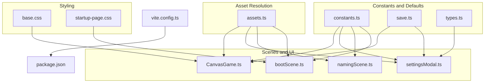
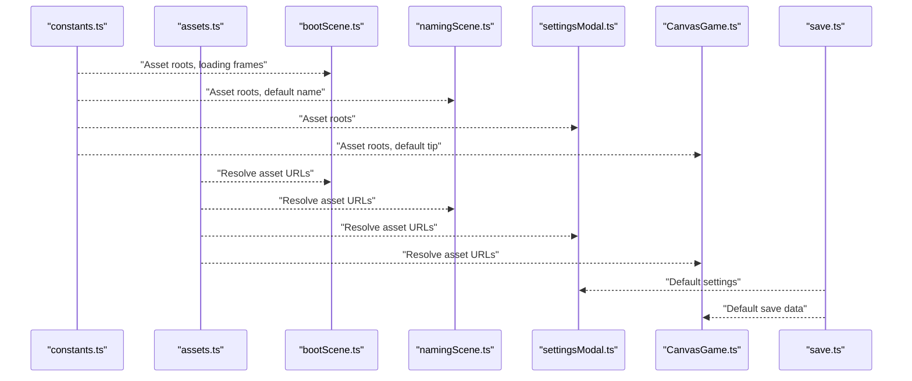
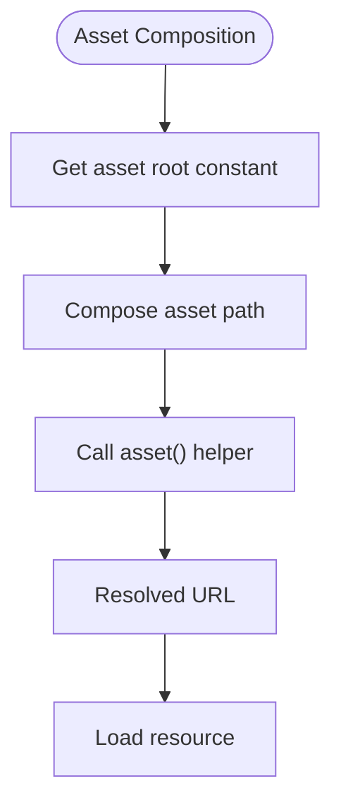
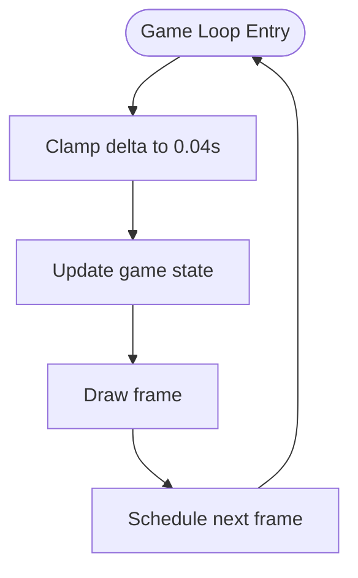
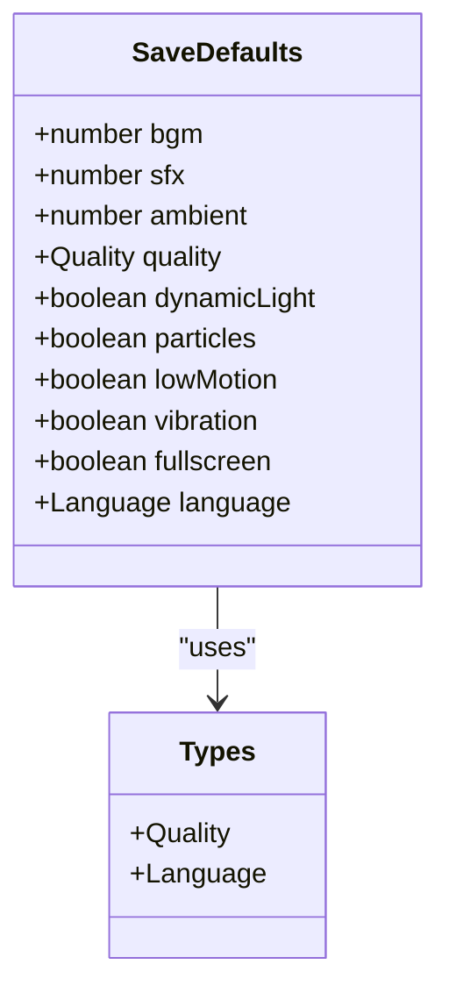
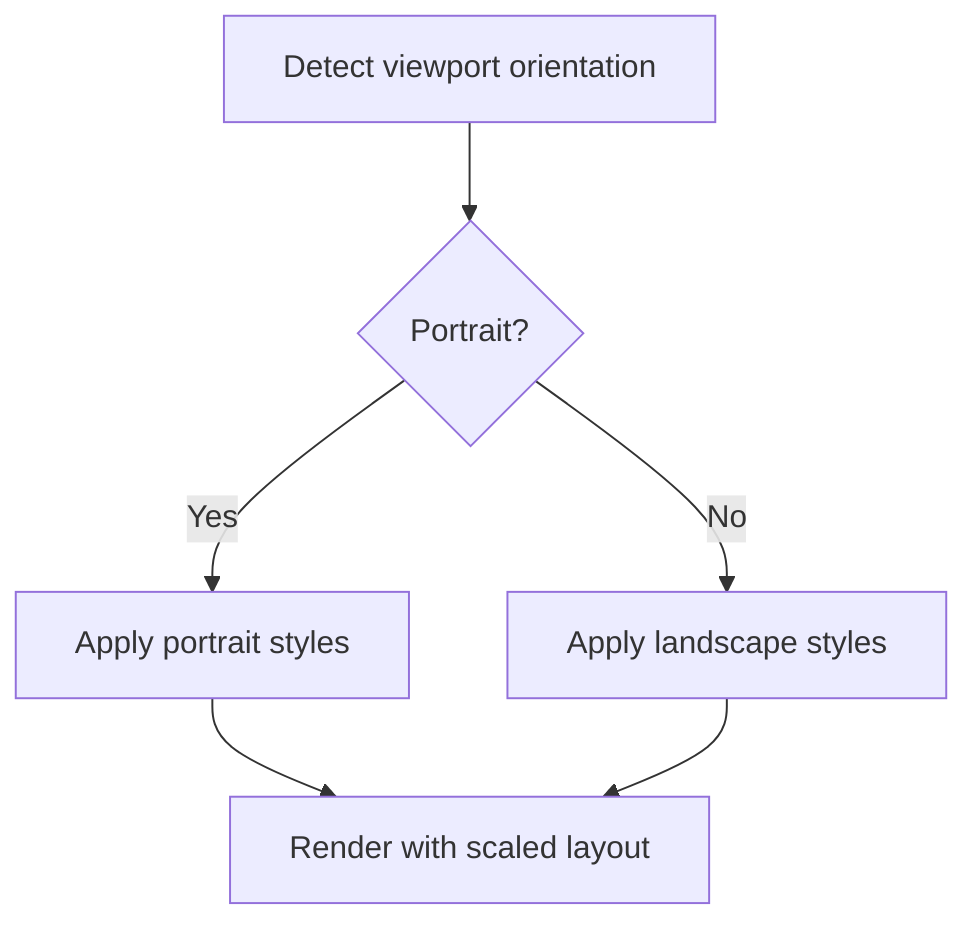
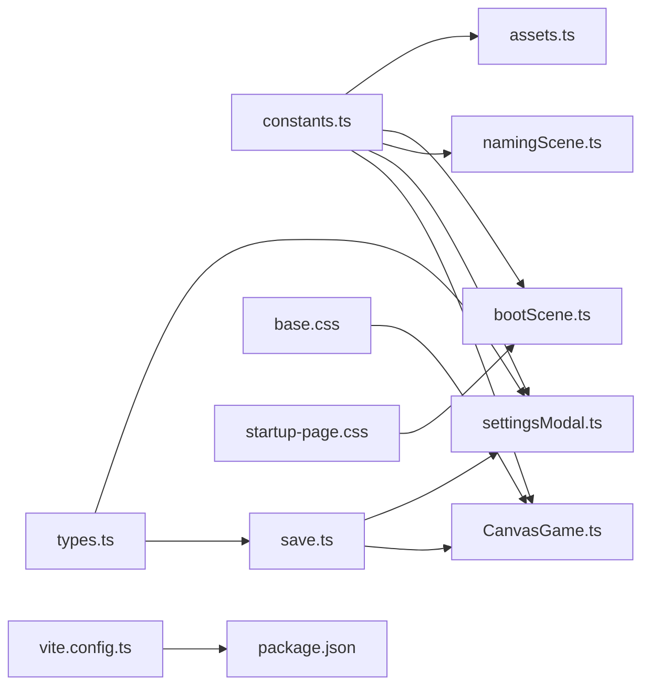

# Global Constants

<cite>
**Referenced Files in This Document**
- [constants.ts](file://src/app/constants.ts)
- [assets.ts](file://src/app/assets.ts)
- [save.ts](file://src/app/save.ts)
- [types.ts](file://src/app/types.ts)
- [settingsModal.ts](file://src/app/components/settingsModal.ts)
- [CanvasGame.ts](file://src/app/game/CanvasGame.ts)
- [bootScene.ts](file://src/app/scenes/bootScene.ts)
- [namingScene.ts](file://src/app/scenes/namingScene.ts)
- [base.css](file://src/styles/base.css)
- [startup-page.css](file://src/styles/startup-page.css)
- [vite.config.ts](file://vite.config.ts)
- [package.json](file://package.json)
</cite>

## Table of Contents
1. [Introduction](#introduction)
2. [Project Structure](#project-structure)
3. [Core Components](#core-components)
4. [Architecture Overview](#architecture-overview)
5. [Detailed Component Analysis](#detailed-component-analysis)
6. [Dependency Analysis](#dependency-analysis)
7. [Performance Considerations](#performance-considerations)
8. [Troubleshooting Guide](#troubleshooting-guide)
9. [Conclusion](#conclusion)

## Introduction
This document describes SporeLight’s global constant definitions and configuration values that drive asset resolution, timing, animation behavior, default settings, and responsive layout. It explains the purpose and usage of each constant, how they influence application behavior and performance, and how developers can safely adjust them during development.

## Project Structure
SporeLight organizes constants and configuration primarily under the application layer:
- Asset root identifiers and default values live in a dedicated constants module.
- Default save data and settings defaults are defined in the save module.
- Scenes and UI components consume these constants to assemble assets and configure behavior.
- CSS defines responsive breakpoints and motion-related behaviors.

**Diagram sources**
- [constants.ts:1-71](file://src/app/constants.ts#L1-L71)
- [assets.ts:1-4](file://src/app/assets.ts#L1-L4)
- [save.ts:1-67](file://src/app/save.ts#L1-L67)
- [types.ts:1-45](file://src/app/types.ts#L1-L45)
- [bootScene.ts:1-94](file://src/app/scenes/bootScene.ts#L1-L94)
- [namingScene.ts:1-36](file://src/app/scenes/namingScene.ts#L1-L36)
- [settingsModal.ts:1-158](file://src/app/components/settingsModal.ts#L1-L158)
- [CanvasGame.ts:1-318](file://src/app/game/CanvasGame.ts#L1-L318)
- [base.css:1-190](file://src/styles/base.css#L1-L190)
- [startup-page.css:257-337](file://src/styles/startup-page.css#L257-L337)
- [vite.config.ts:1-10](file://vite.config.ts#L1-L10)
- [package.json:1-16](file://package.json#L1-L16)

**Section sources**
- [constants.ts:1-71](file://src/app/constants.ts#L1-L71)
- [assets.ts:1-4](file://src/app/assets.ts#L1-L4)
- [save.ts:1-67](file://src/app/save.ts#L1-L67)
- [types.ts:1-45](file://src/app/types.ts#L1-L45)
- [bootScene.ts:1-94](file://src/app/scenes/bootScene.ts#L1-L94)
- [namingScene.ts:1-36](file://src/app/scenes/namingScene.ts#L1-L36)
- [settingsModal.ts:1-158](file://src/app/components/settingsModal.ts#L1-L158)
- [CanvasGame.ts:1-318](file://src/app/game/CanvasGame.ts#L1-L318)
- [base.css:1-190](file://src/styles/base.css#L1-L190)
- [startup-page.css:257-337](file://src/styles/startup-page.css#L257-L337)
- [vite.config.ts:1-10](file://vite.config.ts#L1-L10)
- [package.json:1-16](file://package.json#L1-L16)

## Core Components
This section enumerates and explains SporeLight’s global constants and configuration values, grouped by category.

- Asset Root Paths
  - Complete asset root identifier used across scenes and UI.
  - Naming page asset root identifier for the naming screen.
  - Startup asset root identifier for the boot/loading screen.
  - These constants are consumed by asset resolution helpers to construct URLs.

- Timing and Animation Constants
  - Boot sequence duration in milliseconds.
  - Startup loading frame sequence for animated progress.
  - Default tip text displayed to the user.
  - In-game animation frame timing and movement parameters.
  - Canvas game loop delta clamping and frame timing logic.

- Default Settings Values
  - Audio volumes (BGM, SFX, ambient) as normalized percentages.
  - Initial quality preset and feature toggles (dynamic lighting, particles, low-motion mode, vibration, fullscreen).
  - Language selection defaults.
  - Player name defaults and randomized name pool.

- Responsive Design Breakpoints
  - Media queries for desktop and mobile layouts.
  - Orientation-aware adjustments for portrait mode.
  - Low-motion CSS overrides for accessibility.

- Environment-Specific Values
  - Vite dev server host and port.
  - Public assets directory mapping for local development.

**Section sources**
- [constants.ts:1-71](file://src/app/constants.ts#L1-L71)
- [assets.ts:1-4](file://src/app/assets.ts#L1-L4)
- [save.ts:4-36](file://src/app/save.ts#L4-L36)
- [types.ts:19-31](file://src/app/types.ts#L19-L31)
- [CanvasGame.ts:134-146](file://src/app/game/CanvasGame.ts#L134-L146)
- [CanvasGame.ts:271-284](file://src/app/game/CanvasGame.ts#L271-L284)
- [bootScene.ts:19-64](file://src/app/scenes/bootScene.ts#L19-L64)
- [base.css:64-70](file://src/styles/base.css#L64-L70)
- [startup-page.css:257-337](file://src/styles/startup-page.css#L257-L337)
- [vite.config.ts:3-9](file://vite.config.ts#L3-L9)
- [package.json:6-14](file://package.json#L6-L14)

## Architecture Overview
The following diagram shows how constants and configuration values flow from definition to usage across scenes, UI, and runtime systems.

**Diagram sources**
- [constants.ts:1-71](file://src/app/constants.ts#L1-L71)
- [assets.ts:1-4](file://src/app/assets.ts#L1-L4)
- [bootScene.ts:1-94](file://src/app/scenes/bootScene.ts#L1-L94)
- [namingScene.ts:1-36](file://src/app/scenes/namingScene.ts#L1-L36)
- [settingsModal.ts:1-158](file://src/app/components/settingsModal.ts#L1-L158)
- [CanvasGame.ts:1-318](file://src/app/game/CanvasGame.ts#L1-L318)
- [save.ts:1-67](file://src/app/save.ts#L1-L67)

## Detailed Component Analysis

### Asset Root Paths and Resolution
- Purpose: Centralized identifiers for asset directories enable consistent asset resolution across scenes and UI.
- Usage:
  - Boot scene composes asset URLs using the startup asset root.
  - Naming scene composes asset URLs using the naming asset root.
  - Settings modal composes asset URLs using the complete asset root.
  - Canvas game loads character, world, and FX assets using the complete asset root.
- Impact: Changing these identifiers requires updating all asset composition sites.

**Diagram sources**
- [constants.ts:4-6](file://src/app/constants.ts#L4-L6)
- [assets.ts:1-4](file://src/app/assets.ts#L1-L4)
- [bootScene.ts:27-47](file://src/app/scenes/bootScene.ts#L27-L47)
- [namingScene.ts:10-14](file://src/app/scenes/namingScene.ts#L10-L14)
- [settingsModal.ts:24-26](file://src/app/components/settingsModal.ts#L24-L26)
- [CanvasGame.ts:78-101](file://src/app/game/CanvasGame.ts#L78-L101)

**Section sources**
- [constants.ts:4-6](file://src/app/constants.ts#L4-L6)
- [assets.ts:1-4](file://src/app/assets.ts#L1-L4)
- [bootScene.ts:19-64](file://src/app/scenes/bootScene.ts#L19-L64)
- [namingScene.ts:8-35](file://src/app/scenes/namingScene.ts#L8-L35)
- [settingsModal.ts:10-118](file://src/app/components/settingsModal.ts#L10-L118)
- [CanvasGame.ts:76-101](file://src/app/game/CanvasGame.ts#L76-L101)

### Timing and Animation Constants
- Boot Duration: Controls the total duration of the boot sequence.
- Startup Loading Frames: Defines the ordered frame sequence for the animated loading bar.
- Default Tip Text: Provides the initial instructional message shown to the user.
- In-Game Loop:
  - Delta clamping ensures stable frame timing regardless of device performance.
  - Frame timing for idle, move, and sow animations is derived from time-based modulo arithmetic.
  - Message timers control transient tips and auto-reset behavior.

**Diagram sources**
- [constants.ts:8-9](file://src/app/constants.ts#L8-L9)
- [constants.ts:10-51](file://src/app/constants.ts#L10-L51)
- [CanvasGame.ts:134-146](file://src/app/game/CanvasGame.ts#L134-L146)
- [CanvasGame.ts:271-284](file://src/app/game/CanvasGame.ts#L271-L284)
- [CanvasGame.ts:302-316](file://src/app/game/CanvasGame.ts#L302-L316)

**Section sources**
- [constants.ts:8-51](file://src/app/constants.ts#L8-L51)
- [CanvasGame.ts:134-146](file://src/app/game/CanvasGame.ts#L134-L146)
- [CanvasGame.ts:271-284](file://src/app/game/CanvasGame.ts#L271-L284)
- [CanvasGame.ts:302-316](file://src/app/game/CanvasGame.ts#L302-L316)

### Default Settings and Behavior
- Audio Volume Defaults: BGM, SFX, and ambient volumes are initialized as normalized values.
- Quality Preset: Starts at a balanced “standard” quality.
- Feature Flags: Dynamic lighting, particles, low-motion mode, vibration, and fullscreen defaults are defined.
- Language Defaults: Default locale selection is provided.
- Player Name Defaults: Default name and randomized name pool are defined.

**Diagram sources**
- [save.ts:24-35](file://src/app/save.ts#L24-L35)
- [types.ts:2,3](file://src/app/types.ts#L2,L3)

**Section sources**
- [save.ts:4-36](file://src/app/save.ts#L4-L36)
- [types.ts:19-31](file://src/app/types.ts#L19-L31)

### Responsive Design and Motion Control
- Low-Motion Mode: CSS class applies reduced motion by overriding animation and transition durations.
- Breakpoints:
  - Desktop: Adjusts loading shell width and track height.
  - Mobile: Tightens spacing and scales down typography.
  - Portrait Orientation: Reorients hero and adjusts loading bar sizing.

**Diagram sources**
- [base.css:64-70](file://src/styles/base.css#L64-L70)
- [startup-page.css:257-337](file://src/styles/startup-page.css#L257-L337)

**Section sources**
- [base.css:64-70](file://src/styles/base.css#L64-L70)
- [startup-page.css:257-337](file://src/styles/startup-page.css#L257-L337)

### Environment-Specific Constants
- Dev Server Host and Port: Configured via Vite for local development ergonomics.
- Public Assets Directory: Ensures static assets are served from the expected folder.

**Section sources**
- [vite.config.ts:3-9](file://vite.config.ts#L3-L9)
- [package.json:6-14](file://package.json#L6-L14)

## Dependency Analysis
The following diagram maps how constants and defaults depend on and are consumed by scenes and systems.

**Diagram sources**
- [constants.ts:1-71](file://src/app/constants.ts#L1-L71)
- [assets.ts:1-4](file://src/app/assets.ts#L1-L4)
- [bootScene.ts:1-94](file://src/app/scenes/bootScene.ts#L1-L94)
- [namingScene.ts:1-36](file://src/app/scenes/namingScene.ts#L1-L36)
- [settingsModal.ts:1-158](file://src/app/components/settingsModal.ts#L1-L158)
- [CanvasGame.ts:1-318](file://src/app/game/CanvasGame.ts#L1-L318)
- [save.ts:1-67](file://src/app/save.ts#L1-L67)
- [types.ts:1-45](file://src/app/types.ts#L1-L45)
- [base.css:1-190](file://src/styles/base.css#L1-L190)
- [startup-page.css:257-337](file://src/styles/startup-page.css#L257-L337)
- [vite.config.ts:1-10](file://vite.config.ts#L1-L10)
- [package.json:1-16](file://package.json#L1-L16)

**Section sources**
- [constants.ts:1-71](file://src/app/constants.ts#L1-L71)
- [assets.ts:1-4](file://src/app/assets.ts#L1-L4)
- [save.ts:1-67](file://src/app/save.ts#L1-L67)
- [types.ts:1-45](file://src/app/types.ts#L1-L45)
- [bootScene.ts:1-94](file://src/app/scenes/bootScene.ts#L1-L94)
- [namingScene.ts:1-36](file://src/app/scenes/namingScene.ts#L1-L36)
- [settingsModal.ts:1-158](file://src/app/components/settingsModal.ts#L1-L158)
- [CanvasGame.ts:1-318](file://src/app/game/CanvasGame.ts#L1-L318)
- [base.css:1-190](file://src/styles/base.css#L1-L190)
- [startup-page.css:257-337](file://src/styles/startup-page.css#L257-L337)
- [vite.config.ts:1-10](file://vite.config.ts#L1-L10)
- [package.json:1-16](file://package.json#L1-L16)

## Performance Considerations
- Asset Roots: Centralizing asset root identifiers reduces duplication and improves maintainability. Changing roots affects all asset compositions; ensure all references are updated consistently.
- Timing and Animation:
  - Delta clamping prevents runaway frame times on slower devices.
  - Time-based modulo drives smooth animation cycles; avoid introducing heavy per-frame computations in the update/draw loops.
- Default Settings:
  - Lowering quality presets and disabling effects (dynamic lighting, particles) can improve performance on constrained devices.
  - Disabling vibration and reducing audio volumes lowers CPU/GPU usage.
- Responsive Layout:
  - Low-motion mode reduces GPU load by minimizing animations and transitions.
  - Media queries adapt UI density and element sizes for various screen sizes.

[No sources needed since this section provides general guidance]

## Troubleshooting Guide
- Missing #app Root:
  - The application expects a root DOM element; absence throws an error. Ensure the HTML container exists before initializing the app.
- Asset Loading Failures:
  - Verify asset root constants match the actual directory structure and filenames.
  - Confirm the asset helper resolves to the correct path under the configured public directory.
- Boot Sequence Issues:
  - If the loading bar does not animate, check the startup loading frame sequence and ensure all frames exist.
- Settings Reset:
  - Confirm default settings are applied when resetting; verify the settings modal binds to the correct slider and toggle controls.

**Section sources**
- [main.ts:4-10](file://src/main.ts#L4-L10)
- [constants.ts:10-51](file://src/app/constants.ts#L10-L51)
- [assets.ts:1-4](file://src/app/assets.ts#L1-L4)
- [settingsModal.ts:129-136](file://src/app/components/settingsModal.ts#L129-L136)
- [save.ts:49-66](file://src/app/save.ts#L49-L66)

## Conclusion
SporeLight’s global constants and configuration values provide a centralized foundation for asset resolution, timing, animation, default settings, and responsive behavior. By understanding their roles and interdependencies, developers can safely modify defaults during development while maintaining predictable performance and user experience across platforms.