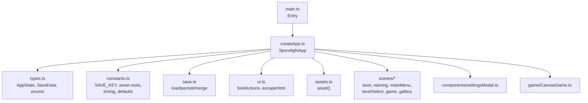
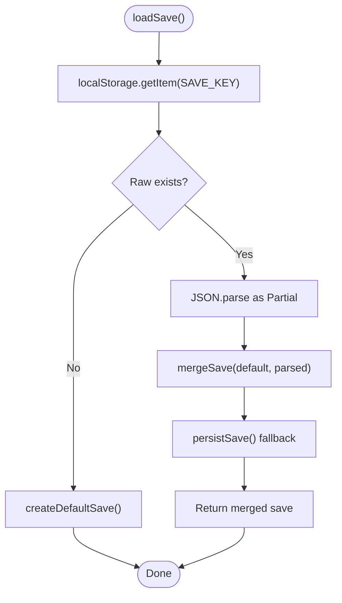
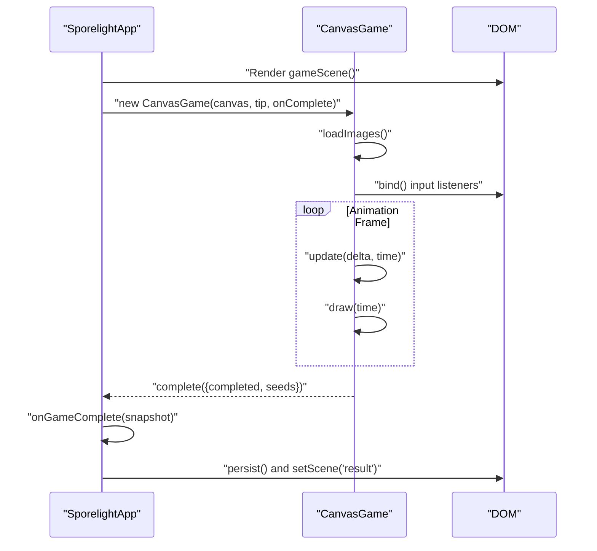
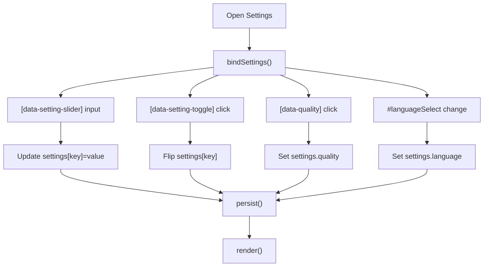
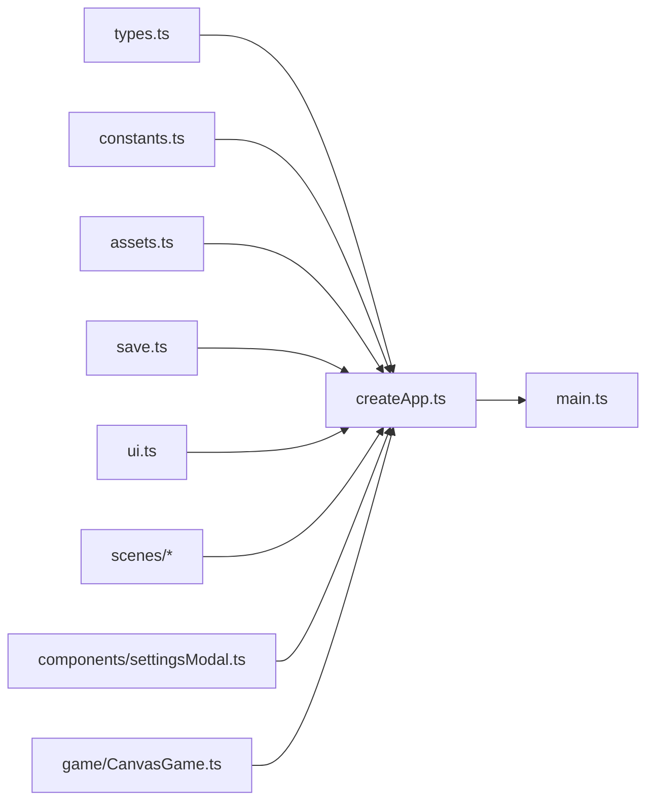

# Technical Reference

<cite>
**Referenced Files in This Document**
- [src/app/types.ts](file://src/app/types.ts)
- [src/app/constants.ts](file://src/app/constants.ts)
- [src/app/save.ts](file://src/app/save.ts)
- [src/app/assets.ts](file://src/app/assets.ts)
- [src/app/ui.ts](file://src/app/ui.ts)
- [src/app/createApp.ts](file://src/app/createApp.ts)
- [src/app/game/CanvasGame.ts](file://src/app/game/CanvasGame.ts)
- [src/app/components/settingsModal.ts](file://src/app/components/settingsModal.ts)
- [src/app/scenes/bootScene.ts](file://src/app/scenes/bootScene.ts)
- [src/app/scenes/gameScene.ts](file://src/app/scenes/gameScene.ts)
- [src/app/scenes/namingScene.ts](file://src/app/scenes/namingScene.ts)
- [src/app/scenes/mainMenuScene.ts](file://src/app/scenes/mainMenuScene.ts)
- [src/app/scenes/levelSelectScene.ts](file://src/app/scenes/levelSelectScene.ts)
- [src/main.ts](file://src/main.ts)
- [package.json](file://package.json)
</cite>

## Table of Contents
1. [Introduction](#introduction)
2. [Project Structure](#project-structure)
3. [Core Components](#core-components)
4. [Architecture Overview](#architecture-overview)
5. [Detailed Component Analysis](#detailed-component-analysis)
6. [Dependency Analysis](#dependency-analysis)
7. [Performance Considerations](#performance-considerations)
8. [Troubleshooting Guide](#troubleshooting-guide)
9. [Conclusion](#conclusion)
10. [Appendices](#appendices)

## Introduction
This document provides a comprehensive technical reference for SporeLight’s TypeScript interfaces and configuration systems. It covers the AppState and SaveData interface definitions, level and gallery data structures, configuration interfaces, and type safety patterns. It also documents global constants (asset roots, timing, animation values, defaults), utility functions (security helpers, action binding, asset path resolution), and the type system architecture. Reference tables summarize public interfaces, properties, methods, and expected behaviors.

## Project Structure
The application is organized around a small set of core modules:
- Types and constants define shared type definitions and global constants.
- Save management persists and merges user data.
- UI utilities provide DOM action binding and HTML escaping.
- Scenes render UI per game state.
- CanvasGame implements the interactive gameplay loop.
- Asset helpers resolve image paths consistently.
- The main entry initializes the application.



**Diagram sources**
- [src/main.ts:1-11](file://src/main.ts#L1-L11)
- [src/app/createApp.ts:1-377](file://src/app/createApp.ts#L1-L377)
- [src/app/types.ts:1-45](file://src/app/types.ts#L1-L45)
- [src/app/constants.ts:1-71](file://src/app/constants.ts#L1-L71)
- [src/app/save.ts:1-67](file://src/app/save.ts#L1-L67)
- [src/app/ui.ts:1-16](file://src/app/ui.ts#L1-L16)
- [src/app/assets.ts:1-4](file://src/app/assets.ts#L1-L4)
- [src/app/scenes/bootScene.ts:1-94](file://src/app/scenes/bootScene.ts#L1-L94)
- [src/app/scenes/namingScene.ts:1-36](file://src/app/scenes/namingScene.ts#L1-L36)
- [src/app/scenes/mainMenuScene.ts:1-24](file://src/app/scenes/mainMenuScene.ts#L1-L24)
- [src/app/scenes/levelSelectScene.ts:1-39](file://src/app/scenes/levelSelectScene.ts#L1-L39)
- [src/app/game/CanvasGame.ts:1-318](file://src/app/game/CanvasGame.ts#L1-L318)
- [src/app/components/settingsModal.ts:1-158](file://src/app/components/settingsModal.ts#L1-L158)

**Section sources**
- [src/main.ts:1-11](file://src/main.ts#L1-L11)
- [src/app/createApp.ts:1-377](file://src/app/createApp.ts#L1-L377)

## Core Components
This section documents the central TypeScript interfaces and configuration structures used across the application.

- Scene union type: Defines valid scenes for rendering and navigation.
- Quality and Language union types: Define acceptable quality presets and language codes.
- LevelId union type: Enumerates playable levels.
- ConfirmMode union type: Encodes confirmation modes for destructive actions.
- LevelSave: Per-level unlock/completion state and star rating.
- SaveData: Persistent user data, including player identity, last level, level states, gallery unlocks, and settings.
- GameSnapshot: Transient snapshot passed from the game to the app upon completion.
- AppState: Runtime application state, including current scene, settings panel visibility, confirm mode, and boot readiness.

Key type safety patterns:
- Discriminated unions via literal types for scenes and level identifiers.
- Strictly typed settings via a dedicated nested object with explicit keys.
- Partial-based merging for resilient save loading.
- Event-driven action binding keyed by string labels.

**Section sources**
- [src/app/types.ts:1-45](file://src/app/types.ts#L1-L45)

## Architecture Overview
The runtime architecture centers on a single-page application controlled by SporelightApp. It renders scenes based on AppState, binds UI actions, manages settings persistence, and orchestrates the boot sequence and gameplay.

```mermaid
classDiagram
class SporelightApp {
-state : AppState
-game : CanvasGame?
-bootTimer : number
-bootFrameTimer : number
+mount()
-render()
-renderScene() string
-bindScene()
-bindSettings()
-ensureBootSequence()
-clearBootSequence()
-resetBootSequence()
-setScene(Scene)
-persist()
-openSettings()
-closeSettings()
-confirmSettingsAction()
-randomizeName()
-setNameInput(string)
-submitName()
-onGameComplete(GameSnapshot)
-showToast(string)
-destroyGame()
-startBootFrames(number)
-stopBootFrames()
-handleResize()
-viewportMode() string
-viewportScale() number
}
class CanvasGame {
-ctx : CanvasRenderingContext2D
-raf : number
-destroyed : boolean
-completed : boolean
-keys : Set<string>
-target : {x,y}?
-player : {x,y,state}
-seeds : Seed[]
-exit : {x,y,active}
-images : Map<string,HTMLImageElement>
-last : number
-sowUntil : number
-messageUntil : number
+destroy()
+sow()
-loadImages()
-bind()
-loop(number)
-update(number,number)
-draw(number)
-say(string)
}
SporelightApp --> CanvasGame : "instantiates on scene='game'"
```

**Diagram sources**
- [src/app/createApp.ts:22-377](file://src/app/createApp.ts#L22-L377)
- [src/app/game/CanvasGame.ts:14-318](file://src/app/game/CanvasGame.ts#L14-L318)

**Section sources**
- [src/app/createApp.ts:16-377](file://src/app/createApp.ts#L16-L377)
- [src/app/game/CanvasGame.ts:14-318](file://src/app/game/CanvasGame.ts#L14-L318)

## Detailed Component Analysis

### Type System and Interfaces
- AppState: Holds save, current scene, settings panel flag, confirm mode, and boot readiness.
- SaveData: Player identity, last level, per-level records, gallery unlocks, and settings.
- LevelSave: Unlocked/completed flags and bestStars per level.
- GameSnapshot: Completion flag and per-seed grown state.
- Enums and unions: Scene, Quality, Language, LevelId, ConfirmMode.

Type safety highlights:
- Literal tuple types for startup loading frames ensure compile-time indexing safety.
- Partial-based merge ensures forward-compatible save loading.
- Event handlers bound by string labels enforce decoupled UI logic.

**Section sources**
- [src/app/types.ts:1-45](file://src/app/types.ts#L1-L45)

### Global Constants
- Persistence and defaults:
  - SAVE_KEY: LocalStorage key for saves.
  - DEFAULT_NAME: Default player name.
- Asset roots:
  - COMPLETE_ASSET_ROOT, NAMING_ASSET_ROOT, STARTUP_ASSET_ROOT: Root folders for asset sets.
- Timing and UI:
  - BOOT_DURATION_MS: Boot sequence duration in milliseconds.
  - GAME_DEFAULT_TIP: Default tip text in the game HUD.
  - STARTUP_LOADING_FRAME_FILES: Ordered list of startup loading frame filenames.
- Randomization:
  - RANDOM_NAMES: Pool of random names for naming scene.

Usage patterns:
- Asset path composition via asset() helper.
- Boot sequence driven by lowMotion setting and frame list.
- Naming scene validates and sanitizes input.

**Section sources**
- [src/app/constants.ts:1-71](file://src/app/constants.ts#L1-L71)

### Save System
- createDefaultSave(): Initializes default save with initial level unlocked and default settings.
- loadSave(): Loads persisted save, merges with defaults, and handles parse errors by falling back to defaults.
- persistSave(): Writes current save to LocalStorage.

Merge semantics:
- Top-level and nested objects merged with defaults as base and user data as overrides.



**Diagram sources**
- [src/app/save.ts:49-66](file://src/app/save.ts#L49-L66)

**Section sources**
- [src/app/save.ts:1-67](file://src/app/save.ts#L1-L67)

### Action Binding and Security Utilities
- bindActions(actions): Binds click events to DOM elements by data-action labels, enabling scene-independent UI logic.
- escapeHtml(value): Escapes HTML special characters to prevent XSS in rendered text.
- actionButton(label, className, disabled?): Generates a button with data-action attribute for consistent binding.

Usage:
- Scenes declare data-action attributes; SporelightApp binds handlers centrally.
- escapeHtml is used in scenes to sanitize user input and dynamic content.

**Section sources**
- [src/app/ui.ts:1-16](file://src/app/ui.ts#L1-L16)
- [src/app/scenes/namingScene.ts:21](file://src/app/scenes/namingScene.ts#L21)
- [src/app/scenes/mainMenuScene.ts:13](file://src/app/scenes/mainMenuScene.ts#L13)

### Asset Path Resolution
- asset(path): Prefixes a path with the images root to form absolute asset URLs.

Integration:
- Used pervasively by scenes and components to construct image sources.

**Section sources**
- [src/app/assets.ts:1-4](file://src/app/assets.ts#L1-L4)

### Scenes and Rendering
- Boot scene: Renders startup visuals, animated loading bar, and helper copy when ready.
- Naming scene: Collects player name, validates input, and triggers persistence.
- Main menu: Welcomes the player and exposes navigation actions.
- Level select: Displays level cards with unlock/completion state.
- Game scene: Hosts the canvas and HUD controls.

Rendering pipeline:
- SporelightApp.render() selects the current scene renderer and injects it into the DOM.
- Settings modal overlays when settingsOpen is true.

**Section sources**
- [src/app/scenes/bootScene.ts:19-94](file://src/app/scenes/bootScene.ts#L19-L94)
- [src/app/scenes/namingScene.ts:8-36](file://src/app/scenes/namingScene.ts#L8-L36)
- [src/app/scenes/mainMenuScene.ts:8-24](file://src/app/scenes/mainMenuScene.ts#L8-L24)
- [src/app/scenes/levelSelectScene.ts:13-39](file://src/app/scenes/levelSelectScene.ts#L13-L39)
- [src/app/scenes/gameScene.ts:3-22](file://src/app/scenes/gameScene.ts#L3-L22)

### Gameplay Loop (CanvasGame)
CanvasGame implements the core game mechanics:
- Initialization loads images from the complete asset root.
- Input handling supports pointer movement and keyboard planting.
- Update loop moves the player, detects proximity to seeds, and triggers growth.
- Draw loop renders background, paths, seeds, exit, and player with appropriate animations.
- Completion detection triggers a GameSnapshot callback to the app.



**Diagram sources**
- [src/app/createApp.ts:101-109](file://src/app/createApp.ts#L101-L109)
- [src/app/game/CanvasGame.ts:32-47](file://src/app/game/CanvasGame.ts#L32-L47)
- [src/app/game/CanvasGame.ts:134-192](file://src/app/game/CanvasGame.ts#L134-L192)
- [src/app/game/CanvasGame.ts:194-296](file://src/app/game/CanvasGame.ts#L194-L296)
- [src/app/createApp.ts:288-303](file://src/app/createApp.ts#L288-L303)

**Section sources**
- [src/app/game/CanvasGame.ts:14-318](file://src/app/game/CanvasGame.ts#L14-L318)
- [src/app/createApp.ts:101-109](file://src/app/createApp.ts#L101-L109)

### Settings Modal and Configuration
- Settings modal renders audio/video/operation/general sections with sliders, toggles, and quality tabs.
- Sliders update volume settings and reflect percentage labels.
- Toggles flip boolean flags and persist immediately.
- Quality tabs change the quality preset.
- Language selection updates the language setting.
- Confirmation dialogs support resetting name and restoring defaults.



**Diagram sources**
- [src/app/createApp.ts:111-163](file://src/app/createApp.ts#L111-L163)
- [src/app/components/settingsModal.ts:10-158](file://src/app/components/settingsModal.ts#L10-L158)

**Section sources**
- [src/app/components/settingsModal.ts:10-158](file://src/app/components/settingsModal.ts#L10-L158)
- [src/app/createApp.ts:111-163](file://src/app/createApp.ts#L111-L163)

## Dependency Analysis
The following diagram shows key module dependencies and interactions:



**Diagram sources**
- [src/app/types.ts:1-45](file://src/app/types.ts#L1-L45)
- [src/app/constants.ts:1-71](file://src/app/constants.ts#L1-L71)
- [src/app/assets.ts:1-4](file://src/app/assets.ts#L1-L4)
- [src/app/save.ts:1-67](file://src/app/save.ts#L1-L67)
- [src/app/ui.ts:1-16](file://src/app/ui.ts#L1-L16)
- [src/app/createApp.ts:1-377](file://src/app/createApp.ts#L1-L377)
- [src/app/game/CanvasGame.ts:1-318](file://src/app/game/CanvasGame.ts#L1-L318)
- [src/app/components/settingsModal.ts:1-158](file://src/app/components/settingsModal.ts#L1-L158)
- [src/app/scenes/bootScene.ts:1-94](file://src/app/scenes/bootScene.ts#L1-L94)
- [src/app/scenes/namingScene.ts:1-36](file://src/app/scenes/namingScene.ts#L1-L36)
- [src/app/scenes/mainMenuScene.ts:1-24](file://src/app/scenes/mainMenuScene.ts#L1-L24)
- [src/app/scenes/levelSelectScene.ts:1-39](file://src/app/scenes/levelSelectScene.ts#L1-L39)
- [src/main.ts:1-11](file://src/main.ts#L1-L11)

**Section sources**
- [src/app/createApp.ts:1-377](file://src/app/createApp.ts#L1-L377)

## Performance Considerations
- Boot sequence: Uses a fixed frame list and interval pacing derived from total duration to maintain smoothness while respecting low-motion preferences.
- Canvas rendering: Delta time clamped to a maximum to stabilize frame rates; animation frames computed via modulo arithmetic for lightweight switching.
- Event handling: Centralized action binding minimizes repeated listener registration and improves maintainability.
- Asset loading: Images are preloaded into memory for immediate drawing; fallback rendering uses placeholder rectangles when images are not yet loaded.

[No sources needed since this section provides general guidance]

## Troubleshooting Guide
Common issues and resolutions:
- Missing #app root: The application throws if the root element is absent; ensure the HTML contains a matching element.
- Invalid player name: Validation enforces length and character constraints; errors are surfaced via an aria-live region.
- Settings persistence failures: Save/load routines catch parsing errors and fall back to defaults; verify browser storage availability.
- Boot sequence stuck: Low-motion mode short-circuits frame animation; otherwise ensure timers are cleared properly on scene transitions.

**Section sources**
- [src/main.ts:6-8](file://src/main.ts#L6-L8)
- [src/app/createApp.ts:264-286](file://src/app/createApp.ts#L264-L286)
- [src/app/save.ts:49-66](file://src/app/save.ts#L49-L66)
- [src/app/createApp.ts:165-183](file://src/app/createApp.ts#L165-L183)

## Conclusion
SporeLight’s type system and configuration architecture emphasize strict typing, resilient persistence, and modular rendering. The AppState and SaveData interfaces provide a clear contract for state and persistence, while constants and utilities ensure consistent asset resolution and UI behavior. The action binding and settings modal demonstrate clean separation of concerns and robust UX patterns.

[No sources needed since this section summarizes without analyzing specific files]

## Appendices

### Public Interfaces Reference

- AppState
  - Properties:
    - save: SaveData
    - scene: Scene
    - settingsOpen: boolean
    - confirmMode: ConfirmMode
    - bootReady: boolean
  - Expected behavior: Drives rendering and navigation; toggled by scene transitions and settings interactions.

- SaveData
  - Properties:
    - playerName: string
    - hasNamed: boolean
    - lastLevel: LevelId
    - levels: Record<LevelId, LevelSave>
    - gallery: Record<string, boolean>
    - settings: Nested object with numeric and boolean fields
  - Expected behavior: Full user profile persisted to LocalStorage; merged with defaults on load.

- LevelSave
  - Properties:
    - unlocked: boolean
    - completed: boolean
    - bestStars: number
  - Expected behavior: Tracks progression per level.

- GameSnapshot
  - Properties:
    - completed: boolean
    - seeds: boolean[] (per-seed grown flags)
  - Expected behavior: Passed from CanvasGame to app on completion.

- Enums and Literals
  - Scene: boot | naming | mainMenu | levelSelect | game | result | gallery
  - Quality: soft | standard | hd
  - Language: zh-CN | zh-TW | en
  - LevelId: valley | pond | cave
  - ConfirmMode: resetName | resetSettings | null

**Section sources**
- [src/app/types.ts:1-45](file://src/app/types.ts#L1-L45)

### Utility Functions Reference

- bindActions(actions)
  - Purpose: Bind click handlers to elements by data-action label.
  - Parameters: Record<string, () => void>
  - Behavior: Adds event listeners for all matching elements.

- escapeHtml(value)
  - Purpose: Escape HTML special characters to prevent XSS.
  - Parameters: string
  - Behavior: Returns sanitized string.

- actionButton(label, className, disabled?)
  - Purpose: Generate a button with data-action attribute.
  - Parameters: label, className, optional disabled flag
  - Behavior: Returns HTML string for insertion.

- asset(path)
  - Purpose: Resolve asset URL with images root.
  - Parameters: path
  - Behavior: Returns composed URL string.

**Section sources**
- [src/app/ui.ts:5-15](file://src/app/ui.ts#L5-L15)
- [src/app/assets.ts:1-4](file://src/app/assets.ts#L1-L4)

### Configuration Parameters Reference

- Persistence and defaults
  - SAVE_KEY: LocalStorage key for saves.
  - DEFAULT_NAME: Default player name.

- Asset roots
  - COMPLETE_ASSET_ROOT: Complete asset set root.
  - NAMING_ASSET_ROOT: Naming page asset root.
  - STARTUP_ASSET_ROOT: Startup page asset root.

- Timing and UI
  - BOOT_DURATION_MS: Boot sequence duration in ms.
  - GAME_DEFAULT_TIP: Default tip text in game HUD.
  - STARTUP_LOADING_FRAME_FILES: Ordered frame filenames for startup animation.

- Randomization
  - RANDOM_NAMES: Pool of random names for naming scene.

**Section sources**
- [src/app/constants.ts:1-71](file://src/app/constants.ts#L1-L71)