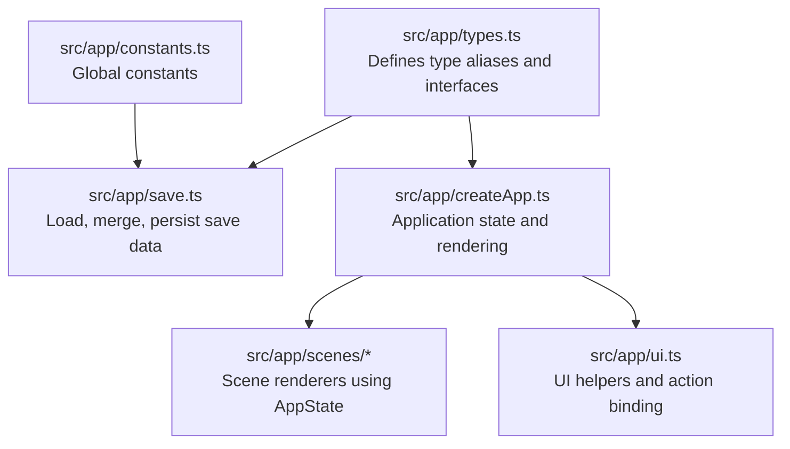
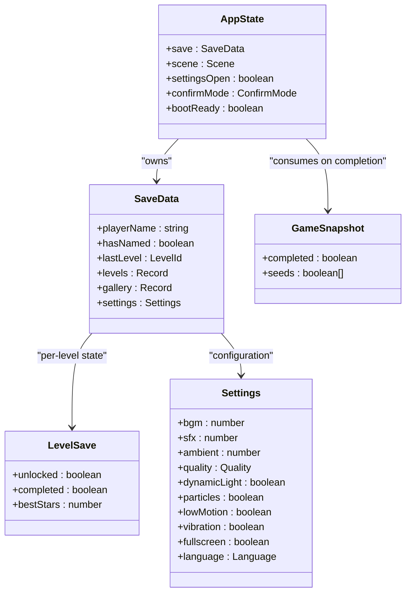
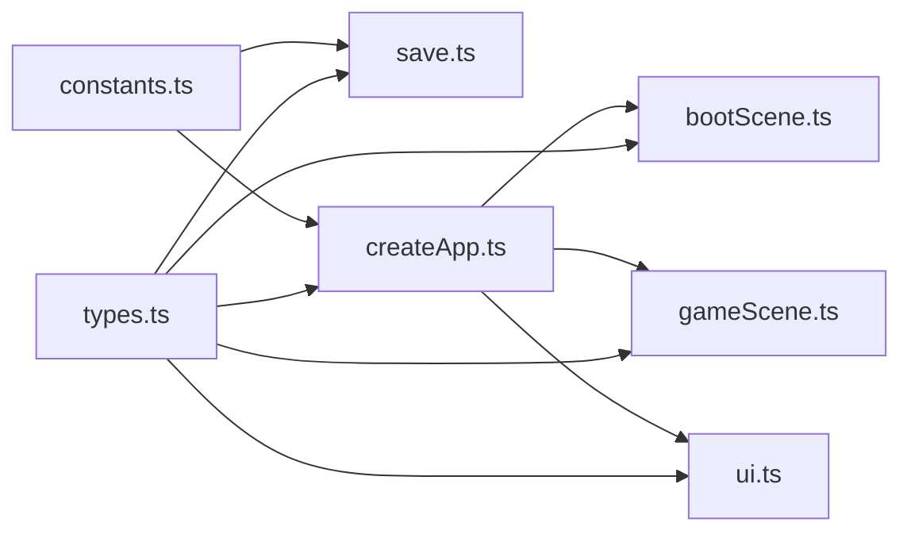

# TypeScript Interfaces

<cite>
**Referenced Files in This Document**
- [types.ts](file://src/app/types.ts)
- [save.ts](file://src/app/save.ts)
- [constants.ts](file://src/app/constants.ts)
- [createApp.ts](file://src/app/createApp.ts)
- [bootScene.ts](file://src/app/scenes/bootScene.ts)
- [gameScene.ts](file://src/app/scenes/gameScene.ts)
- [ui.ts](file://src/app/ui.ts)
- [tsconfig.json](file://tsconfig.json)
</cite>

## Table of Contents
1. [Introduction](#introduction)
2. [Project Structure](#project-structure)
3. [Core Components](#core-components)
4. [Architecture Overview](#architecture-overview)
5. [Detailed Component Analysis](#detailed-component-analysis)
6. [Dependency Analysis](#dependency-analysis)
7. [Performance Considerations](#performance-considerations)
8. [Troubleshooting Guide](#troubleshooting-guide)
9. [Conclusion](#conclusion)

## Introduction
This document provides comprehensive TypeScript interface documentation for SporeLight’s type system. It focuses on the application-wide state model and related type aliases that define save data, level progression, gallery collection, settings, and temporary game snapshots. The goal is to explain how these types are structured, how they relate to each other, and how they enforce type safety across the application.

## Project Structure
The type system is centralized in a dedicated module and consumed by the application lifecycle, scenes, and persistence layer.

**Diagram sources**
- [types.ts:1-45](file://src/app/types.ts#L1-L45)
- [save.ts:1-67](file://src/app/save.ts#L1-L67)
- [constants.ts:1-71](file://src/app/constants.ts#L1-L71)
- [createApp.ts:1-377](file://src/app/createApp.ts#L1-L377)
- [bootScene.ts:1-94](file://src/app/scenes/bootScene.ts#L1-L94)
- [gameScene.ts:1-22](file://src/app/scenes/gameScene.ts#L1-L22)
- [ui.ts:1-16](file://src/app/ui.ts#L1-L16)

**Section sources**
- [types.ts:1-45](file://src/app/types.ts#L1-L45)
- [save.ts:1-67](file://src/app/save.ts#L1-L67)
- [constants.ts:1-71](file://src/app/constants.ts#L1-L71)
- [createApp.ts:1-377](file://src/app/createApp.ts#L1-L377)

## Core Components
This section documents the primary interfaces and type aliases that form SporeLight’s type system.

- Type aliases
  - Scene: union of scene identifiers used for navigation and rendering control
  - Quality: rendering quality presets
  - Language: supported locales
  - LevelId: identifiers for levels
  - ConfirmMode: mode for confirmation prompts

- Interfaces
  - LevelSave: per-level state including unlock, completion, and star rating
  - SaveData: application-wide persistent state including player info, level progress, gallery, and settings
  - GameSnapshot: temporary snapshot of gameplay outcome
  - AppState: runtime application state including save, scene, UI flags, and boot readiness

Key characteristics:
- Strongly typed unions for scene, quality, language, level identifiers, and confirmation modes
- Structured nesting for settings and level records
- Optional properties are not used; defaults are provided by the save creation and merging logic

**Section sources**
- [types.ts:1-45](file://src/app/types.ts#L1-L45)
- [save.ts:4-37](file://src/app/save.ts#L4-L37)
- [save.ts:39-47](file://src/app/save.ts#L39-L47)
- [createApp.ts:22-29](file://src/app/createApp.ts#L22-L29)

## Architecture Overview
The type system underpins the application’s state management and UI rendering pipeline. The AppState orchestrates scene transitions and UI flags, while SaveData persists across sessions. Settings are part of SaveData and influence rendering and behavior. GameSnapshot is produced by the game and consumed by the application to update SaveData.

**Diagram sources**
- [types.ts:7-44](file://src/app/types.ts#L7-L44)
- [createApp.ts:288-303](file://src/app/createApp.ts#L288-L303)

**Section sources**
- [types.ts:7-44](file://src/app/types.ts#L7-L44)
- [createApp.ts:288-303](file://src/app/createApp.ts#L288-L303)

## Detailed Component Analysis

### AppState
- Purpose: Application-wide runtime state controlling scene, UI, and boot sequence readiness.
- Fields:
  - save: SaveData instance loaded from storage
  - scene: current Scene identifier
  - settingsOpen: whether settings modal is open
  - confirmMode: current confirmation prompt mode
  - bootReady: whether boot sequence is complete
- Initialization and updates occur in the application lifecycle and UI bindings.

Usage context:
- Boot scene rendering depends on bootReady
- Scene switching updates the scene field
- Settings modal toggles settingsOpen and confirmMode

**Section sources**
- [types.ts:38-44](file://src/app/types.ts#L38-L44)
- [createApp.ts:22-29](file://src/app/createApp.ts#L22-L29)
- [createApp.ts:65-82](file://src/app/createApp.ts#L65-L82)
- [bootScene.ts:19-65](file://src/app/scenes/bootScene.ts#L19-L65)

### SaveData
- Purpose: Persistent application state persisted to local storage.
- Player information:
  - playerName: string
  - hasNamed: boolean
  - lastLevel: LevelId
- Level progress:
  - levels: Record mapping LevelId to LevelSave
- Gallery collection:
  - gallery: Record mapping asset keys to boolean visibility flags
- Settings:
  - bgm, sfx, ambient: volume levels
  - quality: Quality preset
  - dynamicLight, particles, lowMotion, vibration, fullscreen: boolean toggles
  - language: Language locale

Persistence:
- Default save is created with initial values
- Load merges saved data with defaults to ensure backward compatibility
- Persist writes the entire SaveData to storage

**Section sources**
- [types.ts:13-31](file://src/app/types.ts#L13-L31)
- [save.ts:4-37](file://src/app/save.ts#L4-L37)
- [save.ts:49-62](file://src/app/save.ts#L49-L62)
- [save.ts:64-66](file://src/app/save.ts#L64-L66)
- [constants.ts:1-2](file://src/app/constants.ts#L1-L2)

### LevelSave
- Purpose: Per-level state representing unlock status, completion flag, and best star rating.
- Fields:
  - unlocked: boolean
  - completed: boolean
  - bestStars: number

Usage context:
- Indexed by LevelId in SaveData.levels
- Updated when levels are completed

**Section sources**
- [types.ts:7-11](file://src/app/types.ts#L7-L11)
- [save.ts:9-12](file://src/app/save.ts#L9-L12)

### GameSnapshot
- Purpose: Temporary snapshot of gameplay outcome passed from the game engine to the application.
- Fields:
  - completed: boolean indicating if the level was completed
  - seeds: boolean[] representing seed collection state

Usage context:
- Consumed by the application to update SaveData and navigate to the result scene

**Section sources**
- [types.ts:33-36](file://src/app/types.ts#L33-L36)
- [createApp.ts:288-303](file://src/app/createApp.ts#L288-L303)

### Type Aliases
- Scene: union of scene identifiers used for routing and rendering
- Quality: rendering quality presets
- Language: supported locales
- LevelId: level identifiers
- ConfirmMode: confirmation prompt modes

Usage contexts:
- Scene controls UI rendering and boot sequence
- Quality and language are part of settings
- ConfirmMode drives settings modal actions

**Section sources**
- [types.ts:1-5](file://src/app/types.ts#L1-L5)
- [createApp.ts:151-162](file://src/app/createApp.ts#L151-L162)

## Dependency Analysis
The type system is consumed across modules with clear boundaries:

**Diagram sources**
- [types.ts:1-45](file://src/app/types.ts#L1-L45)
- [save.ts:1-67](file://src/app/save.ts#L1-L67)
- [createApp.ts:1-14](file://src/app/createApp.ts#L1-L14)
- [bootScene.ts:1-3](file://src/app/scenes/bootScene.ts#L1-L3)
- [gameScene.ts:1-2](file://src/app/scenes/gameScene.ts#L1-L2)
- [ui.ts:1-16](file://src/app/ui.ts#L1-L16)
- [constants.ts:1-71](file://src/app/constants.ts#L1-L71)

**Section sources**
- [types.ts:1-45](file://src/app/types.ts#L1-L45)
- [save.ts:1-67](file://src/app/save.ts#L1-L67)
- [createApp.ts:1-14](file://src/app/createApp.ts#L1-L14)

## Performance Considerations
- Local storage operations are synchronous and should be minimized. The save layer batches writes and reads appropriately.
- Merging saves avoids deep cloning overhead by shallow-merging nested objects.
- Using union types and literal types ensures compile-time checks without runtime overhead.

[No sources needed since this section provides general guidance]

## Troubleshooting Guide
Common issues and remedies:
- Missing save data on first launch
  - Cause: No existing save in local storage
  - Behavior: Default save is created automatically
  - Evidence: Load function falls back to default save when raw data is missing
- Partial save migration
  - Cause: New fields added to SaveData
  - Behavior: Merge logic preserves defaults for missing fields
  - Evidence: mergeSave shallow-merges levels, gallery, and settings
- Settings not applying immediately
  - Cause: UI updates require re-render after state changes
  - Behavior: Settings toggles trigger persist and render
  - Evidence: Settings binding updates state and re-renders

**Section sources**
- [save.ts:49-62](file://src/app/save.ts#L49-L62)
- [save.ts:39-47](file://src/app/save.ts#L39-L47)
- [createApp.ts:138-162](file://src/app/createApp.ts#L138-L162)

## Conclusion
SporeLight’s type system provides a robust foundation for state management and UI rendering. The AppState orchestrates scenes and UI flags, SaveData encapsulates persistent state with explicit defaults, LevelSave models per-level progression, and GameSnapshot captures transient outcomes. Type aliases ensure strong typing across scenes, settings, and confirmations. The save layer guarantees forward compatibility and reliable persistence.