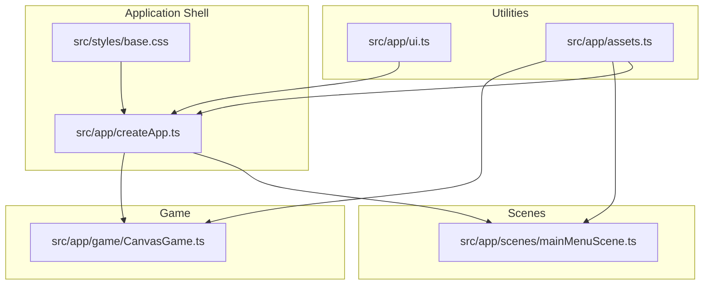
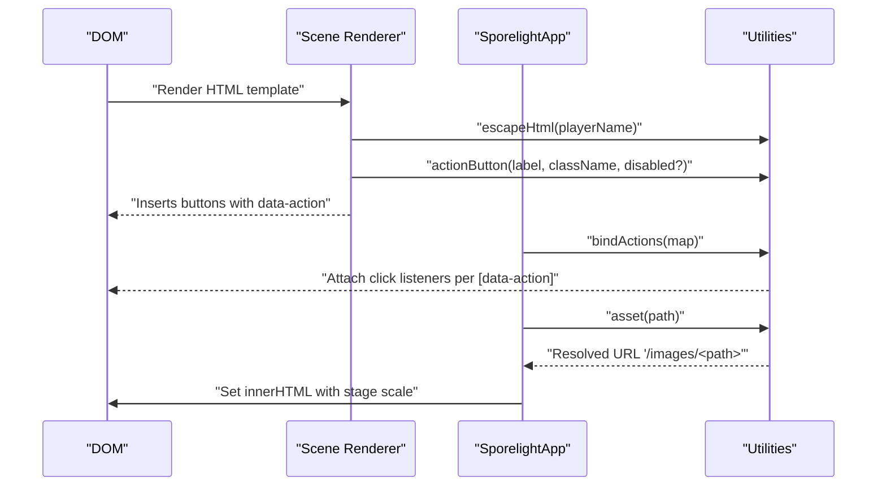
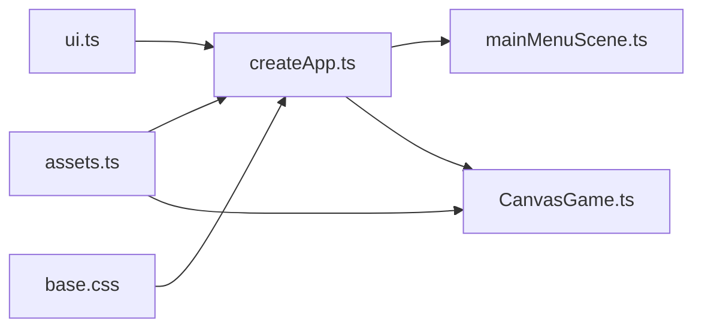

# Utility Functions

<cite>
**Referenced Files in This Document**
- [src/app/ui.ts](file://src/app/ui.ts)
- [src/app/assets.ts](file://src/app/assets.ts)
- [src/app/createApp.ts](file://src/app/createApp.ts)
- [src/app/game/CanvasGame.ts](file://src/app/game/CanvasGame.ts)
- [src/app/scenes/mainMenuScene.ts](file://src/app/scenes/mainMenuScene.ts)
- [src/styles/base.css](file://src/styles/base.css)
</cite>

## Table of Contents
1. [Introduction](#introduction)
2. [Project Structure](#project-structure)
3. [Core Components](#core-components)
4. [Architecture Overview](#architecture-overview)
5. [Detailed Component Analysis](#detailed-component-analysis)
6. [Dependency Analysis](#dependency-analysis)
7. [Performance Considerations](#performance-considerations)
8. [Troubleshooting Guide](#troubleshooting-guide)
9. [Conclusion](#conclusion)

## Introduction
This document describes SporeLight’s utility functions and helper methods that power UI rendering, asset resolution, scene navigation, responsive layout, and input handling. It focuses on:
- XSS-safe HTML rendering via escapeHTML
- Action binding for UI events and scene transitions
- Asset path resolution and sprite sheet/image management
- Responsive viewport scaling and CSS-driven layout
- Touch and pointer interaction handling
- Validation and formatting utilities
- Cross-browser compatibility helpers

## Project Structure
Utilities are organized under src/app and integrate with scene renderers, the application shell, and the canvas-based game.

**Diagram sources**
- [src/app/ui.ts:1-16](file://src/app/ui.ts#L1-L16)
- [src/app/assets.ts:1-4](file://src/app/assets.ts#L1-L4)
- [src/app/createApp.ts:1-377](file://src/app/createApp.ts#L1-L377)
- [src/app/scenes/mainMenuScene.ts:1-24](file://src/app/scenes/mainMenuScene.ts#L1-L24)
- [src/app/game/CanvasGame.ts:1-318](file://src/app/game/CanvasGame.ts#L1-L318)
- [src/styles/base.css:1-190](file://src/styles/base.css#L1-L190)

**Section sources**
- [src/app/ui.ts:1-16](file://src/app/ui.ts#L1-L16)
- [src/app/assets.ts:1-4](file://src/app/assets.ts#L1-L4)
- [src/app/createApp.ts:1-377](file://src/app/createApp.ts#L1-L377)
- [src/app/scenes/mainMenuScene.ts:1-24](file://src/app/scenes/mainMenuScene.ts#L1-L24)
- [src/app/game/CanvasGame.ts:1-318](file://src/app/game/CanvasGame.ts#L1-L318)
- [src/styles/base.css:1-190](file://src/styles/base.css#L1-L190)

## Core Components
- Escape HTML for XSS prevention and safe rendering
- Action button builder and action binder for UI event handling
- Asset path resolver for consistent image URLs
- Viewport scaling and responsive layout helpers
- Pointer/touch input handlers for canvas interactions
- Validation/formatting utilities for user input and messages

**Section sources**
- [src/app/ui.ts:13-15](file://src/app/ui.ts#L13-L15)
- [src/app/ui.ts:1-11](file://src/app/ui.ts#L1-L11)
- [src/app/assets.ts:1-4](file://src/app/assets.ts#L1-L4)
- [src/app/createApp.ts:362-376](file://src/app/createApp.ts#L362-L376)
- [src/app/game/CanvasGame.ts:104-132](file://src/app/game/CanvasGame.ts#L104-L132)
- [src/app/scenes/mainMenuScene.ts:13](file://src/app/scenes/mainMenuScene.ts#L13)

## Architecture Overview
The application composes scenes from templates, binds actions, resolves assets, and scales the stage responsively. Utilities are reused across scenes and the game layer.

**Diagram sources**
- [src/app/scenes/mainMenuScene.ts:13](file://src/app/scenes/mainMenuScene.ts#L13)
- [src/app/ui.ts:1-11](file://src/app/ui.ts#L1-L11)
- [src/app/ui.ts:13-15](file://src/app/ui.ts#L13-L15)
- [src/app/ui.ts:5-11](file://src/app/ui.ts#L5-L11)
- [src/app/assets.ts:1-4](file://src/app/assets.ts#L1-L4)
- [src/app/createApp.ts:45-52](file://src/app/createApp.ts#L45-L52)

## Detailed Component Analysis

### Escape HTML (XSS Prevention)
Purpose: Safely embed user-provided strings into HTML templates to prevent script injection.

- Function: escapeHtml(value: string): string
- Behavior: Replaces unsafe characters (&, <, >, ", ') with HTML entities.
- Usage pattern:
  - Render user name in main menu with XSS protection.
  - Apply to any dynamic text inserted into templates.

Parameters
- value: string — Text to escape.

Returns
- string — Escaped HTML-safe string.

Integration
- Called by scene renderers when templating dynamic content.

Example reference
- [src/app/scenes/mainMenuScene.ts:13](file://src/app/scenes/mainMenuScene.ts#L13)

**Section sources**
- [src/app/ui.ts:13-15](file://src/app/ui.ts#L13-L15)
- [src/app/scenes/mainMenuScene.ts:13](file://src/app/scenes/mainMenuScene.ts#L13)

### Action Button Builder and Action Binder
Purpose: Build declarative UI buttons and bind click handlers globally.

- actionButton(label: string, className: string, disabled?: boolean): string
  - Builds a button element string with data-action attribute and optional disabled state.
- bindActions(actions: Record<string, () => void>): void
  - Attaches click listeners to all elements whose data-action matches a key in the provided map.

Parameters
- label: string — Button text and action key.
- className: string — CSS class suffix appended to a shared base class.
- disabled: boolean — Optional; disables the button.
- actions: Record<string, () => void> — Mapping of action keys to handlers.

Returns
- actionButton: string — HTML string for a button element.
- bindActions: void — Attaches event listeners.

Usage patterns
- Build primary and secondary buttons in scenes.
- Bind scene transitions and game actions via a single call.

Example references
- [src/app/ui.ts:1-11](file://src/app/ui.ts#L1-L11)
- [src/app/createApp.ts:84-109](file://src/app/createApp.ts#L84-L109)

**Section sources**
- [src/app/ui.ts:1-11](file://src/app/ui.ts#L1-L11)
- [src/app/createApp.ts:84-109](file://src/app/createApp.ts#L84-L109)

### Asset Path Resolution
Purpose: Centralize asset path construction for consistent image URLs.

- asset(path: string): string
  - Prefixes a path with the base asset directory to produce a URL.

Parameters
- path: string — Relative path under the assets/images root.

Returns
- string — Fully qualified asset URL.

Usage patterns
- Resolve background images, spritesheets, and UI assets in scenes and game.
- Used by canvas game to load character and world assets.

Example references
- [src/app/assets.ts:1-4](file://src/app/assets.ts#L1-L4)
- [src/app/scenes/bootScene.ts:27](file://src/app/scenes/bootScene.ts#L27)
- [src/app/game/CanvasGame.ts:98-101](file://src/app/game/CanvasGame.ts#L98-L101)

**Section sources**
- [src/app/assets.ts:1-4](file://src/app/assets.ts#L1-L4)
- [src/app/scenes/bootScene.ts:27](file://src/app/scenes/bootScene.ts#L27)
- [src/app/game/CanvasGame.ts:98-101](file://src/app/game/CanvasGame.ts#L98-L101)

### Sprite Sheet and Image Management (CanvasGame)
Purpose: Load, cache, and draw sprite-based graphics efficiently.

Highlights
- Preloads images via asset() and caches them in a map keyed by logical names.
- Draws background, seeds, exit portal, and player character with animations.
- Uses globalAlpha and shadow effects for visual polish.

Key behaviors
- loadImages(): Populate cache with pre-defined keys and asset paths.
- drawImage(key, x, y, width, height): Draw cached image or fallback rectangle.
- frameFor(time): Select animation frame based on state and elapsed time.

Example references
- [src/app/game/CanvasGame.ts:76-102](file://src/app/game/CanvasGame.ts#L76-L102)
- [src/app/game/CanvasGame.ts:286-296](file://src/app/game/CanvasGame.ts#L286-L296)
- [src/app/game/CanvasGame.ts:271-284](file://src/app/game/CanvasGame.ts#L271-L284)

**Section sources**
- [src/app/game/CanvasGame.ts:76-102](file://src/app/game/CanvasGame.ts#L76-L102)
- [src/app/game/CanvasGame.ts:286-296](file://src/app/game/CanvasGame.ts#L286-L296)
- [src/app/game/CanvasGame.ts:271-284](file://src/app/game/CanvasGame.ts#L271-L284)

### Responsive Design and Viewport Scaling
Purpose: Scale the stage to fit the viewport while preserving aspect ratio.

- viewportMode(): Returns "cover" when portrait-like (width < height) or "contain" otherwise.
- viewportScale(): Computes a scale factor based on device size and a fixed design resolution (1280×720).

Behavior
- Stage applies CSS variable --scene-scale to the screen container.
- CSS transforms scale the screen to fill or fit the viewport depending on mode.

Example references
- [src/app/createApp.ts:366-376](file://src/app/createApp.ts#L366-L376)
- [src/styles/base.css:90](file://src/styles/base.css#L90)
- [src/styles/base.css:187-189](file://src/styles/base.css#L187-L189)

**Section sources**
- [src/app/createApp.ts:366-376](file://src/app/createApp.ts#L366-L376)
- [src/styles/base.css:90](file://src/styles/base.css#L90)
- [src/styles/base.css:187-189](file://src/styles/base.css#L187-L189)

### Touch and Cursor Interaction Handlers
Purpose: Translate pointer/touch input into in-game movement and actions.

- Pointer down on canvas:
  - Convert client coordinates to canvas coordinates using bounding rect and device pixel ratios.
  - Set player target and trigger a contextual message.
- Keyboard input:
  - Track pressed keys and trigger planting action on E.

Example references
- [src/app/game/CanvasGame.ts:104-120](file://src/app/game/CanvasGame.ts#L104-L120)
- [src/app/game/CanvasGame.ts:122-132](file://src/app/game/CanvasGame.ts#L122-L132)

**Section sources**
- [src/app/game/CanvasGame.ts:104-120](file://src/app/game/CanvasGame.ts#L104-L120)
- [src/app/game/CanvasGame.ts:122-132](file://src/app/game/CanvasGame.ts#L122-L132)

### Validation and Formatting Utilities
Purpose: Validate user input and format messages for display.

- Name validation:
  - Regex enforces allowed characters and length constraints.
  - Clears error messages on valid input.
- Message formatting:
  - Dynamic tips in the HUD are updated and restored after timeouts.

Example references
- [src/app/createApp.ts:264-286](file://src/app/createApp.ts#L264-L286)
- [src/app/game/CanvasGame.ts:302-316](file://src/app/game/CanvasGame.ts#L302-L316)

**Section sources**
- [src/app/createApp.ts:264-286](file://src/app/createApp.ts#L264-L286)
- [src/app/game/CanvasGame.ts:302-316](file://src/app/game/CanvasGame.ts#L302-L316)

### Cross-Browser Compatibility Helpers
Purpose: Ensure consistent behavior across browsers and devices.

- Pointer events:
  - Uses pointerdown for unified mouse/touch handling.
  - Converts client coordinates to canvas coordinates using getBoundingClientRect and device pixel ratios.
- Low-motion mode:
  - Applies CSS class to reduce motion for accessibility.
  - Shortens boot sequence duration when enabled.

Example references
- [src/app/game/CanvasGame.ts:104-116](file://src/app/game/CanvasGame.ts#L104-L116)
- [src/app/createApp.ts:64](file://src/app/createApp.ts#L64)
- [src/app/createApp.ts:170](file://src/app/createApp.ts#L170)

**Section sources**
- [src/app/game/CanvasGame.ts:104-116](file://src/app/game/CanvasGame.ts#L104-L116)
- [src/app/createApp.ts:64](file://src/app/createApp.ts#L64)
- [src/app/createApp.ts:170](file://src/app/createApp.ts#L170)

## Dependency Analysis
Utilities are consumed by the application shell and scenes. The canvas game depends on asset resolution and UI helpers indirectly through the application lifecycle.

**Diagram sources**
- [src/app/ui.ts:1-16](file://src/app/ui.ts#L1-L16)
- [src/app/assets.ts:1-4](file://src/app/assets.ts#L1-L4)
- [src/app/createApp.ts:1-377](file://src/app/createApp.ts#L1-L377)
- [src/app/scenes/mainMenuScene.ts:1-24](file://src/app/scenes/mainMenuScene.ts#L1-L24)
- [src/app/game/CanvasGame.ts:1-318](file://src/app/game/CanvasGame.ts#L1-L318)
- [src/styles/base.css:1-190](file://src/styles/base.css#L1-L190)

**Section sources**
- [src/app/ui.ts:1-16](file://src/app/ui.ts#L1-L16)
- [src/app/assets.ts:1-4](file://src/app/assets.ts#L1-L4)
- [src/app/createApp.ts:1-377](file://src/app/createApp.ts#L1-L377)
- [src/app/scenes/mainMenuScene.ts:1-24](file://src/app/scenes/mainMenuScene.ts#L1-L24)
- [src/app/game/CanvasGame.ts:1-318](file://src/app/game/CanvasGame.ts#L1-L318)
- [src/styles/base.css:1-190](file://src/styles/base.css#L1-L190)

## Performance Considerations
- Avoid repeated DOM queries by caching selectors during initialization.
- Use requestAnimationFrame for smooth animation loops and limit heavy computations per frame.
- Prefer CSS transforms and opacity for animations; avoid frequent layout thrashing.
- Minimize asset requests by reusing cached images and batching updates.

## Troubleshooting Guide
- Buttons not responding:
  - Ensure data-action attributes match keys in the action map passed to bindActions.
  - Verify bindActions is called after DOM insertion.
- Incorrect asset paths:
  - Confirm asset() prefixes are applied consistently.
  - Check that asset paths are relative to the images directory.
- Canvas not responding to input:
  - Verify pointerdown listener is attached and coordinates are converted using getBoundingClientRect and device pixel ratios.
- Overly large/small UI on mobile:
  - Check viewportMode and viewportScale logic and CSS stage scaling.
- XSS warnings or script injection:
  - Wrap any dynamic text with escapeHtml before inserting into templates.

**Section sources**
- [src/app/ui.ts:5-11](file://src/app/ui.ts#L5-L11)
- [src/app/assets.ts:1-4](file://src/app/assets.ts#L1-L4)
- [src/app/game/CanvasGame.ts:104-116](file://src/app/game/CanvasGame.ts#L104-L116)
- [src/app/createApp.ts:366-376](file://src/app/createApp.ts#L366-L376)
- [src/app/scenes/mainMenuScene.ts:13](file://src/app/scenes/mainMenuScene.ts#L13)

## Conclusion
SporeLight’s utilities provide a cohesive foundation for secure, responsive, and interactive UI. The escapeHTML function prevents XSS, action binding unifies event handling, asset resolution centralizes resource paths, and viewport scaling ensures consistent layouts. Pointer/touch handlers and validation/formatting utilities deliver a polished user experience across devices and browsers.