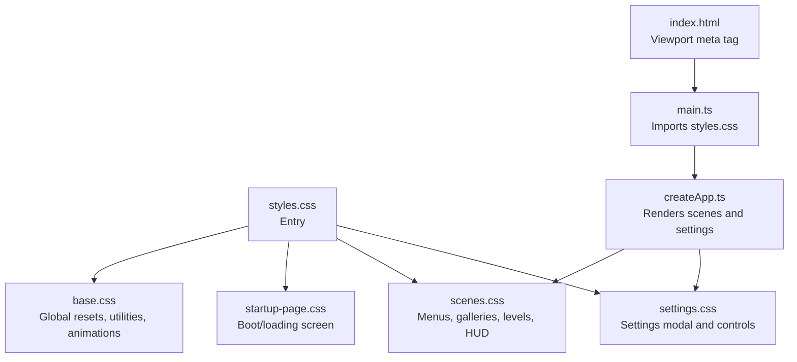
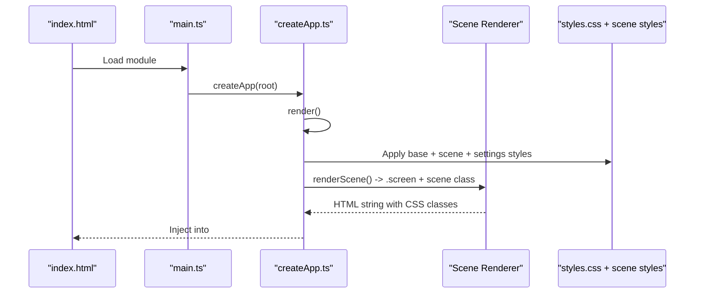
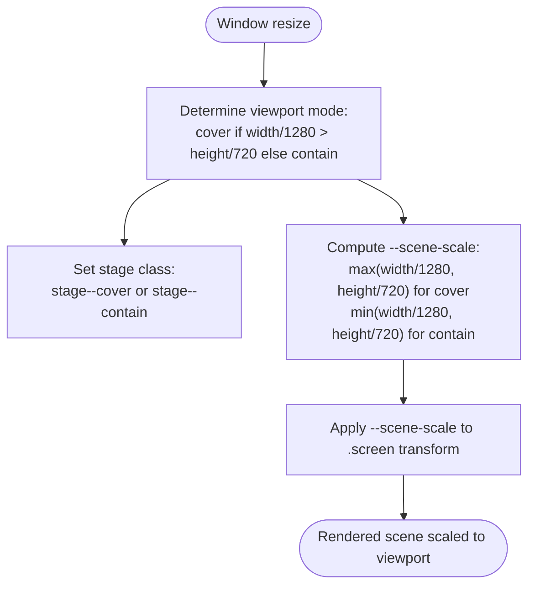
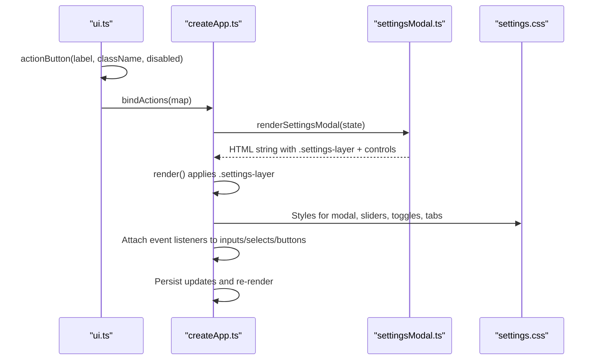
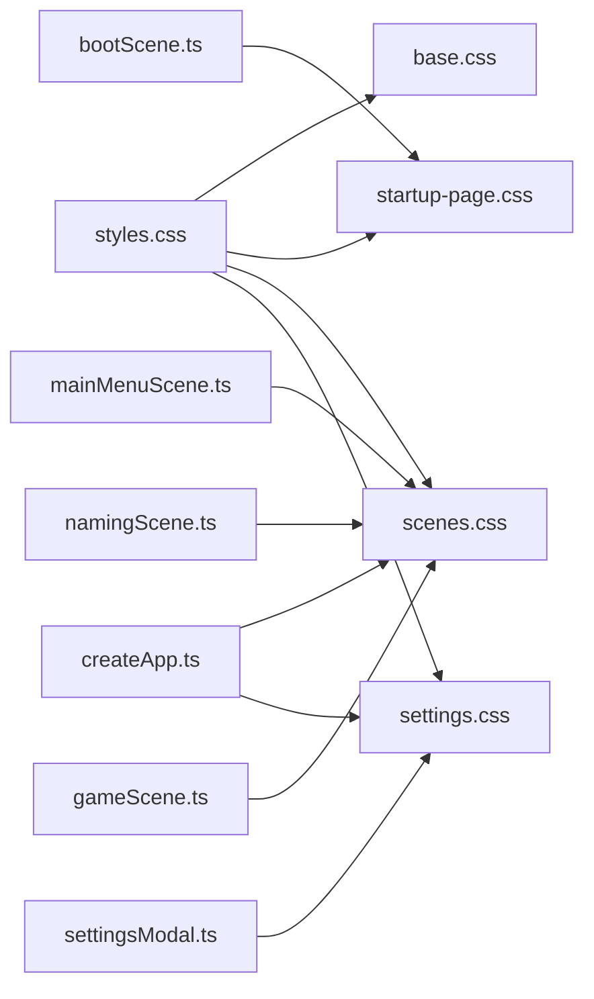

# CSS Architecture

<cite>
**Referenced Files in This Document**
- [styles.css](file://src/styles.css)
- [base.css](file://src/styles/base.css)
- [startup-page.css](file://src/styles/startup-page.css)
- [scenes.css](file://src/styles/scenes.css)
- [settings.css](file://src/styles/settings.css)
- [index.html](file://index.html)
- [main.ts](file://src/main.ts)
- [createApp.ts](file://src/app/createApp.ts)
- [bootScene.ts](file://src/app/scenes/bootScene.ts)
- [mainMenuScene.ts](file://src/app/scenes/mainMenuScene.ts)
- [namingScene.ts](file://src/app/scenes/namingScene.ts)
- [gameScene.ts](file://src/app/scenes/gameScene.ts)
- [settingsModal.ts](file://src/app/components/settingsModal.ts)
- [ui.ts](file://src/app/ui.ts)
- [constants.ts](file://src/app/constants.ts)
- [types.ts](file://src/app/types.ts)
</cite>

## Table of Contents
1. [Introduction](#introduction)
2. [Project Structure](#project-structure)
3. [Core Components](#core-components)
4. [Architecture Overview](#architecture-overview)
5. [Detailed Component Analysis](#detailed-component-analysis)
6. [Dependency Analysis](#dependency-analysis)
7. [Performance Considerations](#performance-considerations)
8. [Troubleshooting Guide](#troubleshooting-guide)
9. [Conclusion](#conclusion)

## Introduction
This document describes SporeLight’s CSS architecture and styling system. It explains the global styles foundation, base CSS reset and normalization, component-based CSS organization, and scene-specific styling via dedicated CSS files. It also covers responsive design principles, viewport scaling strategies, adaptive layout patterns, class naming conventions, UI styling patterns, integration with TypeScript UI handlers, examples of scene transitions, and cross-browser compatibility considerations.

## Project Structure
The CSS system is organized around a single entry that imports modular style sheets:
- Global base styles and shared utilities
- Scene-specific styles for each screen
- Settings modal styles
- Startup page styles

**Diagram sources**
- [styles.css:1-5](file://src/styles.css#L1-L5)
- [base.css:1-190](file://src/styles/base.css#L1-L190)
- [startup-page.css:1-338](file://src/styles/startup-page.css#L1-L338)
- [scenes.css:1-452](file://src/styles/scenes.css#L1-L452)
- [settings.css:1-660](file://src/styles/settings.css#L1-L660)
- [index.html:1-13](file://index.html#L1-L13)
- [main.ts:1-11](file://src/main.ts#L1-L11)
- [createApp.ts:1-377](file://src/app/createApp.ts#L1-L377)

**Section sources**
- [styles.css:1-5](file://src/styles.css#L1-L5)
- [index.html:1-13](file://index.html#L1-L13)
- [main.ts:1-11](file://src/main.ts#L1-L11)

## Core Components
- Global base styles: normalize defaults, define root color scheme, establish shell/stage/screen containers, and provide reusable UI tokens and animations.
- Scene styles: per-scene layouts, grids, overlays, and interactive elements for menus, naming, levels, gallery, results, and gameplay HUD.
- Settings styles: modal dialog, cards, sliders, toggles, tabs, and confirm dialogs.
- Startup styles: animated loading bar, hero sprite, fireflies, and responsive adjustments.

Key patterns:
- Container-first approach: .shell hosts the app; .stage holds the current scene; .screen is the 1280x720 canvas with CSS scaling.
- Utility-first tokens: .asset-button, .small-gem, .primary-gem, .hud-button, .skill-button unify button styling.
- Animation tokens: .is-low-motion disables motion; named @keyframes drive parallax and UI micro-interactions.
- Responsive breakpoints: media queries adapt grids and typography for smaller widths and portrait orientation.

**Section sources**
- [base.css:1-190](file://src/styles/base.css#L1-L190)
- [scenes.css:1-452](file://src/styles/scenes.css#L1-L452)
- [settings.css:1-660](file://src/styles/settings.css#L1-L660)
- [startup-page.css:1-338](file://src/styles/startup-page.css#L1-L338)

## Architecture Overview
The runtime CSS architecture ties into the TypeScript app lifecycle:
- The app renders a .shell container and a .stage with a computed --scene-scale variable.
- The stage receives a class indicating the current scene (e.g., stage--boot, stage--naming).
- Scene rendering functions inject .screen wrappers with scene-specific classes (e.g., .startup-screen, .menu-screen).
- Settings modal is injected as a .settings-layer overlay when opened.

**Diagram sources**
- [index.html:1-13](file://index.html#L1-L13)
- [main.ts:1-11](file://src/main.ts#L1-L11)
- [createApp.ts:42-82](file://src/app/createApp.ts#L42-L82)
- [bootScene.ts:19-64](file://src/app/scenes/bootScene.ts#L19-L64)
- [mainMenuScene.ts:8-22](file://src/app/scenes/mainMenuScene.ts#L8-L22)
- [namingScene.ts:8-34](file://src/app/scenes/namingScene.ts#L8-L34)
- [gameScene.ts:3-21](file://src/app/scenes/gameScene.ts#L3-L21)
- [settingsModal.ts:10-117](file://src/app/components/settingsModal.ts#L10-L117)

## Detailed Component Analysis

### Global Base Styles (.base.css)
- Resets and normalization: universal box-sizing, body sizing, font inheritance for form controls, pointer events for decorative layers.
- Root-level tokens: color-scheme, .shell grid container, .stage absolute positioning with isolation, .screen fixed 1280x720 with CSS scaling.
- Motion accessibility: .is-low-motion disables transitions/animations for reduced motion.
- Shared UI tokens: .asset-button, .small-gem, .primary-gem, .hud-button, .skill-button with consistent gradients, shadows, radii, and hover/focus states.
- Toast notifications: .toast fixed at the bottom-center with shadow and transform.
- Animations: drift, floaty, popIn used across scenes.

Implementation highlights:
- The .screen element scales with --scene-scale so that 1280x720 content fits the viewport while preserving aspect ratio.
- Decorative layers (.logo, .clouds, .parallax, .naming-overlay) are pointer-events:none to avoid interfering with UI.

**Section sources**
- [base.css:1-190](file://src/styles/base.css#L1-L190)

### Scene Styles (.scenes.css)
- Background overlays: pseudo-elements on .menu-screen, .level-screen, .gallery-screen, .result-screen add subtle gradient masks.
- Naming screen: logo/title positioning, .naming-overlay, .name-card with input area and error messaging, .naming-actions.
- Menu screen: .menu-logo, player greeting, .menu-actions grid of .asset-button instances.
- Levels and gallery: responsive grids (.level-grid, .gallery-grid) with card layouts, shading, and lock states.
- Game HUD: .game-hud flex container, .hud-title, .hud-button, .skill-button, .game-tip, .game-actions.
- Result panel: centered .result-panel with unlock indicators and actions.
- Media queries: adjust grids and spacing for narrower widths and lower heights; reflow settings rows on small screens.

Integration with TypeScript:
- Scenes are rendered by functions returning HTML strings with appropriate classes.
- Buttons use .asset-button and data-action attributes bound by ui.ts.

**Section sources**
- [scenes.css:1-452](file://src/styles/scenes.css#L1-L452)
- [mainMenuScene.ts:8-22](file://src/app/scenes/mainMenuScene.ts#L8-L22)
- [namingScene.ts:8-34](file://src/app/scenes/namingScene.ts#L8-L34)
- [gameScene.ts:3-21](file://src/app/scenes/gameScene.ts#L3-L21)

### Settings Modal Styles (.settings.css)
- Overlay and modal: .settings-layer grid overlay, .settings-modal with radial/linear gradients, borders, and inner glows; popIn animation.
- Header/footer: .settings-header with decorative ornaments, .settings-footer with three .footer-button variants.
- Content areas: .settings-body two-column layout; .settings-companion with character scene; .settings-content grid of .settings-card sections.
- Controls: .settings-slider grid with track/thumb styling for WebKit and Firefox; .quality-tabs for quality selection; .toggle-row for boolean toggles; .language-row select.
- Confirm dialog: .confirm-mask and .confirm-dialog with actions.

Integration with TypeScript:
- Modal is rendered conditionally when settingsOpen is true.
- Event listeners are attached to sliders, toggles, tabs, and selects; updates are persisted and re-rendered.

**Section sources**
- [settings.css:1-660](file://src/styles/settings.css#L1-L660)
- [settingsModal.ts:10-117](file://src/app/components/settingsModal.ts#L10-L117)
- [createApp.ts:111-163](file://src/app/createApp.ts#L111-L163)

### Startup Page Styles (.startup-page.css)
- Background layers: .startup-screen with gradient and pseudo-element overlays for texture/brightness.
- Title and hero: .startup-title with reveal animation; .startup-hero with sprite sheet animation.
- Loading bar: .startup-loading-shell with .startup-loading-track and .startup-loading-frame; particle system via .startup-bar-particle with custom properties.
- Fireflies: .startup-firefly--left and .startup-firefly--right with floating animations.
- Ready state: .startup-screen.is-ready toggles helper copy visibility.
- Responsive adjustments: media queries for width thresholds and portrait orientation.

Integration with TypeScript:
- Boot sequence sets .startup-screen.is-ready and animates the loading frame sprites.
- Particles are generated dynamically with inline styles for animation parameters.

**Section sources**
- [startup-page.css:1-338](file://src/styles/startup-page.css#L1-L338)
- [bootScene.ts:19-94](file://src/app/scenes/bootScene.ts#L19-L94)
- [createApp.ts:321-360](file://src/app/createApp.ts#L321-L360)

### Responsive Design and Viewport Scaling
- Viewport meta: width=device-width, initial-scale=1 ensures proper mobile scaling.
- Aspect-ratio containment: .stage receives a class indicating cover vs contain mode based on orientation.
- Scale calculation: --scene-scale computed from window size relative to 1280x720, applied to .screen transform: scale().
- Adaptive layouts: media queries adjust grids, fonts, and component sizes for narrow widths and portrait devices.

**Diagram sources**
- [createApp.ts:362-376](file://src/app/createApp.ts#L362-L376)
- [base.css:86-92](file://src/styles/base.css#L86-L92)

**Section sources**
- [index.html:5](file://index.html#L5)
- [createApp.ts:362-376](file://src/app/createApp.ts#L362-L376)
- [base.css:86-92](file://src/styles/base.css#L86-L92)

### Class Naming Conventions and Styling Patterns
- Component tokens: .asset-button, .small-gem, .primary-gem, .hud-button, .skill-button unify interactive elements.
- Scene-specific containers: .screen + scene class (e.g., .menu-screen, .naming-screen, .startup-screen).
- Layout utilities: .grid classes (e.g., .level-grid, .gallery-grid), .flex utilities (e.g., .naming-actions, .result-actions).
- States and modifiers: .locked, .active, .is-ready, .is-loading, .is-low-motion.
- Accessibility: aria-* attributes on animated elements and canvas; focus-visible outlines on interactive tokens.

**Section sources**
- [base.css:101-138](file://src/styles/base.css#L101-L138)
- [scenes.css:153-156](file://src/styles/scenes.css#L153-L156)
- [settings.css:302-353](file://src/styles/settings.css#L302-L353)

### Integration with TypeScript UI Handlers
- Action binding: ui.ts provides actionButton() and bindActions() to attach click handlers to elements with data-action attributes.
- Scene transitions: createApp.ts switches state.scene and re-renders, applying new stage classes and injecting the appropriate .screen HTML.
- Settings interactions: createApp.ts attaches listeners to sliders, toggles, tabs, and selects inside the settings modal; updates state.save and re-renders.
- Boot sequence: createApp.ts drives the startup loading animation and readiness state.

**Diagram sources**
- [ui.ts:1-16](file://src/app/ui.ts#L1-L16)
- [createApp.ts:111-163](file://src/app/createApp.ts#L111-L163)
- [settingsModal.ts:10-117](file://src/app/components/settingsModal.ts#L10-L117)
- [settings.css:1-660](file://src/styles/settings.css#L1-L660)

**Section sources**
- [ui.ts:1-16](file://src/app/ui.ts#L1-L16)
- [createApp.ts:111-163](file://src/app/createApp.ts#L111-L163)
- [settingsModal.ts:10-117](file://src/app/components/settingsModal.ts#L10-L117)

### Cross-Browser Compatibility Considerations
- WebKit-specific slider styling: custom track and thumb for range inputs.
- Firefox-compatible slider parts: track and progress styling fallbacks.
- Pointer events on decorative layers: prevents accidental interactions on clouds, logos, and parallax elements.
- CSS custom properties for particle animations: --particle-* values computed per element.
- Reduced motion support: .is-low-motion disables transitions and reduces animation iterations.

**Section sources**
- [settings.css:312-353](file://src/styles/settings.css#L312-L353)
- [settings.css:335-353](file://src/styles/settings.css#L335-L353)
- [base.css:64-70](file://src/styles/base.css#L64-L70)
- [startup-page.css:111-120](file://src/styles/startup-page.css#L111-L120)

## Dependency Analysis
The CSS entry aggregates modular styles. Runtime dependencies are driven by the TypeScript app:
- styles.css imports base, startup, scenes, and settings.
- createApp.ts composes scenes and settings modals, applying classes and custom properties.
- Scenes depend on shared tokens and scene-specific styles.
- Settings depends on modal tokens and control styles.

**Diagram sources**
- [styles.css:1-5](file://src/styles.css#L1-L5)
- [createApp.ts:65-82](file://src/app/createApp.ts#L65-L82)
- [bootScene.ts:19-64](file://src/app/scenes/bootScene.ts#L19-L64)
- [mainMenuScene.ts:8-22](file://src/app/scenes/mainMenuScene.ts#L8-L22)
- [namingScene.ts:8-34](file://src/app/scenes/namingScene.ts#L8-L34)
- [gameScene.ts:3-21](file://src/app/scenes/gameScene.ts#L3-L21)
- [settingsModal.ts:10-117](file://src/app/components/settingsModal.ts#L10-L117)

**Section sources**
- [styles.css:1-5](file://src/styles.css#L1-L5)
- [createApp.ts:65-82](file://src/app/createApp.ts#L65-L82)

## Performance Considerations
- CSS transforms and isolation: .stage uses isolation: isolate to reduce paint overlap.
- Reduced motion: .is-low-motion short-circuits animations/transitions for accessibility and performance.
- Viewport scaling: --scene-scale avoids expensive recalculations by applying a single transform to .screen.
- Animations: use transform and opacity for GPU-friendly transitions; limit expensive filters on frequently animated elements.
- Media queries: prefer min-width/max-width over device-height queries for stability across orientations.

[No sources needed since this section provides general guidance]

## Troubleshooting Guide
Common issues and resolutions:
- Scene not filling viewport:
  - Verify stage class indicates cover or contain and --scene-scale is applied.
  - Check window size and orientation to ensure correct mode.
- Buttons not responding:
  - Ensure data-action attributes match keys registered in bindActions.
  - Confirm .asset-button and .hud-button classes are present and not overridden by specificity.
- Settings controls not updating:
  - Confirm event listeners are attached after render and inputs/selects exist in DOM.
  - Verify state.save persistence and re-render cycle.
- Low motion mode not taking effect:
  - Ensure .is-low-motion is applied to .shell and overrides transitions/animations.
- Startup loading stuck:
  - Confirm bootReady flag and .startup-screen.is-ready class are toggled.
  - Check interval timers and frame indices.

**Section sources**
- [createApp.ts:46-63](file://src/app/createApp.ts#L46-L63)
- [createApp.ts:111-163](file://src/app/createApp.ts#L111-L163)
- [base.css:64-70](file://src/styles/base.css#L64-L70)
- [bootScene.ts:19-64](file://src/app/scenes/bootScene.ts#L19-L64)

## Conclusion
SporeLight’s CSS architecture centers on a clean separation of concerns: a robust base layer, modular scene styles, and a dedicated settings modal. The system leverages a 1280x720 stage with CSS scaling for consistent layouts across devices, responsive grids for adaptability, and motion accessibility via reduced-motion tokens. TypeScript-driven scene composition and settings rendering integrate seamlessly with CSS classes and custom properties, enabling maintainable, testable UI styling.