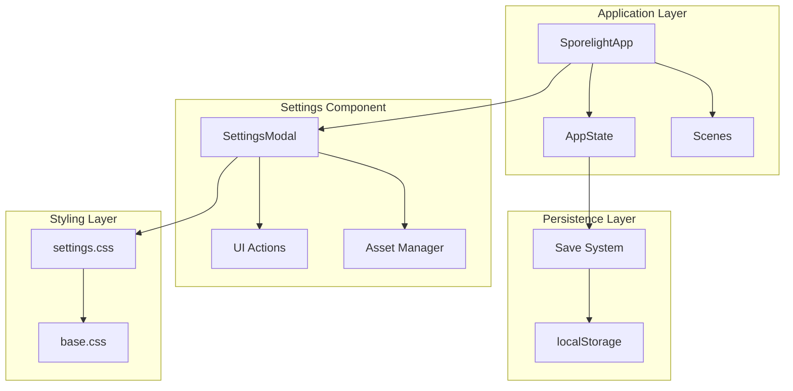
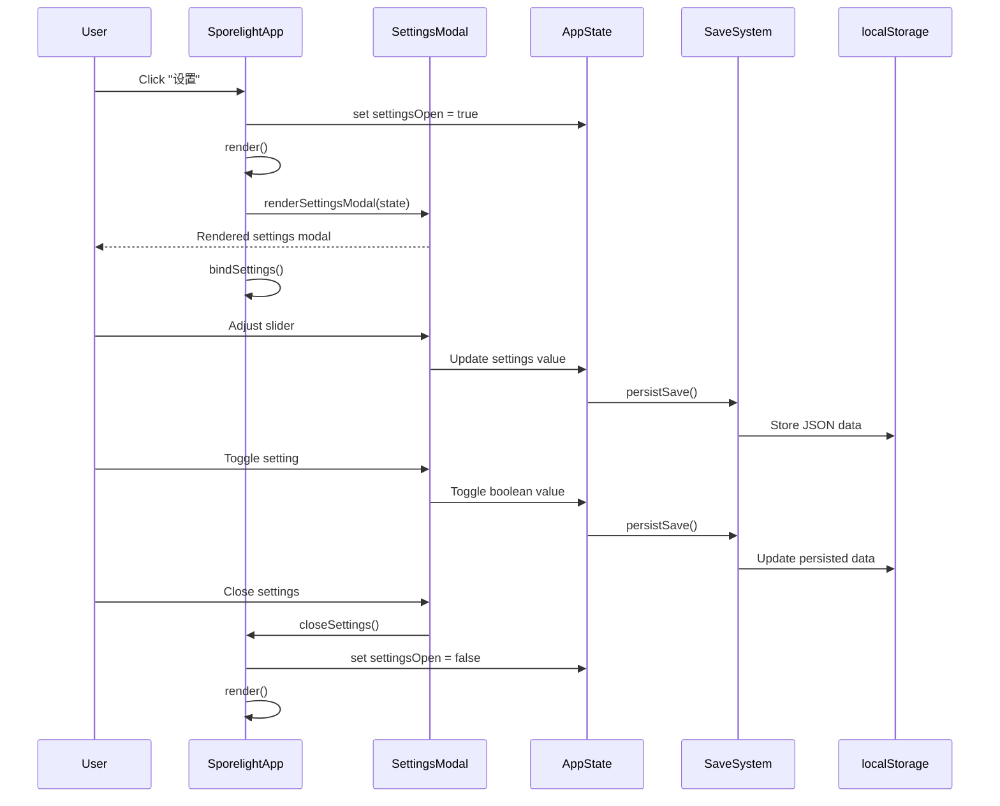
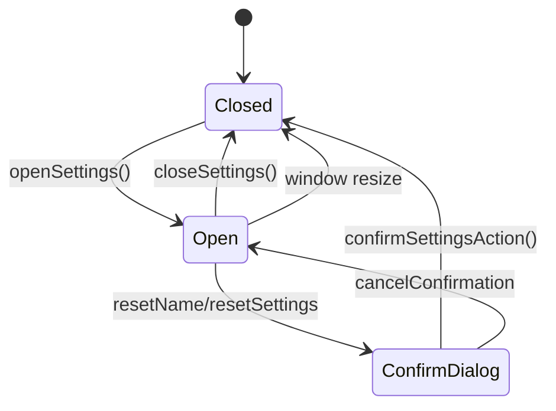
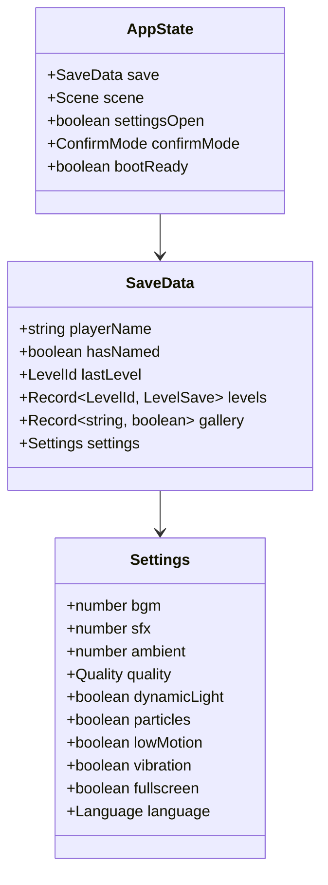
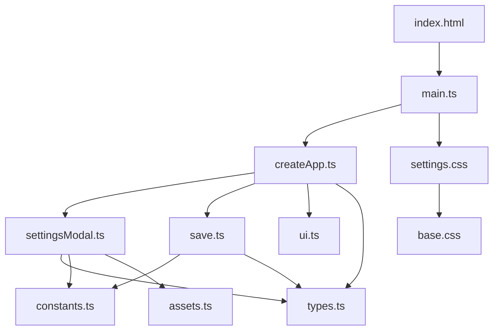

# Settings Modal

<cite>
**Referenced Files in This Document**
- [settingsModal.ts](file://src/app/components/settingsModal.ts)
- [settings.css](file://src/styles/settings.css)
- [save.ts](file://src/app/save.ts)
- [types.ts](file://src/app/types.ts)
- [createApp.ts](file://src/app/createApp.ts)
- [ui.ts](file://src/app/ui.ts)
- [assets.ts](file://src/app/assets.ts)
- [constants.ts](file://src/app/constants.ts)
- [main.ts](file://src/main.ts)
- [index.html](file://index.html)
</cite>

## Table of Contents
1. [Introduction](#introduction)
2. [Project Structure](#project-structure)
3. [Core Components](#core-components)
4. [Architecture Overview](#architecture-overview)
5. [Detailed Component Analysis](#detailed-component-analysis)
6. [Dependency Analysis](#dependency-analysis)
7. [Performance Considerations](#performance-considerations)
8. [Troubleshooting Guide](#troubleshooting-guide)
9. [Conclusion](#conclusion)

## Introduction
This document provides comprehensive documentation for the settings modal implementation in the Sporelight application. It covers the settings interface design, audio configuration controls, visual effect toggles, quality settings management, accessibility options, modal lifecycle, state management, CSS styling approach, responsive behavior, settings data structure, event handling for configuration changes, persistence across sessions, and the relationship between the settings modal and global application preferences.

## Project Structure
The settings modal is implemented as a standalone component that integrates with the main application through a central state management system. The component renders a layered modal UI with audio, video, operation, and general settings sections. It uses CSS Grid for layout, custom animations for visual polish, and integrates with the application's save system for persistence.

**Diagram sources**
- [createApp.ts:22-377](file://src/app/createApp.ts#L22-L377)
- [settingsModal.ts:10-118](file://src/app/components/settingsModal.ts#L10-L118)
- [save.ts:49-66](file://src/app/save.ts#L49-L66)

**Section sources**
- [createApp.ts:16-63](file://src/app/createApp.ts#L16-L63)
- [settingsModal.ts:1-158](file://src/app/components/settingsModal.ts#L1-L158)

## Core Components
The settings modal consists of several key components that work together to provide a comprehensive configuration interface:

### Settings Data Structure
The settings system manages configuration through a structured data model that persists across application sessions. The data structure includes:

- Audio settings: BGM, SFX, and ambient sound volumes
- Visual effects: Dynamic lighting, particle effects, and low motion mode
- Quality settings: Soft, standard, and HD quality modes
- Accessibility: Vibration feedback and fullscreen mode
- Localization: Language selection
- Operation: Hint frequency and dialog speed controls

### Settings Rendering Functions
The component provides specialized rendering functions for different control types:
- Slider controls for volume adjustments
- Toggle switches for boolean settings
- Quality tabs for resolution settings
- Dropdown selectors for language and hint frequency

### Event Handling System
The settings modal implements a robust event handling system that captures user interactions and updates the application state accordingly. Events are bound dynamically when the modal opens and unbound when it closes.

**Section sources**
- [types.ts:13-44](file://src/app/types.ts#L13-L44)
- [save.ts:4-37](file://src/app/save.ts#L4-L37)
- [settingsModal.ts:120-141](file://src/app/components/settingsModal.ts#L120-L141)

## Architecture Overview
The settings modal follows a component-based architecture with clear separation of concerns between rendering, state management, and persistence.

**Diagram sources**
- [createApp.ts:111-163](file://src/app/createApp.ts#L111-L163)
- [settingsModal.ts:10-118](file://src/app/components/settingsModal.ts#L10-L118)
- [save.ts:64-66](file://src/app/save.ts#L64-L66)

## Detailed Component Analysis

### Settings Modal Component
The settings modal is implemented as a pure rendering function that generates HTML markup based on the current application state. It uses template literals to create a structured layout with accessibility attributes and ARIA labels.

#### Interface Design Elements
The modal features a comprehensive settings interface organized into four main categories:

**Audio Configuration Controls**
- Background music slider (0-100% volume)
- Sound effects slider (0-100% volume)
- Ambient sound slider (0-100% volume)
- Real-time percentage display updates

**Visual Effect Toggles**
- Dynamic light effects toggle
- Particle effects toggle
- Low motion mode toggle
- Immediate visual feedback through CSS classes

**Quality Settings Management**
- Three quality tiers: soft, standard, hd
- Visual indication of current selection
- Responsive layout adaptation

**Operation and General Settings**
- Language selection dropdown (Chinese Simplified, Traditional, English)
- Hint frequency control (moderate, less frequent, frequent)
- Dialog speed adjustment (slow, standard, fast)
- Vibration feedback toggle
- Fullscreen mode toggle

#### Modal Lifecycle Management
The modal lifecycle is tightly integrated with the application state:

**Diagram sources**
- [createApp.ts:219-249](file://src/app/createApp.ts#L219-L249)
- [settingsModal.ts:143-157](file://src/app/components/settingsModal.ts#L143-L157)

#### Event Handling Implementation
The settings modal implements sophisticated event handling through the `bindSettings` method:

**Slider Event Handling**
- Listens for input events on all slider controls
- Updates state values in real-time
- Provides immediate visual feedback
- Persists changes to localStorage

**Toggle Switch Events**
- Handles click events for boolean settings
- Toggles state values immediately
- Updates visual state through CSS classes
- Re-renders affected sections

**Quality Selection Events**
- Manages tab-based quality selection
- Updates active state indicators
- Persists quality preference

**Form Control Events**
- Handles language dropdown changes
- Updates localization settings
- Persists language preference

**Section sources**
- [createApp.ts:111-163](file://src/app/createApp.ts#L111-L163)
- [settingsModal.ts:10-118](file://src/app/components/settingsModal.ts#L10-L118)

### CSS Styling Approach
The settings modal employs a comprehensive CSS architecture with modern layout techniques and responsive design principles.

#### Layout Architecture
The modal uses CSS Grid for precise layout control:

**Main Container Structure**
- Fixed positioning with backdrop blur effect
- Radial gradient background with decorative elements
- Responsive sizing with min/max constraints
- Animation transitions for modal entrance

**Content Organization**
- Two-column layout for desktop (sidebar + content)
- Single-column layout for mobile devices
- Grid-based card system for settings sections
- Flexible spacing with gap properties

#### Form Control Styling
Custom-styled form controls provide enhanced user experience:

**Slider Controls**
- Cross-browser compatible track and thumb styling
- Gradient backgrounds for visual appeal
- Custom thumb design with shadow effects
- Percentage display integration

**Toggle Switches**
- Smooth sliding animation for state changes
- Visual state indicators ("on/off" labels)
- Shadow effects for depth perception
- Active state styling

**Quality Tabs**
- Rounded tab design with gradient backgrounds
- Active state highlighting
- Consistent sizing and spacing

#### Responsive Behavior
The modal adapts seamlessly to different screen sizes:

**Desktop Layout**
- Fixed sidebar with character illustration
- Multi-column content area
- Optimized spacing and typography
- Full modal dimensions

**Mobile Adaptation**
- Single-column layout switching
- Reduced modal dimensions
- Adjusted character illustration scaling
- Reorganized form controls

**Section sources**
- [settings.css:1-660](file://src/styles/settings.css#L1-L660)

### State Management Integration
The settings modal integrates deeply with the application's state management system:

#### Application State Structure
The AppState interface defines the complete state model:

**Diagram sources**
- [types.ts:38-44](file://src/app/types.ts#L38-L44)
- [types.ts:13-31](file://src/app/types.ts#L13-L31)

#### Persistence Mechanism
The save system provides robust data persistence:

**Default Configuration**
- Comprehensive default settings for new players
- Balanced audio levels and visual defaults
- Language set to Simplified Chinese by default

**Merge Strategy**
- Merges saved data with defaults
- Preserves unknown fields
- Maintains backward compatibility

**Storage Integration**
- Uses localStorage for persistent storage
- JSON serialization for data transfer
- Error handling for corrupted data

**Section sources**
- [save.ts:4-66](file://src/app/save.ts#L4-L66)
- [types.ts:13-44](file://src/app/types.ts#L13-L44)

### Accessibility Features
The settings modal implements several accessibility enhancements:

#### Semantic Markup
- Proper heading hierarchy for screen readers
- ARIA attributes for modal dialog
- Accessible button labels and roles
- Focus management for keyboard navigation

#### Visual Accessibility
- High contrast color schemes
- Clear visual indicators for states
- Sufficient touch target sizes
- Responsive typography scaling

#### Interaction Accessibility
- Keyboard navigable controls
- Screen reader friendly labels
- Focus outlines for interactive elements
- Reduced motion support

## Dependency Analysis

**Diagram sources**
- [settingsModal.ts:1-3](file://src/app/components/settingsModal.ts#L1-L3)
- [createApp.ts:1-14](file://src/app/createApp.ts#L1-L14)
- [save.ts:1-2](file://src/app/save.ts#L1-L2)

The settings modal has minimal external dependencies, relying primarily on:
- Type definitions for compile-time safety
- Asset management for UI resources
- Application state for data binding
- CSS for styling and animations

**Section sources**
- [settingsModal.ts:1-3](file://src/app/components/settingsModal.ts#L1-L3)
- [createApp.ts:1-14](file://src/app/createApp.ts#L1-L14)
- [save.ts:1-2](file://src/app/save.ts#L1-L2)

## Performance Considerations
The settings modal is designed with performance optimization in mind:

### Rendering Efficiency
- Pure rendering function avoids unnecessary re-renders
- Conditional rendering based on settingsOpen state
- Efficient DOM manipulation through querySelectorAll
- Minimal memory footprint with event delegation

### Event Handling Optimization
- Dynamic event binding/unbinding to prevent memory leaks
- Efficient selector usage with dataset attributes
- Debounced updates for slider controls
- Batched state updates for multiple changes

### Resource Management
- Lazy loading of asset images
- CSS animations for smooth transitions
- Efficient grid layout for responsive design
- Minimal JavaScript bundle size

## Troubleshooting Guide

### Common Issues and Solutions

**Settings Not Persisting**
- Verify localStorage availability in browser
- Check for JSON parsing errors during load
- Ensure SAVE_KEY constant matches expected value
- Validate data structure compatibility

**Event Handlers Not Working**
- Confirm modal is properly bound to settings
- Check for conflicting event listeners
- Verify dataset attributes match selectors
- Ensure proper timing of event binding

**Styling Issues**
- Validate CSS Grid support in target browsers
- Check for missing asset paths
- Verify responsive breakpoint calculations
- Ensure proper z-index stacking order

**Accessibility Problems**
- Test with screen readers and keyboard navigation
- Verify ARIA attributes and roles
- Check color contrast ratios
- Validate focus management

**Section sources**
- [save.ts:49-66](file://src/app/save.ts#L49-L66)
- [createApp.ts:111-163](file://src/app/createApp.ts#L111-L163)
- [settings.css:609-660](file://src/styles/settings.css#L609-L660)

## Conclusion
The settings modal implementation demonstrates a well-architected solution for managing application preferences in the Sporelight game. The component provides a comprehensive configuration interface with intuitive controls, robust state management, and seamless integration with the application's persistence layer. The modular design allows for easy maintenance and future enhancements while maintaining excellent performance and accessibility standards.

The implementation successfully balances user experience with technical excellence, providing a foundation for extending settings functionality as the application evolves. The clear separation of concerns between rendering, state management, and persistence ensures maintainability and scalability for future feature additions.