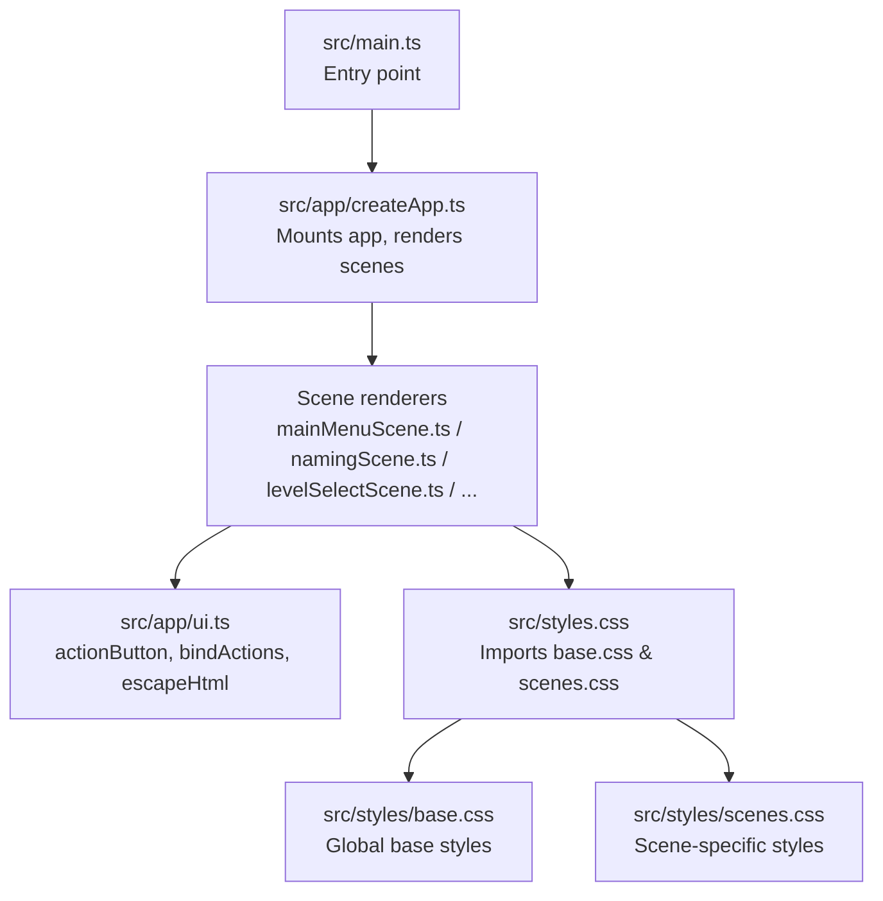
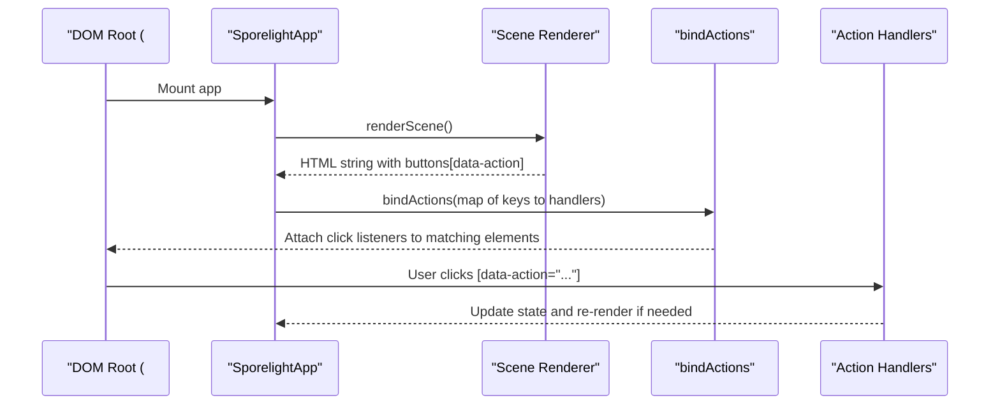
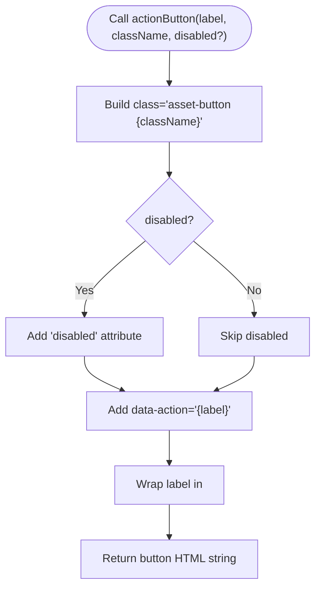
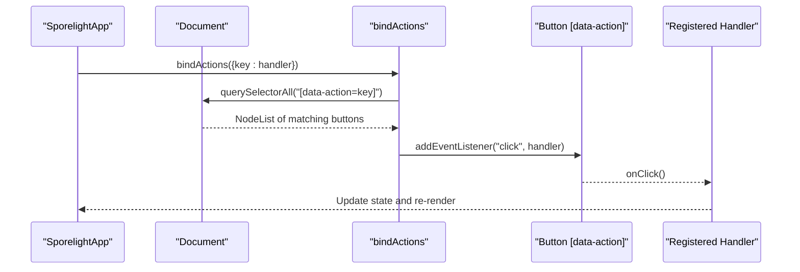
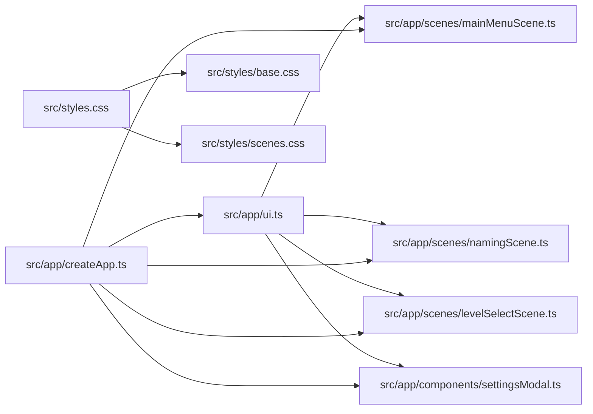

# UI Components

<cite>
**Referenced Files in This Document**
- [src/app/ui.ts](file://src/app/ui.ts)
- [src/app/createApp.ts](file://src/app/createApp.ts)
- [src/app/scenes/mainMenuScene.ts](file://src/app/scenes/mainMenuScene.ts)
- [src/app/scenes/namingScene.ts](file://src/app/scenes/namingScene.ts)
- [src/app/scenes/levelSelectScene.ts](file://src/app/scenes/levelSelectScene.ts)
- [src/app/components/settingsModal.ts](file://src/app/components/settingsModal.ts)
- [src/styles/base.css](file://src/styles/base.css)
- [src/styles/scenes.css](file://src/styles/scenes.css)
- [src/main.ts](file://src/main.ts)
- [src/styles.css](file://src/styles.css)
</cite>

## Table of Contents
1. [Introduction](#introduction)
2. [Project Structure](#project-structure)
3. [Core Components](#core-components)
4. [Architecture Overview](#architecture-overview)
5. [Detailed Component Analysis](#detailed-component-analysis)
6. [Dependency Analysis](#dependency-analysis)
7. [Performance Considerations](#performance-considerations)
8. [Troubleshooting Guide](#troubleshooting-guide)
9. [Conclusion](#conclusion)

## Introduction
This document explains SporeLight’s UI component system with a focus on:
- The actionButton factory for creating interactive buttons with asset classes and data-action attributes
- The bindActions mechanism for event delegation and action binding patterns
- The escapeHtml utility for XSS prevention and secure HTML rendering
- The responsive button design system and CSS class naming conventions
- How UI components integrate with the scene-based UI architecture

It also provides practical examples of button creation, action binding, and security implementation patterns used across the application.

## Project Structure
SporeLight organizes UI logic into small, reusable utilities and scene-specific renderers:
- UI utilities live under src/app/ui.ts and export helpers for button markup, event binding, and sanitization
- Scenes (boot, naming, main menu, level select, result, gallery) render screen-specific HTML and embed action-bound buttons
- The global app orchestrator (src/app/createApp.ts) mounts the application, renders the current scene, and binds actions per scene
- Styles are split into base.css and scenes.css, with global styles.css importing them



**Diagram sources**
- [src/main.ts:1-11](file://src/main.ts#L1-L11)
- [src/app/createApp.ts:1-377](file://src/app/createApp.ts#L1-L377)
- [src/app/ui.ts:1-16](file://src/app/ui.ts#L1-L16)
- [src/styles.css:1-5](file://src/styles.css#L1-L5)
- [src/styles/base.css:1-190](file://src/styles/base.css#L1-L190)
- [src/styles/scenes.css:1-452](file://src/styles/scenes.css#L1-L452)

**Section sources**
- [src/main.ts:1-11](file://src/main.ts#L1-L11)
- [src/app/createApp.ts:16-82](file://src/app/createApp.ts#L16-L82)
- [src/styles.css:1-5](file://src/styles.css#L1-L5)

## Core Components
This section documents the three core UI utilities and their roles in the system.

- actionButton(label, className, disabled?)
  - Purpose: Produces a button element with standardized asset-button class, a custom class slot, optional disabled state, and a data-action attribute
  - Typical usage: Render buttons inside scene templates with semantic labels that match bindActions keys
  - Example usage paths:
    - [src/app/scenes/mainMenuScene.ts:16-19](file://src/app/scenes/mainMenuScene.ts#L16-L19)
    - [src/app/scenes/levelSelectScene.ts:31](file://src/app/scenes/levelSelectScene.ts#L31)

- bindActions(actions)
  - Purpose: Event delegation binder that attaches click handlers to elements whose data-action matches keys in the provided actions map
  - Pattern: Call once per scene after rendering to wire up all action handlers
  - Example usage paths:
    - [src/app/createApp.ts:84-109](file://src/app/createApp.ts#L84-L109) — scene actions
    - [src/app/createApp.ts:111-163](file://src/app/createApp.ts#L111-L163) — settings modal actions and DOM listeners

- escapeHtml(value)
  - Purpose: Sanitizes user-provided text to prevent XSS during HTML insertion
  - Typical usage: Escape dynamic content inserted into innerHTML contexts
  - Example usage paths:
    - [src/app/scenes/mainMenuScene.ts:13](file://src/app/scenes/mainMenuScene.ts#L13)
    - [src/app/scenes/namingScene.ts:21](file://src/app/scenes/namingScene.ts#L21)

**Section sources**
- [src/app/ui.ts:1-16](file://src/app/ui.ts#L1-L16)
- [src/app/createApp.ts:84-109](file://src/app/createApp.ts#L84-L109)
- [src/app/createApp.ts:111-163](file://src/app/createApp.ts#L111-L163)
- [src/app/scenes/mainMenuScene.ts:13-19](file://src/app/scenes/mainMenuScene.ts#L13-L19)
- [src/app/scenes/namingScene.ts:21](file://src/app/scenes/namingScene.ts#L21)

## Architecture Overview
The UI architecture follows a scene-driven pattern:
- The app mounts and renders a single “screen” per scene
- Each scene renderer returns a template string containing buttons with data-action attributes
- After rendering, the app calls bindActions with a map of action keys to handlers
- Some settings and toggles use direct DOM queries and listeners alongside bindActions



**Diagram sources**
- [src/app/createApp.ts:38-82](file://src/app/createApp.ts#L38-L82)
- [src/app/createApp.ts:84-109](file://src/app/createApp.ts#L84-L109)
- [src/app/ui.ts:5-11](file://src/app/ui.ts#L5-L11)

## Detailed Component Analysis

### actionButton Function
- Design: Returns a button with class "asset-button" plus a custom class slot, optional disabled attribute, and data-action set to the label
- Intent: Standardize button appearance and semantics while enabling centralized event binding via data-action
- Usage patterns:
  - Primary and secondary buttons across scenes
  - Conditional disabled states based on game state
- Example paths:
  - [src/app/scenes/mainMenuScene.ts:16-19](file://src/app/scenes/mainMenuScene.ts#L16-L19)
  - [src/app/scenes/levelSelectScene.ts:31](file://src/app/scenes/levelSelectScene.ts#L31)



**Diagram sources**
- [src/app/ui.ts:1-3](file://src/app/ui.ts#L1-L3)

**Section sources**
- [src/app/ui.ts:1-3](file://src/app/ui.ts#L1-L3)
- [src/app/scenes/mainMenuScene.ts:16-19](file://src/app/scenes/mainMenuScene.ts#L16-L19)
- [src/app/scenes/levelSelectScene.ts:31](file://src/app/scenes/levelSelectScene.ts#L31)

### bindActions Mechanism
- Design: Iterates over an actions map and attaches click listeners to all elements matching [data-action=key]
- Benefits:
  - Centralized action registration per scene
  - Declarative UI-to-behavior binding via data-action
  - Clean separation between rendering and event wiring
- Usage patterns:
  - Scene actions bound after renderScene()
  - Settings modal actions bound separately with additional DOM listeners
- Example paths:
  - [src/app/createApp.ts:84-109](file://src/app/createApp.ts#L84-L109)
  - [src/app/createApp.ts:111-163](file://src/app/createApp.ts#L111-L163)



**Diagram sources**
- [src/app/ui.ts:5-11](file://src/app/ui.ts#L5-L11)
- [src/app/createApp.ts:84-109](file://src/app/createApp.ts#L84-L109)

**Section sources**
- [src/app/ui.ts:5-11](file://src/app/ui.ts#L5-L11)
- [src/app/createApp.ts:84-109](file://src/app/createApp.ts#L84-L109)
- [src/app/createApp.ts:111-163](file://src/app/createApp.ts#L111-L163)

### escapeHtml Utility
- Design: Replaces potentially dangerous characters (& < > " ') with HTML entities to prevent XSS in innerHTML contexts
- Usage patterns:
  - Inserting player name into menus and forms
  - Rendering dynamic content safely
- Example paths:
  - [src/app/scenes/mainMenuScene.ts:13](file://src/app/scenes/mainMenuScene.ts#L13)
  - [src/app/scenes/namingScene.ts:21](file://src/app/scenes/namingScene.ts#L21)

```mermaid
flowchart TD
Start(["escapeHtml(value)"]) --> ReplaceAmp["Replace '&' with '&amp;'"]
ReplaceAmp --> ReplaceLt["Replace '<' with '&lt;'"]
ReplaceLt --> ReplaceGt["Replace '>' with '&gt;'"]
ReplaceGt --> ReplaceDq["Replace '\"' with '&quot;'"]
ReplaceDq --> ReplaceSq["Replace ''' with '&#039;'"]
ReplaceSq --> ReturnSafe["Return sanitized string"]
```

**Diagram sources**
- [src/app/ui.ts:13-15](file://src/app/ui.ts#L13-L15)

**Section sources**
- [src/app/ui.ts:13-15](file://src/app/ui.ts#L13-L15)
- [src/app/scenes/mainMenuScene.ts:13](file://src/app/scenes/mainMenuScene.ts#L13)
- [src/app/scenes/namingScene.ts:21](file://src/app/scenes/namingScene.ts#L21)

### Responsive Button Design System and CSS Conventions
- Asset-button foundation:
  - Buttons share the "asset-button" base class for consistent visuals and interactions
  - Additional sizing and layout classes are applied per use case
- Common button classes:
  - "asset-button" (base)
  - "small-gem", "primary-gem" (sizes and prominence)
  - "level-enter", "hud-button", "round-nav" (scene-specific roles)
- Responsive behavior:
  - Media queries adjust layouts for smaller screens, ensuring buttons remain usable
  - Grids and gaps adapt to viewport constraints
- Example paths:
  - [src/styles/base.css:107-138](file://src/styles/base.css#L107-L138)
  - [src/styles/scenes.css:104-115](file://src/styles/scenes.css#L104-L115)
  - [src/styles/scenes.css:153-164](file://src/styles/scenes.css#L153-L164)
  - [src/styles/scenes.css:398-451](file://src/styles/scenes.css#L398-L451)

```mermaid
classDiagram
class BaseButton {
"+asset-button"
"+cursor : pointer"
"+transition effects"
"+disabled state handling"
}
class SmallGem {
"+height : 44px"
"+padding : 0 18px"
}
class PrimaryGem {
"+min-width : 190px"
"+height : 58px"
"+margin-top : 18px"
"+padding : 0 34px"
"+font-size : 20px"
}
class LevelEnter {
"+height : 44px"
"+padding : 0 20px"
}
class RoundNav {
"+position : absolute"
"+z-index : 4"
"+top : 30px"
"+height : 44px"
"+padding : 0 22px"
}
class HUDButton {
"+height : 46px"
"+padding : 0 22px"
}
BaseButton <|-- SmallGem
BaseButton <|-- PrimaryGem
BaseButton <|-- LevelEnter
BaseButton <|-- RoundNav
BaseButton <|-- HUDButton
```

**Diagram sources**
- [src/styles/base.css:107-138](file://src/styles/base.css#L107-L138)
- [src/styles/scenes.css:104-115](file://src/styles/scenes.css#L104-L115)
- [src/styles/scenes.css:153-164](file://src/styles/scenes.css#L153-L164)
- [src/styles/scenes.css:284-288](file://src/styles/scenes.css#L284-L288)
- [src/styles/scenes.css:158-172](file://src/styles/scenes.css#L158-L172)

**Section sources**
- [src/styles/base.css:107-138](file://src/styles/base.css#L107-L138)
- [src/styles/scenes.css:104-115](file://src/styles/scenes.css#L104-L115)
- [src/styles/scenes.css:153-164](file://src/styles/scenes.css#L153-L164)
- [src/styles/scenes.css:284-288](file://src/styles/scenes.css#L284-L288)
- [src/styles/scenes.css:158-172](file://src/styles/scenes.css#L158-L172)
- [src/styles/scenes.css:398-451](file://src/styles/scenes.css#L398-L451)

### Scene Integration Patterns
- Naming scene:
  - Uses escapeHtml to render the player name safely
  - Uses data-action attributes for form actions
  - Example paths:
    - [src/app/scenes/namingScene.ts:13](file://src/app/scenes/namingScene.ts#L13)
    - [src/app/scenes/namingScene.ts:27-31](file://src/app/scenes/namingScene.ts#L27-L31)
- Main menu scene:
  - Uses actionButton to build primary navigation buttons
  - Example paths:
    - [src/app/scenes/mainMenuScene.ts:16-19](file://src/app/scenes/mainMenuScene.ts#L16-L19)
- Level select scene:
  - Uses actionButton for level enter buttons with conditional disabled logic
  - Example paths:
    - [src/app/scenes/levelSelectScene.ts:31](file://src/app/scenes/levelSelectScene.ts#L31)
- Settings modal:
  - Uses data-action attributes for modal controls and confirmation dialogs
  - Uses direct DOM listeners for sliders, toggles, and quality tabs
  - Example paths:
    - [src/app/components/settingsModal.ts:14, 99-110, 143-156:14-156](file://src/app/components/settingsModal.ts#L14-L156)
    - [src/app/createApp.ts:111-163](file://src/app/createApp.ts#L111-L163)

**Section sources**
- [src/app/scenes/namingScene.ts:13](file://src/app/scenes/namingScene.ts#L13)
- [src/app/scenes/namingScene.ts:27-31](file://src/app/scenes/namingScene.ts#L27-L31)
- [src/app/scenes/mainMenuScene.ts:16-19](file://src/app/scenes/mainMenuScene.ts#L16-L19)
- [src/app/scenes/levelSelectScene.ts:31](file://src/app/scenes/levelSelectScene.ts#L31)
- [src/app/components/settingsModal.ts:14, 99-110, 143-156:14-156](file://src/app/components/settingsModal.ts#L14-L156)
- [src/app/createApp.ts:111-163](file://src/app/createApp.ts#L111-L163)

## Dependency Analysis
The UI system exhibits clean separation of concerns:
- src/app/ui.ts is a standalone utility module consumed by scene renderers and the app orchestrator
- src/app/createApp.ts depends on ui.ts and scene renderers to assemble the UI
- Styles are imported globally and scoped to scenes via class selectors



**Diagram sources**
- [src/app/ui.ts:1-16](file://src/app/ui.ts#L1-L16)
- [src/app/createApp.ts:1-377](file://src/app/createApp.ts#L1-L377)
- [src/app/scenes/mainMenuScene.ts:1-24](file://src/app/scenes/mainMenuScene.ts#L1-L24)
- [src/app/scenes/namingScene.ts:1-36](file://src/app/scenes/namingScene.ts#L1-L36)
- [src/app/scenes/levelSelectScene.ts:1-39](file://src/app/scenes/levelSelectScene.ts#L1-L39)
- [src/app/components/settingsModal.ts:1-158](file://src/app/components/settingsModal.ts#L1-L158)
- [src/styles.css:1-5](file://src/styles.css#L1-L5)
- [src/styles/base.css:1-190](file://src/styles/base.css#L1-L190)
- [src/styles/scenes.css:1-452](file://src/styles/scenes.css#L1-L452)

**Section sources**
- [src/app/ui.ts:1-16](file://src/app/ui.ts#L1-L16)
- [src/app/createApp.ts:1-377](file://src/app/createApp.ts#L1-L377)
- [src/styles.css:1-5](file://src/styles.css#L1-L5)

## Performance Considerations
- Event delegation with bindActions minimizes listener overhead by attaching a single handler per action key
- Using data-action attributes allows batch binding after rendering, reducing repeated DOM queries
- CSS transitions and transforms are hardware-accelerated where supported, aiding smooth interactions
- Media queries ensure optimal layout scaling without heavy JavaScript calculations

[No sources needed since this section provides general guidance]

## Troubleshooting Guide
Common issues and resolutions:
- Buttons not responding
  - Verify that the button’s data-action value matches a registered key in bindActions
  - Confirm that bindActions is called after rendering the scene
  - References:
    - [src/app/ui.ts:5-11](file://src/app/ui.ts#L5-L11)
    - [src/app/createApp.ts:84-109](file://src/app/createApp.ts#L84-L109)
- Unsafe content in UI
  - Ensure dynamic text is passed through escapeHtml before insertion
  - References:
    - [src/app/ui.ts:13-15](file://src/app/ui.ts#L13-L15)
    - [src/app/scenes/mainMenuScene.ts:13](file://src/app/scenes/mainMenuScene.ts#L13)
    - [src/app/scenes/namingScene.ts:21](file://src/app/scenes/namingScene.ts#L21)
- Disabled buttons not visually distinct
  - Confirm the disabled attribute is applied and that base.css handles disabled styles
  - References:
    - [src/app/ui.ts:1-3](file://src/app/ui.ts#L1-L3)
    - [src/styles/base.css:42-46](file://src/styles/base.css#L42-L46)
- Layout shifts on small screens
  - Check media query breakpoints and ensure appropriate classes are applied
  - References:
    - [src/styles/scenes.css:398-451](file://src/styles/scenes.css#L398-L451)

**Section sources**
- [src/app/ui.ts:5-11](file://src/app/ui.ts#L5-L11)
- [src/app/createApp.ts:84-109](file://src/app/createApp.ts#L84-L109)
- [src/app/ui.ts:13-15](file://src/app/ui.ts#L13-L15)
- [src/app/scenes/mainMenuScene.ts:13](file://src/app/scenes/mainMenuScene.ts#L13)
- [src/app/scenes/namingScene.ts:21](file://src/app/scenes/namingScene.ts#L21)
- [src/app/ui.ts:1-3](file://src/app/ui.ts#L1-L3)
- [src/styles/base.css:42-46](file://src/styles/base.css#L42-L46)
- [src/styles/scenes.css:398-451](file://src/styles/scenes.css#L398-L451)

## Conclusion
SporeLight’s UI system combines a small set of focused utilities with a scene-driven rendering model:
- actionButton standardizes button creation with asset classes and data-action semantics
- bindActions enables declarative, centralized event binding
- escapeHtml ensures safe rendering of dynamic content
- A responsive design system built on shared CSS classes scales gracefully across devices
Together, these patterns deliver a maintainable, secure, and extensible UI architecture.