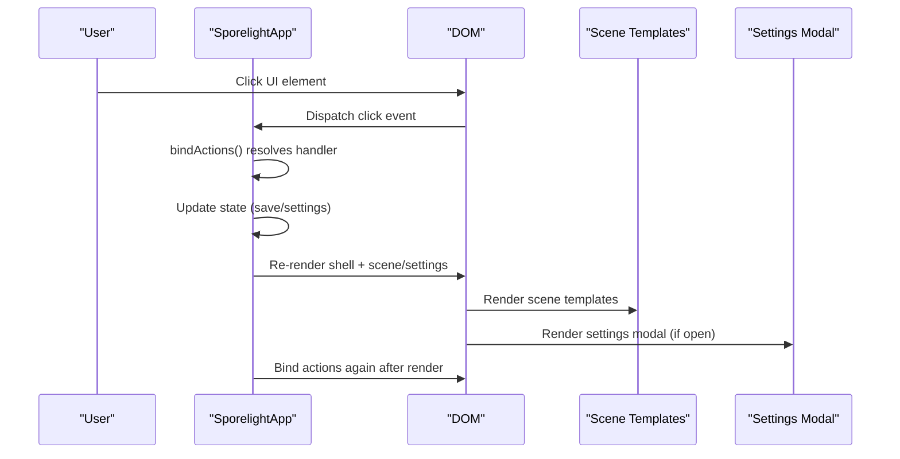
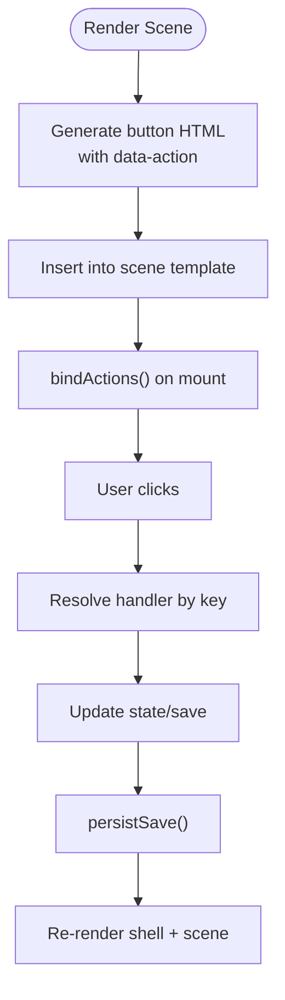
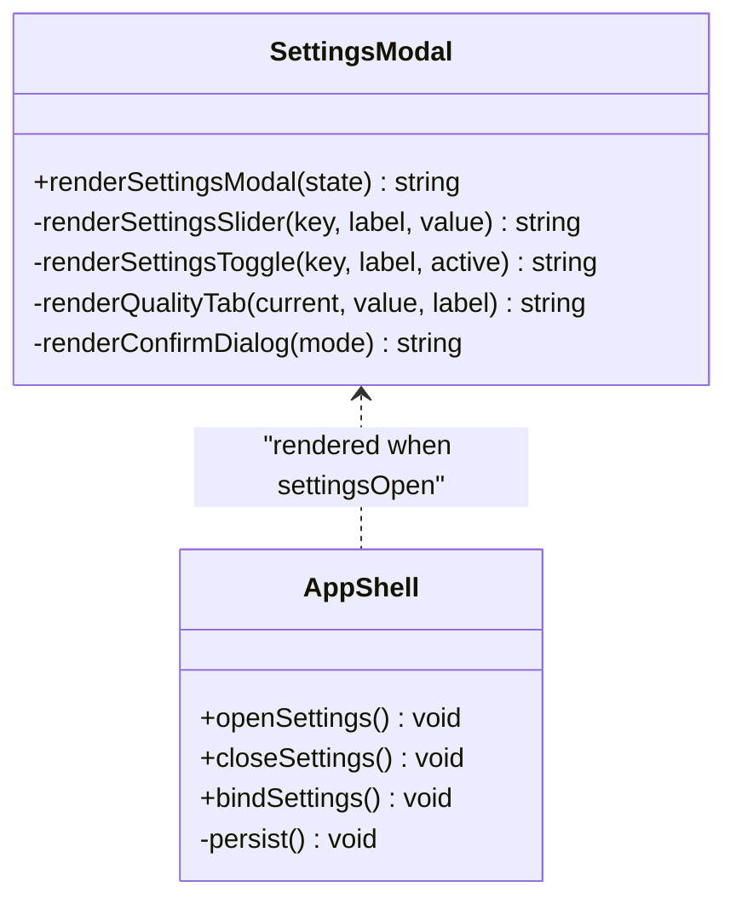
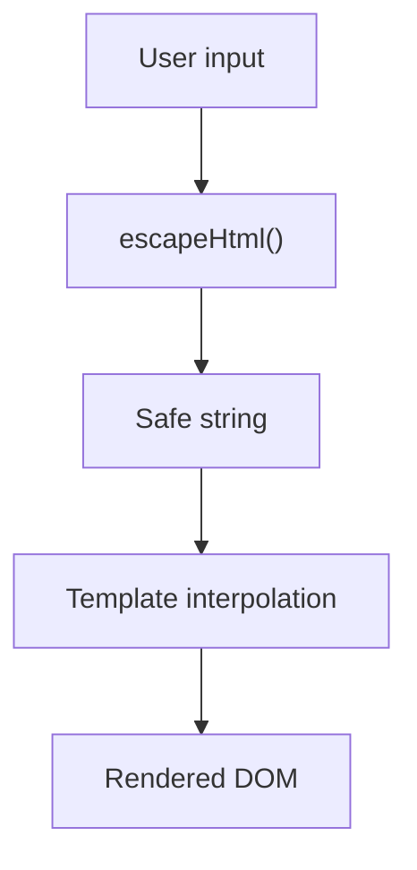
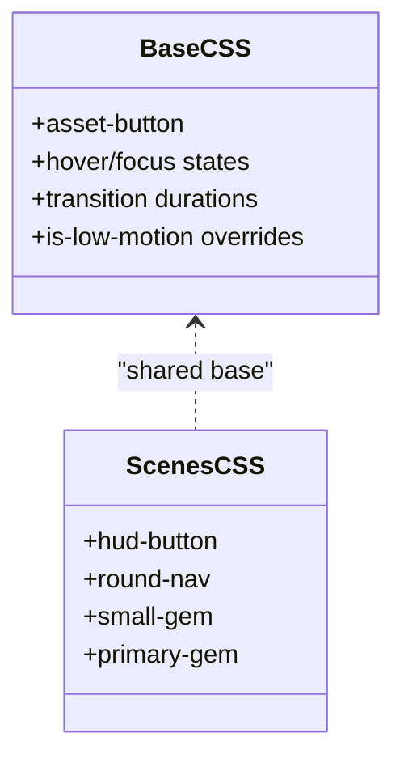
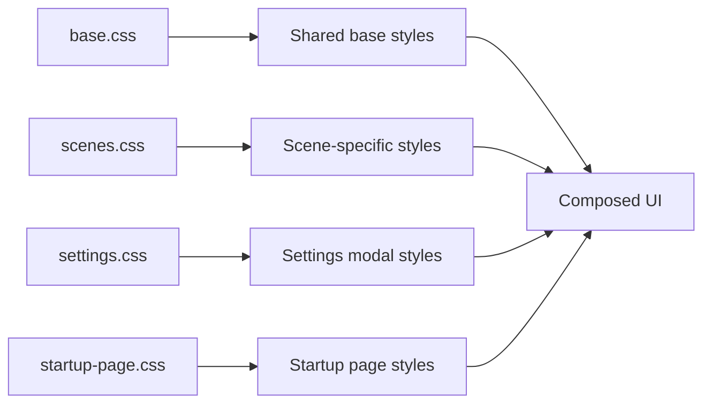
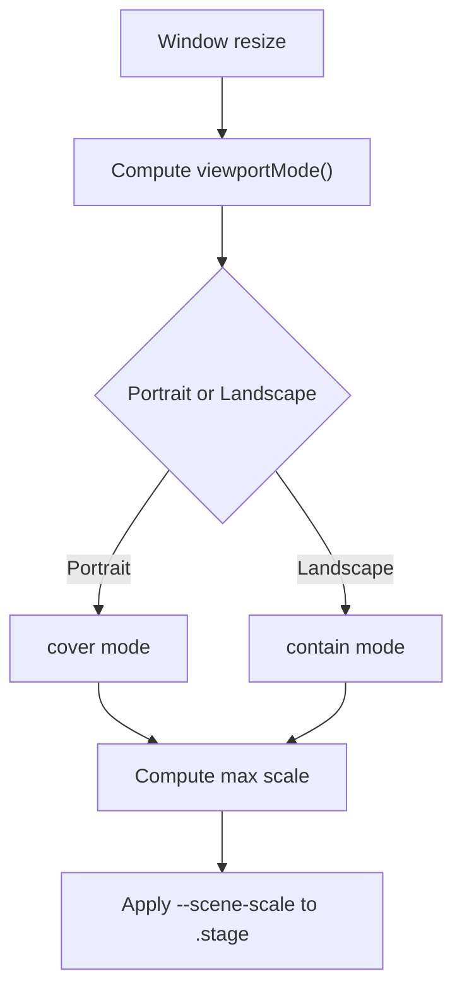
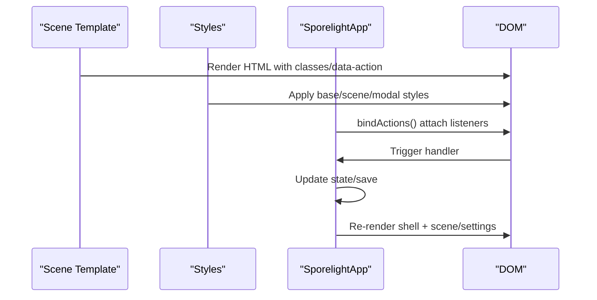
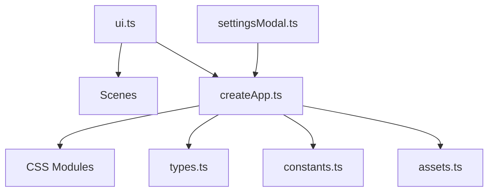

# User Interface System

<cite>
**Referenced Files in This Document**
- [src/app/ui.ts](file://src/app/ui.ts)
- [src/app/components/settingsModal.ts](file://src/app/components/settingsModal.ts)
- [src/styles/base.css](file://src/styles/base.css)
- [src/styles/scenes.css](file://src/styles/scenes.css)
- [src/styles/settings.css](file://src/styles/settings.css)
- [src/styles/startup-page.css](file://src/styles/startup-page.css)
- [src/app/createApp.ts](file://src/app/createApp.ts)
- [src/app/types.ts](file://src/app/types.ts)
- [src/app/assets.ts](file://src/app/assets.ts)
- [src/app/constants.ts](file://src/app/constants.ts)
- [src/app/scenes/bootScene.ts](file://src/app/scenes/bootScene.ts)
- [src/app/scenes/namingScene.ts](file://src/app/scenes/namingScene.ts)
- [src/app/scenes/mainMenuScene.ts](file://src/app/scenes/mainMenuScene.ts)
- [src/app/scenes/levelSelectScene.ts](file://src/app/scenes/levelSelectScene.ts)
- [src/app/scenes/gameScene.ts](file://src/app/scenes/gameScene.ts)
- [src/app/scenes/resultScene.ts](file://src/app/scenes/resultScene.ts)
- [src/app/scenes/galleryScene.ts](file://src/app/scenes/galleryScene.ts)
</cite>

## Table of Contents
1. [Introduction](#introduction)
2. [Project Structure](#project-structure)
3. [Core Components](#core-components)
4. [Architecture Overview](#architecture-overview)
5. [Detailed Component Analysis](#detailed-component-analysis)
6. [Dependency Analysis](#dependency-analysis)
7. [Performance Considerations](#performance-considerations)
8. [Troubleshooting Guide](#troubleshooting-guide)
9. [Conclusion](#conclusion)
10. [Appendices](#appendices)

## Introduction
This document describes SporeLight’s user interface system. It covers the UI component architecture, the button system design, action binding mechanisms, HTML escaping utilities, and responsive design patterns. It also documents the settings modal implementation, including audio configuration, visual effect controls, quality settings management, and accessibility options. Finally, it explains the CSS architecture—base styles, scene-specific styling, component-based CSS organization, and responsive design—and how TypeScript UI handlers integrate with CSS styling to manage scene-specific UI requirements.

## Project Structure
The UI system is organized around a small set of cohesive modules:
- UI utilities: reusable helpers for rendering buttons, binding actions, and escaping HTML.
- Settings modal: a self-contained component that renders and manages settings UI.
- Scenes: individual screens rendered as HTML templates with embedded UI actions.
- Styles: modular CSS files for base layout, scene-specific visuals, settings modal, and startup page.
- Application shell: orchestrates rendering, action binding, and viewport scaling.

```mermaid
graph TB
subgraph "UI Utilities"
UI["src/app/ui.ts"]
end
subgraph "Settings Modal"
SM["src/app/components/settingsModal.ts"]
end
subgraph "Scenes"
BS["src/app/scenes/bootScene.ts"]
NS["src/app/scenes/namingScene.ts"]
MS["src/app/scenes/mainMenuScene.ts"]
LS["src/app/scenes/levelSelectScene.ts"]
GS["src/app/scenes/gameScene.ts"]
RS["src/app/scenes/resultScene.ts"]
GLS["src/app/scenes/galleryScene.ts"]
end
subgraph "Styles"
BASE["src/styles/base.css"]
SCNS["src/styles/scenes.css"]
SETT["src/styles/settings.css"]
START["src/styles/startup-page.css"]
end
subgraph "App Shell"
APP["src/app/createApp.ts"]
TYPES["src/app/types.ts"]
CONST["src/app/constants.ts"]
ASSETS["src/app/assets.ts"]
end
APP --> UI
APP --> SM
APP --> BS
APP --> NS
APP --> MS
APP --> LS
APP --> GS
APP --> RS
APP --> GLS
APP --> BASE
APP --> SCNS
APP --> SETT
APP --> START
APP --> TYPES
APP --> CONST
APP --> ASSETS
```

**Diagram sources**
- [src/app/createApp.ts:1-377](file://src/app/createApp.ts#L1-L377)
- [src/app/ui.ts:1-16](file://src/app/ui.ts#L1-L16)
- [src/app/components/settingsModal.ts:1-158](file://src/app/components/settingsModal.ts#L1-L158)
- [src/app/scenes/bootScene.ts:1-94](file://src/app/scenes/bootScene.ts#L1-L94)
- [src/app/scenes/namingScene.ts:1-36](file://src/app/scenes/namingScene.ts#L1-L36)
- [src/app/scenes/mainMenuScene.ts:1-24](file://src/app/scenes/mainMenuScene.ts#L1-L24)
- [src/app/scenes/levelSelectScene.ts:1-39](file://src/app/scenes/levelSelectScene.ts#L1-L39)
- [src/app/scenes/gameScene.ts:1-22](file://src/app/scenes/gameScene.ts#L1-L22)
- [src/app/scenes/resultScene.ts:1-31](file://src/app/scenes/resultScene.ts#L1-L31)
- [src/app/scenes/galleryScene.ts:1-43](file://src/app/scenes/galleryScene.ts#L1-L43)
- [src/styles/base.css:1-190](file://src/styles/base.css#L1-L190)
- [src/styles/scenes.css:1-452](file://src/styles/scenes.css#L1-L452)
- [src/styles/settings.css:1-660](file://src/styles/settings.css#L1-L660)
- [src/styles/startup-page.css:1-338](file://src/styles/startup-page.css#L1-L338)
- [src/app/types.ts:1-45](file://src/app/types.ts#L1-L45)
- [src/app/constants.ts:1-71](file://src/app/constants.ts#L1-L71)
- [src/app/assets.ts:1-4](file://src/app/assets.ts#L1-L4)

**Section sources**
- [src/app/createApp.ts:1-377](file://src/app/createApp.ts#L1-L377)
- [src/app/ui.ts:1-16](file://src/app/ui.ts#L1-L16)
- [src/app/components/settingsModal.ts:1-158](file://src/app/components/settingsModal.ts#L1-L158)
- [src/styles/base.css:1-190](file://src/styles/base.css#L1-L190)
- [src/styles/scenes.css:1-452](file://src/styles/scenes.css#L1-L452)
- [src/styles/settings.css:1-660](file://src/styles/settings.css#L1-L660)
- [src/styles/startup-page.css:1-338](file://src/styles/startup-page.css#L1-L338)

## Core Components
- Button system: a single helper generates asset-backed buttons with action binding attributes and optional disabled state.
- Action binding: a centralized mechanism binds click handlers to elements by matching data-action attributes.
- HTML escaping: a utility escapes unsafe characters to prevent XSS when rendering user-provided text.
- Settings modal: a comprehensive settings UI composed of cards for audio, video, operation, and general settings, with toggles, sliders, and quality tabs.
- Scene rendering: each scene returns a template string with embedded UI actions and styled elements.
- Viewport scaling: the app computes a CSS variable for scaling scenes to fit the device while preserving aspect ratio.

**Section sources**
- [src/app/ui.ts:1-16](file://src/app/ui.ts#L1-L16)
- [src/app/components/settingsModal.ts:1-158](file://src/app/components/settingsModal.ts#L1-L158)
- [src/app/createApp.ts:362-376](file://src/app/createApp.ts#L362-L376)
- [src/app/scenes/mainMenuScene.ts:1-24](file://src/app/scenes/mainMenuScene.ts#L1-L24)
- [src/app/scenes/namingScene.ts:1-36](file://src/app/scenes/namingScene.ts#L1-L36)

## Architecture Overview
The UI architecture follows a unidirectional data flow:
- The application state drives rendering of scenes and the settings modal.
- Scenes and the settings modal declare actions via data-action attributes.
- The action binding layer attaches event listeners to these elements.
- CSS handles styling, transitions, animations, and responsive layouts.
- Viewport scaling ensures consistent presentation across devices.

**Diagram sources**
- [src/app/createApp.ts:84-109](file://src/app/createApp.ts#L84-L109)
- [src/app/ui.ts:5-11](file://src/app/ui.ts#L5-L11)
- [src/app/components/settingsModal.ts:111-163](file://src/app/components/settingsModal.ts#L111-L163)

## Detailed Component Analysis

### Button System and Action Binding
- The button helper creates a standardized button with an asset-button class, optional disabled state, and a data-action attribute for binding.
- The action binding utility queries all elements with a matching data-action and attaches click handlers.
- Scenes use the button helper to produce consistent UI elements with embedded actions.

**Diagram sources**
- [src/app/ui.ts:1-11](file://src/app/ui.ts#L1-L11)
- [src/app/scenes/mainMenuScene.ts:16-20](file://src/app/scenes/mainMenuScene.ts#L16-L20)
- [src/app/createApp.ts:84-109](file://src/app/createApp.ts#L84-L109)

**Section sources**
- [src/app/ui.ts:1-11](file://src/app/ui.ts#L1-L11)
- [src/app/scenes/mainMenuScene.ts:8-23](file://src/app/scenes/mainMenuScene.ts#L8-L23)
- [src/app/createApp.ts:84-109](file://src/app/createApp.ts#L84-L109)

### Settings Modal Implementation
The settings modal is a self-contained component that:
- Renders a layered dialog with header, companion scene, content area, footer, and version.
- Provides audio sliders for background music, sound effects, and ambient sounds.
- Offers video quality tabs and toggles for dynamic lighting, particle effects, low-motion mode, vibration, and fullscreen.
- Includes operation controls for hint frequency and dialog speed.
- Supports general settings like language selection and reset actions.
- Integrates confirm dialogs for destructive actions.

**Diagram sources**
- [src/app/components/settingsModal.ts:10-158](file://src/app/components/settingsModal.ts#L10-L158)
- [src/app/createApp.ts:111-163](file://src/app/createApp.ts#L111-L163)

**Section sources**
- [src/app/components/settingsModal.ts:10-158](file://src/app/components/settingsModal.ts#L10-L158)
- [src/app/createApp.ts:111-163](file://src/app/createApp.ts#L111-L163)

### HTML Escaping Utility
The escape utility prevents XSS by replacing potentially dangerous characters in user-provided strings before insertion into templates. Scenes rely on this to safely render player names and messages.

**Diagram sources**
- [src/app/ui.ts:13-15](file://src/app/ui.ts#L13-L15)
- [src/app/scenes/namingScene.ts:21-21](file://src/app/scenes/namingScene.ts#L21-L21)
- [src/app/scenes/resultScene.ts:14-14](file://src/app/scenes/resultScene.ts#L14-L14)

**Section sources**
- [src/app/ui.ts:13-15](file://src/app/ui.ts#L13-L15)
- [src/app/scenes/namingScene.ts:21-21](file://src/app/scenes/namingScene.ts#L21-L21)
- [src/app/scenes/resultScene.ts:14-14](file://src/app/scenes/resultScene.ts#L14-L14)

### Responsive Button Design Patterns
Buttons share a common class and hover/focus states defined in base styles. Scene-specific variants (e.g., HUD buttons, round nav buttons, primary gems) are defined in scene styles. Animations and transitions are controlled globally, with a low-motion mode class applied to the shell to reduce motion for accessibility.

**Diagram sources**
- [src/styles/base.css:107-138](file://src/styles/base.css#L107-L138)
- [src/styles/scenes.css:104-115](file://src/styles/scenes.css#L104-L115)
- [src/styles/scenes.css:158-172](file://src/styles/scenes.css#L158-L172)
- [src/styles/scenes.css:284-288](file://src/styles/scenes.css#L284-L288)

**Section sources**
- [src/styles/base.css:107-138](file://src/styles/base.css#L107-L138)
- [src/styles/scenes.css:104-115](file://src/styles/scenes.css#L104-L115)
- [src/styles/scenes.css:158-172](file://src/styles/scenes.css#L158-L172)
- [src/styles/scenes.css:284-288](file://src/styles/scenes.css#L284-L288)

### CSS Architecture
- Base styles define global resets, typography, interactive elements, and motion preferences.
- Scene-specific styles encapsulate layout and component styles per screen.
- Settings modal styles provide a dedicated layer with complex grids, toggles, sliders, and responsive adjustments.
- Startup page styles manage boot sequence visuals and responsive behavior.

**Diagram sources**
- [src/styles/base.css:1-190](file://src/styles/base.css#L1-L190)
- [src/styles/scenes.css:1-452](file://src/styles/scenes.css#L1-L452)
- [src/styles/settings.css:1-660](file://src/styles/settings.css#L1-L660)
- [src/styles/startup-page.css:1-338](file://src/styles/startup-page.css#L1-L338)

**Section sources**
- [src/styles/base.css:1-190](file://src/styles/base.css#L1-L190)
- [src/styles/scenes.css:1-452](file://src/styles/scenes.css#L1-L452)
- [src/styles/settings.css:1-660](file://src/styles/settings.css#L1-L660)
- [src/styles/startup-page.css:1-338](file://src/styles/startup-page.css#L1-L338)

### Viewport Scaling and Responsive Design
The app computes a CSS variable for scene scaling and selects between “contain” and “cover” modes based on orientation. This ensures consistent layout across devices while preserving aspect ratio.

**Diagram sources**
- [src/app/createApp.ts:362-376](file://src/app/createApp.ts#L362-L376)
- [src/styles/base.css:186-190](file://src/styles/base.css#L186-L190)

**Section sources**
- [src/app/createApp.ts:362-376](file://src/app/createApp.ts#L362-L376)
- [src/styles/base.css:186-190](file://src/styles/base.css#L186-L190)

### Integration Between TypeScript Handlers and CSS Styling
- Scenes render UI with semantic classes and data-action attributes.
- The action binding layer attaches handlers to these elements.
- CSS defines the look-and-feel, transitions, and responsive behavior.
- The settings modal is rendered conditionally and bound separately, with specialized handlers for sliders, toggles, and quality tabs.

**Diagram sources**
- [src/app/scenes/mainMenuScene.ts:16-20](file://src/app/scenes/mainMenuScene.ts#L16-L20)
- [src/styles/scenes.css:153-156](file://src/styles/scenes.css#L153-L156)
- [src/app/createApp.ts:84-109](file://src/app/createApp.ts#L84-L109)
- [src/app/components/settingsModal.ts:111-163](file://src/app/components/settingsModal.ts#L111-L163)

**Section sources**
- [src/app/scenes/mainMenuScene.ts:16-20](file://src/app/scenes/mainMenuScene.ts#L16-L20)
- [src/styles/scenes.css:153-156](file://src/styles/scenes.css#L153-L156)
- [src/app/createApp.ts:84-109](file://src/app/createApp.ts#L84-L109)
- [src/app/components/settingsModal.ts:111-163](file://src/app/components/settingsModal.ts#L111-L163)

## Dependency Analysis
The UI system exhibits low coupling and high cohesion:
- UI utilities are standalone and imported by scenes and the app shell.
- The settings modal is decoupled from scenes and rendered conditionally.
- Styles are organized by domain (base, scenes, settings, startup) with minimal cross-dependencies.
- Constants and assets are centralized for consistent resource resolution.

**Diagram sources**
- [src/app/ui.ts:1-16](file://src/app/ui.ts#L1-L16)
- [src/app/components/settingsModal.ts:1-158](file://src/app/components/settingsModal.ts#L1-L158)
- [src/app/createApp.ts:1-377](file://src/app/createApp.ts#L1-L377)
- [src/app/types.ts:1-45](file://src/app/types.ts#L1-L45)
- [src/app/constants.ts:1-71](file://src/app/constants.ts#L1-L71)
- [src/app/assets.ts:1-4](file://src/app/assets.ts#L1-L4)

**Section sources**
- [src/app/ui.ts:1-16](file://src/app/ui.ts#L1-L16)
- [src/app/components/settingsModal.ts:1-158](file://src/app/components/settingsModal.ts#L1-L158)
- [src/app/createApp.ts:1-377](file://src/app/createApp.ts#L1-L377)
- [src/app/types.ts:1-45](file://src/app/types.ts#L1-L45)
- [src/app/constants.ts:1-71](file://src/app/constants.ts#L1-L71)
- [src/app/assets.ts:1-4](file://src/app/assets.ts#L1-L4)

## Performance Considerations
- Motion reduction: the low-motion class reduces animations and transitions for accessibility and performance.
- Event delegation: bindActions queries elements once per render; keep the number of action-bound elements reasonable.
- CSS transforms and compositing: leverage transform and opacity for smooth UI interactions.
- Asset paths: centralized asset resolution avoids redundant computation.
- Boot sequence: preloading frames and pausing during low-motion improves perceived performance.

[No sources needed since this section provides general guidance]

## Troubleshooting Guide
- Actions not firing:
  - Verify data-action attributes match keys registered in bindActions.
  - Ensure bindActions runs after DOM insertion and re-runs after re-render.
- Settings not persisting:
  - Confirm persistSave is called after updating settings.
  - Check that settingsOpen and confirmMode are managed properly during render cycles.
- Buttons not styled:
  - Ensure shared classes (e.g., asset-button) are present and base.css is loaded.
  - Verify scene-specific classes (e.g., hud-button) are included for that scene.
- Responsive layout issues:
  - Confirm viewportMode and viewportScale are computed and applied to the stage.
  - Check media queries in scenes.css and settings.css for targeted breakpoints.

**Section sources**
- [src/app/createApp.ts:84-109](file://src/app/createApp.ts#L84-L109)
- [src/app/createApp.ts:111-163](file://src/app/createApp.ts#L111-L163)
- [src/styles/base.css:64-70](file://src/styles/base.css#L64-L70)
- [src/app/createApp.ts:362-376](file://src/app/createApp.ts#L362-L376)

## Conclusion
SporeLight’s UI system combines a small set of reusable utilities, a modular CSS architecture, and a clean separation of concerns between scenes, settings, and the application shell. The action binding pattern, HTML escaping, and viewport scaling work together to deliver a consistent, accessible, and responsive experience across devices.

[No sources needed since this section summarizes without analyzing specific files]

## Appendices

### Settings Modal Controls Reference
- Audio sliders: background music, sound effects, ambient sounds.
- Video quality: soft, standard, hd tabs.
- Toggles: dynamic light, particles, low-motion, vibration, fullscreen.
- Operation controls: hint frequency, dialog speed.
- General settings: language, reset actions.

**Section sources**
- [src/app/components/settingsModal.ts:34-103](file://src/app/components/settingsModal.ts#L34-L103)
- [src/app/createApp.ts:129-162](file://src/app/createApp.ts#L129-L162)

### Scene-Specific UI Elements
- Main menu: start, continue, gallery, settings buttons.
- Naming: random name, reset field, start journey, input with validation.
- Level select: level cards with enter/lock states.
- Game HUD: back, title, settings, skill button.
- Result panel: actions and unlock indicators.
- Gallery: locked/unlocked cards with descriptions.

**Section sources**
- [src/app/scenes/mainMenuScene.ts:15-20](file://src/app/scenes/mainMenuScene.ts#L15-L20)
- [src/app/scenes/namingScene.ts:26-31](file://src/app/scenes/namingScene.ts#L26-L31)
- [src/app/scenes/levelSelectScene.ts:20-35](file://src/app/scenes/levelSelectScene.ts#L20-L35)
- [src/app/scenes/gameScene.ts:8-18](file://src/app/scenes/gameScene.ts#L8-L18)
- [src/app/scenes/resultScene.ts:10-27](file://src/app/scenes/resultScene.ts#L10-L27)
- [src/app/scenes/galleryScene.ts:18-39](file://src/app/scenes/galleryScene.ts#L18-L39)