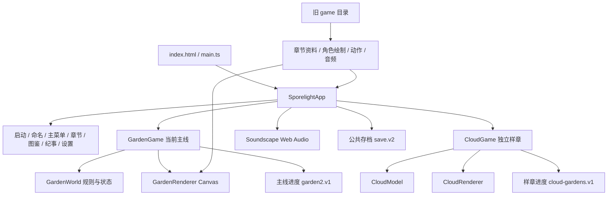

# Sporelight 项目全面分析与跨端规划

> 更新提示（2026-11-03）：本文保留 `476c5e3` 的历史分析；代码已更新至 `5791bbc`。已完成项、剩余问题、最新验证与计划调整见 [更新复核与原分析差异](22-更新复核与原分析差异-5791bbc.md)。

> 审查日期：2026-11-03（Asia/Shanghai）  
> 代码基线：`476c5e3`，package 版本 `2.0.0`。  
> 方法：主 agent 汇总与实测，三个子 agent 并行审查架构、跨端、玩法，再交叉核对代码证据。  
> 本次交付是分析与实施计划，未修改业务代码、关卡、依赖清单或发布配置。

## 1. 核心判断

**项目已经是一款有完整解谜循环与自动化规则测试的可玩 Web 游戏，适合继续发展；面向移动端和 PC 商业发布需要调整，但现阶段没有证据要求全部重写或立即迁移游戏引擎。**

建议保留 TypeScript 规则核心和现有美术，先完成数据一致性、性能测量、输入与平台接口、资源发行管线，再用最复杂关卡验证移动端与桌面封装。产品方向保持“单人、双角色协作、生态空间解谜、修复花园”，优先深化现有玩法。

最先处理的事项：

1. 统一主线进度与成绩来源，修复图鉴统计、存储失败后的展示及旧档回看问题。
2. 确立 Garden 2.0 为当前主线，把历史实现、公共代码和迁移代码划清边界。
3. 升级已失去维护支持的构建工具链，建立可复现的浏览器测试环境。
4. 将美术源文件与发行资源分开；按实测优化每帧模型重建、派生几何、DOM 热区和暂停绘制。
5. 增加平台接口和移动安全区、输入适配、持久化恢复；先用实际设备做跨端样板。
6. 完善引导、分级提示、操作影响预览与修复后的反馈，再扩展关卡数量。

## 2. 阅读导航

| 文档 | 内容 | 建议读者 |
| --- | --- | --- |
| [技术架构与优化清单](17-技术架构与优化清单.md) | 完整模块框架、数据流、证据、问题优先级、技术目标架构 | 开发、技术负责人 |
| [移动端与 PC 适配方案](18-移动端与PC适配方案.md) | 技术路线比较、平台接口、输入/布局/性能/存档、发行矩阵 | 开发、测试、发行 |
| [游戏模式功能与玩法建议](19-游戏模式功能与玩法建议.md) | 现有 12+3 关、模式选择、玩法扩展、功能清单、内容节奏 | 策划、制作人、美术 |
| [分阶段实施与验收计划](20-分阶段实施与验收计划.md) | 可执行任务、依赖关系、阶段门槛、测试策略、估算与分工 | 全体成员 |

这些文档共同构成本次报告。后续实施先按第 20 号文档排期；具体代码问题以第 17 号文档为证据依据。

## 3. 审查范围与结论可信度

审查覆盖 `src` 的应用、三个玩法系统、场景、存档、音频和样式；同时检查测试、资源加工脚本、构建、CI、历史 QA 与设计资料。图片目录做了规模和用途审查，没有逐张评定美术版权或视觉品质。

报告使用四种表述：

- **代码确认**：当前实现或调用链明确支持，可通过所列文件复核。
- **本次实测**：本次实际执行的命令及输出。
- **历史证据**：仓库已有 QA 截图与报告，不算本次重测。
- **建议/待验证**：未来方案、体验判断、性能假设与目标，不代表已实现或已达标。

本次未执行真机游玩、完整浏览器 UI 重测、内存/帧率/电量采样、商店上传或签名验证。不能据此宣称“移动端已适配完成”“所有状态不会软锁”“已经可以上架”。

## 4. 当前项目规模与技术栈

| 项目 | 本次观察 |
| --- | --- |
| 源文件 | `src` 61 个：48 个 TypeScript、13 个 CSS |
| 测试与脚本 | `tests` 8 个文件；`scripts` 24 个文件 |
| 应用技术 | TypeScript、原生 DOM/CSS、Canvas 2D、Web Audio、localStorage |
| 构建工具 | 声明 Vite `^5.2.0`、TypeScript `^5.4.5`；锁定/安装实际为 Vite `5.4.21`、TypeScript `5.9.3` |
| 框架/引擎 | 无 React/Vue，无 Unity/Godot 等专用引擎 |
| 后端 | 未发现业务服务端、账号服务、云存档、联网对战 |
| 当前主线 | Garden 2.0，3 章 12 关，收集预算合计 56 粒 |
| 可访问样章 | 云庭微光，3 关，6 处探索、3 张故事页 |
| 保留系统 | 旧主线 GameModel/GridWorld/CanvasGame；其中部分资料与绘制/音频仍被复用 |
| 静态素材 | `assets` 715 个文件，93,322,805 字节，约 89.00 MiB |
| 构建产物 | `dist` 718 个文件，93,674,451 字节，约 89.33 MiB |
| 部署 | GitHub Pages 工作流：安装 → 类型检查 → 规则测试 → 构建 → 部署 |

**资源目录与发行目录大小不等于首屏下载量，也不等于运行内存。** 首屏网络、图片解码峰值与真实安装包大小需要分别测量。

## 5. 当前运行框架

启动后根据命名状态进入命名或菜单；主线进入 GardenGame，动作经过规则预演、动画、正式提交、存档与界面更新；通关更新新旧两份进度并显示关内结束浮层。云庭拥有独立模型和存档。

这套“规则与渲染分离”的基础值得保留，主要问题是应用协调层、数据来源和关卡特例尚未形成统一边界。

## 6. 当前能力与缺口

| 领域 | 已具备 | 主要缺口 |
| --- | --- | --- |
| 玩法 | 引芽、平台旋转/升降/平移、双角色能力差异、搬运、光路、留影、动作乐句、组合谜题 | 操作前影响预览、通用机制配置、完整新手教学、更多有意义的解法 |
| 内容 | 12 关主线、3 关样章、图鉴、故事、观察点、修复后重访 | 统一内容权威源、内容工具、跨玩法的统一收藏展示 |
| 输入 | 键盘、点击地块寻路、触屏方向按钮、动作按钮 | 手柄、映射、设备切换提示、真实触摸/触控取消场景验收 |
| 体验 | 撤销、提示、减少动态、音量、画质、暂停、自动续玩 | 设置效果一致性、存档导出/备份、提示层级、清晰目标反馈 |
| 跨端 | Web 路径相对化、响应式基础、DPR 上限、隐藏页暂停模拟 | 原生容器、系统安全区、平台生命周期、稳定持久化、签名与分发 |
| 工程 | strict TS、135 项规则测试、构建和 Pages CI、历史 UI 回归 | 浏览器 CI、显式测试依赖、测试类型检查、性能基线、内容验证器 |

## 7. 问题优先级概览

本次没有确认 P0（立即造成普遍崩溃/不可恢复丢档的阻断）问题。P1 是下一轮开发及跨端前必须优先解决的问题；P2 是公开发布前的质量建设；P3 是扩展阶段投资。

| 级别 | 工作包 | 原因 |
| --- | --- | --- |
| P1 | 唯一内存进度、统一成绩 selector、单一保存提交 | 避免保存失败后菜单与游戏不一致、跨档解锁不一致 |
| P1 | 图鉴成绩与当前关卡收集口径统一 | 当前图鉴读旧成绩且重玩提升未同步 |
| P1 | 工具链支持状态与依赖审计整改 | 本次审计发现 5 个受影响工具链依赖包；Node 20 CI 已结束支持 |
| P1 | 当前基线和可复现验证入口 | 避免继续按旧文档/旧运行器实施功能 |
| P2 | 回看快照、设置效果、资源失败处理 | 消除可见行为与承诺不一致 |
| P2 | 帧内工作量、暂停策略、资源发行清单 | 在扩大内容与封装前控制成本 |
| P2 | 输入/存储/生命周期/震动平台接口 | 支撑键鼠、触屏、手柄和原生容器 |
| P2 | 引导、预览、分级提示、字体和可达性 | 提高解谜理解度与小屏可读性 |
| P3 | 通用机制、编辑工具、挑战包、装饰庭院 | 在核心品质稳定后提高内容产能和复玩价值 |

## 8. 移动端与 PC 是否需要调整

**需要。调整重点是平台边界和用户体验，而不是先换编程语言。**

- 移动端：安全区、横竖屏布局、触控目标、系统返回、锁屏/后台/来电恢复、音频恢复、断网和存档、低端机温度与内存。
- PC：键鼠完整操作、手柄导航、窗口缩放、分辨率/全屏、失焦暂停、用户数据目录、安装更新和渠道 SDK。
- 共用：稳定规则核心、统一命令、内容注册表、资源清单、存档迁移、可观测的性能和错误。

建议先验证 **Web 核心 + Capacitor 移动封装 + Electron 桌面封装**；Tauri 作为体积和系统集成方向的候选。此选择是工程建议，不是已验证的最佳性能结论。若路线变为大规模 3D、复杂物理、主机发行，或代表性关卡在优化后仍无法达标，再立项比较 Godot/Unity 等迁移成本。详见跨端方案中的决策门槛。

## 9. 产品与模式建议

建议主产品只强调一个核心：**“安排路、水、光与伙伴的位置，让花园重新成为家。”**

首发组合：故事旅程 + 关内可选探索 + 修复后漫游 + 统一自然手册；摄影作为首发后优先扩展。用同一套关卡提供辅助程度选择，不因使用提示、撤销或减少动态削减故事奖励。

后续组合：少量精心设计的挑战变体、轻量纪念庭院、章节扩展。每日谜题、编辑器、合作模式只有在内容产能、输入基础和规则边界稳定后再投入；实时 PvP、强制打卡体力与大型开放世界暂不适合当前产品。

## 10. 本次验证记录

环境：Windows，Node `v24.22.1`。原工作区未安装依赖；通过可用的 pnpm 工具启动 npm 10，执行按锁文件安装。没有修改 package.json 或 package-lock.json。

| 检查 | 实际命令/方式 | 结果 |
| --- | --- | --- |
| 安装 | `npm ci --ignore-scripts --no-audit --no-fund`（通过工具运行） | 成功；旧 lockfile 补取元数据警告，锁文件未变化 |
| 类型 | `node node_modules/typescript/bin/tsc --noEmit` | 通过；范围为 src |
| 规则 | `node scripts/test.mjs` | 135/135 通过，无跳过 |
| 构建 | `node node_modules/vite/bin/vite.js build` | 成功，42 个模块 |
| JS | Vite 构建输出 | 203.15 kB，gzip 80.55 kB |
| CSS | Vite 构建输出 | 125.89 kB，gzip 26.72 kB |
| 依赖审计 | `npm audit --json` | 退出码 1；5 个受影响包，4 high、1 moderate、0 critical |
| 工作区 | `git status --short` / `git diff --stat` | 初始已有未跟踪 agentchanges；此次新增分析文档并追加记录，业务文件未改 |

审计涉及 Vite、esbuild、nanoid、PostCSS、source-map-js，属于构建/开发依赖；**不能把审计等级直接解释成已部署的静态游戏存在同等可利用风险**。没有执行自动修复或主版本升级。整改需按调用条件和上游支持范围处理，并重跑构建与 UI 回归。

官方版本依据：[Vite 支持策略](https://vite.dev/releases)、[Node.js 发布状态](https://nodejs.org/en/about/previous-releases)。查询日期为本报告日期，实施升级时再次确认。

## 11. 建议实施顺序

先做数据与工具链基线，再并行推进资源/性能、跨端样板和体验打磨；跨端样板通过后才扩大内容生产。不要同时进行引擎迁移、存档改版、全量关卡重做和商业化接入。

详细任务、验收标准和人日范围见 [分阶段实施与验收计划](20-分阶段实施与验收计划.md)。其中工期为小团队规划估算，需要在样板测量后重新校准；商店审核、外包美术和硬件采购不在估算内。
