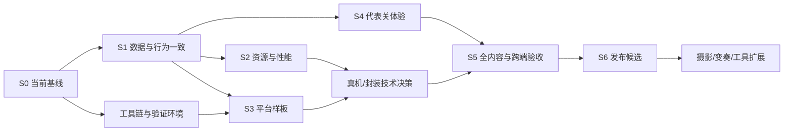

# Sporelight 分阶段实施与验收计划

> 更新提示（2026-11-03）：本文保留 `476c5e3` 的历史分析；代码已更新至 `5791bbc`。已完成项、剩余问题、最新验证与计划调整见 [更新复核与原分析差异](22-更新复核与原分析差异-5791bbc.md)。

> 2026-11-03 · [返回总报告](16-项目全面分析与跨端规划.md)。  
> 本文为可执行 backlog，不表示这些改造已完成。当前已完成的是审查、规则验证、构建和文档交付。

## 1. 规划假设

- 延续单人 2D 庭院解谜，首发打磨现有 12 关，云庭保持独立短篇。
- 先完成 Android/Windows 样板；iOS 若首发，样板阶段同步纳入；macOS/Linux 按发行承诺安排。
- 不在本轮同时做引擎重写、实时联机、公开编辑器、完整经营系统或大规模新关卡。
- 人日估算为工程与技术验证量级，需按团队熟悉度、真机结果和内容改动修订；不含大批新美术、翻译采购、商店审核等待、设备/证书采购和账号后台。
- 没有最低机型、首发渠道、iOS 构建环境的最终决定前，可以先做通用架构和数据修复，但不能把平台发布日期定为承诺。

## 2. 依赖关系与主路径

三个并行工作方向可以共享 schema 和接口，但不要同时修改同一个中央控制器。存档合同、Command 类型、资源 manifest 和最低设备预算先确定，再分别实现。

## 3. 阶段计划

| 阶段 | 目标与交付物 | 建议工程量 | 退出门槛 |
| --- | --- | ---: | --- |
| S0 基线与范围 | 当前功能表、规则/场景依赖图、设备矩阵、性能采集场景、可复现工具链计划 | 3–5 人日 | 当前系统/历史系统清楚；135 规则基线可复现；最低设备及平台范围确定 |
| S1 数据与行为 | ProgressStore、selectors、SaveRepository、迁移/备份、图鉴提分/回看/设置修复 | 6–10 人日 | 全界面成绩一致；失败不回退内存；旧档、部分写失败、重玩与回看通过 |
| S2 性能与资源 | 资源白名单、关键加载状态、模型/几何缓存、按需热区、暂停停绘、性能报告 | 8–14 人日 | 同设备数据表明改善；无画面/规则退化；运行资源完整且可追溯 |
| S3 跨端样板 | 统一输入/生命周期、Capacitor 与一种桌面壳的代表关 release 包 | 6–10 人日 | 实机离线、保存、恢复、音频、安全区与基础性能通过；明确是否继续现有渲染 |
| S4 代表关体验 | 1-2/1-4/3-3 预览、三级提示、角色目标、移动布局，首次玩家研究 | 8–14 人日 | 不靠开发者解释理解因果；关键误触/卡点已闭环；形成可复用交互规范 |
| S5 全内容验收 | 将模式覆盖 12 关，统一图鉴/纪事/结算，双端完整流程与版本升级验证 | 8–15 人日 | 承诺平台上完整流程、存档/输入/性能矩阵达标，无 P1 阻断 |
| S6 发布候选 | 签名/安装/更新流水线、版本资源、发行资料、授权/SDK清单、故障恢复方案 | 5–10 人日 | release 包安装/升级/离线/回滚策略通过，交付版本可追踪 |

合计约 **44–78 工程人日**，不是自然日承诺。阶段可以部分并行，但平台样板、存档正确性和发行候选在关键路径上；一人团队与多角色团队的日历时长不同。每阶段结束重新估算下一阶段，不在未验证的引擎迁移上预先给固定交付日期。

## 4. 可执行任务清单

### 4.1 基线、工具链与数据

| ID | 优先级/负责人角色 | 任务 | 依赖 | 验收标准 |
| --- | --- | --- | --- | --- |
| B01 | P1 / 技术负责人 | 把 Garden2 设为现行权威，标记旧文档和旧运行器状态 | 无 | README/产品矩阵/入口说明一致，历史测试不被误删 |
| B02 | P1 / 工程 | 统一 Node LTS、Vite/TS 兼容迁移、锁文件和 CI | B01 | 干净安装、check/test/build、关键浏览器通过；审计结果逐项处理 |
| B03 | P1 / QA+工程 | 显式声明 esbuild/Playwright，测试 tsconfig，固定浏览器 | B02 | 新环境一条命令启动规则与关键 UI 检查，不依赖个人路径 |
| B04 | P1 / 技术+产品 | 确定首发 OS/最低机型/横竖屏/手柄范围 | 无 | 一页平台承诺及设备清单，标出尚无设备的项目 |
| D01 | P1 / 核心工程 | ProgressStore 与统一进度/成绩 selectors | B01 | 页面不再为展示进度自行读取 localStorage |
| D02 | P1 / 核心工程 | 新存档 schema、单次提交、旧档迁移、备份 | D01 | 当前三套存档键可迁移且保留，兼容 `sporelight.save.v1` 历史回退来源；读回校验成功，失败可恢复 |
| D03 | P1 / 核心工程+QA | 修复图鉴旧分母与重玩提分 | D01 | 低收集→全收集→重启，全部界面一致 |
| D04 | P1 / 核心工程+QA | 模拟存储拒绝、配额、部分写入、坏档 | D02 | 当前会话继续，错误明确，解锁不撕裂，备份不被覆盖 |
| D05 | P2 / 应用工程 | 区分继续/重玩/回看；无 memory 旧通关特殊处理 | D01–D02 | 回看不进入伪完成初始谜题，重玩不破坏最佳纪录 |
| D06 | P2 / 应用工程 | 已完成漫游仍可设置，震动/画质真实生效 | D01 | 所有暴露开关可验证或显示不可用；标准/高清定义清楚 |
| D07 | P2 / 应用工程 | 导入/导出和恢复 UI | D02 | 非法版本拒绝，导入前备份，跨端 schema 一致 |

### 4.2 性能、资源与平台

| ID | 优先级/负责人角色 | 任务 | 依赖 | 验收标准 |
| --- | --- | --- | --- | --- |
| R01 | P2 / 性能工程+QA | 记录 1-4/2-2/3-3/3-4 基线 | B04 | 设备/系统/包版本/画质/帧时间/内存/加载数据齐全 |
| R02 | P2 / 性能工程 | 动作 from/to 渲染快照缓存 | R01 | 动画期间不逐帧构造 GardenWorld，效果与状态相同 |
| R03 | P2 / 核心工程 | state revision 的 tiles/邻接/可见性缓存 | R01 | 缓存失效覆盖所有动作，重要不变量与解法保持 |
| R04 | P2 / UI工程 | 热区按变化更新、静态层缓存、暂停停绘 | R01 | 暂停负载降低，镜头/尺寸/动作命中不滞后 |
| R05 | P2 / 资源工程+美术 | 原图与 runtime 分离、manifest、压缩与章节加载 | B01 | 无源文件误删；请求资源全可用；包体增减可解释 |
| R06 | P2 / 应用工程 | 资源失败重试/占位/关键加载进度 | R05 | 缺图/慢加载可理解，可恢复，不静默丢机关 |
| P01 | P2 / 平台工程 | InputRouter + Keyboard/Pointer，后接 Gamepad | D01 | 不同输入输出相同命令，取消/切换不重复动作 |
| P02 | P2 / 平台工程 | 暂停原因集合、返回层级、音频中断恢复 | D02 | 设置/后台/失焦叠加正确，恢复无跳帧/叠音 |
| P03 | P2 / UI工程 | 安全区/dvh/文本缩放/横竖屏/软键盘 | B04 | 最低尺寸可完成所有流程，无遮挡与裁切 |
| P04 | P2 / 平台工程 | Capacitor 原生存储与代表关包 | D02,P01–P03 | Android/iOS 承诺设备 release 包可离线玩并稳定恢复 |
| P05 | P2 / 平台工程 | Electron 样板与 Tauri 必要对比，选一种 | D02,P01–P02 | 记录体积/内存/兼容/维护成本，最终只维护一个桌面壳 |
| P06 | P2 / 平台+QA | 键位/手柄完整 UI 导航、桌面分辨率/窗口状态 | P01,P05 | 若承诺手柄，可从菜单到退出全程操作；高 DPI 无裁切 |
| P07 | P2 / 技术负责人 | 技术路线闸门评审 | R02–R06,P04–P05 | 以最低设备数据决定继续 Canvas、换渲染或立迁移实验 |

### 4.3 玩法、内容与发布

| ID | 优先级/负责人角色 | 任务 | 依赖 | 验收标准 |
| --- | --- | --- | --- | --- |
| G01 | P2 / 策划+UI | 转庭/水位/留影影响预览 | D01,P01 | 接通/断开/乘客变化可见，取消不改状态 |
| G02 | P2 / 策划+核心 | 三级提示、操作拒绝原因与目标摘要 | B01 | 初级无完整解，末级能继续，不扣奖励 |
| G03 | P2 / 策划+UI | 角色位置/持物/等候/跟随、首轮换手教学 | P01 | 无开发者解释也能理解谁能做什么 |
| G04 | P2 / 策划 | 重做 2-3 教学后的顺序决策 | G02 | 存在真实编排选择，单步/暂停/重置保持 |
| G05 | P2 / 策划+美术 | 逐关收藏意图与生态反馈 | B01 | 每个点有目的；不增加无意义空走；预算仍一致 |
| G06 | P2 / 用户研究+QA | 首次玩家代表关测试 | G01–G03 | 记录观察，不用主持提示替代产品引导；问题有责任人 |
| G07 | P2 / 策划+工程 | 教学/预览/提示铺到全部 12 关 | G06 | 每关特殊条件仍准确，新增 UI 不遮关键目标 |
| G08 | P3 / 核心+工具 | 机制组件化、关卡 schema、验证器 | D02,P07 | 新增试验关不必改核心多个 level.id 分支；非法引用构建失败 |
| G09 | P3 / 产品+工程 | 摄影/明信片与每章一个变奏试点 | S5通过 | 正式档隔离，导出成功，变奏不是仅延长路线 |
| Q01 | P2 / QA+工程 | 关键 UI 回归纳入 PR CI | B03,D03 | 首次启动、通关、提分、回看、设置、异常存储路径自动化 |
| Q02 | P2 / QA | 设备矩阵、离线、后台、强杀、更新全流程 | P04–P07,G07,F01基础产物 | 逐项有日志/截图/版本，不把模拟器结果标成真机 |
| F01 | P2 / 发行工程 | 各平台版本/签名/安装/资源一致性流水线 | P04–P05 | 样板期提供可验证的 release 产物供 Q02 使用，S6 完善发行流水线；敏感签名配置不进入源码 |
| F02 | P2 / 制作人+发行 | 商店材料、素材授权、第三方 SDK/隐私清单 | B04,F01 | 与实际功能一致，政策在发布冻结时重新核实 |
| F03 | P2 / 发行+QA | 存档升级/坏包恢复/发行回退方案 | D02,F01 | 出现失败可以定位版本并恢复，不覆盖用户有效数据 |

## 5. 建议后续多 agent 分工

本次已实际使用三个子 agent：架构代码审查、跨端发布审查、玩法产品审查；主 agent 负责实际命令验证、证据纠偏与文档整合。

进入实施时建议继续按边界并行：

| 工作流 | 主要范围 | 交接合同 | 应避免的冲突 |
| --- | --- | --- | --- |
| 核心/数据 agent | ProgressStore、SaveRepository、schema、规则机制 | selectors、Command、版本迁移与样本档 | 不同时改变 UI DOM 结构 |
| 平台/性能 agent | 输入适配、生命周期、缓存、容器、设备指标 | 平台接口、预算、构建产物说明 | 不自行改变玩法规则或存档格式 |
| 体验/内容 agent | 预览、提示、教学、收藏、场景与文案 | 交互状态、关卡配置与验收脚本 | 不绕过统一进度服务读写存档 |
| 主协调 agent/负责人 | 接口与任务拆分、整合、回归、最终文档 | 每轮确认数据/命令/资源合同 | 不把多个大改造未经验证一次合并 |

每项改动先列受影响文件、行为和验收；同一个中央文件由一个负责人整合。规则/内容/存档/格式化拆成可审阅变更。agent 可并行分析，但真机体验、平台账号和发行选择仍需实际负责人决策。

## 6. 测试层级和覆盖矩阵

| 层级 | 必测内容 | 执行时机 |
| --- | --- | --- |
| L1 静态与内容 | TS src/tests、资源 manifest、重复 ID/缺失引用/非法位置 | 每次 PR |
| L2 规则 | 当前 135 基线；重要多解、非法动作、占用保护、收集、目标条件 | 规则/关卡改动 |
| L3 应用数据 | 完成→解锁→提分→图鉴→回看；失败/坏档/升级/备份 | 数据与应用改动 |
| L4 浏览器 UI | Chromium/WebKit/Firefox、真实触摸事件、键盘与焦点 | 关键 UI PR 与发布候选 |
| L5 真机/容器 | 触控、安全区、音频、后台/强杀、原生存储、手柄 | 跨端样板、里程碑、候选版本 |
| L6 发布 | 签名安装、覆盖升级、离线首启、资源版本一致、恢复方案 | 每个发行候选 |

### 6.1 重要故障注入场景

1. 第一次通关时新进度可写、旧进度不可写，及反向情况。
2. 首次低收集通关，重玩全收集，然后关页重开，确认所有界面一致。
3. 只有旧 completed、没有 Garden2 memory，进入纪事和回看。
4. 操作前、旋转中、试奏中、结算瞬间后台/强杀。
5. localStorage/新存储不可读、不可写、容量不足、JSON 损坏、版本过旧/过新。
6. 窗口或屏幕旋转时存在寻路队列，指针按下后系统取消，手柄断开。
7. 关键纹理缺失/加载慢、首屏离线、资源版本与代码不一致。
8. 修复后漫游调设置、重玩退出、回看结束，确认完成记录不被意外覆盖。

### 6.2 主线不变量

- 角色位置始终对应合法可站立图块；平台运动保持稳定身份。
- 一个物件最多一个持有者，不能同时出现在地面和手中。
- 非法操作不改状态；占用的根路/影路不能被撤掉。
- 规则依赖当前路水光时，不用历史奖励代替当前条件。
- 收藏不重复发放，普通关无需全收集才能结束，最佳成绩只增不减。
- 提示、低动态和输入方式不改变收藏资格或故事奖励。
- 每个关键布局有继续/撤销/重开途径；已知解通过不能替代更多路径验证。

## 7. 质量闸门

### 闸门 A：允许扩大功能前

统一数据源与旧档迁移完成；重玩成绩与图鉴一致；错误写入有可恢复策略；工具链可复现。未过 A 时不叠加云同步、成就或新收藏系统。

### 闸门 B：决定技术路线

代表关签名 release 包在最低目标设备上有性能、恢复、离线、音频数据；先完成局部优化，再决定换渲染/引擎。浏览器小窗口截图不算闸门 B 证据。

### 闸门 C：允许公开发行

承诺平台的完整旅程通过、没有未解决 P1、进度升级验证、资源授权/SDK清单完整、真实功能与商店描述一致。已知 P2 若延期必须有影响范围和责任人，不用“以后优化”隐去限制。

列入发布验收矩阵的必需能力，无论任务优先级为何，都不得以 P2 延期方式绕过。平台存储、安全区、生命周期与签名安装等是对应平台的发布门槛。

## 8. 测量与问题记录模板

建议每个性能/故障记录包含：日期、Git commit、包版本、平台/机型/OS、画质/分辨率、关卡、操作步骤、期望/实际、复现概率、日志/截图、严重级别、负责人、修复版本和复测结果。

性能额外记录 p50/p95 帧间隔与长帧、内存峰值和重访趋势、冷启动可操作时间、输入反馈延迟、网络传输/解码资源、连续运行时长。不要把目录字节数当作网络流量或内存。

## 9. 风险与取舍

| 风险 | 早期信号 | 应对 |
| --- | --- | --- |
| 多系统继续扩散 | 新功能又单独读取旧档/新增独立成绩 | 所有视图只经 selector，新数据先定义 schema |
| 大重构回归 | 同时换目录、规则、渲染、存档 | 一次一个行为边界，保留迁移与作者解 |
| 资源压缩伤美术 | 透明边缘、色彩、字形变差 | 按类别压缩，做截图对照，不全量盲转格式 |
| 真机验证太晚 | 最后才发现 WebKit/安全区/后台问题 | 首个封装样板就用真机和 release 配置 |
| 内容投入失焦 | 同时启动多人、经营、日常、编辑器 | 首发只做核心旅程与漫游；扩展按试玩反馈选一项 |
| 庞大抽象阻塞开发 | 为 12 关先造通用 ECS/脚本语言 | 抽已重复机制，保留受控特殊 hook |
| 文档再次过期 | README、设计稿、UI 描述不同 | 每次行为变更同步功能矩阵与验收记录 |
| 未核实发布承诺 | 写“支持所有手机/60fps/两小时” | 使用设备矩阵和实测范围，不做无限范围保证 |

## 10. 下一轮建议直接启动的工作包

第一批：**D01–D05 数据一致性 + B02/B03 工具链与验证基线**。交付应包括统一进度查询、图鉴提分修复、旧档回看处理、损坏/失败恢复测试，以及可复现的工具链报告。

第二批并行：**R01–R06 性能资源 + P01–P05 跨端样板 + G01–G03 体验代表关**。完成后做闸门 B 与首次玩家研究，再决定是否扩大到全内容。

现在不必先回答所有未来商业化/联网问题；首发范围、最低设备、iOS 是否同步、手柄是否承诺是最先需要产品负责人定下的四项约束。
