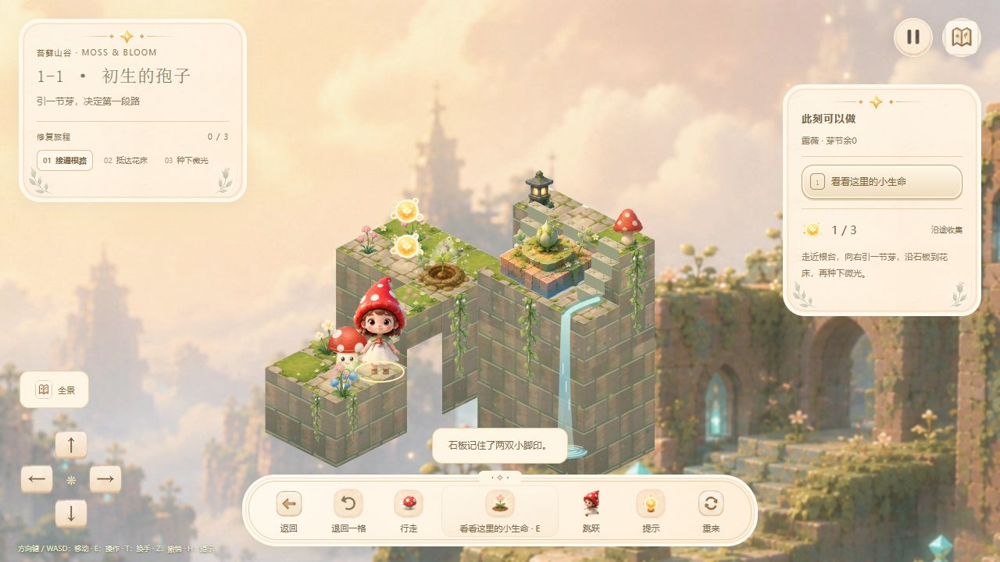
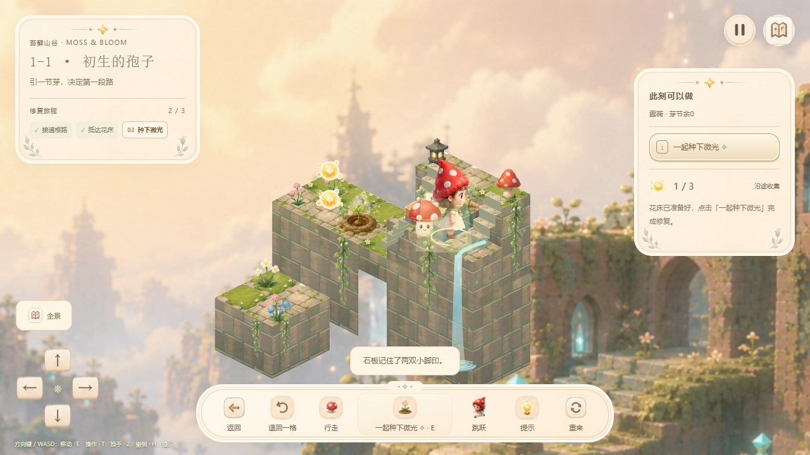

# 1-1「初生的孢子」体验诊断与修改计划

日期：2026-11-04。版本：`5791bbc`。结论基于当前实际生效的 `garden2`，不是旧版格子玩法。

执行状态更新：首批调整已按用户要求撤回，代码与本地预览恢复到调整前版本。[历史实施记录](24-首批体验调整与验收.md)仅供追溯；下文保留诊断与建议。

用户反馈：使用电脑键盘，主要觉得画面、镜头或界面不舒服。本报告以视觉与阅读舒适度为主，操作衔接作为相关问题。

## 结论

1-1 已经具有完整的美术和通关规则，但当前构图、信息层级与教学流程没有围绕首次游玩统一起来。玩家需要在较小的可玩石台上辨认落脚点，同时阅读分散的面板和处理尚未讲清的支路规则。角色遮挡、相近的色彩层级，以及动作期间整组控件禁用，又进一步增加了视觉与操作负担。

建议先把 1-1 做成一个清楚、安静、能顺着直觉完成的体验样板，再推广到其他关卡。当前证据不足以把“不顺畅”主要归因于掉帧，也不足以支持更换引擎或重做全部美术。

## 本轮证据与范围

- 浏览器：在 `127.0.0.1:4174` 的独立起始存档试玩，视口 1280×720；没有操作用户 `localhost:4174` 的游戏进度。
- 实际复现：入场 → 向下引芽 → 收集支路微光 → 按 H → 返回根台 → 收回 → 向右引芽 → 点击花床 → 再次点击花床 → E 播种 → 以 1/3 收藏通关。
- 规则层复核：直接向右引芽、走到花床并修复，可以 0/3 收藏通关。满收集与完成修复是两种目标。
- 两个并行只读审查分别核查操作实现和关卡/引导。键盘长按与输入丢弃结论来自代码，不冒充本轮键盘长按实测。
- 本轮没有帧时间/长任务采样，也没有完成窄窗、手机或真机复测。650–900px 的布局问题是 CSS 与构图规则暴露的风险，须在实施时验证。

## 画面为什么不舒服

### 1. 可玩主体与周围信息的比例失衡

在桌面首屏中，真正需要辨认的对象只有露薇、根台、缺口和花床，但左右大面板、底部工具条、方向盘、全景和消息同时常驻。背景还有一整套建筑和瀑布，玩家首先看到大量装饰与说明，再辨认实际可走的小平台。

这不是“再放大一点”就能独立解决的问题。镜头需要知道界面占用了哪些区域；界面也需要给场景让出完整空间。

- `scene.ts:7–15` 同时输出全部面板和操作入口。
- `garden-journey.css:4,19` 左上标题卡宽 292px，右侧操作卡宽 254px。
- `render.ts:36–40` 桌面采用整体适配，横向预留固定 330px，没有按当前 HUD 的实际遮挡区域求构图。
- 650–900px 区间工具条已改为两行，但左右面板仍接近桌面尺寸；650px 以下才切换另一套布局。窄窗口更可能出现“场景缩小、面板仍很大”。

### 2. 主角、伙伴与路面的尺度关系影响辨认

首关面积小，主角和伙伴贴近站立。帽子、身体与蘑菇覆盖根台、邻格和花床附近的地面。玩家需要知道的是“脚踩哪块、哪里能走、哪里可以互动”，而这些细节与较大的角色形象挤在一起。

证据：`render.ts:195–214` 绘制收藏与角色；地块绘制宽度为 `70×scale`，主角图像绘制宽度为 `115×scale`。这只是图像绘制盒比例，不能直接等同于不透明轮廓，但截图已经能看见附近地面被遮住。

建议保留角色辨识度，先试小幅调整角色/地面比例、同格伙伴站位和局部遮挡处理，再决定是否需要改素材。

### 3. 视觉层级接近，阅读位置又太分散

左上展示三阶段修复目标，右侧展示另一段下一步说明，底部展示事件消息。生长动作还同时出现在场景“＋”、右侧列表和底部主按钮。大量米色纸面、棕色细字和装饰边框使用接近的强调程度，真正需要按的动作没有明显胜出。

首次玩家需要不断在“角色 → 右侧 → 底部 → 左上”之间切换。对键盘玩家，常驻虚拟方向盘和大量鼠标操作入口还增加了不必要的视觉占位。

证据：`scene.ts:7–15`、`garden-journey.css:10–39`。这是结合截图的体验判断，不是已有用户样本统计。

### 4. PC 首关更像构图问题，尚无镜头抖动证据

`render.ts:39–40` 只有宽度低于 650px 且非全景时才跟随角色；桌面主要是整体适配。1-1 的两条生长槽都在既有地图边界内。因此当前没有依据把电脑上的不舒服解释为追随镜头抖动。

建议首关继续采用稳定镜头，围绕“根台—新路—花床”构图；UI 改动后重新确定安全可视区域。避免直接添加持续跟随或频繁拉近拉远。

## 规则和操作怎样放大不适

### 5. 第一关过早要求支路、预算、回收和改道

初始只有 1 节芽，开局就提供向右与向下两个选择。第三粒收藏在南侧支路；要拿到它再通关，需要先向下长芽、走过去、返回根台、收回、再向右长芽。界面称为“沿途收集”，没有明确它是可选的折返挑战。

证据：`levels.ts:17,42,60,67`；`world.ts:198–201`；`tests/garden2Solutions.ts:2`。完成修复并不检查 3/3 收藏，见 `world.ts:179,271–274`。

支路截图中已经收集 1/3、芽节余 0，右侧却仍提示向右引芽：

### 6. 提示在关键失败状态下没有解释下一步

`world.ts:283` 的 1-1 提示是固定句。已经向下生长、离开根台、预算为 0 时，按 H 仍得到“走近根台，向右引一节芽……”，没有明确“回根台→收回→改向右”。本轮已在支路复现。

1-2 已有空间生长引导与回根台按钮，但没有用于首关，见 `render.ts:219,225` 和 `GardenGame.ts:113–114`。提示有时过早给出完整答案，有时又不解释当前不能执行它的原因。

### 7. 点到对象以后，操作还要转移到面板

点击花床会走到它所在的格子；到达后再次点击同一个花床，仍然不会播种。玩家必须转去右侧、底部，或按 E。本轮已实际复现，并保存抵达后再次点击无状态变化的画面。

原因：`GardenGame.ts:32` 对地块/地标统一调用 `go()`，没有保存“我要与花床互动”的意图。建议明确对象点击流程：点对象后走到可互动位置，在对象旁显示动作；再次点击或 E 执行。不能悄悄自动消耗资源。

### 8. 键盘节奏存在确定的不连续行为

- `GardenGame.ts:46` 过滤方向键的 `e.repeat`，长按只走一格。
- `GardenGame.ts:53–57` 在移动/动作期间直接拒绝新意图，没有下一步缓冲；提前按方向或 E 会丢失。
- `GardenGame.ts:64` 普通走路 205ms，滚动 155ms，跳跃 620ms，其他许多动作统一 780ms；期间方向和动作控件同时禁用。
- `GardenGame.ts:102,106,111` 与 `garden-journey.css:49` 会让控件在动作期间禁用/变淡；反复走格时，界面状态也频繁切换。
- 跳跃只使用普通相邻可走格，不能跨本来需要引芽的缺口；开局展示它容易造成能力预期偏差。鼠标寻路也未更新跳跃使用的 `lastDirection`，见 `GardenGame.ts:15,56,79`。

205ms 单格本身不足以证明动作太慢。优先解决连续意图和反馈，再微调速度。

## 建议修改计划

| 顺序 | 修改内容 | 验收标准 |
| --- | --- | --- |
| 第一批 A：视觉样板 | 精简 1-1 HUD：暂停、单句当前目标、上下文动作与轻量收藏即可。键盘模式收起方向盘；返回/重来放暂停页；撤销首次有历史后出现；滚动、跳跃按教学进度开放。阶段列表可折叠。 | 玩家能在场景附近完成核心操作，不必往返阅读三个说明区；保留可发现的辅助入口。 |
| 第一批 B：场景构图 | 按 HUD 实际占位计算安全可视区域；先确定石台与主角尺度，再减弱背景建筑的竞争。调整伙伴站位、足底定位、目标高亮；首关保持稳定镜头。 | 根台、正确生长槽、可行走路径与花床可辨；关键落脚点不被人物/面板长期遮挡。覆盖 1280×720、738×672、900px 两侧与 649/650px 两侧。 |
| 第一批 C：键盘衔接，可并行 | 保留格子规则，增加方向按住连续走；动画期间保存最多一个最新意图，允许到下个安全格转向/改道/停车。统一逻辑朝向与视觉朝向。 | 按下立即响应；长按持续走；松开最多完成当前格；快速转向与临近目标提前 E 不会静默丢失；无穿越障碍或重复执行。 |
| 第二批：重排教学 | 首次流程改成“走几步拿微光→靠近根台→引一节芽→走过新路→照料花床”。第一次只呈现必要的生长选择；回收改道放到 1-2 或完成后探索。首关收藏沿主路线布置。 | 第一次成功之前无需理解拆路折返；收藏是否可选表达清楚；不读说明也能建立动作与结果的对应。 |
| 第二批：状态化引导 | 从真实规则推导未引芽/支路已长/预算耗尽/回根台/道路连通/花床就绪等状态；把原位空间提示做成通用能力。到达地标后原位出现可执行动作。 | 旧存档、撤销、重来、走支路后提示仍与当前可执行动作一致；无需重复读一整段固定解法。 |
| 第三批：反馈与性能 | 操作立即给出按键/落点反馈；分开调整生长、回收、观察的动画时长与锁定范围。测量帧耗时后，再缓存未来世界/地形/热区，合并移动存档写入。 | 目标为有效输入 100ms 内有可见反馈。报告帧时间与长任务数据；不能仅凭代码复杂就宣称优化了卡顿。 |

首关建议体验目标（待验证，非现有成绩）：首次玩家 10 秒内完成第一次有效移动，30 秒内理解一次生长；一次小样本测试记录完成时间、误操作、提示使用与折返次数。若邀请 5 位首次玩家，可先以至少 4 位不依赖外部解释完成为阶段目标，同时记录原因，不能把小样本当成总体成功率。

## 实施边界与验证

- 第一轮集中打磨 1-1；输入与构图能力保持可复用，其余关卡做回归，不同时铺满新教学内容。
- 保留柔和画风与慢节奏，但让空间关系和主要动作有清楚层级。没有必要在首轮替换整套美术。
- 规则变化须检查 `GardenWorld`、真实 UI、图鉴/结算与收藏统计一致性。若调整地块/收藏标识，必须处理 1-1 进行中存档兼容，保留已完成记录。
- 键盘回归覆盖长按、快速交替方向、按键提前量、E/Space/J、焦点切换、暂停恢复与低动态设置；UI 回归覆盖窄窗、手机横竖屏、字体与关键对象遮挡。
- 本轮仅新增报告与证据，没有修改玩法、输入、样式或构建产物。无需为文档改动重新运行规则全套测试。

## 已排除的误判

- 地图入口没有错误显示旧版“自由探索”：`mapPresentation.ts:14` 已将旧 `kind/subtitle` 覆盖成当前规则与介绍。
- 尚未证明有显著掉帧、镜头抖动或特定设备性能故障。源码中存在每帧构造未来世界、重算热区和每步同步存档等成本，只能先列为测量项。

## 跨关卡影响与公共组件扩展审查

补充日期：2026-11-04。本节为源码分析与实施方案，没有修改游戏实现。

### 直接回答

主线 12 关应共同获得输入、镜头、HUD、空间反馈和适配的公共改进，并且全部参与回归。1-1 的教学简化、收藏位置和镜头参数则由本关配置控制，不能直接把所有关卡改成首关的操作数量与节奏。

当前已经共用一套主线实现，但输入、镜头和 HUD 还没有充分拆成独立组件；规则与引导也未完全配置化。现阶段不能称为“所有公共组件已经抽好、新关卡只需增加数据”。

「云庭微光」的 3 关属于独立控制器、模型、渲染器与界面链路，不会自动获得主线改动。它与主线共享部分图标、声音、设置和绘制工具，后续可通过小型适配器接入公共输入/布局能力，无需先合并两套玩法模型。

### 现有共享范围

| 能力 | 现有实现 | 修改影响与当前限制 |
| --- | --- | --- |
| 主线入口 | `createApp.ts:66,126–127` 统一使用 `renderGardenScene` 与 `GardenGame` | 主线 12 关共用。旧 `scenes/gameScene.ts` 仍存在，但不是当前主线路由。 |
| 输入与动画调度 | `GardenGame.ts:30–80,126–132` | 修改长按、意图缓冲和动作衔接会覆盖 12 关；尚无独立输入管理器/动作调度器。 |
| 规则、寻路、撤销和安全事务 | `world.ts:141–165` | 已有共享基础能力；改变互动高差或邻接判断也会影响全部谜题。 |
| 镜头与场景 | `render.ts:16,33–40,102–118` | 全主线共用；镜头参数和布局预算内嵌于渲染器，关卡还不能声明取景策略。 |
| HUD与结算框 | `scene.ts:7–17`；`GardenGame.ts:84–107` | 一份固定大模板加控制器内多处 DOM 更新，尚非可组合的目标栏、动作区与工具栏组件。 |
| 目标与可用动作展示 | `presentation.ts:3–34` | 已抽出展示函数，但阶段目标按关卡 ID 分支，真正完成条件另在 `world.ts:177–189`，存在规则漂移风险。 |
| 视觉、断点和主题 | `styles.css:12–13` 加载 `garden2.css`、`garden-journey.css` | `.garden-*` 改动覆盖全主线；两份样式都改布局和断点，需明确布局与皮肤职责。 |
| 人物、地形、天气等绘制 | `game/characterMotion.ts`、`landscape.ts`、`pondWeather.ts`、`gardenArt.ts`、`moleDialogue.ts` | 已有较清楚的小模块。独立文件不必然代表通用能力，例如鼹鼠对话仍是专属演出。 |
| 主线进度 | `garden2/save.ts`、`createApp.ts:127` | 全主线共用；类型或状态结构变化必须连同存档迁移验证。 |

### 还不能靠加关卡数据扩展的地方

新增地图可使用已有 `tiles/modules/roots/marks` 数据，但新增完整玩法通常还需修改：

- 初始物品：`world.ts:11–18`。
- 动态地形、光路和关卡专用状态：`world.ts:80–128`。
- 完成前置条件与行为：`world.ts:177–189,240–274`。
- 提示与阶段目标：`world.ts:282–295`、`presentation.ts:7–18`。
- 特殊状态栏与地图引导：`GardenGame.ts:97–100,113–121`、`render.ts:219–225`。

这些地方多以关卡 ID 分支。继续复制分支会让 UI、提示与真正规则分别维护同一件事，增加遗漏与不一致。镜叶引导从真实状态推导、撤销和读档后重算的思路值得保留，但它目前仍固定检查 `2-2` 和特定物件位置。

### 类型已有基础，扩展保护仍不充分

| 当前类型/行为 | 扩展风险 | 建议 |
| --- | --- | --- |
| `Actor`、`Tile`、`Root`、`Module.kind`、`GardenLevel` 已有类型定义 | 能描述目前的地图与基础机关，但不代表拥有完整的扩展契约 | 保留基础类型，渐进补充配置与查询结果。 |
| `Command.id: string`，内部使用冒号拆命令 | 命令名、方向和物件引用拼写错误不能被充分检查 | 内部使用有明确 kind 的命令对象；仅在 DOM 边界编码/解码，并验证输入。 |
| `Module` 的轴、距离、高低范围都是可选字段 | 可以创建缺轴/距离的平移机关，缺失参数可能被默认值隐藏 | 拆成 `RotateModule / SlideModule / LiftModule`，由各类型要求必要参数。 |
| `flags: string[]`、物件和地块引用为宽泛字符串 | 编译器难发现错误引用；外部存档还存在运行时非法输入 | 给机制状态和引用增加明确类型，并保留存档与关卡配置的运行时校验。 |
| `roots` 是数组，但预算、引导和部分热区默认取 `[0]` | 看似支持多根台，实际会读错预算、目标或高度 | 按 rootId 计算预算、引导、位置与可用动作，增加多根台样例验证。 |
| `GardenLevel` 缺少初始物件、目标、引导、HUD 和镜头契约 | 新关卡继续向控制器/渲染器增加分支 | 关卡定义逐步增加 `initialItems / goals / presentation / tutorial` 等配置。 |
| 未知关卡 ID 在 `levels.ts:54` 回退第一关 | 配置或引用拼错可能被静默掩盖 | 开发期明确报配置错误；读档迁移使用独立、可记录的兜底策略。 |

### 建议的复用边界

1. **公共体验层**：输入意图、动作调度、HUD 组件、布局计算、镜头、原位动作、提示绘制、反馈、无障碍。公共层不判断“这是第几关”，而是消费规则和表现配置。
2. **机制层**：根芽、旋转/平移/升降、物件搬运、光路、投影、节拍、伙伴协作。每种机制提供可用动作、动作校验、状态变更、目标与引导查询，组合成后续关卡。
3. **关卡层**：地块和高度、机关实例、初始物件、目标组合、收藏、教学顺序、取景参数与文案。已有机关参数优先从数据推导；教学限制才显式配置，避免重复维护两套能力列表。
4. **专属演出**：鼹鼠、花门、特定雨景等保留小型适配器。无需为了少量内容构造任意脚本语言或插件平台。

布局配置应由公共默认值、章节视觉配置和必要的关卡覆盖组合，并共同消费可用宽高、输入方式、低动态设置和实际 HUD 占位。尺寸断点由公共布局模块统一管理，不能散落到每张关卡。

目标栏、通关判断和提示应读取同一份规则求值结果。提示显示教学建议与实际完成条件可以有区别，但需要明确标记，不能把“推荐步骤未做”当成“合法解法不能完成”。

### 推进与回归安排

1. **先建立模块边界并做 1-1 样板**：抽取公共输入、布局/镜头、HUD 与 Guidance 数据契约；1-1 的界面精简由本关教学配置控制。公共行为改变同步影响全部主线。
2. **验证复用确实成立**：让 1-2 根路和 2-2 镜叶接入同一套引导展示；它们只提供规则结果，UI 与 Canvas 无需新增关卡编号分支。
3. **按机制逐批迁移**：根芽 → 花园变换 → 伙伴/搬运 → 光影/节拍 → 组合关。保留关卡难度和解法，不同时重做十二张地图。
4. **主线 12 关全部基础回归**：沿用逐关解法、每步存档恢复和收藏校验，增加公共输入、错误配置、撤销和暂停测试；不能以 1-1 看着顺了替代后续关卡验证。
5. **代表机制完成跨屏验证**：小地图、大地图、多角色、搬运、变换、节拍分别选代表关，覆盖 320×568、390×844、738×672、1280×720、1920×1080、2560×1440，并补手机横屏/低高窗口及 649/650、900px 两侧。检查目标、路径、交互和关键物件，不只检查是否溢出。
6. **云庭单独接入与验收**：在主线公共契约稳定后，通过适配器复用输入/布局等模块；云庭的 3 关单独回归。主线完成时不能把云庭也标为已调整。

公共改造必须特别保护：1-4 移动会解除拉杆保持，2-3 试奏时操作限制，转庭/升降后旧路径失效，镜叶/投影的多解，以及伙伴未到位时的操作。缓冲应保存具体操作意图和目标，执行前重新校验，避免延迟 E 误触另一个机关。

本轮仅补充分析文档。上述模块名、类型与配置字段均是建议，尚未创建或接入实现；未重新执行构建或规则测试。
